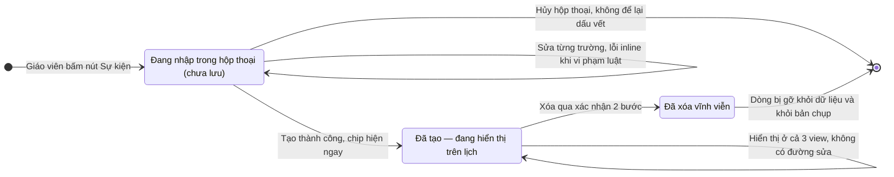
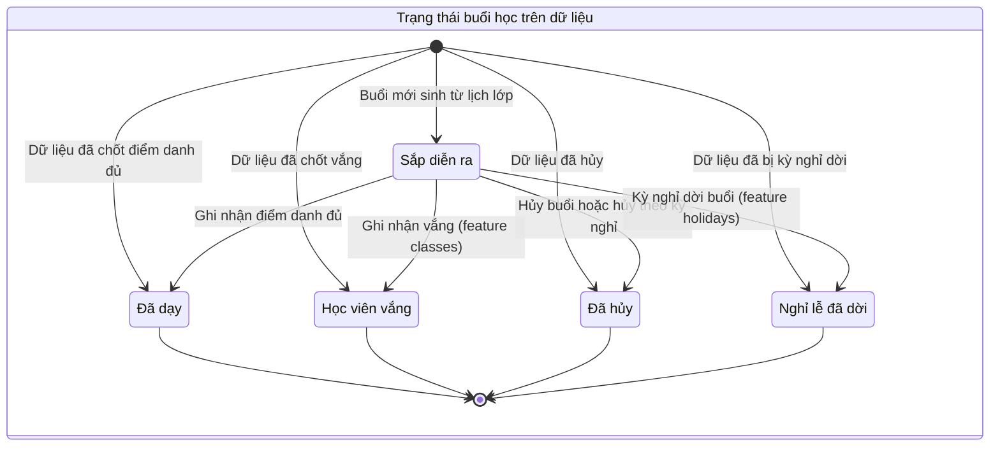

# schedule-reverse-states.md — Trạng thái thực thể (feature `schedule`)

## Tóm tắt kết luận

- Thực thể riêng của feature (`org_event` — sự kiện vận hành) **không có cột trạng thái** trong dữ liệu (`packages/db/src/schema/org-event.ts:9-27`); vòng đời chỉ là vòng đời *tồn tại*: đang nhập (chưa lưu) → đang hiển thị → đã xóa. Không thể "lược" sâu hơn vì code không có trạng thái nào khác; dưới đây vẽ đúng những gì code cho phép.
- Trạng thái *buổi học* mà lịch hiển thị (`upcoming | completed | absent | cancelled | holiday`) là tài sản của **feature classes** (`packages/db/src/schema/lesson.ts:52-66`); schedule chỉ **chiếu trạng thái lên cách hiển thị** — vẽ dưới dạng bản đồ hiển thị, không phải state machine nghiệp vụ (không có chuyển trạng thái nào do màn lịch ghi).
- Kỳ nghỉ có pipeline trạng thái riêng (preview → apply → hoàn tác) — **thuộc feature holidays**, lược khỏi file này (lý do: ranh giới feature; điểm chạm chỉ là thẻ hiển thị + hộp thoại).

## ST-1 — Vòng đời sự kiện vận hành (thực thể của feature)

> Mọi chuyển đổi đều do hành động người dùng trên màn lịch; không có hẹn giờ, không có tự động hóa.

Bằng chứng: tạo duy nhất một lần khi gửi form (`apps/web/src/components/schedule/org-event-modal.tsx:89-117`; `apps/server/src/routes/events.ts:34-63`); xóa duy nhất qua chip, vĩnh viễn (`apps/web/src/components/schedule/org-event-chip.tsx:40-58`; `apps/server/src/routes/events.ts:65-78`); không có API sửa (âm bản — `reverse-gaps.md` Gap-1).

## ST-2 — Trạng thái buổi học chiếu lên lịch (tài sản feature classes — bản đồ hiển thị)

> Đây KHÔNG phải state machine của feature schedule: mọi chuyển trạng thái trong khối đều do nghiệp vụ điểm danh/sửa buổi/dời kỳ nghỉ thực hiện (feature classes/holidays). Lịch chỉ quyết định *vẽ thế nào* theo trạng thái.

Cách lịch hiển thị theo trạng thái (bằng chứng):

| Trạng thái | View Tháng | View Tuần | View Ngày | Nguồn |
|------------|-----------|-----------|-----------|-------|
| Sắp diễn ra | mục màu lớp thường | block màu lớp bấm được | mục agenda bấm được | `apps/web/src/components/schedule/schedule-month-view.tsx:120-134`; `schedule-week-view.tsx:161-233`; `schedule-day-view.tsx:112-135` |
| Đã dạy | mục thường | mờ 60% + tên gạch ngang | mờ 60% + gạch ngang | `apps/web/src/components/schedule/schedule-week-view.tsx:173-181,187-193`; `schedule-day-view.tsx:80-88` |
| Học viên vắng | như upcoming | như upcoming (không có luật riêng) | như upcoming | `apps/web/src/lib/schedule-week.ts:92-106` (rollup trạng thái) |
| Đã hủy | ẩn hẳn (không tính mục lẫn đếm dư) | mờ 35% + gạch ngang; nhãn "Đã hủy — «tên kỳ nghỉ»" nếu do kỳ nghỉ | vẫn hiện, gạch ngang mờ 35% | `apps/web/src/lib/schedule-month.ts:233-235`; `schedule-week-view.tsx:173-181,218-221`; `schedule-day-view.tsx:12-17,80-88` |
| Nghỉ lễ đã dời | (chưa gặp trong ô tháng — chỉ biểu tượng qua thẻ kỳ nghỉ) | viền cảnh báo, mờ, nhãn "Nghỉ lễ — Đã dời lịch" + ngày bù | (agenda hiển thị qua thẻ kỳ nghỉ cả ngày) | `apps/web/src/components/schedule/schedule-week-view.tsx:150-159,209-217`; `apps/web/src/lib/schedule-day.ts:155-165` |

Ghi chú lược: cột "View Tháng" cho các trạng thái "Sắp diễn ra / Đã dạy / Học viên vắng" được suy từ logic "chỉ `cancelled` bị bỏ" (`apps/web/src/lib/schedule-month.ts:233-235`) — tức các trạng thái khác vẫn hiện như mục thường; không có test riêng cho từng trạng thái ở ô tháng → nhãn 🔵 cho ba dòng đó (vẫn có ≥2 mã hậu thuẫn logic chỉ-bỏ-cancelled: dòng 233-235 và test `apps/web/src/lib/schedule-month.test.ts:132-157`).

## ST-3 — Lược gì và vì sao

| Thực thể / pipeline | Quyết định | Lý do |
|---------------------|------------|-------|
| Kỳ nghỉ (preview → apply → hoàn tác) | Lược | Thuộc feature holidays; màn lịch chỉ mời hộp thoại (`apps/web/src/routes/_auth/schedule.tsx:157-162,242-251`) |
| Ca học (điểm danh, sửa buổi) | Lược | Thuộc feature classes; lịch chỉ mở hộp thoại (`apps/web/src/components/schedule/class-session-modal.tsx:18-25`) |
| org_event trạng thái dữ liệu | Không lược được thêm | Schema chỉ có tồn tại/không tồn tại (`packages/db/src/schema/org-event.ts:9-27`) — Gap-3 |
| Trạng thái form (đang lưu, lỗi server) | Đã nêu trong F2/F3 | Lưu/xóa có khóa nút trong lúc chờ (`apps/web/src/components/schedule/org-event-modal.tsx:84-87,91`; `org-event-chip.tsx:33-38`) |
