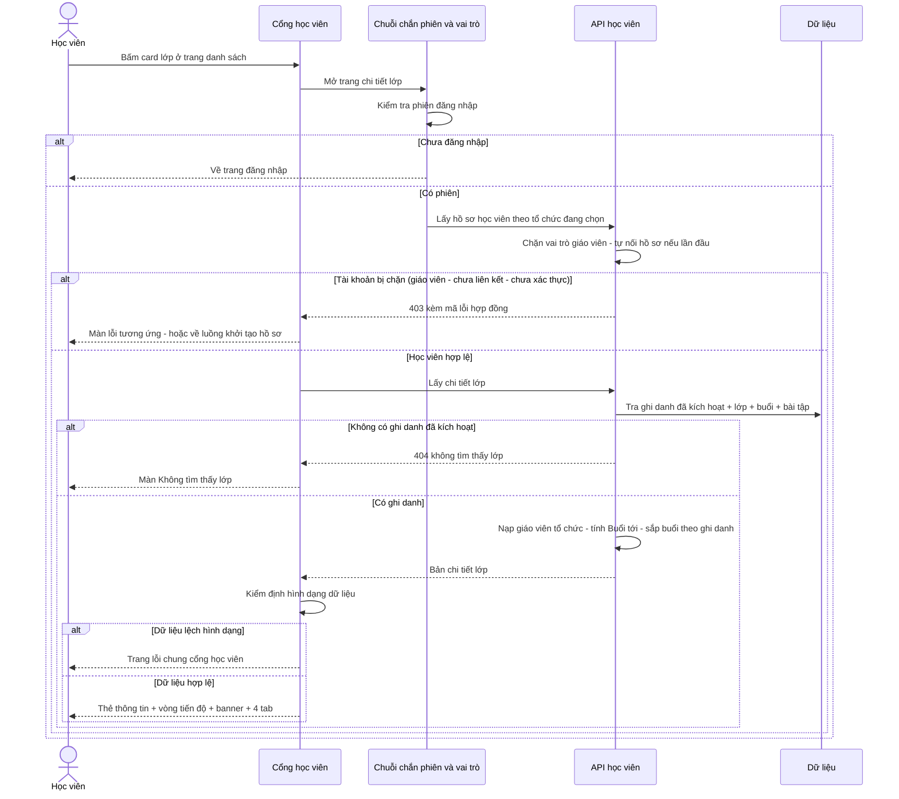
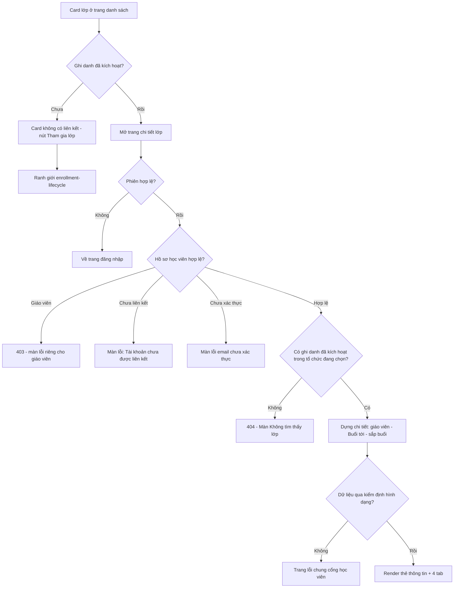
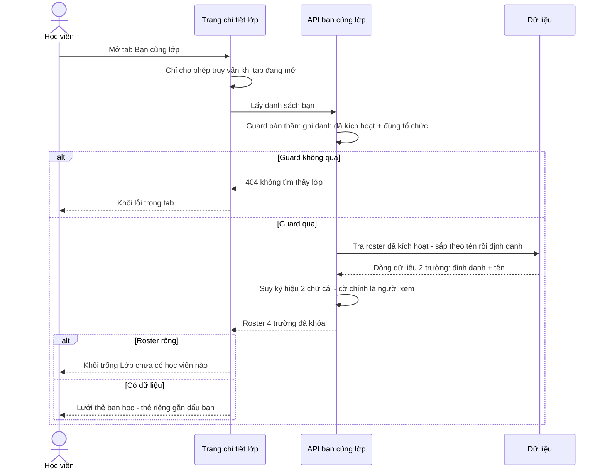
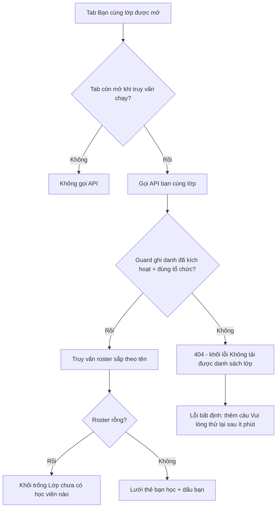
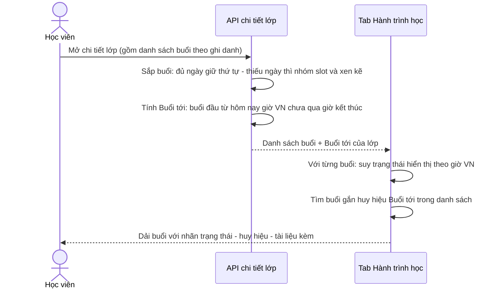
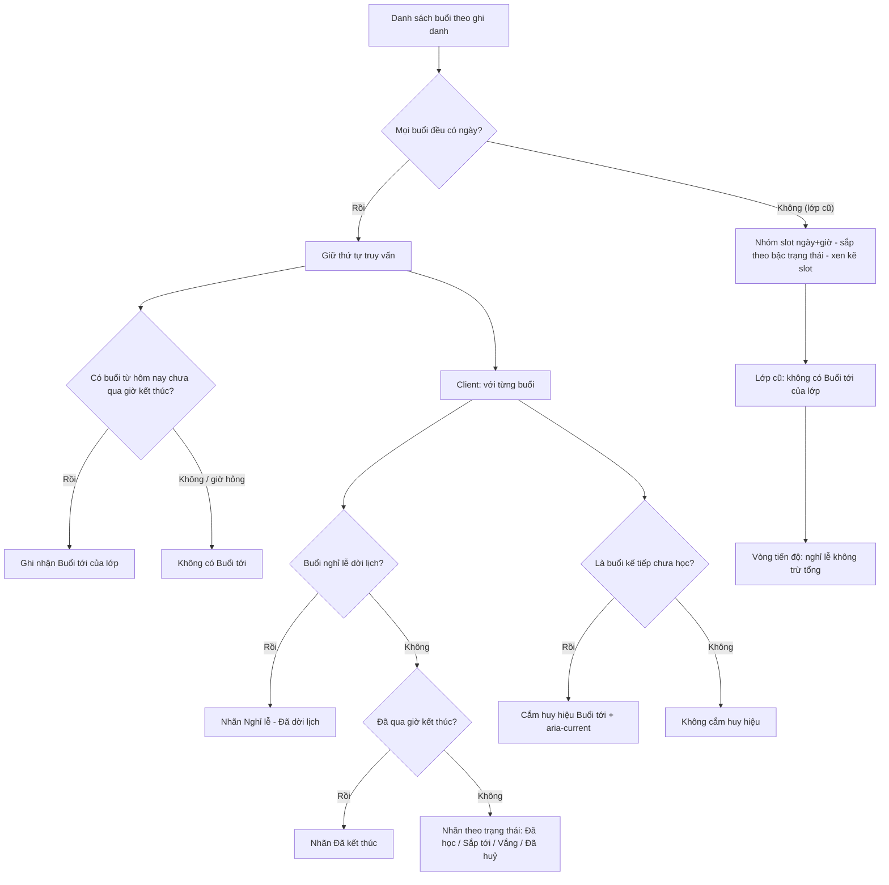
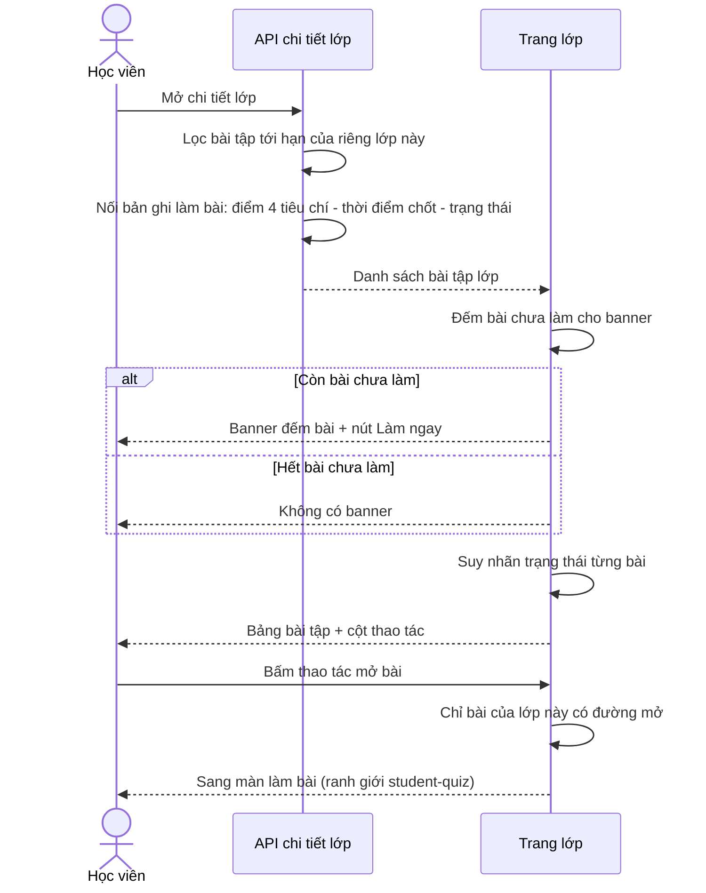
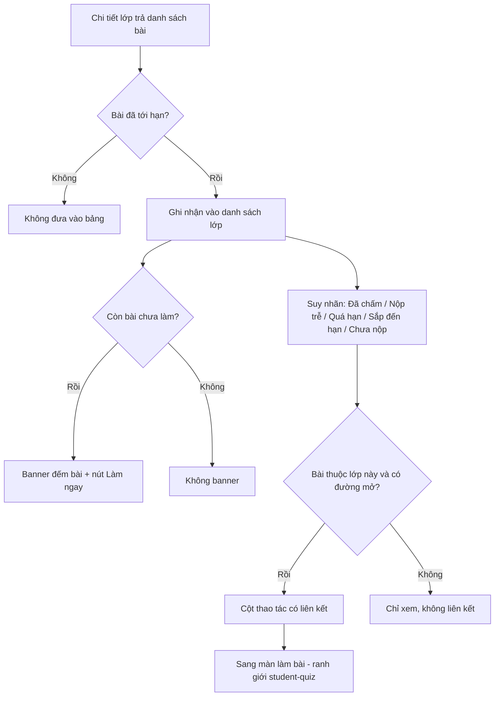

# student-classes — Luồng nghiệp vụ (flows)

> Nhãn: ✅ chắc chắn (code khẳng định: validator/hằng/guard/enum/migration/chuỗi lỗi) · 🔵 suy đoán (≥2 chỗ code hậu thuẫn) · 🟡 cần xác nhận (vì sao/mục tiêu/priority → OQ).

Mỗi luồng có cả sơ đồ trình tự lẫn sơ đồ khối; mọi bước đều bám code, không thêm bước không có trong nguồn.

## F1 — Mở trang chi tiết lớp từ danh sách

Entry: card lớp ở trang danh sách (mở được chỉ khi ghi danh đã kích hoạt). Thoát: trang chi tiết, hoặc một trong các màn từ chối.

Bằng chứng từng nhánh: guard phiên apps/student/src/routes/_auth/route.tsx:4-13 ✅; chặn vai trò apps/server/src/routes/student.ts:506-516 + apps/server/src/role-gates.test.ts:190-217 ✅; chưa liên kết → màn lỗi apps/student/src/routes/_auth/classes/$classId.tsx:32-38; chưa hoàn tất onboarding → về onboarding :42-44 ✅; guard ghi danh apps/server/src/routes/student.ts:1048-1063 ✅; 404 đồng nhất apps/server/src/student.test.ts:840-856 ✅; kiểm định client apps/student/src/lib/repos/student.ts:187-218 ✅.

## F2 — Xem "Bạn cùng lớp"

Bằng chứng: truy vấn có điều kiện theo tab apps/student/src/lib/repos/student.ts:438-445 ✅; guard + 404 apps/server/src/routes/student-classmates.ts:42-57 ✅; roster + ánh xạ :59-78 ✅; hình dạng khóa cứng packages/api/src/contracts.ts:2222-2232 + test :196-204 ✅; ký hiệu :17-22 + test :228-232 ✅; các khối UI apps/student/src/components/class/classmates-tab.tsx:35-62 ✅.

## F3 — Xem "Hành trình học" và suy luận Buổi tới / Đã kết thúc

Bằng chứng: sắp buổi apps/server/src/routes/student-class.ts:236-278 + test apps/server/src/student.test.ts:858-907 ✅; Buổi tới :77-117 + test :1487-1731 ✅; suy "Đã kết thúc" apps/student/src/components/class/class-lesson-list.tsx:57-67 + test :66-83 ✅; huy hiệu :69-85, :197-203 ✅; vòng tiến độ apps/student/src/components/class/class-detail-view.tsx:66-105 ✅. Ghi chú: Buổi tới của lớp (server) và huy hiệu trên buổi (client) là hai phép tính độc lập cùng quy ước thời gian 🔵 [apps/server/src/routes/student-class.ts:77-82 bình luận "đồng bộ isLessonEnded client" + apps/student/src/components/class/class-lesson-list.tsx:57-67 + test :48-64].

## F4 — Xem và mở bài tập từ trang lớp

Bằng chứng: lọc tới hạn apps/server/src/lib/assignment-visibility.ts:8-16 ✅; truy vấn + nối bản ghi làm bài apps/server/src/routes/student-class.ts:145-233 ✅; suy nhãn apps/student/src/lib/assignment-status.ts:119-256 ✅; banner apps/student/src/components/class/class-detail-view.tsx:107-162 ✅; điều kiện liên kết apps/student/src/components/class/class-assignment-table.tsx:99-115 ✅.
