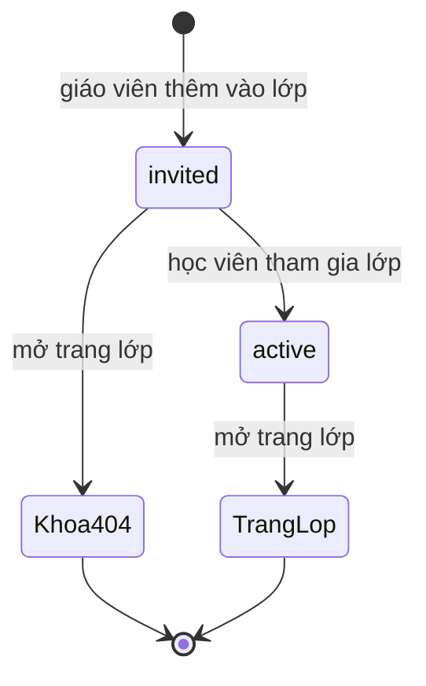
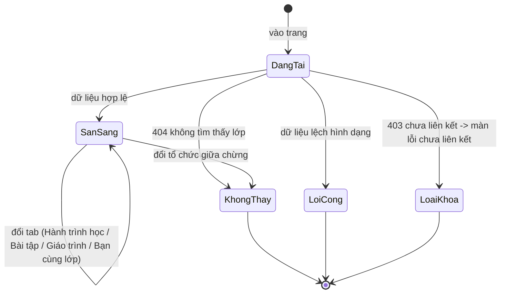

# student-classes — Trạng thái (states)

> Nhãn: ✅ chắc chắn (code khẳng định: validator/hằng/guard/enum/migration/chuỗi lỗi) · 🔵 suy đoán (≥2 chỗ code hậu thuẫn) · 🟡 cần xác nhận (vì sao/mục tiêu/priority → OQ).

Tên trạng thái trong dữ liệu được giữ nguyên như từ vựng hợp đồng; nhãn tiếng Việt là chuỗi hiển thị trích nguyên văn (R2).

## State: Vòng đời ghi danh (enrollment.status — ranh giới feature `enrollment-lifecycle`)

| Giá trị | Ý nghĩa | Trang lớp nhìn thấy gì | Nguồn |
|---------|---------|------------------------|-------|
| `invited` | Đã được thêm vào lớp, chờ học viên tham gia | Card không liên kết + "Chờ kích hoạt"; API chi tiết/roster trả 404 | packages/api/src/contracts.ts:1615-1616; apps/student/src/components/overview/class-card.tsx:207-215; apps/server/src/student.test.ts:840-846 | 
| `active` | Đã tham gia | Card liên kết; vào được chi tiết + roster | apps/server/src/routes/student.ts:1048-1063; apps/server/src/routes/student-classmates.ts:42-57 |

Giá trị mặc định `active` trong dữ liệu chỉ để điền dòng cũ trong migration; code mới ghi trạng thái tường minh. ✅ [packages/db/src/schema/enrollment.ts:30-33; packages/db/src/migrations/0022_neat_quicksilver.sql:1]

Hai bước chuyển được đánh dấu là ranh giới: tạo `invited` và kích hoạt `active` đều thuộc feature `enrollment-lifecycle`; trang này chỉ ĐỌC theo giá trị hiện có. ✅ [apps/server/src/routes/student.ts:1300-1324 là điểm kích hoạt; trang lớp không có thao tác ghi — apps/student/src/lib/repos/student.ts:396-445]

## State: Trạng thái lớp hiển thị (nhãn card + đầu trang chi tiết)

| Giá trị dữ liệu | Nhãn hiển thị | Nguồn |
|-----------------|---------------|-------|
| `active` | "Đang học" | apps/student/src/components/class/class-detail-view.tsx:59-64 |
| `completed` | "Đã kết thúc" | như trên |
| `paused` | "Tạm dừng" | như trên |
| `archived` | "Đã lưu trữ" | như trên |

Dữ liệu mặc định `active`; toàn bộ 4 nhãn được client định nghĩa sẵn dù thực tế chủ yếu gặp "Đang học". ✅ [packages/db/src/schema/class.ts:27 (default); class-detail-view.tsx:59-64]

## State: Trạng thái hiển thị của buổi học (dải Hành trình học)

Nhãn lấy từ hằng client; trạng thái dữ liệu gốc là từ vựng hợp đồng (`upcoming`, `completed`, `absent`, `cancelled`, `holiday` — packages/db/src/schema/lesson.ts:49-57).

| Điều kiện (theo thứ tự kiểm) | Nhãn hiển thị | Nguồn |
|------------------------------|---------------|-------|
| Buổi nghỉ lễ dời lịch | "Nghỉ lễ — Đã dời lịch" | apps/student/src/components/class/class-lesson-list.tsx:13-49 |
| Có ngày + đã qua giờ kết thúc (trừ nghỉ lễ) | thêm "Đã kết thúc" (client tự suy theo thời gian, không lưu) | class-lesson-list.tsx:57-67 + test :66-83 |
| `completed` hoặc `absent` theo ghi danh | "Đã học" / "Vắng" | class-lesson-list.tsx:13-49 |
| `cancelled` | "Đã huỷ" | như trên |
| Còn lại (`upcoming`) | "Sắp tới" | như trên |
| Là buổi kế tiếp chưa học | thêm huy hiệu "Buổi tới" + aria-current | class-lesson-list.tsx:69-85, :197-203 |

Bậc sắp trong slot legacy: `completed`=0, `absent`=0, `cancelled`=1, `upcoming`=2. ✅ [apps/server/src/routes/student-class.ts:236-250; test apps/server/src/student.test.ts:858-907]

## State: Buổi tới của lớp (server tính — #395)

| Điều kiện | Kết quả | Nguồn |
|-----------|---------|-------|
| Có buổi với ngày >= hôm nay (giờ VN) và mốc kết thúc (ngày+giờ+thời lượng) > bây giờ | Buổi đó là Buổi tới | apps/server/src/routes/student-class.ts:77-117; test apps/server/src/student.test.ts:1658-1707, :1719-1731 |
| Mốc kết thúc == bây giờ | coi như đã kết thúc, không chọn | :110-112 + test :1709-1717 |
| Giờ kết thúc lệch định dạng (không đoán được) | coi như chưa kết thúc (fail-open) | :110-112 |
| Lớp legacy (mọi buổi không ngày) | không có Buổi tới | :77-82 |

## State: Nhãn trạng thái bài tập (tab Bài tập)

Nhãn do client suy từ dữ liệu bài + bản ghi làm bài (apps/student/src/lib/assignment-status.ts:119-256) — bảng dưới là 5 nhãn chính, còn có nhóm nhãn "Điểm: …" và "Đã nộp…" (:146-147, :182-186):

| Tình huống | Nhãn | Nguồn (dòng) |
|-----------|------|--------------|
| Đã chốt trả bài + nộp trễ | "Đã chấm · Nộp trễ" | assignment-status.ts:161 |
| Đã chốt trả bài đúng hạn | "Đã chấm" | :161 |
| Quá hạn chưa nộp | "Quá hạn" | :205 |
| Gần hạn chưa nộp | "Sắp đến hạn" | :217 |
| Còn thời gian, chưa nộp | "Chưa nộp" | :227, :243, :256 |

Điểm hiển thị là bộ 4 tiêu chí IELTS Writing (task/coherence/lexical/grammar) khi bài trả về đủ hình dạng; sai hình dạng → rỗng (không hiện điểm). ✅ [apps/server/src/routes/student-class.ts:213-215; packages/api/src/contracts.ts:2144-2152]

## State: Màn hình trang chi tiết lớp (client)

- Chưa liên kết → render màn lỗi; chuyển hướng onboarding là nhánh hồ sơ chưa hoàn tất onboarding (`onboardingCompletedAt == null`), ở mức route. ✅ [apps/student/src/routes/_auth/classes/$classId.tsx:29-44]
- "Đổi tổ chức giữa chừng → 404" là kịch bản code chủ đích ghi chú. ✅ [$classId.tsx:51-53]
- Tab Bạn cùng lớp có 4 trạng thái con riêng: đang tải / lỗi / trống / có dữ liệu. ✅ [apps/student/src/components/class/classmates-tab.tsx:35-62]
