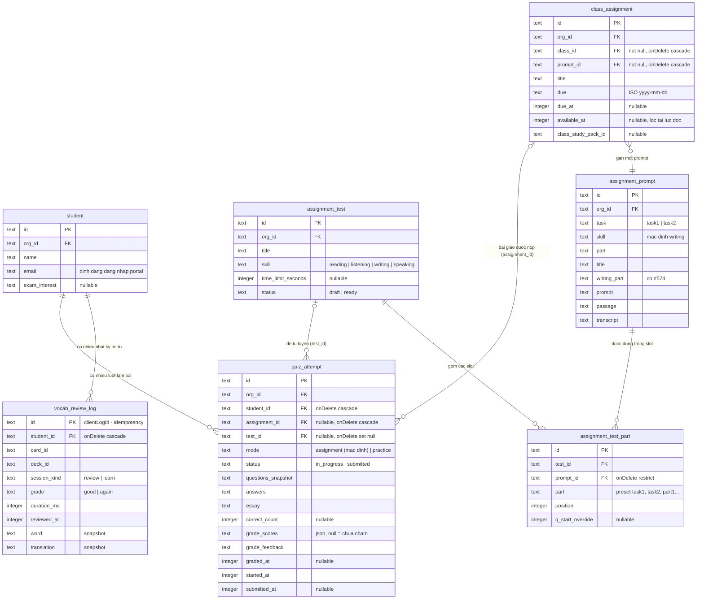

# ERD dữ liệu nguồn — student-history

Phase 11 **không có entity riêng** cho lịch sử: biểu đồ dưới là các bảng nguồn mà route đọc tại chỗ (apps/server/src/routes/student-history.ts:230-355). Chỉ liệt kê cột có thật trong schema.

## Ghi chú quan hệ và ràng buộc

- ✅ `quiz_attempt` có unique (assignment_id, student_id) — một học viên một lượt nộp mỗi bài giao — packages/db/src/schema/quiz-attempt.ts:86-89.
- ✅ CHECK DB: mode `assignment` buộc phải có `assignment_id`; KHÔNG có CHECK đảo cho practice vì FK `test_id` ON DELETE SET NULL sẽ bị CHECK chặn — packages/db/src/schema/quiz-attempt.ts:98-106.
- ✅ Index phục vụ lịch sử: (org_id, student_id, mode, submitted_at), chú thích "History phase 11" — packages/db/src/schema/quiz-attempt.ts:91-97.
- ✅ `vocab_review_log` cố ý không có FK tới thẻ/deck; snapshot `word` + `translation` để lịch sử sống sót khi giáo viên xoá deck — packages/db/src/schema/vocab.ts:126-132.
- ✅ `assignment_test_part` không có org_id — scoping đi qua testId; unique (test_id, part) — packages/db/src/schema/assignment-test.ts:53-78.
- ✅ `class_assignment.available_at` nullable = không giới hạn thời điểm khả dụng; route lịch sử lọc theo thời điểm đọc — packages/db/src/schema/class-assignment.ts:38, apps/server/src/routes/student-history.ts:312 (🟡 OQ-05).
- 🔵 Cột `writing_part` ở prompt là căn cứ `hasWriting` khi lọc/không lọc Writing — packages/db/src/schema/assignment-prompt.ts và apps/server/src/routes/student-history.ts:308-311, 531-538.
