# Luồng nghiệp vụ đảo ngược — student-history

Nhãn trong biểu đồ viết không dấu để giữ cú pháp mermaid ổn định; tên gọi ở tiêu đề giữ dấu. Mỗi luồng liệt kê Nguồn trước, bằng chứng dạng gạch đầu dòng sau biểu đồ.

## F1 — Mở trang lịch sử

Nguồn: apps/student/src/routes/_auth/history.tsx; apps/student/src/components/layout/student-nav.tsx; apps/student/src/lib/repos/student.ts.

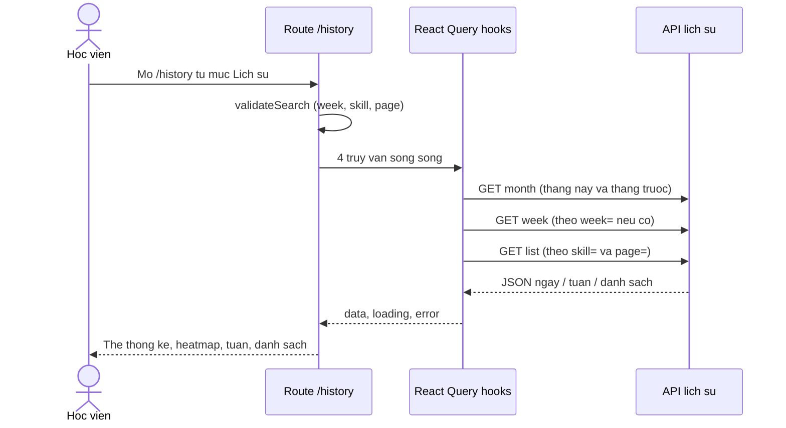

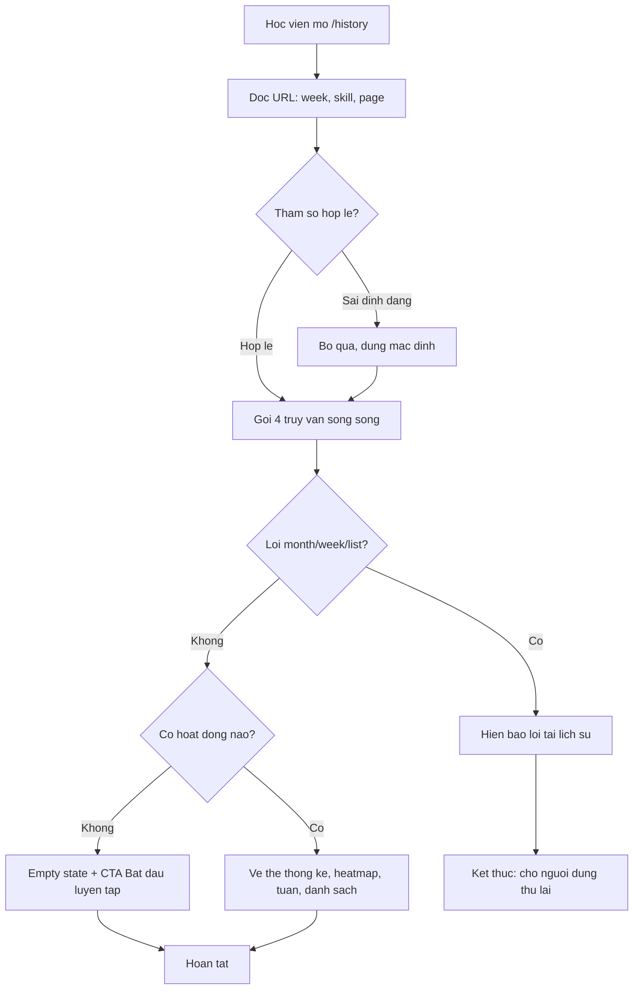

- ✅ Mục nav "Lịch sử" → `/history` — apps/student/src/components/layout/student-nav.tsx:45-51 (cờ `HISTORY_ROUTES_LIVE` dòng 22).
- ✅ `validateSearch` đọc `week/skill/page`, giá trị sai → undefined (dùng mặc định) — apps/student/src/routes/_auth/history.tsx:29-42.
- ✅ 4 truy vấn: tháng này, tháng trước, tuần, danh sách — apps/student/src/routes/_auth/history.tsx:76-86.
- 🔵 Cập nhật dữ liệu nhờ staleTime 30s + nạp lại khi vào trang, không có invalidation sau nộp bài — apps/student/src/lib/repos/student.ts:653-720 và kiểm chứng âm NEG-02 (`_evidence.md`).
- ✅ Cổng lỗi chỉ xét monthNow/week/list — apps/student/src/routes/_auth/history.tsx:128-141 (E-11: lỗi tháng trước im lặng — stats vẫn tính với dữ liệu thiếu, 96-118).

## F2 — Gom dữ liệu phía máy chủ

Nguồn: apps/server/src/routes/student-history.ts.

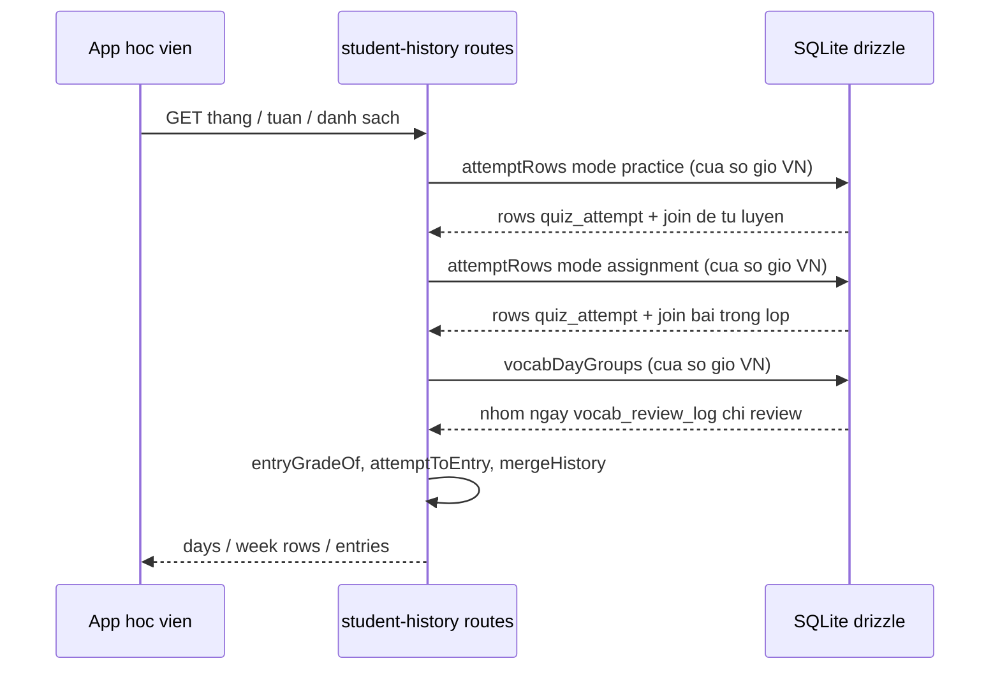

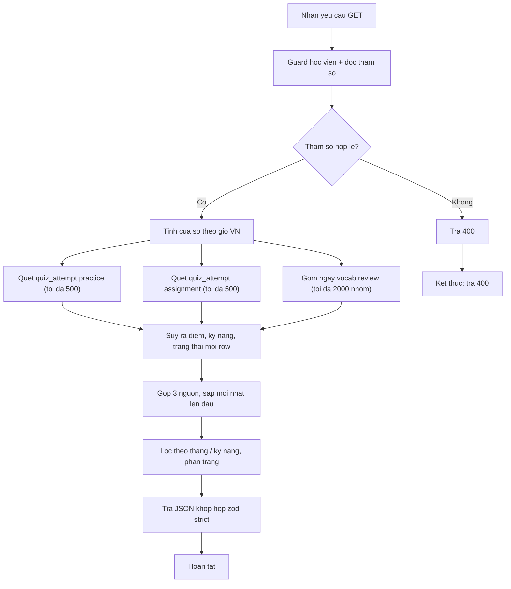

- ✅ Hai nhánh join riêng cho practice (254-278) và assignment (279-317) — apps/server/src/routes/student-history.ts:230-333.
- ✅ Chỉ `submitted_at` khác null được tính (loại bài làm dở, loại học viên khác) — apps/server/src/routes/student-history.test.ts:399-416.
- ✅ Từ vựng gom theo ngày VN trong SQL, chỉ phiên `review` — apps/server/src/routes/student-history.ts:182-220.
- ✅ Gộp và sắp mới nhất lên đầu — apps/server/src/routes/student-history.ts:362-402 (400).
- 🟡 Vượt giới hạn quét bị cắt im lặng → OQ-01 — apps/server/src/routes/student-history.ts:85-86.

## F3 — Heatmap tháng và chọn tuần

Nguồn: apps/student/src/components/history/month-heatmap.tsx; week-table.tsx; apps/student/src/routes/_auth/history.tsx.

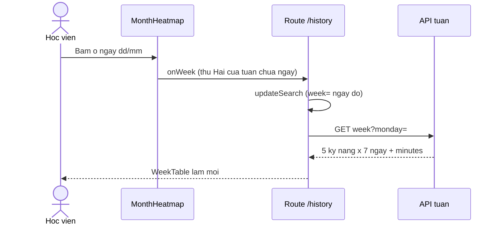

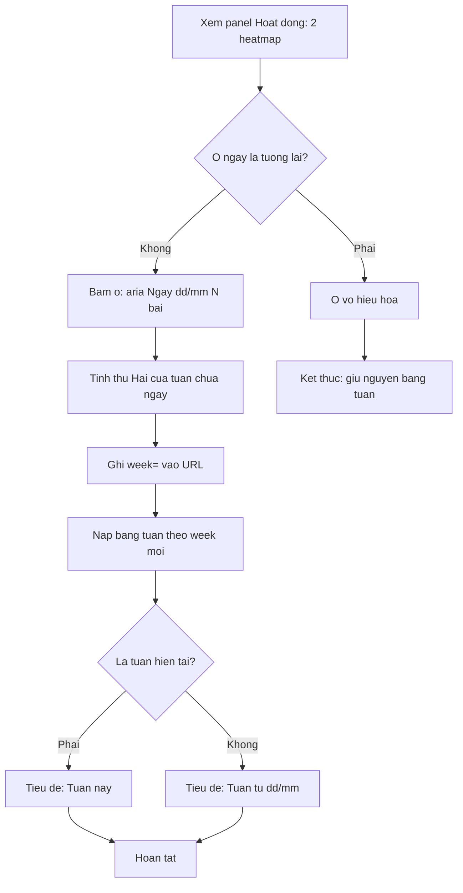

- ✅ aria-label "Ngày dd/mm: N bài" theo giờ VN — apps/student/src/components/history/month-heatmap.tsx:90; test apps/student/src/components/history/month-heatmap.test.tsx:19-40.
- ✅ Bấm ô ngày đặt đúng Thứ Hai của tuần — apps/student/src/components/history/month-heatmap.test.tsx:42-59; e2e apps/e2e/specs/student-history.spec.ts:148-151.
- ✅ Ô của tuần đang chọn có aria-pressed; ngày tương lai disabled — apps/student/src/components/history/month-heatmap.test.tsx:61-84.
- ✅ "Tuần này"/"Tuần từ dd/mm" — apps/student/src/routes/_auth/history.tsx:257-269.

## F4 — Danh sách: lọc kỹ năng và phân trang

Nguồn: apps/student/src/components/history/history-list.tsx; apps/student/src/routes/_auth/history.tsx; apps/server/src/routes/student-history.ts:505-551.

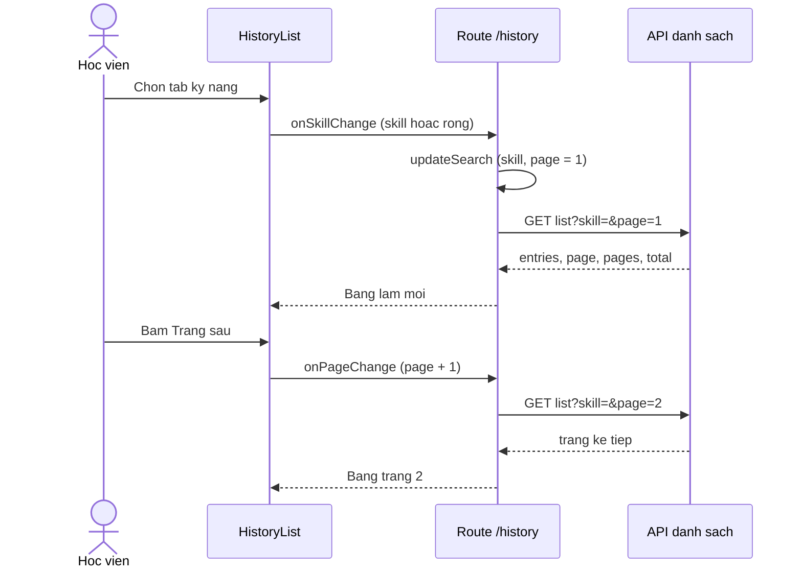

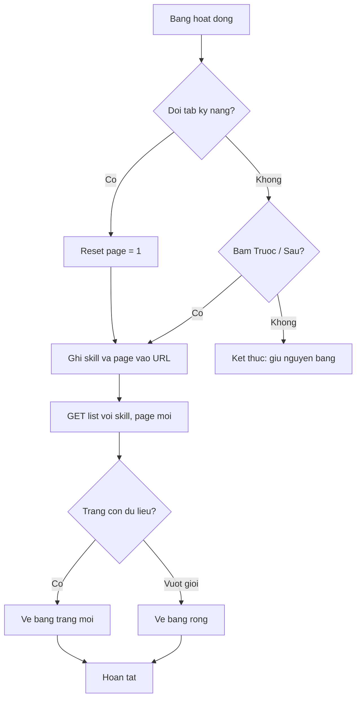

- ✅ Đổi tab → reset trang 1 + cập nhật URL — apps/student/src/routes/_auth/history.tsx:272-292 (277-283).
- ✅ "Tất cả" trả chuỗi rỗng; tab "Từ vựng" → `vocabulary` — apps/student/src/components/history/history-list.test.tsx:110-119.
- ✅ Phân trang "Trước"/"Trang x / y"/"Sau" — apps/student/src/components/history/history-list.tsx:197-222; trang vượt giới hạn trả `entries` rỗng — apps/server/src/routes/student-history.test.ts:468-513.
- ✅ Lọc Writing bao gồm bài ghép có phần Writing (#574) — apps/server/src/routes/student-history.ts:531-538.

## F5 — Xem lại nhận xét Writing

Nguồn: apps/student/src/components/history/history-list.tsx:39-46; writing-review.tsx; apps/student/src/lib/repos/quiz.ts; apps/server/src/routes/student.ts:2228.

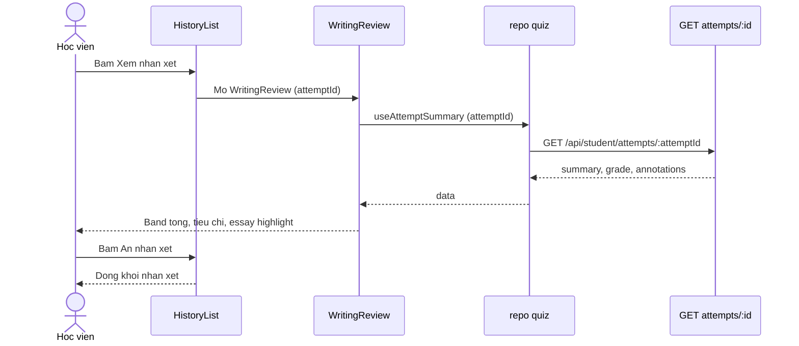

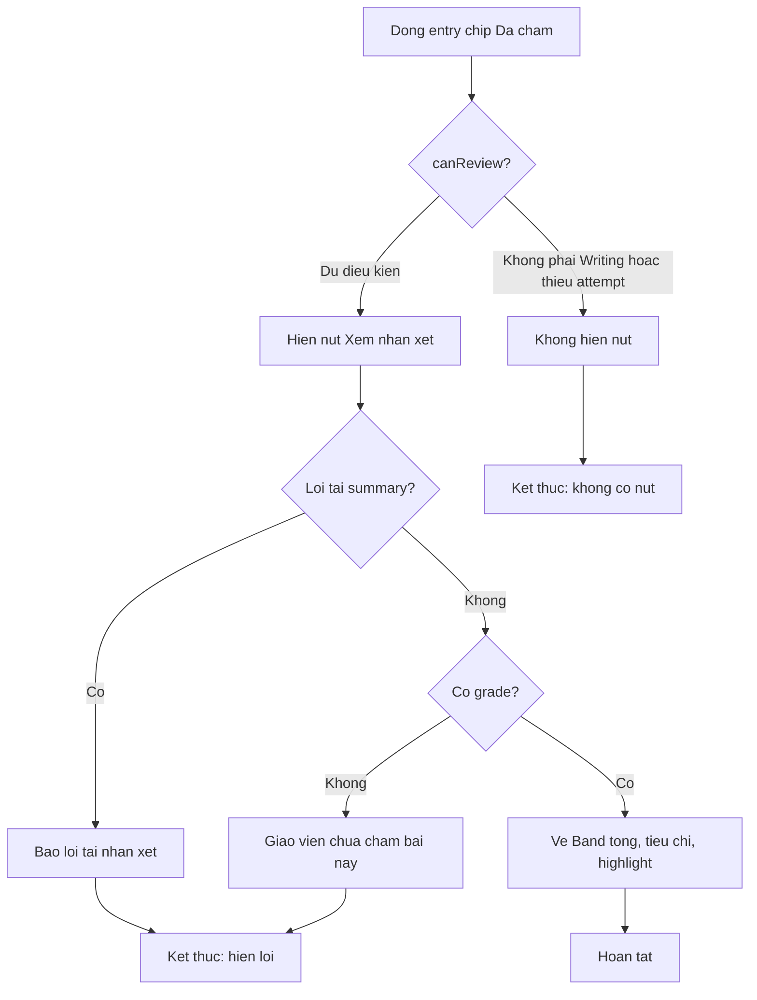

- ✅ Điều kiện `canReview`: `graded` + kỹ năng Writing (kể cả `hasWriting`) + có attemptId — apps/student/src/components/history/history-list.tsx:39-46.
- ✅ Mở/đóng "Xem nhận xét"/"Ẩn nhận xét" — apps/student/src/components/history/history-list.test.tsx:129-182.
- ✅ Ba trạng thái khối: spinner, lỗi nguyên văn, "Giáo viên chưa chấm bài này." — apps/student/src/components/history/writing-review.tsx:23-29, 75-79.
- ✅ "Band tổng" + tiêu chí IELTS theo part + highlight ghi chú — apps/student/src/components/history/writing-review.test.tsx:53-73.

## F6 — Vào lịch sử từ trang luyện tập

Nguồn: apps/student/src/components/practice/history-button.tsx; apps/student/src/routes/_auth/practice/$skill.tsx; apps/e2e/specs/student-history.spec.ts:175-192.

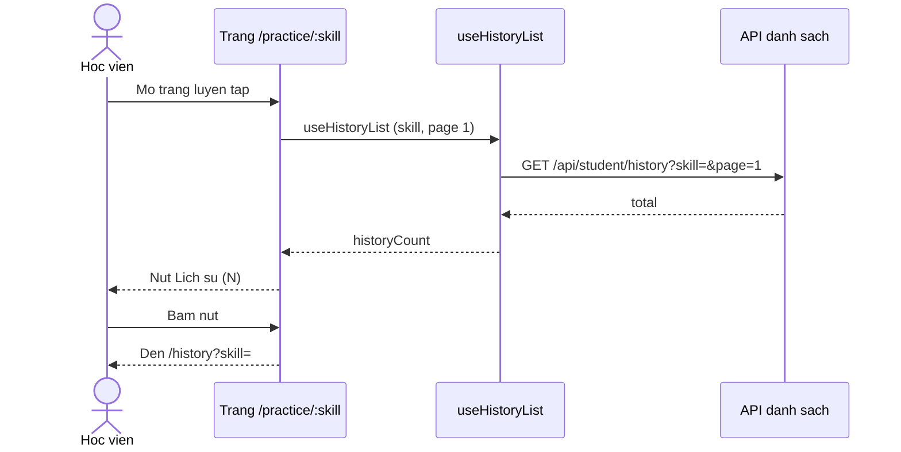

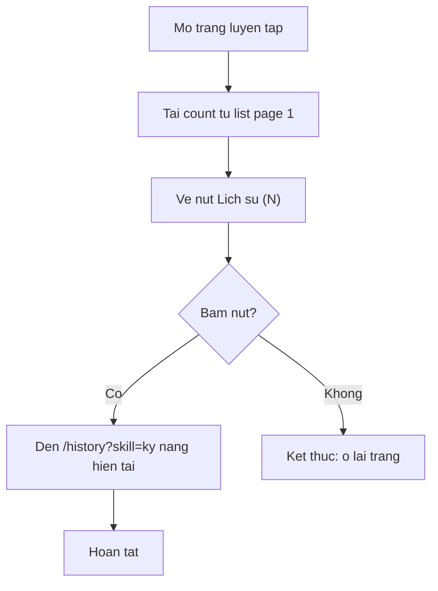

- ✅ Nút hiển thị "(1)" và dẫn `/history?skill=reading` — apps/e2e/specs/student-history.spec.ts:175-192.
- ✅ Đếm lấy `total` của trang 1 — apps/student/src/routes/_auth/practice/$skill.tsx:61-68.
- 🟡 Tải nguyên trang 20 entry chỉ để lấy tổng → OQ-11 — packages/api/src/contracts.ts:2305.
- 🔵 Comment "caller chưa mount" đã lỗi thời: component được mount thật — apps/student/src/components/practice/history-button.tsx:6-8 và apps/student/src/routes/_auth/practice/$skill.tsx:118-126 (GAP-5).

## F7 — Dữ liệu mới chảy vào lịch sử (read-model)

Nguồn: packages/db/src/schema/quiz-attempt.ts; packages/db/src/schema/vocab.ts; apps/server/src/routes/student-history.ts. Bề mặt viết tham chiếu bộ `docs/_reverse/student-practice/`.

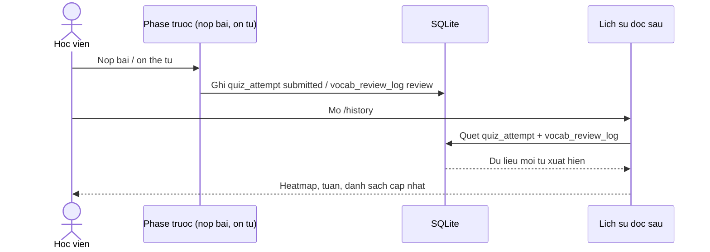

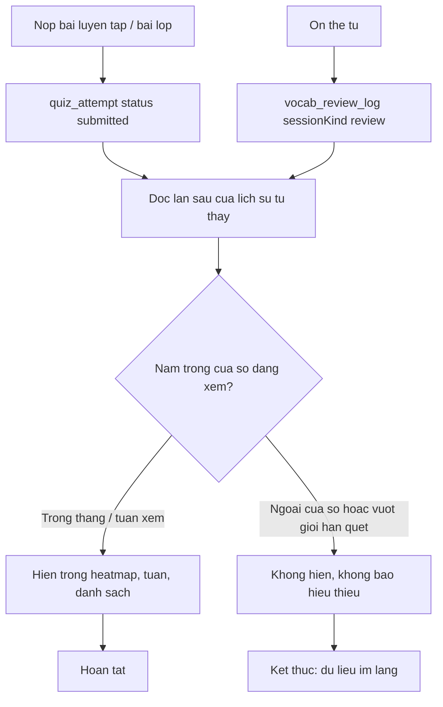

- ✅ Lịch sử không ghi gì: chỉ SELECT — apps/server/src/routes/student-history.ts:404-411 (INF-1).
- ✅ Bài nộp tạo `quiz_attempt` với `submitted_at` — packages/db/src/schema/quiz-attempt.ts:83; nhật ký ôn tạo `vocab_review_log` — packages/db/src/schema/vocab.ts:133-157.
- 🔵 Không có invalidation — cập nhật phụ thuộc nạp lại trang (staleTime 30s): NEG-02 + apps/student/src/lib/repos/student.ts:653-720.
- 🟡 Dữ liệu ngoài cửa sổ hoặc vượt giới hạn quét biến mất im lặng → OQ-01.
