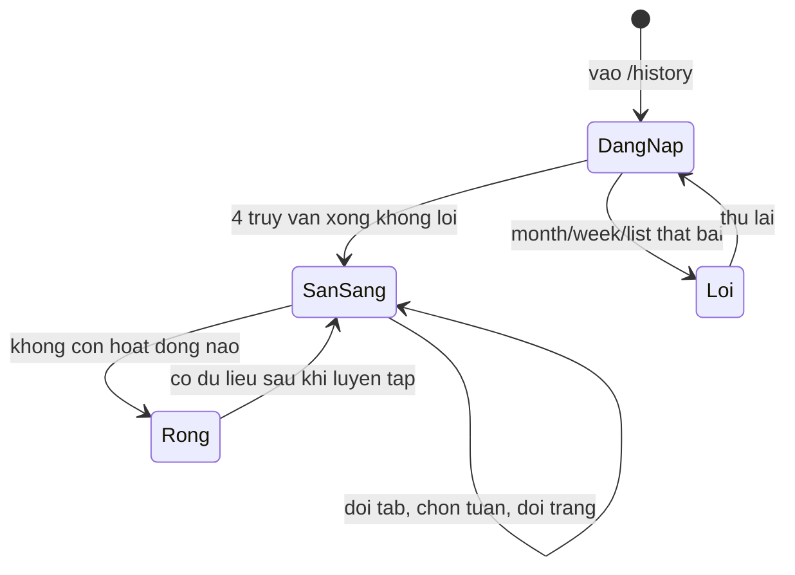
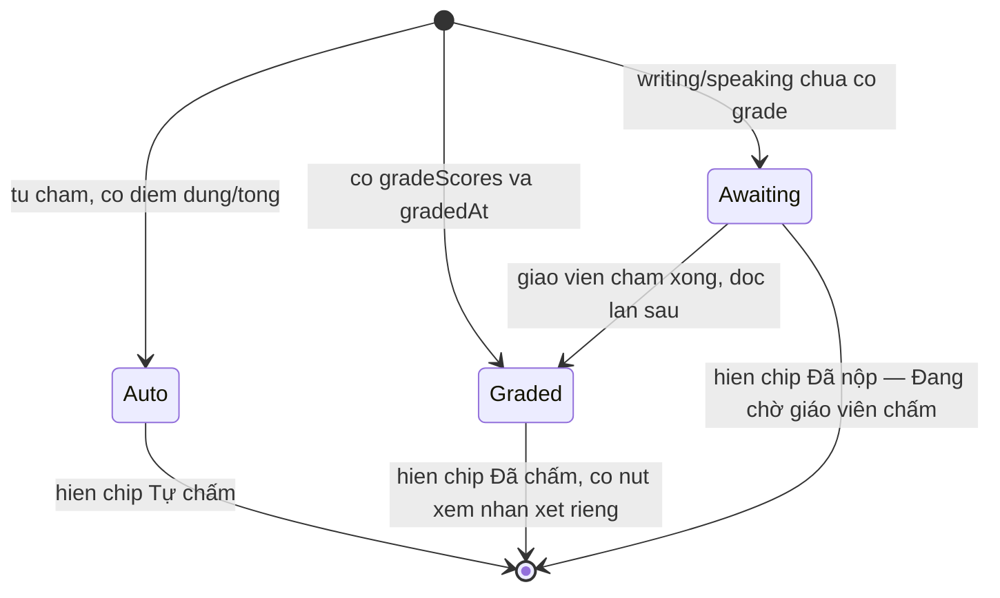
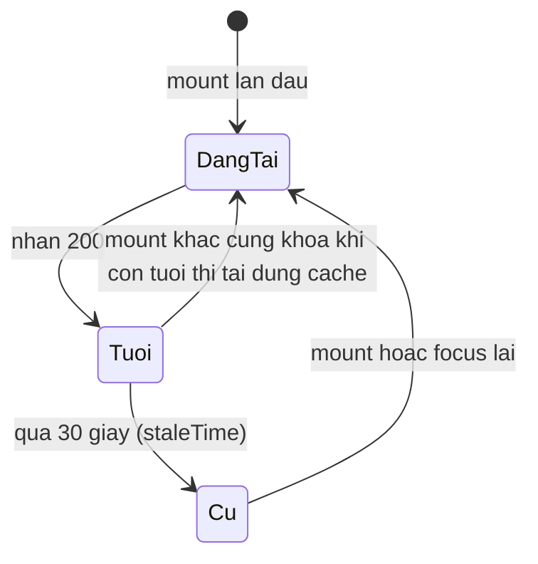

# Máy trạng thái đảo ngược — student-history

Ba máy trạng thái quan sát được từ code: trang `/history`, trạng thái một entry, vòng đời cache truy vấn. Nhãn chuyển trạng thái không chứa dấu chấm phẩy.

## SM-A — Trang /history (apps/student/src/routes/_auth/history.tsx)

Chứng thực:

- ✅ Cổng loading gồm cả tháng trước — apps/student/src/routes/_auth/history.tsx:120-127.
- ✅ Cổng lỗi chỉ xét monthNow/week/list (chuỗi "Không tải được lịch sử. Vui lòng thử lại.") — 128-141; lỗi tháng trước không đưa vào Loi (E-11).
- ✅ Empty state khi `hasNoActivity` — 147-150, nội dung 165-178.
- ✅ Chuyển trong SanSang diễn ra qua URL (`?week=`, `?skill=`, `?page=`) — 90-92.

## SM-B — Trạng thái một entry lịch sử (apps/server/src/routes/student-history.ts:120-156, hợp đồng packages/api/src/contracts.ts:2371)

Chứng thực:

- ✅ Enum `auto | graded | awaiting` trong hợp đồng — packages/api/src/contracts.ts:2371.
- ✅ Phân loại: `graded` khi có gradeScores + gradedAt (144-147); Writing/Speaking chưa chấm → `awaiting` (148-150); còn lại `auto` (154-155) — apps/server/src/routes/student-history.ts:120-156.
- ✅ Chip hiển thị 4 nhãn (gồm "Đã ôn" cho từ vựng, không thuộc máy này) — apps/student/src/components/history/history-list.tsx:17-21, 34.
- ✅ Chờ chấm dùng chung một nhãn cho practice và assignment (#478) — apps/student/src/components/history/history-list.tsx:14-16, test 91-107.
- 🟡 "Graded" của entry không phải Writing không mở được khối nhận xét → OQ-09.

## SM-C — Vòng đời cache truy vấn lịch sử (apps/student/src/lib/repos/student.ts:653-720)

Chứng thực:

- ✅ staleTime 30_000 cho các hook lịch sử — apps/student/src/lib/repos/student.ts:653-669 (month), 671-687 (week), 689-720 (list).
- ✅ Không có invalidation sau nộp bài — kiểm chứng âm NEG-02 (`_evidence.md`).
- 🔵 Hệ quả nghiệp vụ: học viên nộp bài xong quay lại `/history` trong 30 giây có thể thấy dữ liệu cũ cho tới lần nạp lại — apps/student/src/lib/repos/student.ts:653-720 và apps/student/src/components/practice/history-button.tsx (điều hướng sang trang mới kích hoạt truy vấn).
