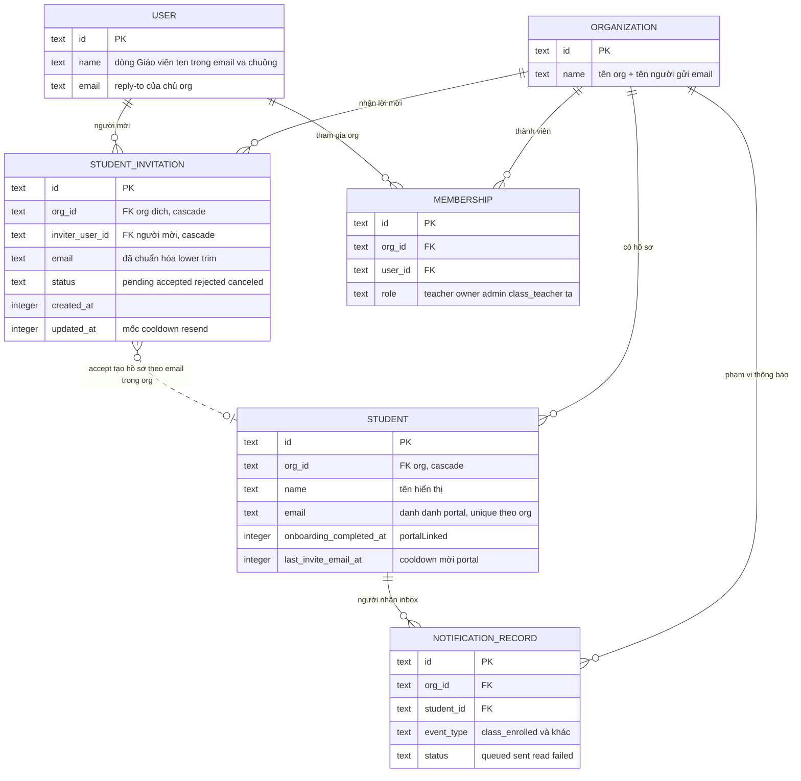

```markdown
---
type: reverse-srs-erd
feature: student-invitations
updated: 2026-11-11
---

# student-invitations — ERD tái lập (reverse)



## Entity Reference

| Entity | Mô tả nghiệp vụ | Thuộc tính chính | Nguồn | Nhãn |
|--------|-----------------|------------------|-------|------|
| Lời mời học viên (student_invitation) | Thư mời vào org, chờ HV phản hồi trên portal | org, người mời, email, status, timestamps | `packages/db/src/schema/student-invitation.ts:12-42` | ✅ |
| Hồ sơ học viên (student) | Người học trong 1 org; danh tính portal là email | org, tên, email, onboardingCompletedAt, lastInviteEmailAt | `packages/db/src/schema/student.ts:9-70` | ✅ |
| Tổ chức (organization) | Trung tâm/trường; scope của lời mời + hồ sơ + vai trò | id, name | `packages/db/src/schema/student-invitation.ts:16-18`, `apps/server/src/lib/notifications/org-mail-sender.ts:20-25` | ✅ |
| Người mời (user) | Tài khoản giáo viên thực hiện lời mời | name (hiển thị trong email/chuông), email | `apps/server/src/routes/kernel.ts:254-264`, `apps/server/src/routes/student.ts:558-560` | ✅ |
| Thành viên org (membership) | Phân quyền quản lý lời mời trong org | role teacher/owner/admin/class_teacher/ta | `apps/server/src/app.ts:278-298`, `packages/auth/src/role.ts:116-129` | ✅ |
| Thông báo in-app (notification_record) | Inbox portal; KHÔNG sinh từ lời mời org | eventType, status, idempotencyKey | `packages/db/src/schema/notification-record.ts:19-55` | ✅ |
| Chuông giáo viên (notif) | Feed thông báo GV, độc lập với feature này | text, channel, dot | `packages/db/src/schema/notif.ts:8-26` | ✅ |

## Quan hệ

| Từ | Đến | Bản số | Ý nghĩa | Nguồn | Nhãn |
|----|-----|--------|---------|-------|------|
| ORGANIZATION | STUDENT_INVITATION | 1-N | Mỗi lời mời thuộc đúng 1 org; xóa org → mất lời mời (cascade) | `packages/db/src/schema/student-invitation.ts:16-18` | ✅ |
| USER | STUDENT_INVITATION | 1-N | Người mời; xóa user → mất lời mời (cascade) | `packages/db/src/schema/student-invitation.ts:19-21` | ✅ |
| ORGANIZATION | STUDENT | 1-N | Một email có N hồ sơ, mỗi org tối đa 1 (unique org+email) | `packages/db/src/schema/student.ts:66-69` | ✅ |
| STUDENT_INVITATION | STUDENT | N-0..1 | Không có FK — liên kết logic: accept tạo hồ sơ cùng email trong org đích nếu chưa có | `apps/server/src/routes/student.ts:612-636` | 🔵 |
| ORGANIZATION | MEMBERSHIP / USER | 1-N | Vai trò trong org quyết quyền mời | `apps/server/src/app.ts:278-298` | ✅ |
| ORGANIZATION/STUDENT | NOTIFICATION_RECORD | 1-N | Inbox portal; lời mời org không ghi bảng này | `packages/db/src/schema/notification-record.ts:23-28` | ✅ |

## Notes

* `email` của lời mời được ghi đã chuẩn hóa (lower/trim) tại điểm tạo; mọi tra cứu cũng chuẩn hóa 2 phía — `apps/server/src/routes/kernel.ts:702`, `apps/server/src/routes/student.ts:140`.
* Không có bảng trung gian lời mời↔hồ sơ; việc accept tạo hồ sơ mới nếu thiếu là cơ chế nối 2 entity.
* Các thuộc tính kỹ thuật DB (index phụ, default timestamp) cố ý không đưa vào sơ đồ — xem schema nguồn.
```
