```markdown
---
type: reverse-srs-flows
feature: student-invitations
updated: 2026-11-11
---

# student-invitations — Flows tái lập (reverse)

> Mỗi flow bóc từ code; bước nào có trong code mới vẽ. Nhãn 🔵/🟡 đánh dấu bước suy đoán/cần xác nhận (chi tiết OQ ở `../reverse-gaps.md`).

## Flow 1: GV mời HV qua email (tạo lời mời + uniqueness per org+email)

### Sequence — GV mời học viên

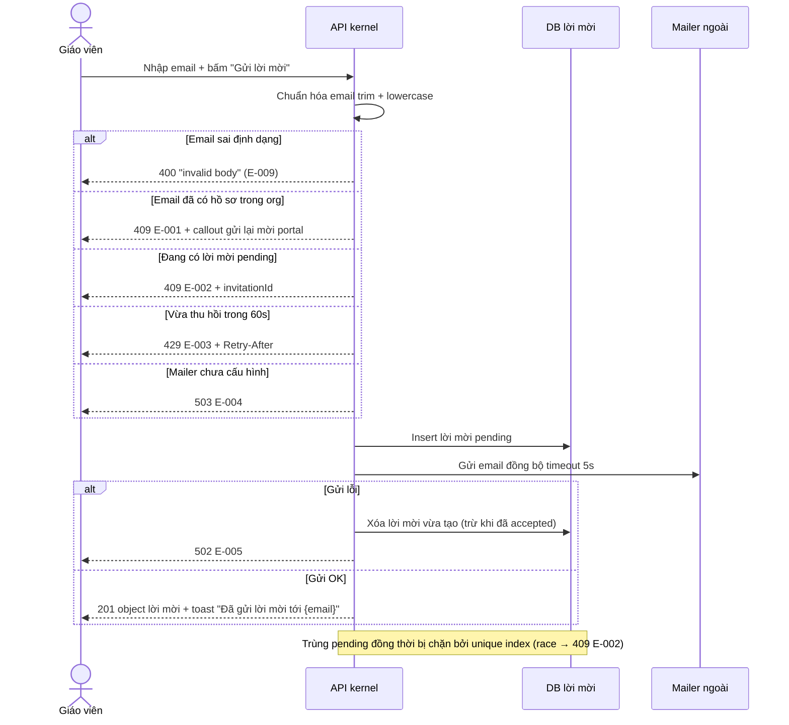

### Activity — GV mời học viên

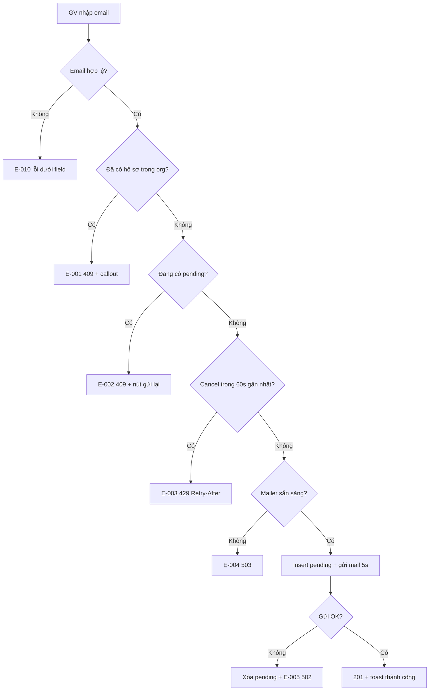

## Flow 2: GV gửi lại lời mời pending (resend, cooldown CAS)

### Sequence — Gửi lại lời mời

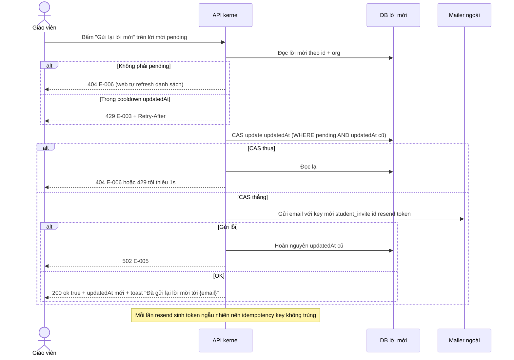

### Activity — Gửi lại lời mời

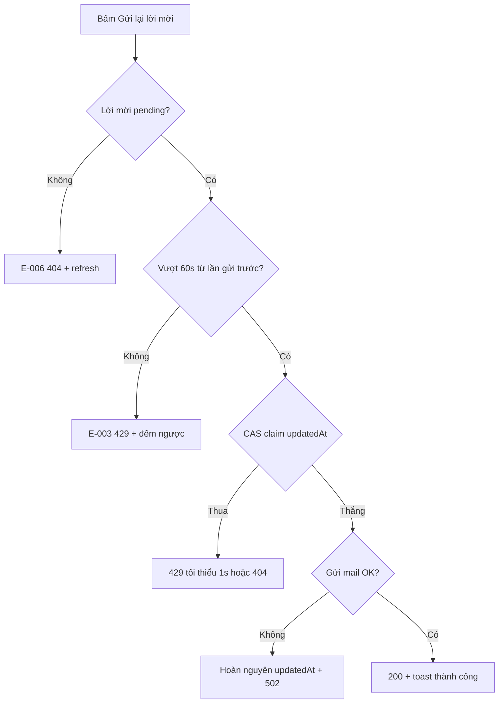

## Flow 3: GV thu hồi lời mời pending (cancel)

### Sequence — Thu hồi lời mời

```mermaid
sequenceDiagram
    actor GV as Giáo viên
    participant API as API kernel
    participant DB as DB lời mời
    GV->>API: Bấm "Thu hồi" trên lời mời pending
    alt Role không đủ quyền
        API-->>GV: 403 E-008
    else Lời mời không pending
        API-->>GV: 404 E-006
    else OK
        API->>DB: Update status canceled + updatedAt
        API-->>GV: 200 ok true + toast "Đã thu hồi lời mời tới {email}"
    end
    Note over DB: Dòng được GIỮ LẠI với status canceled, không xóa; mời lại trong 60s kể từ createdAt sẽ 429
```

### Activity — Thu hồi lời mời

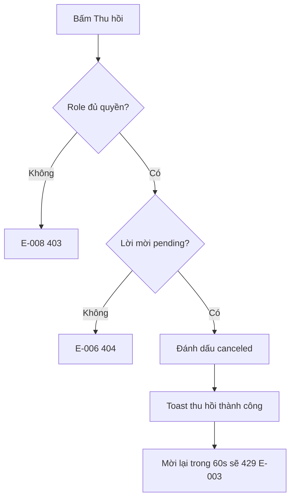

## Flow 4: HV nhận thông báo + chấp nhận (cross-portal hop — trọng tâm)

### Sequence — Học viên chấp nhận lời mời

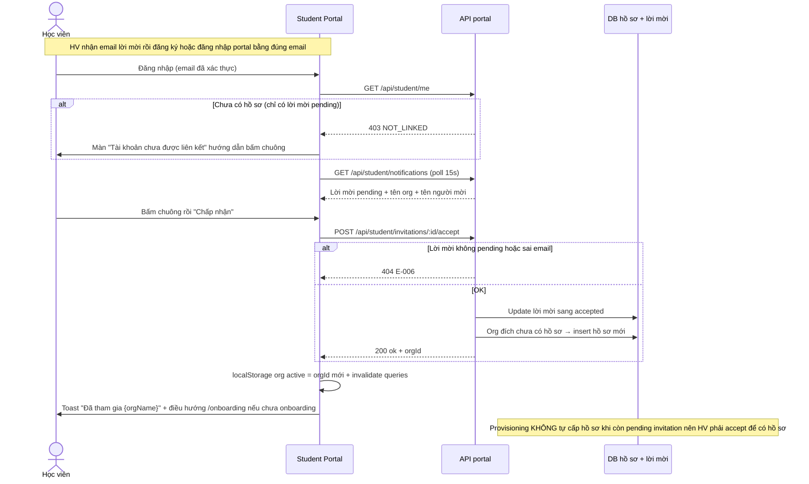

### Activity — Học viên chấp nhận lời mời

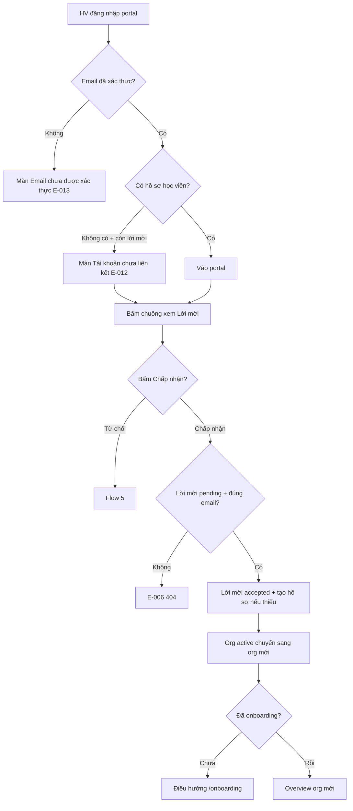

## Flow 5: HV từ chối lời mời

### Sequence — Học viên từ chối

```mermaid
sequenceDiagram
    actor HV as Học viên
    participant Portal as Student Portal
    participant API as API portal
    participant DB as DB lời mời
    HV->>Portal: Bấm "Từ chối" trên lời mời
    Portal->>API: POST /api/student/invitations/:id/reject
    alt Lời mời không pending hoặc sai email
        API-->>Portal: 404 E-006
    else OK
        API->>DB: Update status rejected
        API-->>Portal: 200 ok true
    end
    Portal->>Portal: Refresh danh sách lời mời
    Note over DB: Không tạo hồ sơ nào; GV không nhận thông báo nào (OQ-4)
    Note over DB: GV mời lại email rejected không bị cooldown 60s (BR-012 🔵)
```

### Activity — Học viên từ chối

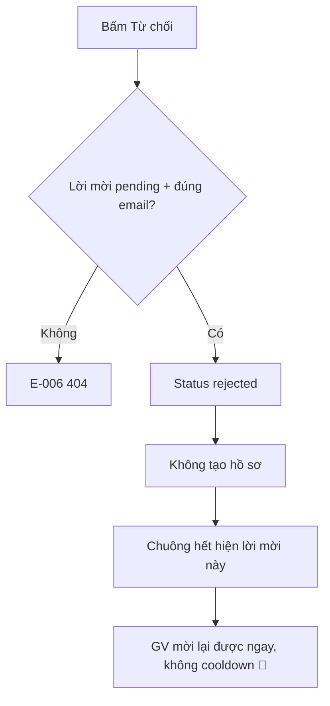

## Flow 6: HV chuyển org đang hoạt động (org switcher + header)

### Sequence — Chuyển org

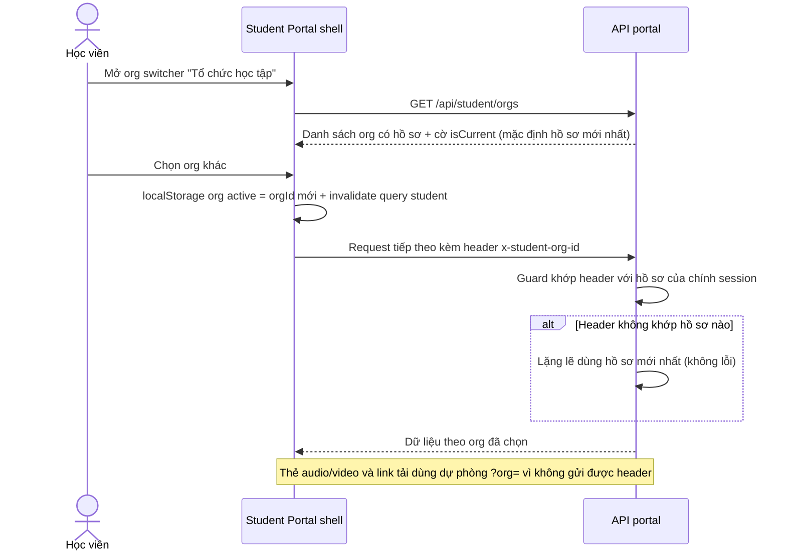

### Activity — Chuyển org

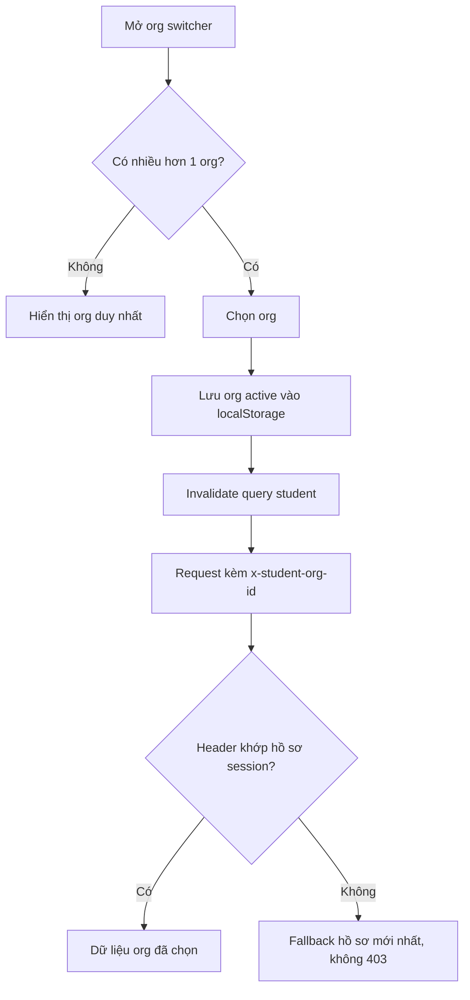

## Flow 7: GV tạo học viên thủ công cùng email → auto-accept lời mời pending

### Sequence — Tạo HV thủ công tự động chấp nhận lời mời

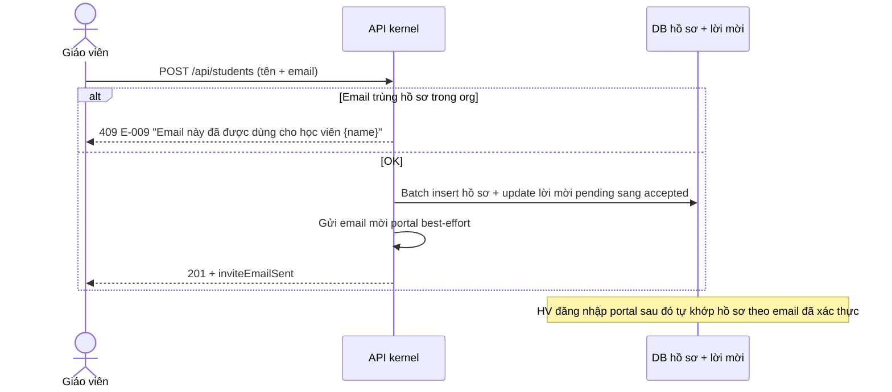

### Activity — Tạo HV thủ công auto-accept

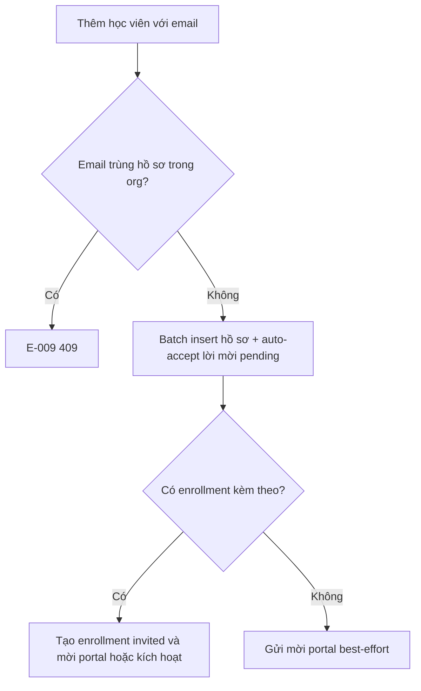
```
