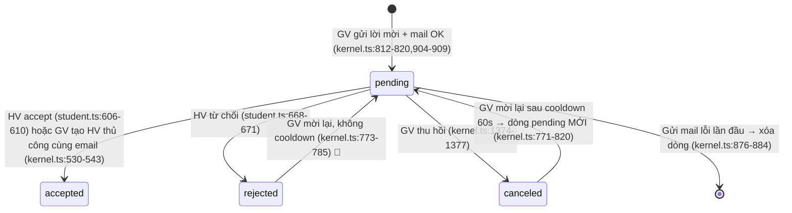
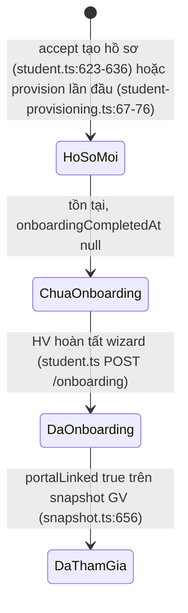

```markdown
---
type: reverse-srs-states
feature: student-invitations
updated: 2026-11-11
---

# student-invitations — States tái lập (reverse)

## State: Lời mời học viên (student_invitation.status)

> Nguồn: enum thật `pending | accepted | rejected | canceled` — `packages/db/src/schema/student-invitation.ts:23-26` (default `pending`), migration `packages/db/src/migrations/0025_spotty_betty_ross.sql:6`. Toàn bộ transition cite ở từng mũi tên.



**Ghi chú trạng thái:**

| Trạng thái | Ý nghĩa | Vào bằng | Ra bằng | Nguồn | Nhãn |
|-----------|---------|----------|---------|-------|------|
| pending | Đã tạo + đã gửi email, chờ HV phản hồi | POST /api/students/invite thành công | accept / reject / cancel / xóa khi mail lỗi | `apps/server/src/routes/kernel.ts:812-820` | ✅ |
| accepted | HV đã tham gia org (hoặc GV đã tạo hồ sơ thủ công cùng email); hồ sơ học viên tồn tại trong org đích | accept (portal) hoặc POST /api/students trùng email | kết thúc (không có transition ra trong code) | `apps/server/src/routes/student.ts:606-610`, `apps/server/src/routes/kernel.ts:530-543` | ✅ |
| rejected | HV từ chối; không tạo hồ sơ | reject (portal) | kết thúc; mời lại tạo dòng mới | `apps/server/src/routes/student.ts:668-671` | ✅ |
| canceled | GV thu hồi; dòng được giữ lại | DELETE /api/students/invitations/:id | kết thúc; mời lại trong 60s kể từ createdAt bị 429 | `apps/server/src/routes/kernel.ts:1374-1377,773-797` | ✅ |
| (đã xóa) | Lời mời không tồn tại khi mail gửi lỗi lần đầu — không phải giá trị status | mailer throw lúc invite | — | `apps/server/src/routes/kernel.ts:876-884` | ✅ |
| expired (hết hạn) | KHÔNG TỒN TẠI trong code — pending không tự hết hạn | — | — | negative-search `_evidence.md` §7 | 🟡 |

**Ghi chú vòng đời:**
- Uniqueness `pending` per (org, email) chỉ ràng buộc trạng thái `pending`; các trạng thái khác được phép trùng email thoải mái — `packages/db/src/schema/student-invitation.ts:38-40`. ✅
- Accept/reject/cancel yêu cầu status hiện tại `pending` ở bước ĐỌC; riêng accept/reject khi UPDATE không lặp lại điều kiện status (OQ-7) — `apps/server/src/routes/student.ts:607-610,668-671`. 🟡
- Không có trạng thái "đang gửi email" — email gửi đồng bộ trước khi trả 201; thất bại thì row bị xóa. ✅

## State: Hồ sơ học viên khi accept (student + portalLinked)

> Hồ sơ được TẠO khi accept nếu org đích chưa có; trạng thái "tham gia portal" xác định bởi `onboardingCompletedAt`.



**Ghi chú:**

| Trạng thái hồ sơ | Ý nghĩa nghiệp vụ | GV thấy gì | Nguồn | Nhãn |
|------------------|-------------------|------------|-------|------|
| Chưa onboarding + có email | "Chờ xác nhận" trong tab lời mời/Học viên (isPendingPortalStudent) | Badge "Chờ xác nhận" + nút gửi lại mời portal | `apps/web/src/lib/repos/students.ts:97-102`, `apps/web/src/routes/_auth/students/index.tsx:50` | ✅ |
| Đã onboarding | "Đã tham gia portal" (portalLinked true) | HV counted như đang hoạt động; gửi lại mời portal → 409 ALREADY_JOINED | `apps/server/src/routes/kernel.ts:1175-1183`, `apps/server/src/routes/snapshot.ts:656` | ✅ |
| Nhiều hồ sơ cùng email (khác org) | Học viên đa org; org active do header quyết | org-switcher portal hiển thị đủ danh sách | `apps/server/src/routes/student.ts:676-711`, `apps/server/src/student-invitation.test.ts:377-408` | ✅ |
```
