# srs/student-practice-reverse-flows — student-practice

Mỗi luồng có đủ 2 sơ đồ: sequence (tương tác) + flowchart (hoạt động). Số liệu trên nút
lấy từ code thật. Nhãn: ✅ code khẳng định, 🔵 suy luận ≥2 bằng chứng, 🟡 kèm OQ.

## F1 — Xem tổng quan luyện từ vựng

Nguồn: apps/student/src/routes/_auth/practice/vocabulary/index.tsx:1-333;
apps/server/src/routes/vocab.ts:562-743; apps/student/src/lib/repos/vocab.ts:1-234.

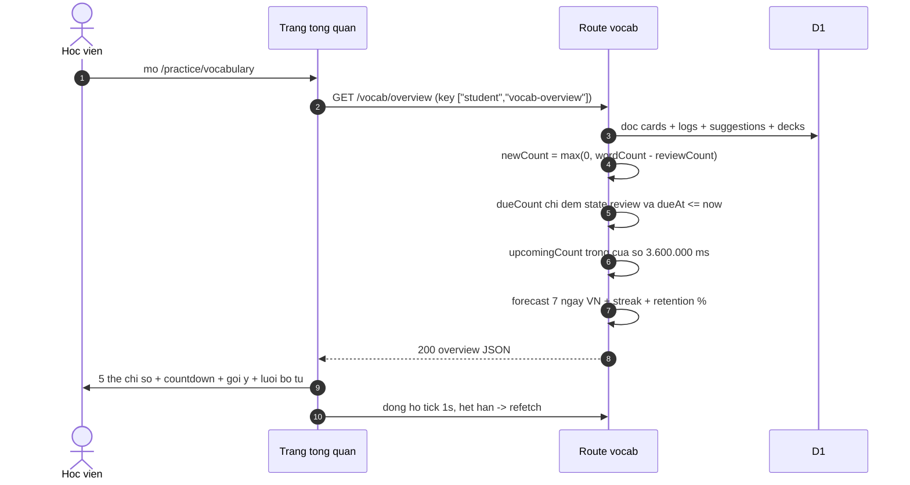

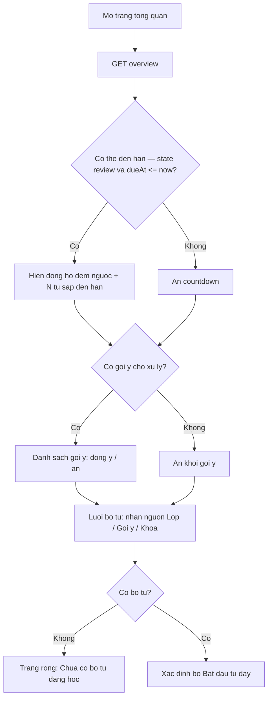

- ✅ dueCount chỉ đếm thẻ state review (vocab.ts:617-619); cửa sổ upcoming 3.600.000 ms
  (vocab.ts:58, vocab.ts:624-630).
- ✅ Chuỗi ngày theo ngày VN, mốc hôm nay hoặc hôm qua (vocab.ts:666-686).
- ✅ Wording empty: "Chưa có bộ từ đang học" (index.tsx:253-267); lỗi tải
  "Không tải được dữ liệu từ vựng. Vui lòng thử lại." (index.tsx:96-100).
- 🔵 refetch khi hết giờ: onExpired của vocab-countdown (vocab-countdown.tsx:12-24) +
  invalidation qua query key (repos/vocab.ts).

## F2 — Vào bộ từ: cấp thẻ + dữ liệu phiên

Nguồn: apps/server/src/routes/vocab.ts:887-916; apps/server/src/lib/vocab-provision.ts:81-108,
:368-594, :592-756; apps/student/src/routes/_auth/practice/vocabulary/$deckId.tsx:1-224.

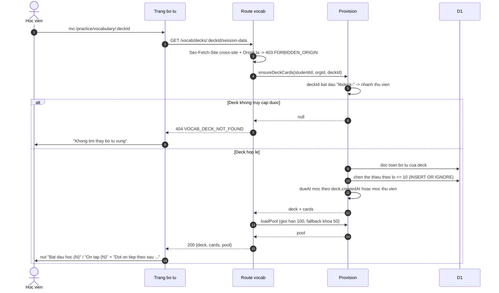

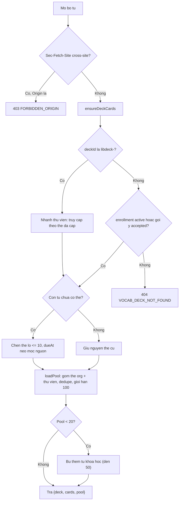

- ✅ Access predicate org deck: enrollment active HOẶC suggestion accepted
  (vocab-provision.ts:81-108); nhánh libdeck- (vocab-provision.ts:374).
- ✅ Chèn lô ≤10 — giới hạn 100 tham số bind của D1 (vocab-provision.ts:24-30); lazy
  INSERT OR IGNORE, race test (vocab.test.ts:304-321).
- ✅ Mốc dueAt org (vocab-provision.ts:419-431), thư viện (vocab-provision.ts:520-532).
- ✅ loadPool gộp + dedupe (vocab-provision.ts:599-608), giới hạn 100 (:686, :698),
  fallback khóa <20 → 50 (:721-740).
- ✅ UI: nút + disabled title "Chưa có từ nào để ôn"/"Đã học hết từ mới"
  ($deckId.tsx:130-176); "Đợt ôn tiếp theo sau X" ($deckId.tsx:123-130).

## F3 — Phiên học từ mới (Learn)

Nguồn: packages/api/src/srs/learn-session.ts:1-444; apps/server/src/routes/vocab.ts:1046-1161;
packages/api/src/srs/scheduler.ts:70-79; apps/student/src/components/vocab/vocab-session-view.tsx:102-334.

```mermaid
sequenceDiagram
    autonumber
    actor HV as Hoc vien
    participant ENG as LearnSession (client)
    participant SPA as View phien
    participant API as Route vocab
    participant DB as D1
    SPA->>ENG: khoi tao tu session-data (queue new dueAt asc, id asc)
    loop Moi tu trong phien
        ENG-->>SPA: buoc intro (the chua lat)
        HV->>SPA: lat the
        ENG-->>SPA: buoc nghe-chon hoac chon-nghia
        HV->>SPA: tra loi
        ENG-->>SPA: dung -> buoc tiep; sai -> thong bao + tu o cuoi hang doi
        ENG-->>SPA: buoc go tu hoac chon tu
        HV->>SPA: tra loi cuoi
        ENG-->>SPA: hoan tat tu -> onCommit(gradeGood = dung ngay lan dau)
        SPA->>API: POST /vocab/learn-commit {clientLogId uuid, cardId, gradeGood, durationMs}
        API->>API: clamp durationMs <= 3.600.000; 404 neu the khong thuoc HV
        API->>API: idempotency theo clientLogId (409 "log id conflict" neu clientLogId thuoc hoc vien khac)
        API->>API: learned(): level 1, state review, dueAt = now + 1 ngay
        API->>DB: batch: ghi log + cap nhat the (nguyen tu)
        API-->>SPA: 200 {card} — race replay tra lai ket qua cu
    end
    ENG-->>SPA: het queue -> tong ket phien
```

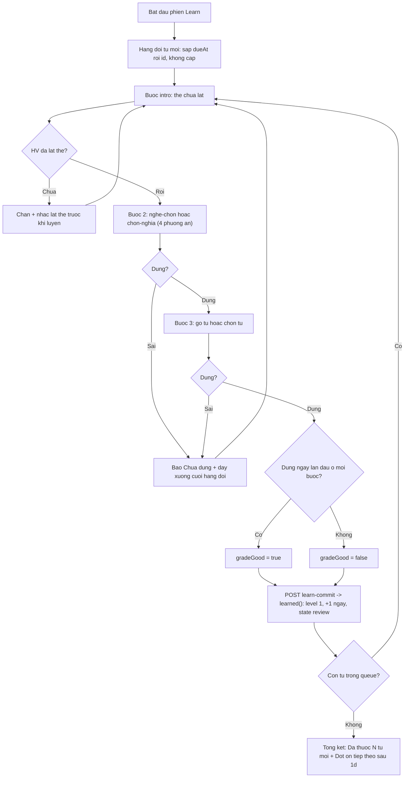

- ✅ Chuỗi bước + chặn chưa lật thẻ (learn-session.ts:70-83, learn-session.ts:194-230,
  wording intro tại vocab-session-view.tsx:631-694).
- ✅ gradeGood = first-try-correct, từ chỉ intro thì true (learn-session.ts:376-411,
  contracts.ts:3595-3607).
- ✅ `learned()` luôn về mức 1, 1 ngày, state review (scheduler.ts:70-79); e2e countdown
  /^(1d 0h|23:59)/ + "Đợt ôn tiếp theo sau 1d" (vocab-srs.spec.ts:359-486).
- ✅ Sai → đẩy cuối hàng đợi trong phiên (learn-session.ts:279-302); commit idempotent +
  batch + replay (vocab.ts:1046-1161, vocab.test.ts:421-487, vocab.test.ts:488-539).

## F4 — Phiên ôn tập (Review)

Nguồn: packages/api/src/srs/review-session.ts:1-394; apps/server/src/routes/vocab.ts:918-1044;
packages/api/src/srs/scheduler.ts:27-65.

```mermaid
sequenceDiagram
    autonumber
    actor HV as Hoc vien
    participant ENG as ReviewSession (client)
    participant SPA as View phien
    participant API as Route vocab
    participant DB as D1
    SPA->>ENG: khoi tao tu pool (state review, dueAt asc, xao tron)
    alt Khong con the den han
    HV->>SPA: nhan "On tap" khi dem = 0
    Note over ENG: fallback cho phep on som: lay toan bo pool theo dueAt
    end
    loop Moi the
        ENG-->>SPA: prompt minigame (4 lua chon / go tu / tu danh gia)
        HV->>SPA: tra loi
        ENG-->>SPA: verdic "Chinh xac" / "Chua dung" / "Chua nho"
        SPA->>API: POST /vocab/answer {clientLogId, cardId, correct, durationMs}
        API->>API: clamp durationMs <= 3.600.000
        alt The chua den han (dueAt > now) hoac state new
            API-->>SPA: 200 tra card, KHONG ghi log, KHONG doi lich
        else Den han binh thuong
            API->>API: applyAnswer: dung +1; sai L2-4 giu 1; sai L5 -> warning; sai L5 warning -> L1
            API->>DB: batch log + card
            API-->>SPA: 200 {card} (replay neu rac)
        end
        ENG-->>ENG: sai 5 cau lien tiep -> overlay khich le
        ENG-->>ENG: "Chua nho" lan 1 -> requeue vi tri 4-5, lan 2 -> loai khoi phien (done +1)
    end
    ENG-->>SPA: tong ket phien review
```

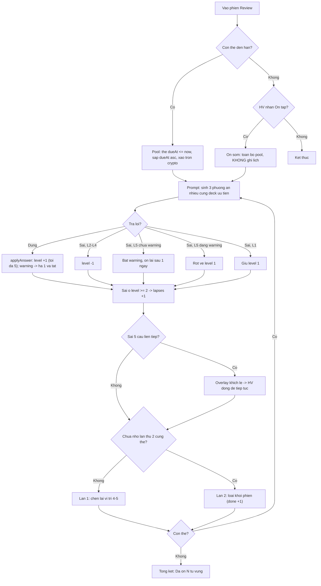

- ✅ Pool chỉ state review, sort hạn, fallback ôn sớm (review-session.ts:96-119).
- ✅ Chuyển đổi applyAnswer đủ nhánh (scheduler.ts:27-65) + bất biến warning chỉ ở mức 5
  (schema/vocab.ts:84-94); vectors 14 ca đáp án (level-vectors.json, scheduler.test.ts:14).
- ✅ Cross-session guard: state new hoặc dueAt > now → trả card, không log, không đổi lịch
  (vocab.ts:962-977) — BR-04 🟡 OQ-04.
- ✅ Encouragement 5 (review-session.ts:55, :183-247); forgot-cap 2 + requeue splice(4 +
  rng.nextInt(2)) (:253-286, :368-371); verdict whitelist 3 chuỗi (vocab-feedback-panel.tsx:50-66).
- ✅ Persist lỗi → "Không lưu được kết quả học do lỗi kết nối..." + Thử lại/Bỏ qua
  (vocab-feedback-panel.tsx:92-118).

## F5 — Gợi ý bộ từ của giáo viên

Nguồn: apps/server/src/routes/vocab.ts:744-885; apps/student/src/routes/_auth/practice/vocabulary/index.tsx:55-82;
apps/student/src/components/vocab/vocab-suggestion-list.tsx:93-108.

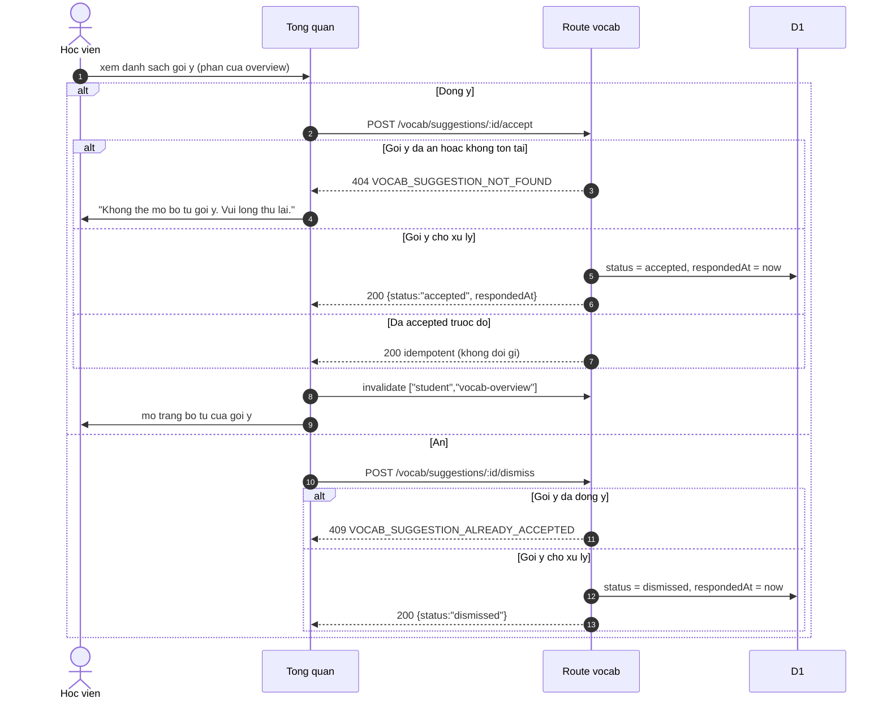

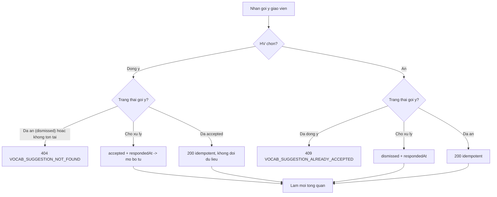

- ✅ Trạng thái suggestion: pending → accepted | dismissed, kèm respondedAt
  (schema/vocab.ts:159-203, contracts.ts:3469-3491).
- ✅ Accept: 404 khi thiếu/đã dismissed (vocab.ts:773-781), idempotent khi đã accepted
  (:783-796). Dismiss: 409 khi accepted (vocab.ts:857-865).
- ✅ Wording lỗi client: "Không thể mở bộ từ gợi ý. Vui lòng thử lại." (index.tsx:61-63),
  "Không thể ẩn gợi ý. Vui lòng thử lại." (index.tsx:77-79).
- 🔵 Sau accept client mở thẳng trang bộ từ (index.tsx:55-63 navigate) + invalidate overview.

## F6 — Khóa học từ vựng thư viện

Nguồn: apps/server/src/routes/vocab.ts:353-561; apps/student/src/routes/_auth/practice/vocabulary/courses/index.tsx:1-227;
apps/student/src/routes/_auth/practice/vocabulary/courses/$courseId.tsx:1-266; packages/db/src/schema/vocab-library.ts:1-83.

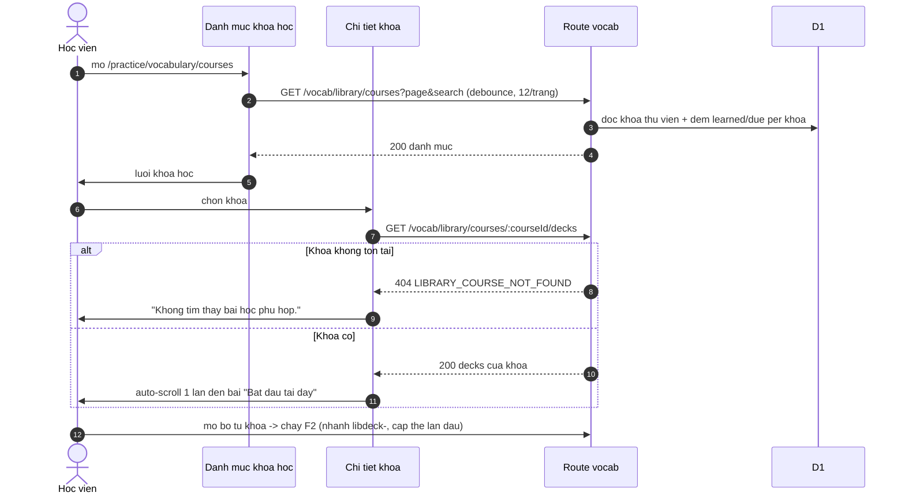

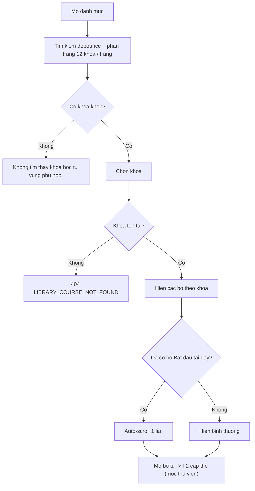

- ✅ Danh mục 12/trang (contracts.ts:2238), search debounce (courses/index.tsx:44-57),
  empty "Không tìm thấy khóa học từ vựng phù hợp." (:104-115).
- ✅ 404 LIBRARY_COURSE_NOT_FOUND (vocab.ts:461-469); chi tiết empty "Không tìm thấy bài
  học phù hợp." ($courseId.tsx:180-190); auto-scroll "Bắt đầu tại đây" ($courseId.tsx:74-95).
- ✅ Tiền tố dự phòng libcourse-/libdeck-/libword- (contracts.ts:3137-3147); khóa học
  dùng chung, không gắn org (schema/vocab-library.ts:1-83, migration 0037).
- 🟡 Truy cập bộ thư viện = đã có thẻ cấp cho học viên đó; "đăng ký" ngầm định là lần mở
  bộ từ đầu tiên — không có nút đăng ký tách biệt (liên quan OQ-10; xem BR-09/OQ-06 về mốc).

## F7 — Phát âm thanh

Nguồn: apps/server/src/routes/vocab.ts:167-287, :1163-1245;
apps/student/src/components/vocab/vocab-pronunciation-buttons.tsx:1-119.

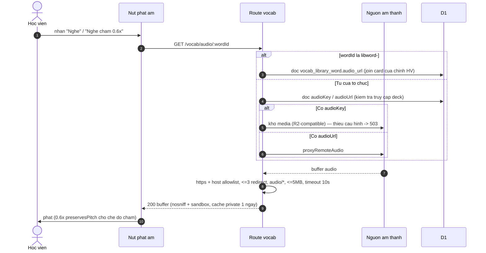

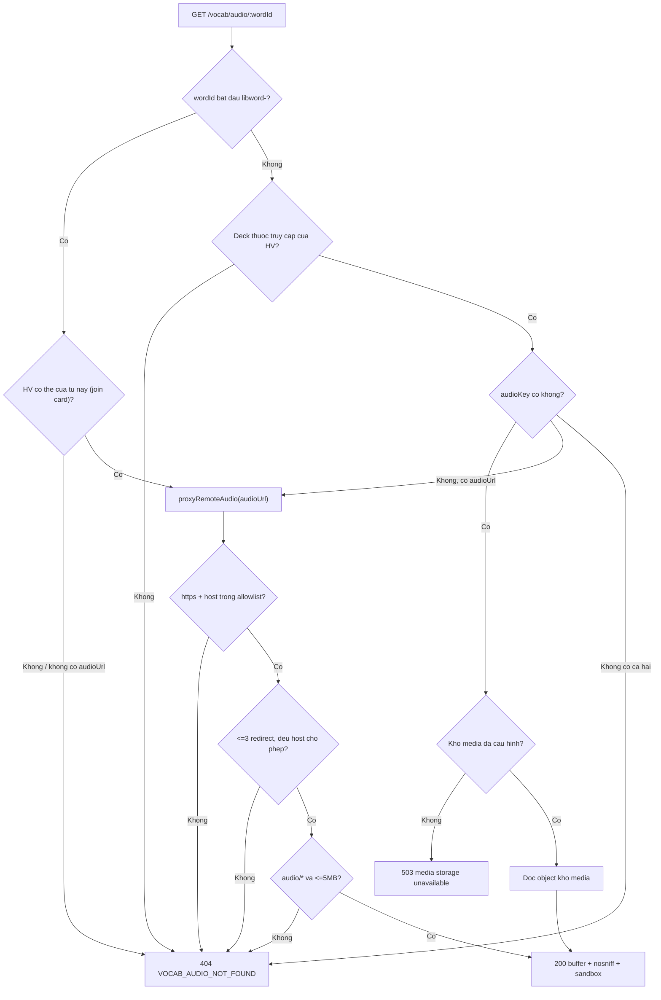

- ✅ Allowlist 2 host cố định, timeout 10 s, ≤3 redirect (vocab.ts:167-176); mọi nhánh lỗi
  upstream đồng nhất 404 (vocab.ts:177-287) — INF-3.
- ✅ libword- join thẻ của chính học viên (chống đọc chéo) (vocab.ts:1221-1228); org word
  qua access predicate (vocab.ts:1173-1192); 503 khi thiếu store (vocab.ts:1183-1190).
- ✅ Nút "Nghe" / "Nghe chậm" 0.6x preservesPitch (vocab-pronunciation-buttons.tsx:7-20).

## F8 — Duyệt catalog luyện đề và bắt đầu đề (phân hệ B)

Nguồn: apps/server/src/routes/student-practice.ts:229-364, :412-470;
apps/student/src/routes/_auth/practice/$skill.tsx:1-191;
apps/student/src/components/practice/skill-catalog.tsx:1-197; apps/student/src/lib/repos/student.ts:521-620.

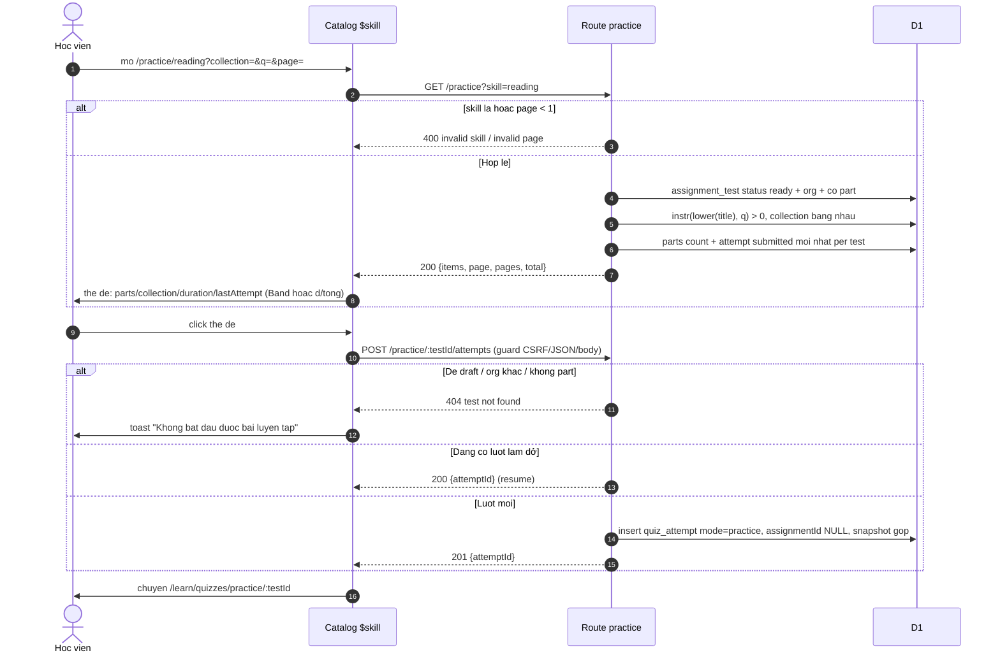

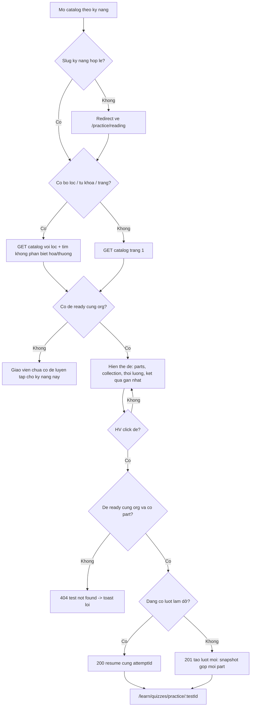

- ✅ 4 kỹ năng + không Dictation (contracts.ts:347-355, :2235; test skill=dictation → 400
  student-practice.test.ts:386-395); slug sai → redirect reading ($skill.tsx:31-38).
- ✅ instr thay LIKE chống wildcard (student-practice.ts:251-266); orderBy desc
  createdAt,id (:275-281); phân trang 12 (contracts.ts:2238).
- ✅ lastAttempt chỉ đếm lượt submitted của chính học viên, status "graded" khi có
  gradeScores + gradedAt (student-practice.ts:297-341; contracts.ts:2241-2253).
- ✅ Idempotent resume 200 / tạo mới 201 (student-practice.ts:412-470; test :438-491);
  test "Luyện tập › Reading: mở đề seed → nộp → thấy điểm" (e2e :120-158) — practice tự
  start không qua gate dialog như assignment.

## F9 — Làm và nộp đề luyện, xem điểm (phân hệ B)

Nguồn: apps/server/src/routes/student-practice.ts:367-410;
apps/student/src/routes/_auth/learn/quizzes/practice/$testId.tsx:1-50;
apps/student/src/lib/repos/quiz.ts:32-48, :176-186; apps/server/src/routes/student.ts:1919;
apps/server/src/routes/student-practice.ts:118-142.

```mermaid
sequenceDiagram
    autonumber
    actor HV as Hoc vien
    participant TAKE as Man lam de
    participant API as Route practice + quiz chung
    participant DB as D1
    TAKE->>API: GET /practice/:testId/quiz
    API->>DB: de ready + attempt in_progress gan nhat
    alt Co luot da nop o tab khac
        API-->>TAKE: attempt status submitted
        TAKE->>HV: redirect thang trang tong ket
    else Chua co / dang lam
        API-->>TAKE: 200 StudentQuizDetail (khung part dau + cau gop moi part)
    end
    HV->>TAKE: tra loi tung cau (autosave qua may attempt chung)
    HV->>TAKE: Nop bai
    TAKE->>API: POST /api/student/attempts/:attemptId/submit (dung chung)
    API->>DB: cham tu snapshot -> correctCount
    API-->>TAKE: counters
    TAKE->>HV: tong ket: dung/tong (tu cham) — ghi am/noi cho giao vien cham -> Band
    Note over API: KHONG stamp bai tap lop; KHONG vao bang diem lop #378
```

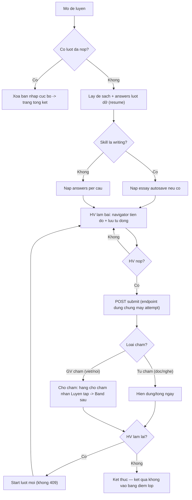

- ✅ Lượt submitted ở tab khác → redirect summary; không redirect khi chưa có lượt dở
  ($testId.tsx:6-26); writing nạp essay (photo :28-33).
- ✅ Nộp qua endpoint dùng chung /api/student/attempts/:attemptId/submit
  (repos/quiz.ts:176-186, student.ts:1919) — vòng đời attempt chi tiết thuộc feature
  student-quiz (cross-ref, không nhân bản).
- ✅ Đề Viết luyện vào hàng chờ chấm với nhãn "Luyện tập"; không lọt bảng điểm lớp /
  attemptByTarget (student-practice.test.ts:646-758); e2e KHÔNG lọt bảng điểm lớp
  (:159-178).
- ✅ Band: ieltsOverallBand = round(mean*2)/2; formatBand toFixed(1)
  (ielts-band.ts:143-152); nhãn "Band x.x" từ gradeScores + gradedAt
  (student-practice.ts:118-142).
