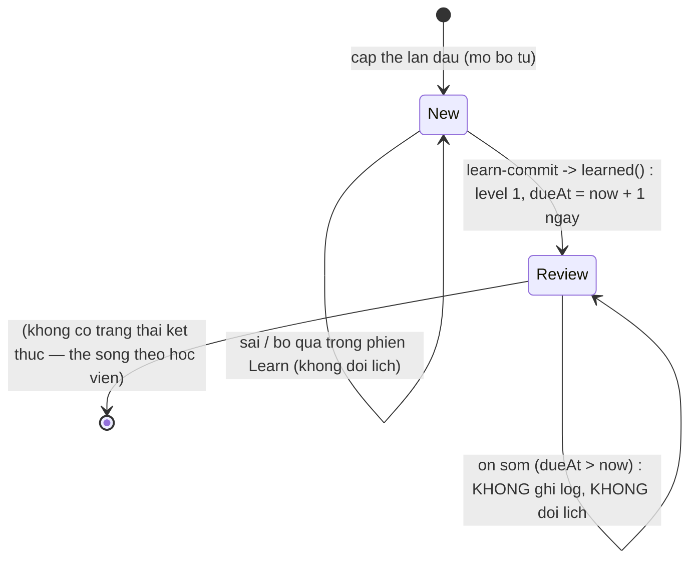
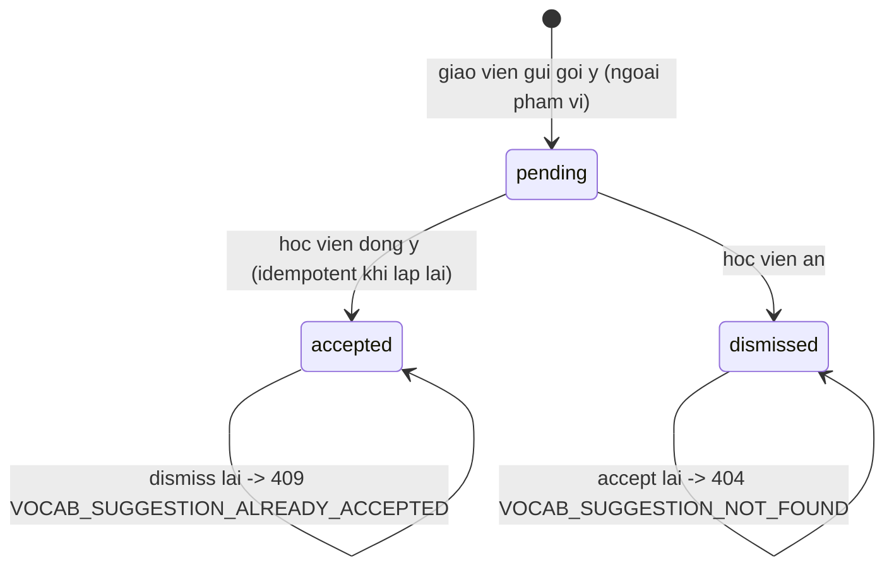
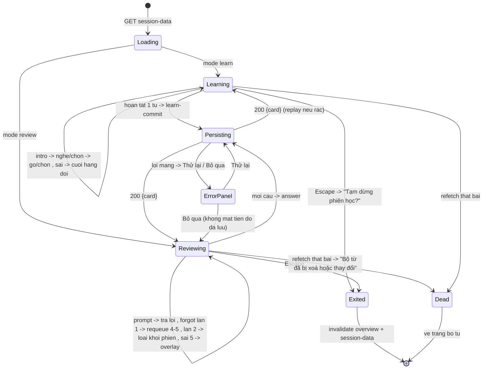

# srs/student-practice-reverse-states — student-practice

Ba máy trạng thái: (1) thẻ SRS — máy chính (complexity_flag: state-machine);
(2) gợi ý; (3) phiên học phía client (UI, không bền). Tên trạng thái giữ "từ vựng
hợp đồng" (state = new | review; level 1-5; isWarning; suggestion status = pending |
accepted | dismissed).

## 1. Thẻ SRS của học viên (vocab_card)

Trạng thái phức hợp: `state` (new → review, một chiều) × `level` (1-5) × `isWarning`
(chỉ hợp lệ ở level 5). Bộ lập lịch chỉ đọc `dueAt` (epoch ms UTC); `intervalDays`
chỉ để hiển thị.

Chứng thực:

- Cấp thẻ: `INSERT OR IGNORE` theo unique (studentId, wordId), lô ≤10 —
  apps/server/src/lib/vocab-provision.ts:368-594, packages/db/src/schema/vocab.ts:84-124. ✅
- new → review chỉ qua `learned()`: level 1, dueAt = now + 1 ngày —
  packages/api/src/srs/scheduler.ts:70-79; e2e countdown "1d 0h"/"23:59" —
  apps/e2e/specs/vocab-srs.spec.ts:359-486. ✅
- Chuyển đổi ôn: đủ nhánh applyAnswer — packages/api/src/srs/scheduler.ts:27-65;
  vectors 14 ca — packages/api/src/srs/scheduler.test.ts:14,
  packages/api/src/srs/vectors/level-vectors.json:1-1024. ✅
- Bất biến warning chỉ ở level 5 — packages/db/src/schema/vocab.ts:84-94 (comment
  invariants). ✅
- Ôn sớm không ghi: guard state new / dueAt > now — apps/server/src/routes/vocab.ts:962-977;
  test — apps/server/src/routes/vocab.test.ts:626-657. ✅ (ý nghĩa nghiệp vụ 🟡 OQ-04)
- Khoảng chuẩn theo mức 1/3/7/14/30 ngày; warning → 1 ngày —
  packages/api/src/srs/scheduler.ts:1-7. ✅
- lapses +1 khi sai ở level ≥2 — packages/api/src/srs/scheduler.ts:27-65. ✅

## 2. Gợi ý bộ từ (vocab_suggestion)

Chứng thực:

- Accept: 404 khi thiếu/đã dismissed — apps/server/src/routes/vocab.ts:773-781;
  idempotent khi đã accepted — apps/server/src/routes/vocab.ts:783-796. ✅
- Dismiss: 409 khi accepted — apps/server/src/routes/vocab.ts:857-865. ✅
- respondedAt ghi ở cả hai chuyển — packages/api/src/contracts.ts:3469-3491
  (schema mutation response). ✅
- Trên surface học viên không có route nào đưa accepted/dismissed về pending. Phía giáo
  viên, re-suggest lên deck đã dismissed flip status về pending (upsert per
  (studentId, deckId)) — packages/db/src/schema/vocab.ts:159-166 (comment schema). ✅
  (ngoài phạm vi feature này, ghi để khỏi đọc nhầm máy trạng thái)

## 3. Phiên học phía client (UI, không bền)

Server không giữ trạng thái phiên; máy dưới đây sống trong bộ nhớ tab
(khóa engine `${deckId}:${sessionNonce}:${mode}` — apps/student/src/components/vocab/vocab-session-view.tsx:102).

Chứng thực:

- Engine key + swap — vocab-session-view.tsx:102; persist đệm/replay
  (vocab-session-view.tsx:62-88, :198-231); selfCheck 240 ms (:279-300);
  Enter/Escape (:302-334); dialog xóa (:524-551); exit confirm (:553-586). ✅
- Panel lỗi lưu: "Không lưu được kết quả học do lỗi kết nối..." + Thử lại/Bỏ qua —
  apps/student/src/components/vocab/vocab-feedback-panel.tsx:92-118. ✅
- Bỏ qua KHÔNG mất tiến trình đã lưu (log từng lượt độc lập) — vocab.ts:979-1026; vocab.ts:1046-1161 (learn-commit cùng pattern idempotent). 🔵
- Exit invalidate: apps/student/src/routes/_auth/practice/vocabulary/$deckId.session.tsx:46-60. ✅
