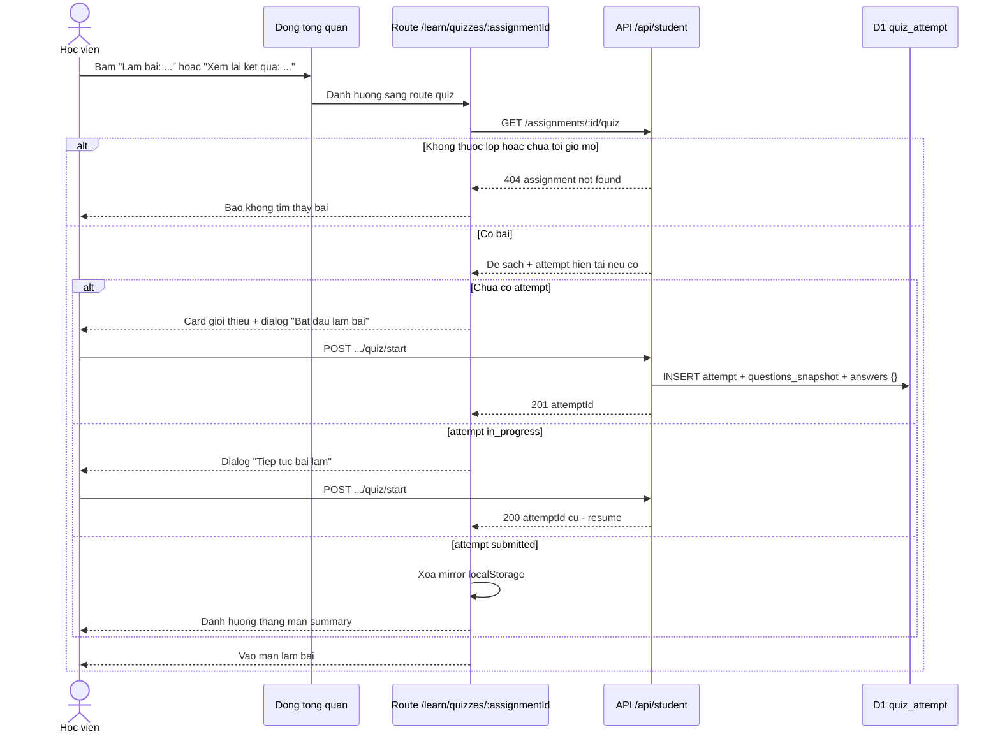
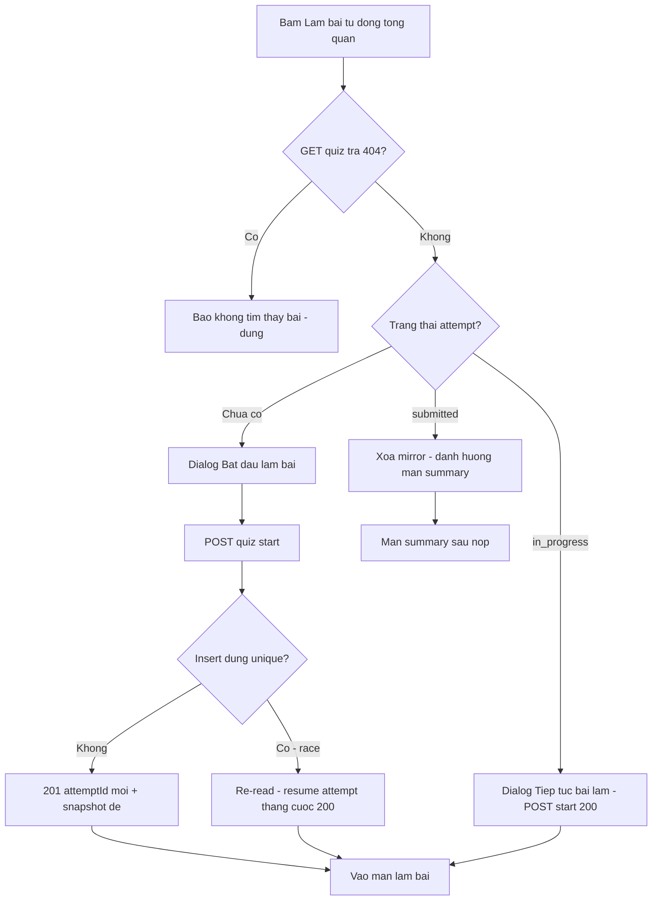
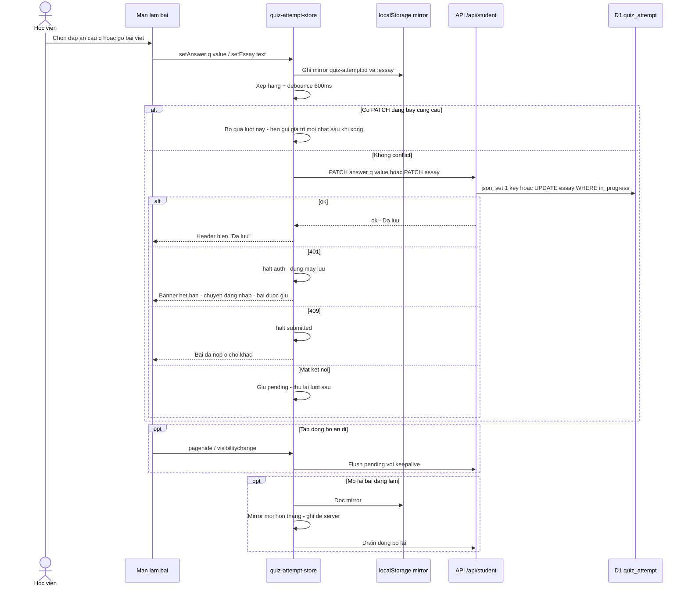
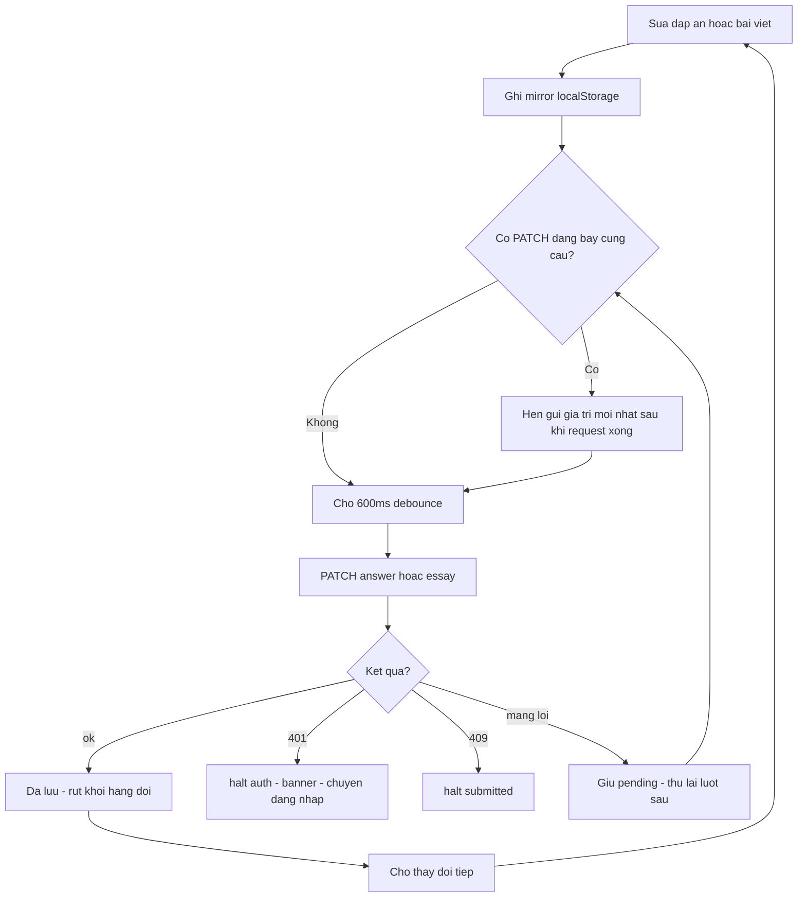
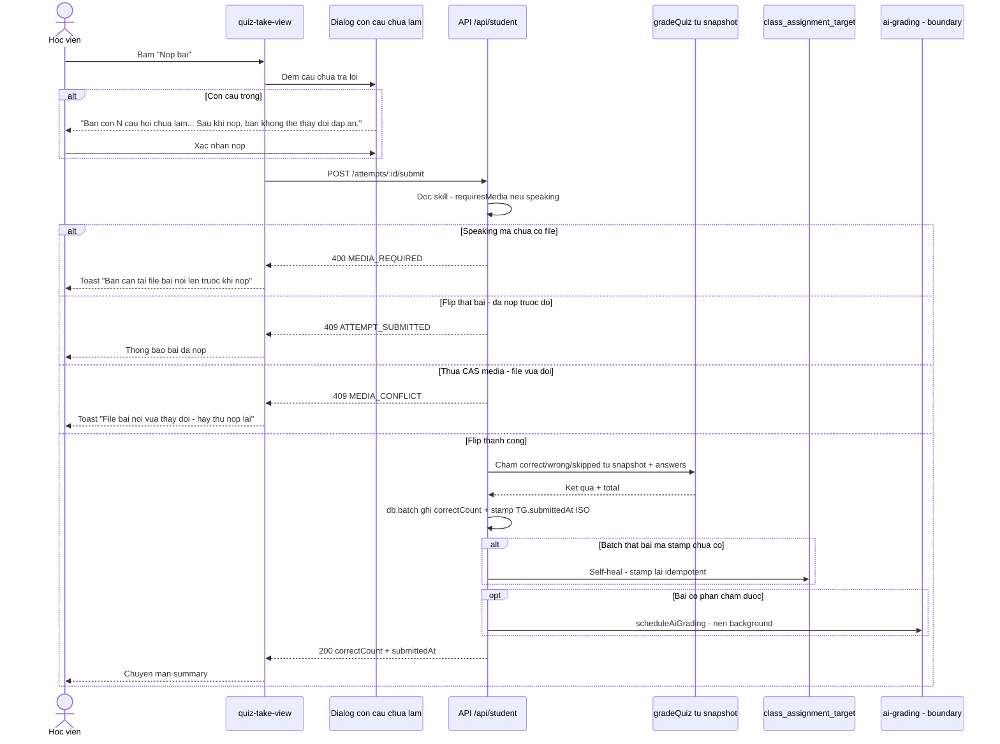
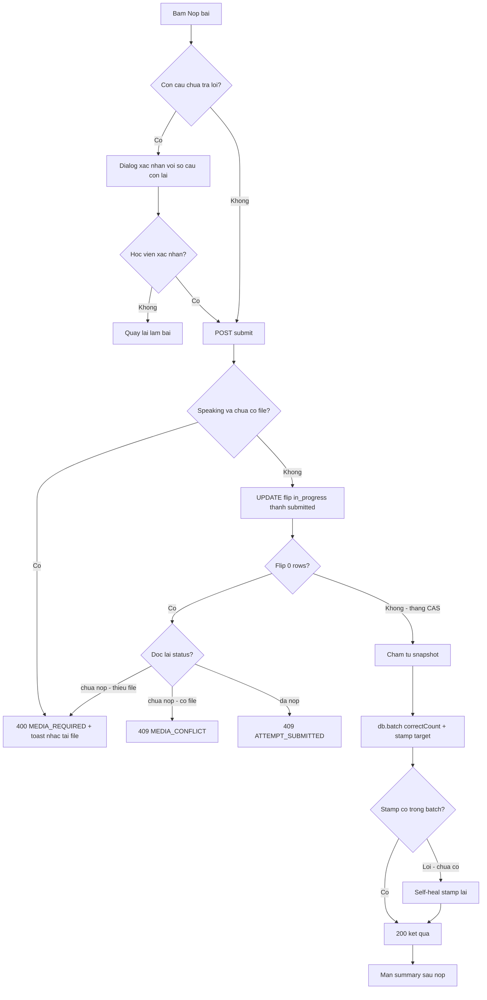
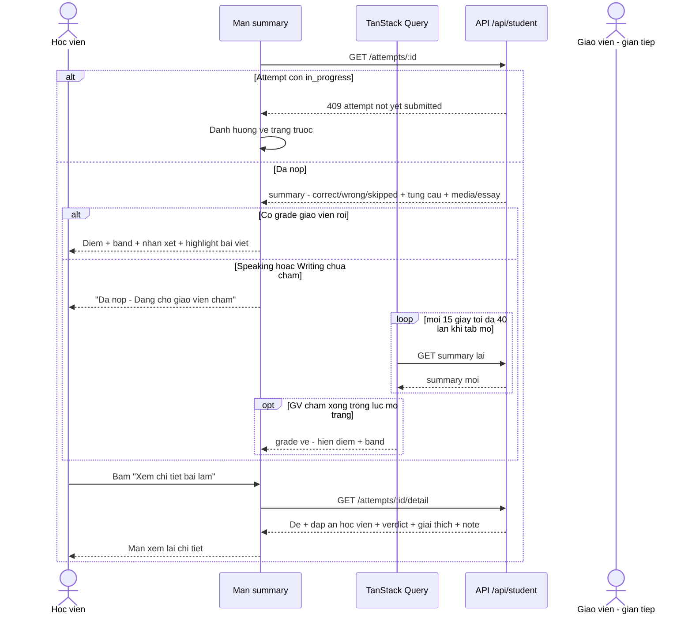
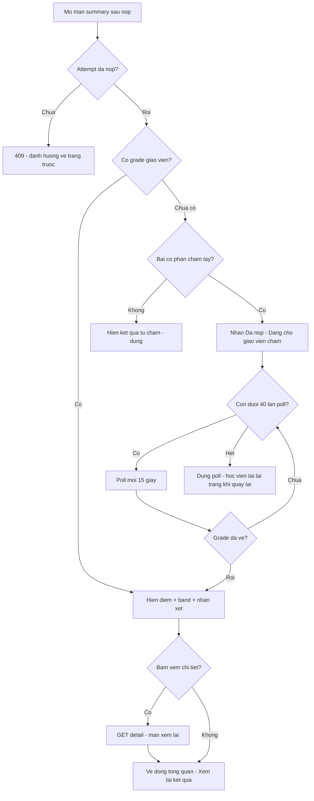
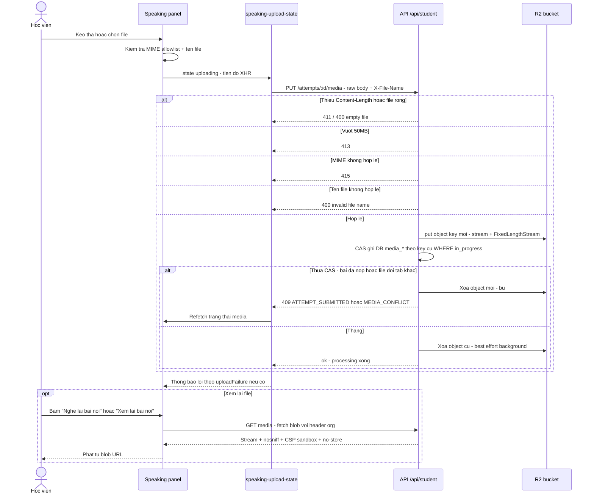
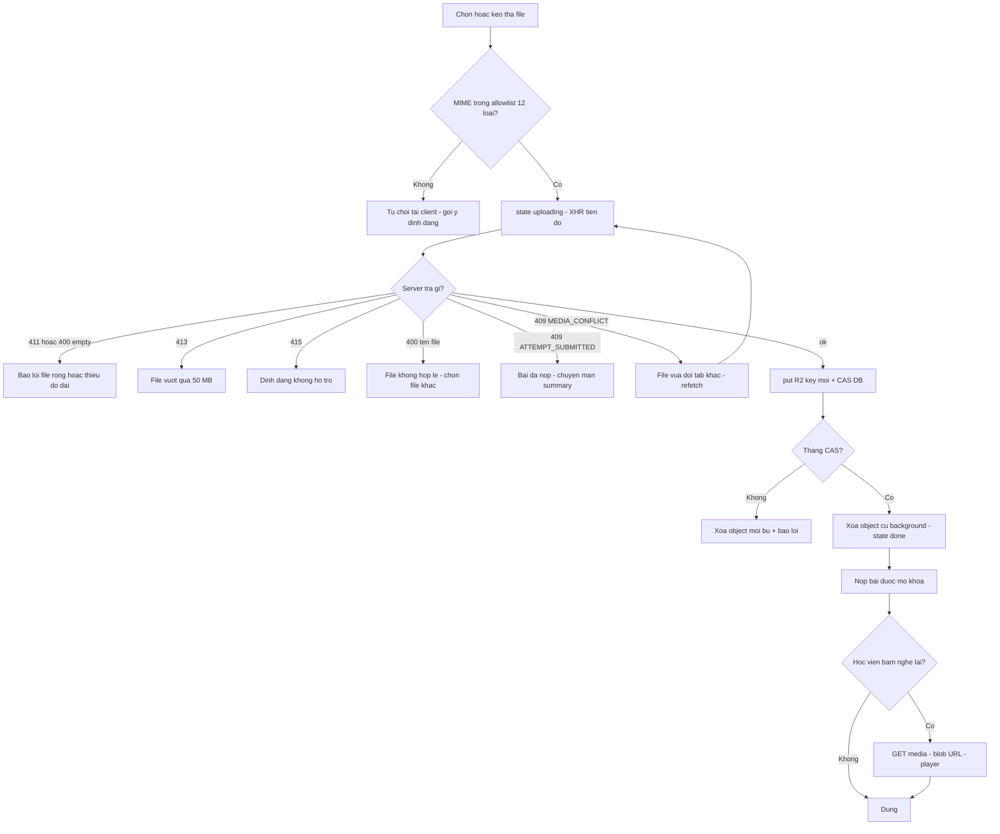

# student-quiz — Flows tái lập (reverse)

> Quy ước: mọi nhãn đều truy vết được trong code (cite ở `_evidence.md`). Không vẽ bước không có trong code. Trong sơ đồ, văn bản bỏ dấu theo tập ký tự ASCII an toàn cho Mermaid.

## Flow 1: Mở quiz và bắt đầu bài làm (F1 / UC-01)

> Nguồn: [S1] `apps/server/src/routes/student.ts:1333-1549`, [S13] `apps/student/src/routes/_auth/learn/quizzes/$assignmentId.tsx:20-62`, [S17] `apps/student/src/components/quiz/quiz-lifecycle-dialogs.tsx:110-150`. — ✅

### Sequence — Mở quiz và bắt đầu

### Activity — Mở quiz và bắt đầu

## Flow 2: Trả lời câu hỏi và tự lưu (F2 / UC-02)

> Nguồn: [S12] `apps/student/src/lib/quiz-attempt-store.ts:108-360`, [S1] `apps/server/src/routes/student.ts:1552-1686`, [S16] `apps/student/src/components/quiz/quiz-take-view.tsx:495-505`. — ✅

### Sequence — Trả lời và tự lưu

### Activity — Trả lời và tự lưu

## Flow 3: Nộp bài (F3 / UC-03)

> Nguồn: [S1] `apps/server/src/routes/student.ts:1911-2051`, [S17] `apps/student/src/components/quiz/quiz-lifecycle-dialogs.tsx:160-181`, [S16] `apps/student/src/components/quiz/quiz-take-view.tsx:288-310`, [S8] `packages/api/src/lib/grade-quiz.ts:56-72`. — ✅

### Sequence — Nộp bài

### Activity — Nộp bài

## Flow 4: Xem kết quả và chờ điểm giáo viên (F4 / UC-04)

> Nguồn: [S1] `apps/server/src/routes/student.ts:2053-2405`, [S11] `apps/student/src/lib/repos/quiz.ts:188-248`, [S14] `apps/student/src/routes/_auth/learn/quizzes/attempt/$attemptId.tsx:126-300`, [S15] `apps/student/src/routes/_auth/learn/quizzes/attempt/$attemptId.detail.tsx`. — ✅

### Sequence — Xem kết quả và chờ điểm

### Activity — Xem kết quả và chờ điểm

## Flow 5: Tải lên và nghe lại file bài nói (F5 / UC-05)

> Nguồn: [S1] `apps/server/src/routes/student.ts:1691-1909`, [S18] `apps/student/src/components/quiz/speaking-submission-panel.tsx:316-578` + `apps/student/src/components/quiz/speaking-upload-state.ts:14-110`, [S19] `apps/student/src/components/quiz/quiz-media-player.tsx`, [S26] `apps/server/src/lib/r2-media-store.ts:14-48`. — ✅

### Sequence — File bài nói

### Activity — File bài nói

