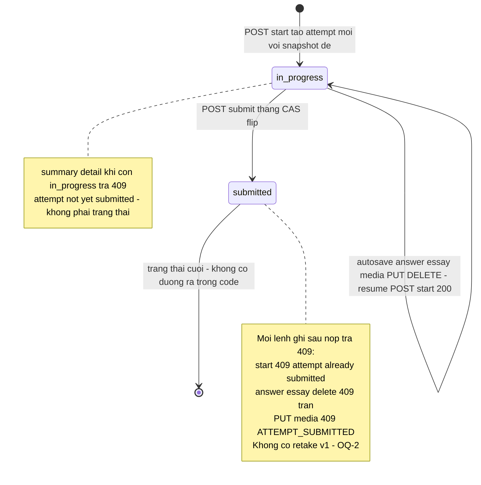
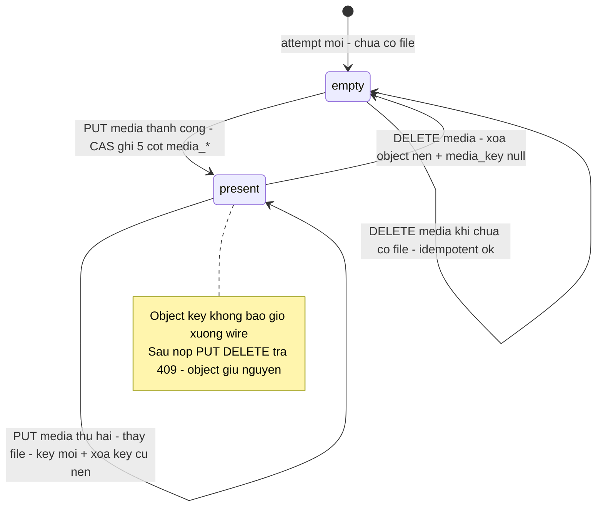
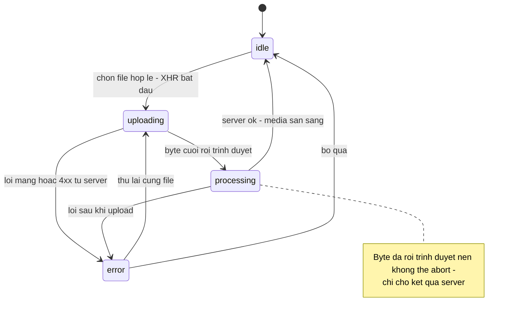
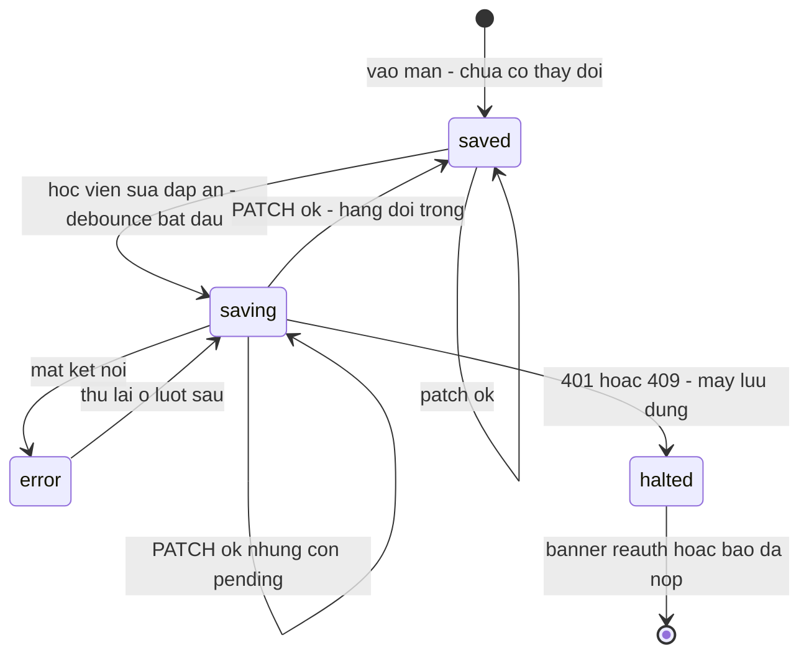
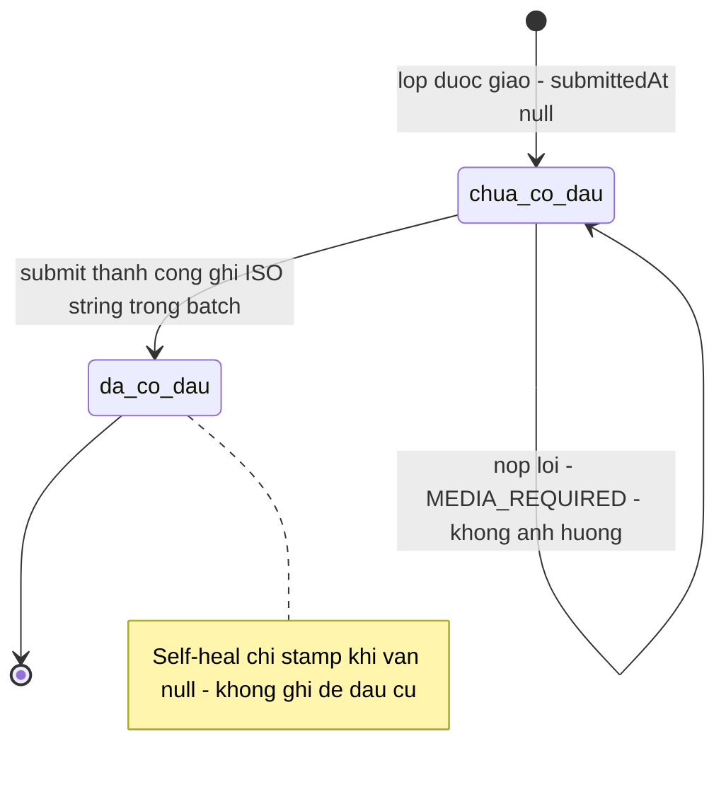

# student-quiz — States tái lập (reverse)

## State 1: Vòng đời một attempt (giá trị `status` thật: `in_progress` | `submitted`)

> Nguồn: [S2] `packages/db/src/schema/quiz-attempt.ts:62` (default `in_progress`, hai giá trị), [S1] `apps/server/src/routes/student.ts:1461-1549` (đường vào `in_progress`), `:1919-2051` (đường vào `submitted`), `:1506,1544,1596,1623,1662,1683,1742,1804,1877` (các đường bị chặn). — ✅

**Bảng trạng thái:**

| Trạng thái (giá trị thật) | Ý nghĩa | Vào bằng | Ra bằng | Nguồn | Nhãn |
|---|---|---|---|---|---|
| `in_progress` | Bài đang làm; mọi autosave hợp lệ | Tạo mới lúc start; giữ nguyên qua các PATCH/PUT/DELETE | Submit thắng CAS | `apps/server/src/routes/student.ts:1478-1485,1944-1952` | ✅ |
| `submitted` | Đã chốt; đọc-only trừ `grade_*` (giáo viên) | Submit thắng CAS; race nộp kép thua CAS → 409 | Không có đường ra trong code | `apps/server/src/routes/student.ts:1944-1984`; test `apps/server/src/routes/student-quiz.test.ts:731-773` | ✅ |

**Các đường "không đổi trạng thái" (rejected — không phải trạng thái):** start khi đã nộp → 409; PATCH answer/essay sau nộp → 409; PUT/DELETE media sau nộp → 409 `ATTEMPT_SUBMITTED` (object R2 không bị đụng tới); submit đề Speaking thiếu file → 400 `MEDIA_REQUIRED`, flip không xảy ra, target không bị đóng dấu. — ✅ [S1] `apps/server/src/routes/student.ts:1506,1596,1623,1662,1683,1742,1804,1877,1982-1984`; test [S24] `apps/server/src/routes/student-quiz-media.test.ts:419-451`.

**Self-heal (không đổi trạng thái):** flip thắng nhưng `db.batch` lỗi trước khi đóng dấu → request sau phát hiện `submittedAt === null` trên target và stamp bù (idempotent). — ✅ [S1] `apps/server/src/routes/student.ts:2023-2045`; test `apps/server/src/routes/student-quiz.test.ts:774-793`.

**Nhánh practice (ranh giới):** cùng hai trạng thái, `mode='practice'`, không có lượt giao nên không đóng dấu target; start qua route `/api/student/practice/:testId/attempts`. — ✅ [S2] `packages/db/src/schema/quiz-attempt.ts:33-41`, [S32] `apps/server/src/routes/student-practice.ts:412`.

## State 2: File bài nói trên attempt (cột `media_key` + 4 cột metadata)

> Nguồn: [S2] `packages/db/src/schema/quiz-attempt.ts:66-70`, [S1] `apps/server/src/routes/student.ts:1699-1881`. — ✅

**Bảng trạng thái:**

| Trạng thái | Ý nghĩa | Vào bằng | Ra bằng | Nguồn | Nhãn |
|---|---|---|---|---|---|
| `empty` (media_key NULL) | Chưa có file; đề Speaking khoá nút nộp | Attempt mới; sau DELETE thành công | PUT media hợp lệ | `apps/server/src/routes/student.ts:1824-1881` | ✅ |
| `present` (media_key có giá trị) | Có đúng 1 file trong R2; GET media phát được | PUT media thắng CAS | PUT thay (key mới) hoặc DELETE | `apps/server/src/routes/student.ts:1745-1804` | ✅ |

**CAS hai phía:** object R2 ghi TRƯỚC với key mới, DB ghi SAU bằng UPDATE … WHERE `media_key` IS NULL (lần đầu) hoặc = key cũ (lần thay) + `status='in_progress'`; thua CAS xoá object mới bù, thắng xoá object cũ nền. — ✅ [S1] `apps/server/src/routes/student.ts:1691-1698` (docblock), `:1751-1804`; test [S24] `apps/server/src/routes/student-quiz-media.test.ts:669-707`.

## State 3: Máy trạng thái tải lên phía client (`speaking-upload-state`)

> Nguồn: [S18] `apps/student/src/components/quiz/speaking-upload-state.ts:14-44`. — ✅

**Bảng trạng thái:**

| Trạng thái | Ý nghĩa | Vào bằng | Ra bằng | Nguồn | Nhãn |
|---|---|---|---|---|---|
| `idle` | Không có lượt tải đang chạy | Ban đầu; sau processing xong; sau bỏ qua lỗi | Chọn file | `apps/student/src/components/quiz/speaking-upload-state.ts:14` | ✅ |
| `uploading` | Đang gửi, có tiến độ % | Chọn file hợp lệ | Byte cuối rời trình duyệt hoặc lỗi | `apps/student/src/components/quiz/speaking-upload-state.ts:15,26-35` | ✅ |
| `processing` | Đã gửi hết, chờ server chốt (không abort được) | Byte cuối | Server ok / lỗi | `apps/student/src/components/quiz/speaking-upload-state.ts:16,26-35` | ✅ |
| `error` | Thất bại kèm thông điệp + hành động (retryable/refetch/reauth/submitted) | Lỗi mạng hoặc 4xx/409 | Thử lại hoặc bỏ qua | `apps/student/src/components/quiz/speaking-upload-state.ts:18-23,46-110` | ✅ |

## State 4: Trạng thái tự lưu nhìn từ header (`saving` | `saved` | `error`)

> Nguồn: [S20] `apps/student/src/components/quiz/quiz-runtime-header.tsx:8-10`, [S12] `apps/student/src/lib/quiz-attempt-store.ts:57-100` (halt), `:223-360` (queue). — ✅

**Ghi chú:** "Lỗi lưu" là trạng thái hiển thị khi có lỗi mạng; `halt` (401/409/finalized) là trạng thái engine — dừng hẳn, không tự gửi nữa. — ✅ [S12] `apps/student/src/lib/quiz-attempt-store.ts:36,252-261,312-327`.

## State 5: Dấu nộp trên lượt giao (`class_assignment_target.submitted_at`)

> Nguồn: [S3] `packages/db/src/schema/class-assignment.ts:53,68,71-73`, [S1] `apps/server/src/routes/student.ts:2003-2008,2040-2041`. — ✅

**Trạng thái liên quan (ranh giới):** nhãn trên tổng quan ("Chưa nộp" / "Đã nộp" / "Đã nộp — Đang chờ giáo viên chấm" / "Đã chấm" / "Điểm: X" / biến thể trễ) derive ở client từ attempt + target + grade — thuộc feature tổng quan, đọc tại [S21] `apps/student/src/lib/assignment-status.ts`, nguồn dữ liệu [S32] `apps/server/src/routes/student-class.ts:145-235`. — ✅
