# srs/student-tuition-reverse-flows — student-tuition

Mỗi luồng có đủ 2 sơ đồ: sequence (tương tác) + flowchart (hoạt động). Số liệu trên nút
lấy từ code thật. Nhãn: ✅ code khẳng định, 🔵 suy luận ≥2 bằng chứng, 🟡 kèm OQ.
Nhãn sơ đồ viết không dấu để tránh lỗi render mermaid; wording UI trích nguyên văn ở phần
chứng thực.

## F1 — Vào mục Học phí: danh sách hóa đơn

Nguồn: apps/student/src/routes/_auth/tuition/index.tsx:1-66;
apps/server/src/routes/student.ts:124-210, apps/server/src/routes/student.ts:928-953;
apps/student/src/components/overview/tuition-list.tsx:1-130.

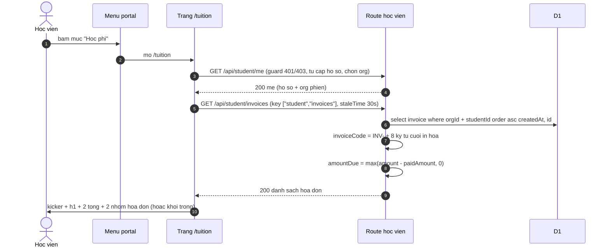

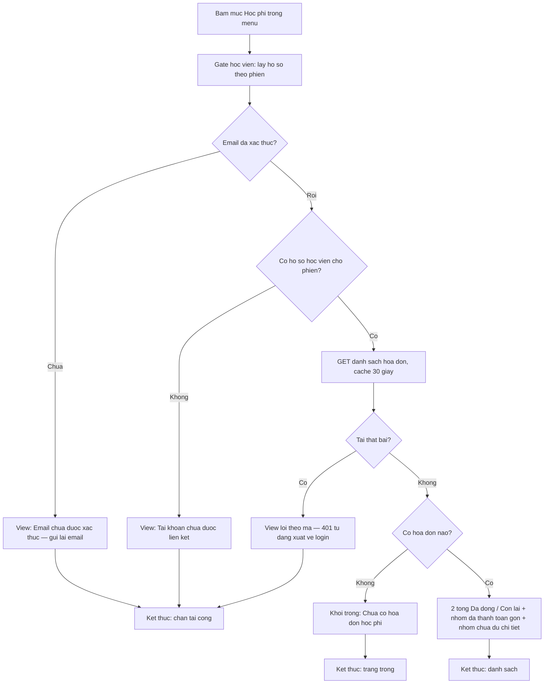

- ✅ Guard 401 → EMAIL_UNVERIFIED → provision → NOT_LINKED; org chỉ khớp hồ sơ của phiên
  (student.ts:124-210); route hóa đơn bọc requireStudent (student.ts:732-733).
- ✅ Chỉ đọc org + student, order asc createdAt,id (student.ts:928-953); invoiceCode +
  amountDue clamp tại server (student.ts:946-951).
- ✅ Wording: "Học phí của tôi" (index.tsx:45-47), "Chưa có hóa đơn học phí" + mô tả
  (index.tsx:50-55), "Đã thanh toán"/"Hạn <due>"/"Chưa có hạn đóng"/"Đã nhận X / Y"/"Tổng Y"
  (tuition-list.tsx:88-123).
- ✅ isSettled/paidOf/dueOf — bắt cả thu tay paid với paidAmount 0 (tuition-list.tsx:10-22).
- 🔵 e2e đi cùng đường: vào /tuition khi rỗng thấy h1 + empty (S36:297-307); portal có QR
  sau khi giáo viên phát hành (S35:260-269).

## F2 — Xem chi tiết phiếu + QR thanh toán

Nguồn: apps/student/src/routes/_auth/tuition/$invoiceId.tsx:1-105;
apps/server/src/routes/student.ts:957-976; apps/server/src/lib/payment-instructions.ts:21-115;
packages/ui/src/components/payments/payment-qr-panel.tsx:1-183.

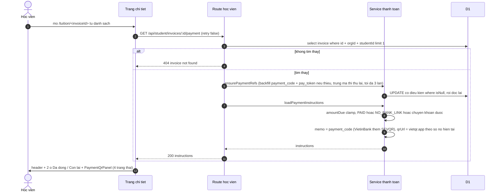

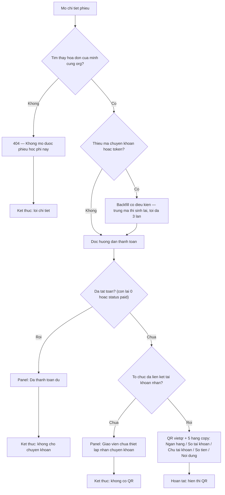

- ✅ 3 nhánh 404 đồng nhất (student.ts:971-975); backfill có điều kiện + retry ≤3
  (payment-instructions.ts:21-55).
- ✅ PAID theo amountDue ≤ 0 HOẶC status paid — comment "Settled covers both ledger-paid
  and manually mark-paid rows" (payment-instructions.ts:78-82); NO_BANK_LINK hai bước kiểm
  (payment-instructions.ts:84-95).
- ✅ QR từ link hiện tại + số nợ hiện tại, không lưu (payment-instructions.ts:57-61,
  :96-115); SEVQR cho VietinBank (vietqr.ts:5-13).
- ✅ Panel 4 trạng thái + wording + copy 5 trường + aria-live (payment-qr-panel.tsx:33-49,
  :83-108, :143-178); nền trắng + lỗi ảnh (:130-141).
- 🔵 retry:false + poll bump reload là cơ chế làm mới duy nhất của trang (INF-2).

## F3 — Tự cập nhật khi tiền về (poll)

Nguồn: apps/student/src/routes/_auth/tuition/$invoiceId.tsx:14-39;
apps/student/src/lib/repos/payments-portal.ts:1-4.

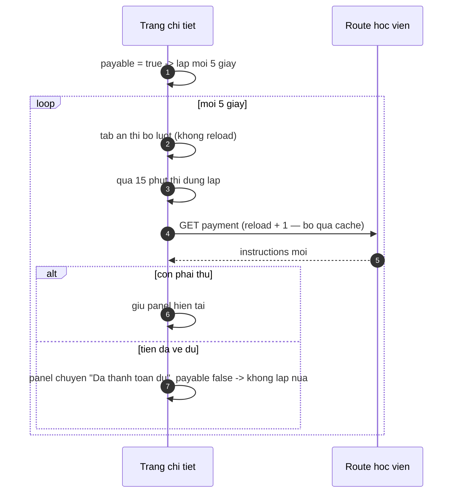

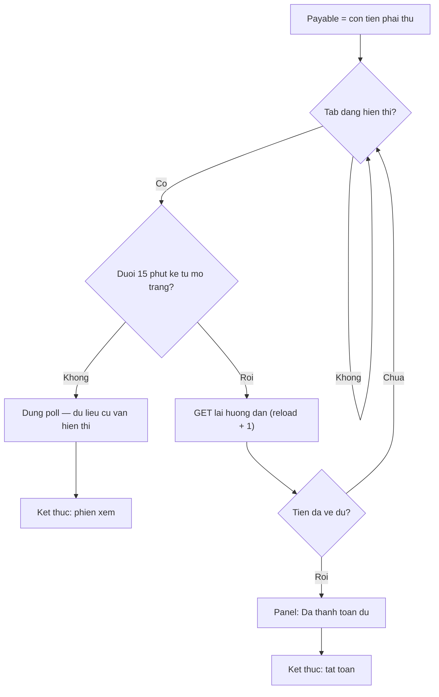

- ✅ Interval 5 giây chỉ đặt khi payment.data?.payable; guard document.hidden và cap
  Date.now() - openedAt < POLL_CAP_MS bên trong tick ($invoiceId.tsx:31-39); hằng số
  payments-portal.ts:1-4; comment "cùng quy tắc với public /pay" ($invoiceId.tsx:14-17).
- 🔵 reload là thành phần của query key nên mỗi bump là request thật, không dính staleTime
  (INF-2).
- 🟡 Không có nút làm mới thủ công như /pay — OQ-12.

## F4 — Vào mục học phí từ thông báo

Nguồn: apps/server/src/lib/notifications/templates.ts:40-52, apps/server/src/lib/notifications/templates.ts:130-145;
apps/student/src/components/layout/notification-bell.tsx:53-61.

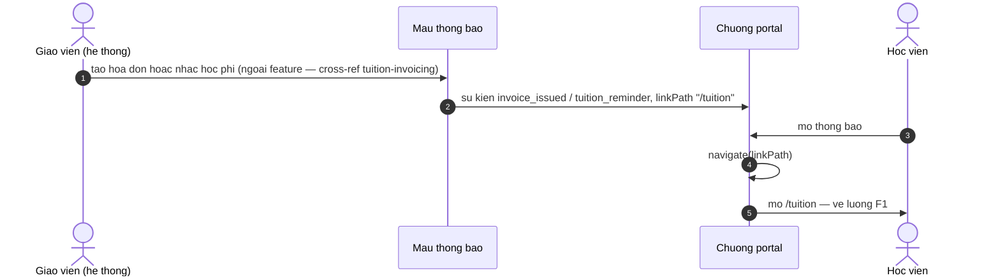

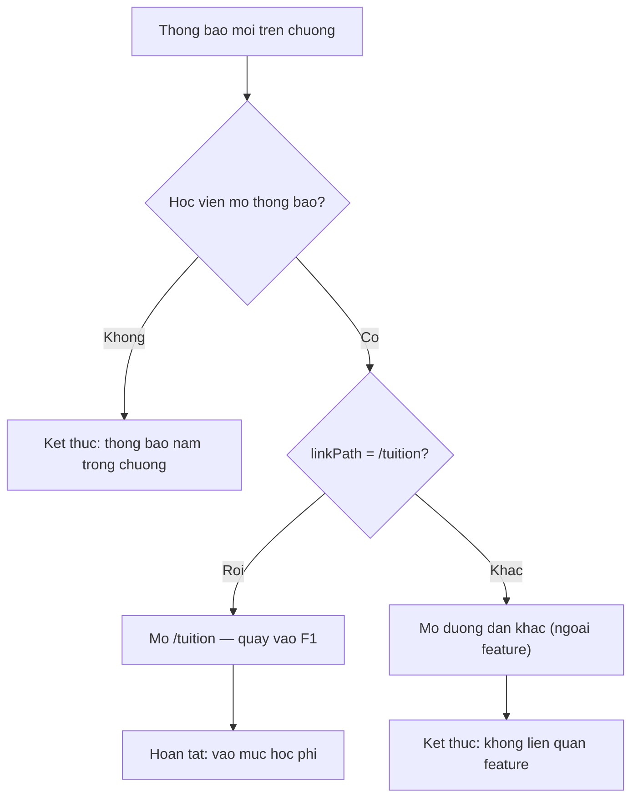

- ✅ invoiceIssuedEvent + tuitionReminderEvent đều linkPath "/tuition"
  (templates.ts:142, templates.ts:50); bell navigate theo linkPath (notification-bell.tsx:53-61).
- ✅ Idempotency hai sự kiện: invoice_issued:<id> và theo ngày VN (templates.ts:139,
  templates.ts:47).
- Việc phát sự kiện thuộc phía giáo viên — cross-ref S40.

## F5 — Xem tổng hợp học phí theo lớp trên hồ sơ (GV)

Nguồn: apps/web/src/routes/_auth/students/$studentId.tsx:326-365;
apps/web/src/components/tuition/student-tuition-summary.tsx:1-118;
apps/web/src/lib/tuition-from-kernel.ts:329-399.

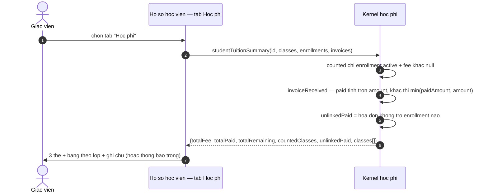

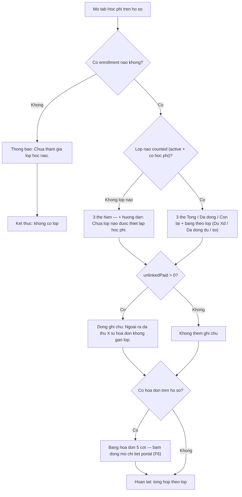

- ✅ Quy tắc counted + invoiceReceived + unlinkedPaid — 13 it trong describe
  studentTuitionSummary (tuition-from-kernel.test.ts:707-1014).
- ✅ Wording: "—" (student-tuition-summary.tsx:11-12), "Chưa kích hoạt — chưa tính"/"Dư"/
  "Đã đóng đủ" (:14-22), "Chưa thiết lập" (:24-30), "Đã mời" (:32-51), "Ngoài ra đã thu…"/
  "Chưa tham gia lớp học nào."/"Chưa lớp nào được thiết lập học phí. Thiết lập ở trang lớp."
  (:82-98); thẻ Còn lại hot khi còn nợ (:78-79).
- ✅ Trạng thái lạ enrollment hiển thị như invited (test :183-206).
- 🔵 Kernel dùng chung với trang Doanh thu (INF-1) — một nguồn tính tiền.

## F6 — Mở hóa đơn từ hồ sơ học viên (GV — trong cùng app web)

Nguồn: apps/web/src/routes/_auth/students/$studentId.tsx:342-350;
apps/web/src/routes/_auth/tuition/$invoiceId.tsx:35,93-137 (đích — thuộc tuition-invoicing).

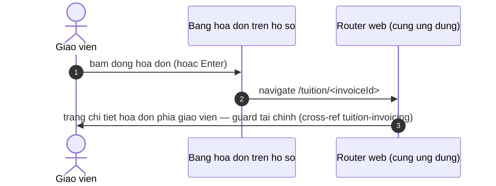

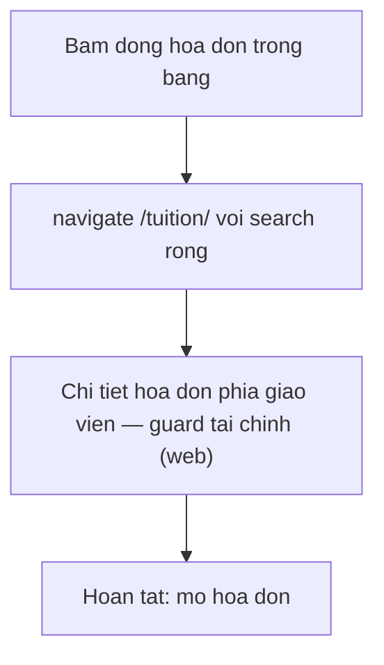

- ✅ onClick dòng → navigate /tuition/$invoiceId (#345 — $studentId.tsx:345-350).
- ✅ Trang đích là chi tiết hóa đơn phía giáo viên của feature tuition-invoicing (guard tài
  chính, mark-paid, lịch sử giao dịch — apps/web/src/routes/_auth/tuition/$invoiceId.tsx:93-137).
  E-05 (TEACHER_ON_STUDENT_PORTAL) chỉ xảy ra khi phiên giáo viên tự đăng nhập thẳng portal
  học viên, không đi qua F6 (student-error-view.tsx:99-104, :148).
- 🔵 (đã rút) Kết cục "bị chặn ở cổng học viên" KHÔNG đúng code — navigate resolve trong
  cùng app web nên mở chi tiết hóa đơn phía giáo viên (apps/web/src/routes/_auth/tuition/
  $invoiceId.tsx:35,93-97); e2e chỉ assert URL (student-tuition-summary.spec.ts:158-163).
