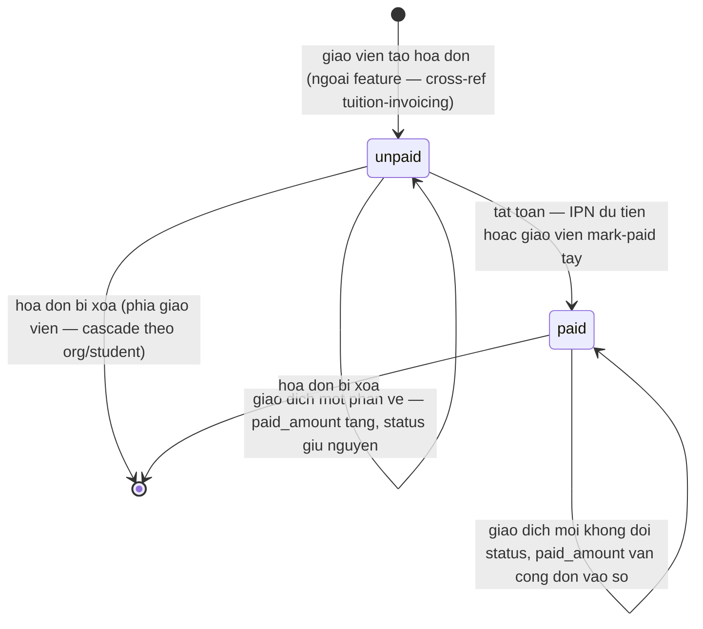
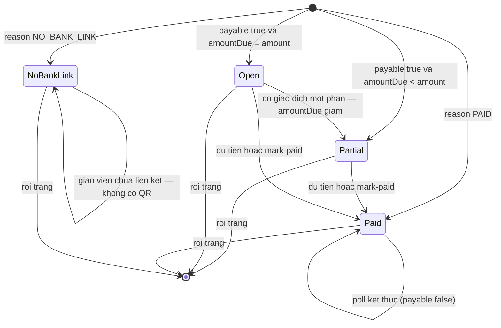
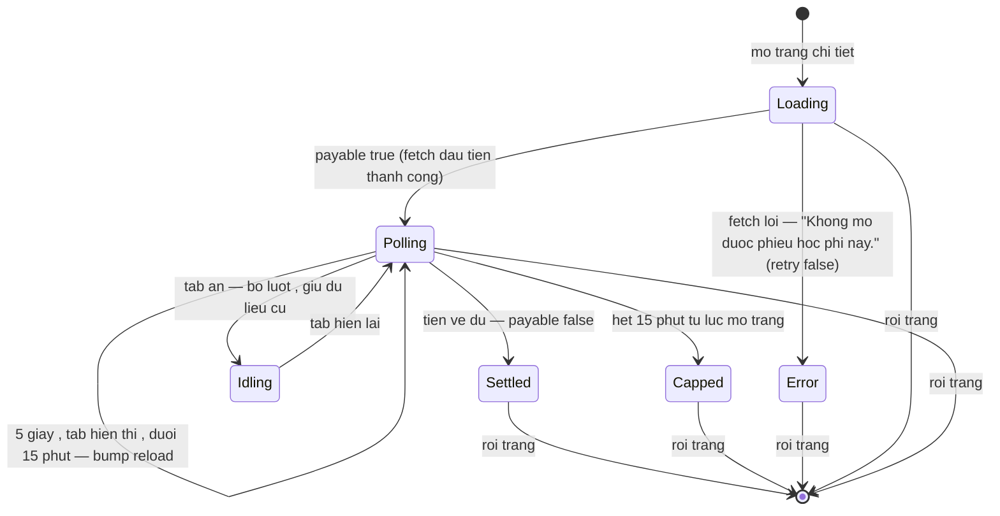

# srs/student-tuition-reverse-states — student-tuition

Ba máy trạng thái: (1) hóa đơn học phí — máy bền (trạng thái lưu DB);
(2) panel QR — máy hiển thị dùng chung 3 bề mặt (không bền); (3) vòng đời phiên xem chi
tiết phía portal (không bền). Tên trạng thái giữ "từ vựng hợp đồng" (status = unpaid |
paid; reason = PAID | NO_BANK_LINK).

## 1. Hóa đơn học phí (invoice.status)

Chỉ 2 trạng thái bền; "Quá hạn" không phải trạng thái — là nhãn suy diễn từ `due` so với
hôm nay (giờ Việt Nam), không có writer. `paid_amount` tăng qua sổ giao dịch, không qua
máy trạng thái.

Chứng thực:

- Schema: status default "unpaid", không CHECK hai giá trị nhưng chỉ có 2 giá trị được
  ghi trong domain — packages/db/src/schema/invoice.ts:37. ✅
- paid_amount "recomputed from the payment_transaction ledger — never incremented
  directly" — packages/db/src/schema/invoice.ts:19-25, packages/db/src/schema/payment-transaction.ts:5-22. ✅
- "Quá hạn" suy diễn #322, trạng thái lạ hiển thị như chưa thu —
  apps/web/src/lib/tuition-from-kernel.ts:194-205; nhãn "Đã thu"/"Chưa thu"/"Quá hạn" —
  apps/web/src/lib/format-invoice.ts:24-30. ✅ (BR-11)
- Writer trạng thái thuộc phía giáo viên/đối soát (mark-paid, IPN matching) — cross-ref
  docs/_reverse/tuition-invoicing/. 🔵 (schema không có route học viên nào ghi — R3)

## 2. Panel QR (PaymentQrPanel — hiển thị, không bền)

Suy từ {payable, reason, amountDue, amount}: 4 trạng thái hiển thị. Panel sống trong bộ
nhớ tab, dựng lại mỗi lần fetch.

Chứng thực:

- Công thức state (nguyên văn code): `!payable ? (reason === "PAID" ? "paid" : "nolink")
  : paidAmount > 0 ? "partial" : "open"` (tương đương amountDue < amount nhờ clamp) — packages/ui/src/components/payments/payment-qr-panel.tsx:83-89. ✅
- Wording 4 trạng thái — payment-qr-panel.tsx:33-49 (paidFull "Đã thanh toán đủ",
  noBankLink "Giáo viên chưa thiết lập nhận chuyển khoản", partial "Đã nhận X / Y"). ✅
- reason là trường hợp đồng duy nhất có giá trị enum — packages/api/src/contracts.ts:3018. ✅
- Panel dùng chung portal /pay/modal GV — apps/web/src/components/modals/invoice-payment-modal.tsx:244,
  apps/web/src/routes/pay.$token.tsx, apps/student/src/routes/_auth/tuition/$invoiceId.tsx:99. ✅

## 3. Vòng đời phiên xem chi tiết (client, không bền)

Máy sống trong tab chi tiết: poll 5 giây chỉ khi payable + tab hiển thị, dừng hẳn sau 15
phút kể từ lúc mở trang. openedAt chốt một lần khi mount.

Chứng thực:

- Poll effect: interval 5s đặt khi payment.data?.payable; trong tick kiểm `document.hidden`
  và `Date.now() - openedAt < POLL_CAP_MS`; cleanup clearInterval —
  apps/student/src/routes/_auth/tuition/$invoiceId.tsx:22-39. ✅
- retry:false — lỗi fetch không tự thử lại ($invoiceId.tsx:28). ✅
- POLL_INTERVAL_MS 5000, POLL_CAP_MS 15*60*1000 — apps/student/src/lib/repos/payments-portal.ts:1-4;
  bản sao web apps/web/src/lib/repos/payments.ts:13-16. ✅ (OQ-03)
- Capped: /pay công khai có nút làm mới sau cap, portal không —
  apps/web/src/routes/pay.$token.tsx:18. ✅ (OQ-12)
- Không có test điều khiển visibility — GAP-4.
