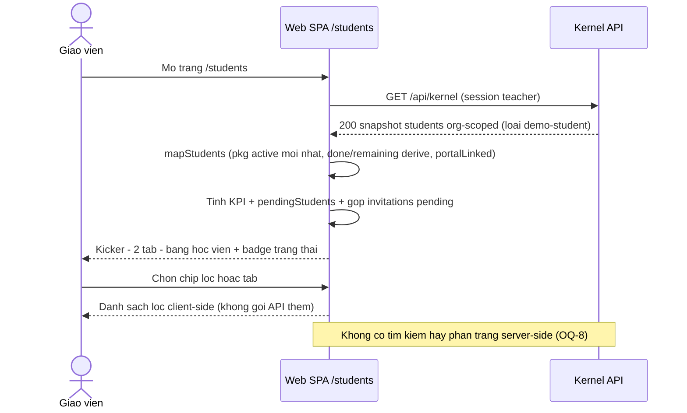
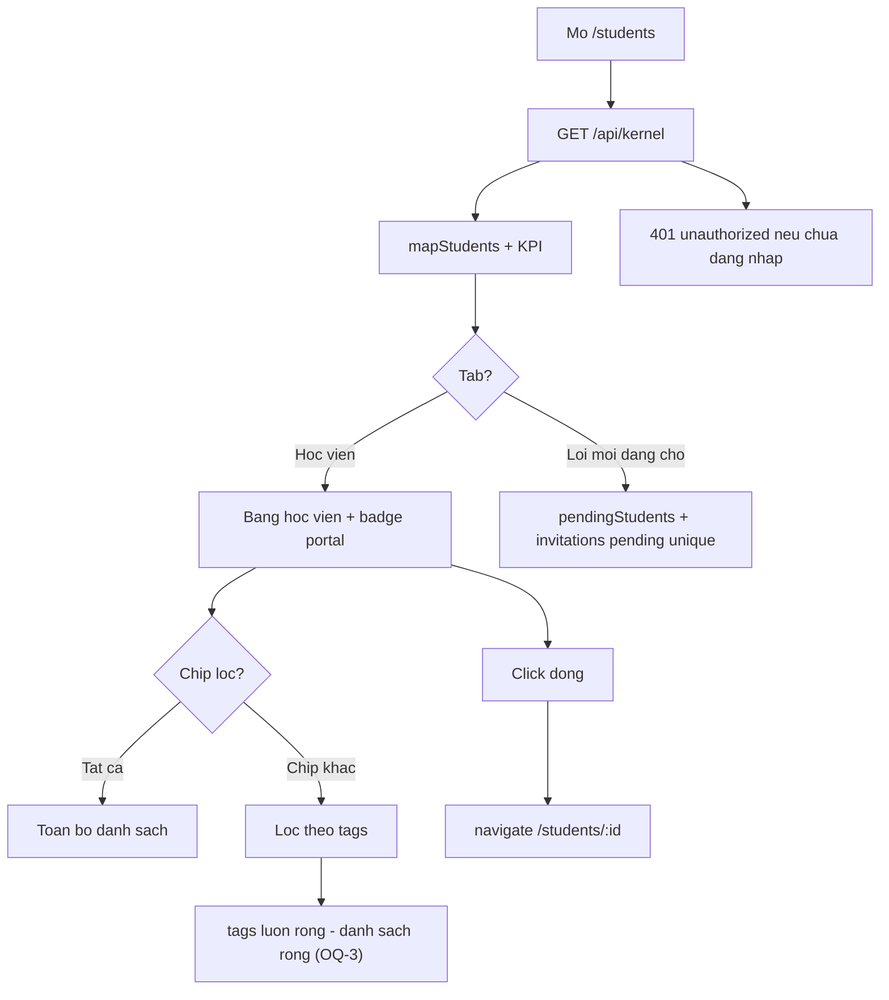
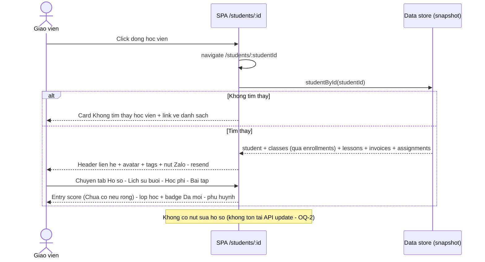
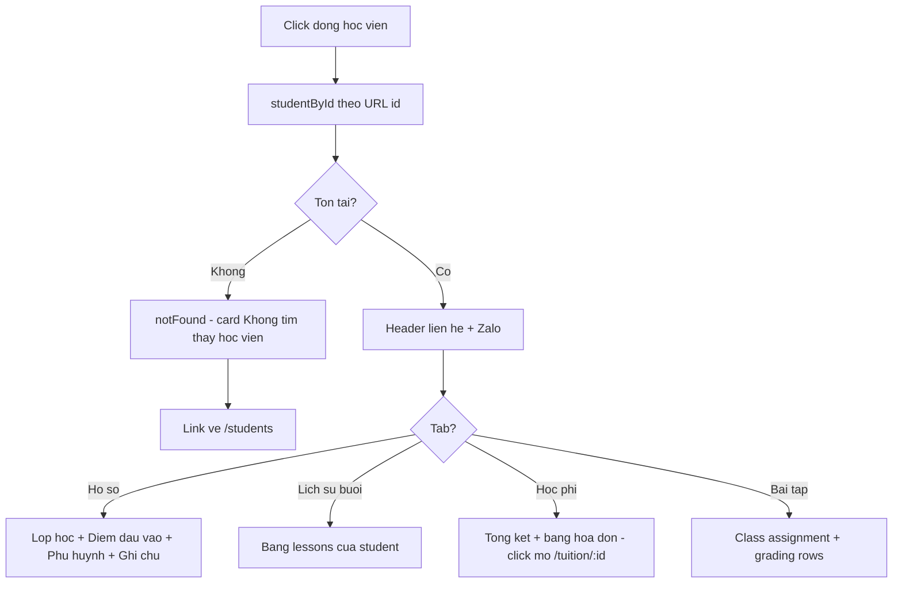
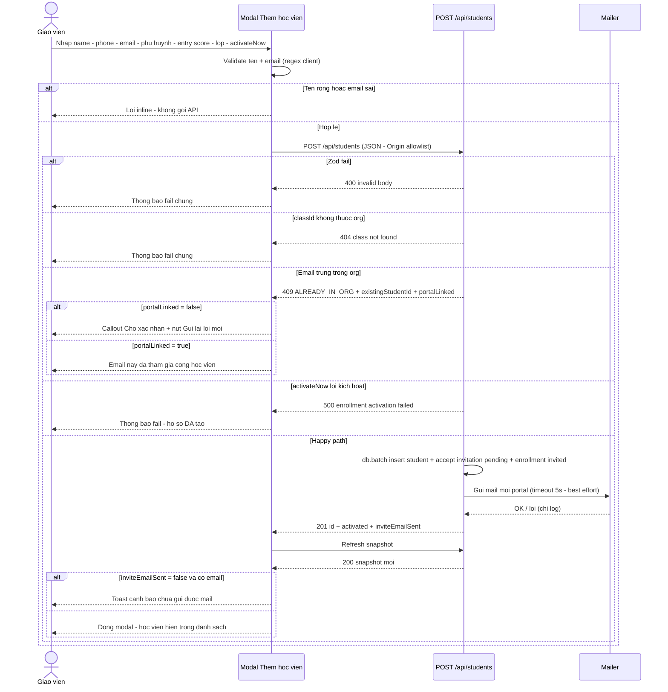
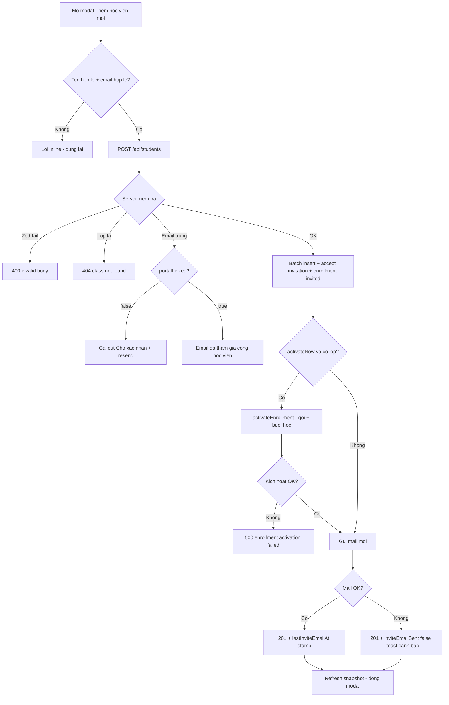
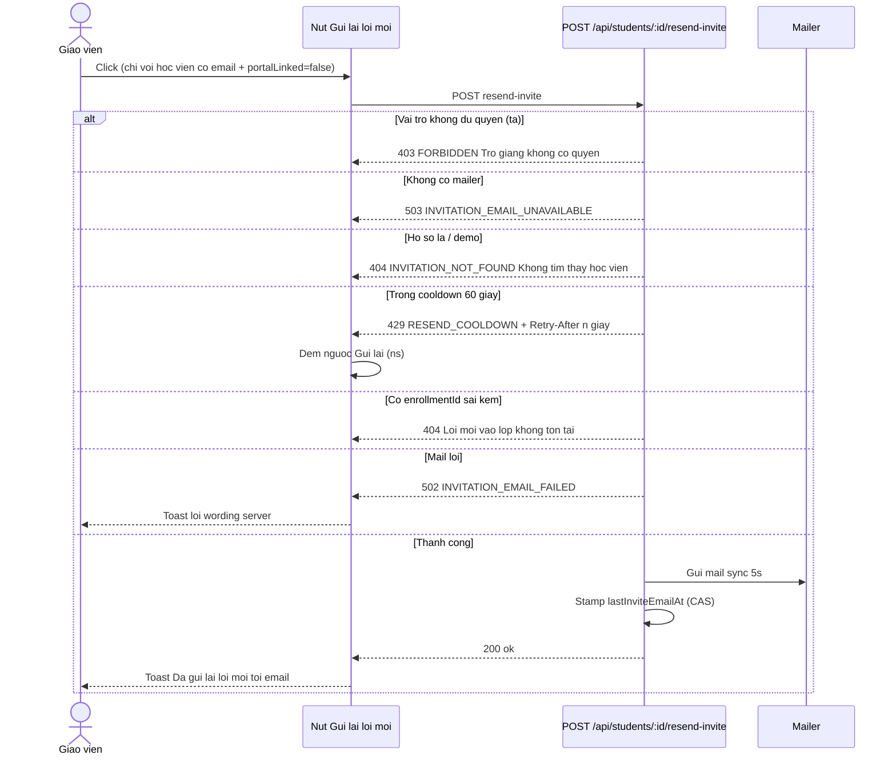
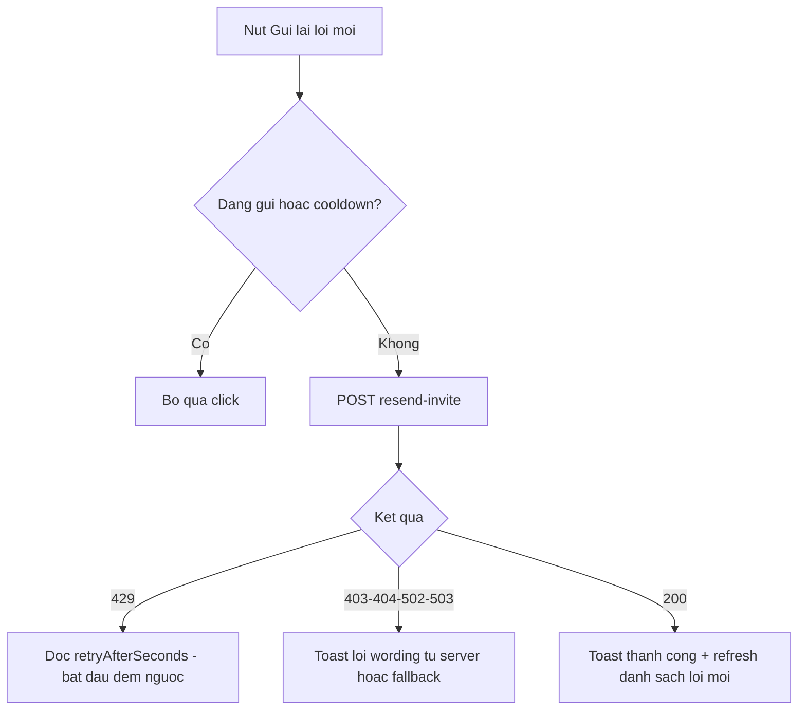

# students — Flows tái lập (reverse)

> Quy ước: mọi nhãn đều truy vết được trong code (cite ở `_evidence.md`). Không vẽ bước không có trong code.

## Flow 1: Xem danh sách học viên + tìm kiếm/lọc

### Sequence — Xem danh sách học viên

### Activity — Xem danh sách học viên

## Flow 2: Xem chi tiết học viên (hồ sơ, lớp, điểm đầu vào)

### Sequence — Xem chi tiết học viên

### Activity — Xem chi tiết học viên

## Flow 3: Thêm học viên thủ công (tạo hồ sơ + tùy chọn ghi danh + mail mời)

> Flow này tồn tại trong code dù PDR nói ngược lại (OQ-1). KHÔNG có flow "cập nhật thông tin học viên" — code không có đường nào (FR-022, G-2).

### Sequence — Thêm học viên thủ công

### Activity — Thêm học viên thủ công

## Flow 4: Gửi lại lời mời portal (resend từ danh sách/chi tiết)

### Sequence — Gửi lại lời mời portal

### Activity — Gửi lại lời mời portal

## Flow 5 (ranh giới — không vẽ chi tiết): học viên tự liên kết portal

Hồ sơ chuyển sang "Đã liên kết" khi học viên đăng nhập portal (email verified) và hoàn tất wizard onboarding (`onboardingCompletedAt` được stamp) — thuộc feature `student-*` / `auth-student-signup`. Hand-off: `apps/server/src/routes/student.ts:124-210` (guard + provision), `apps/server/src/routes/student.ts:1241-1289` (onboarding), `apps/server/src/student-provisioning.ts:17-84` (D1-D7).
