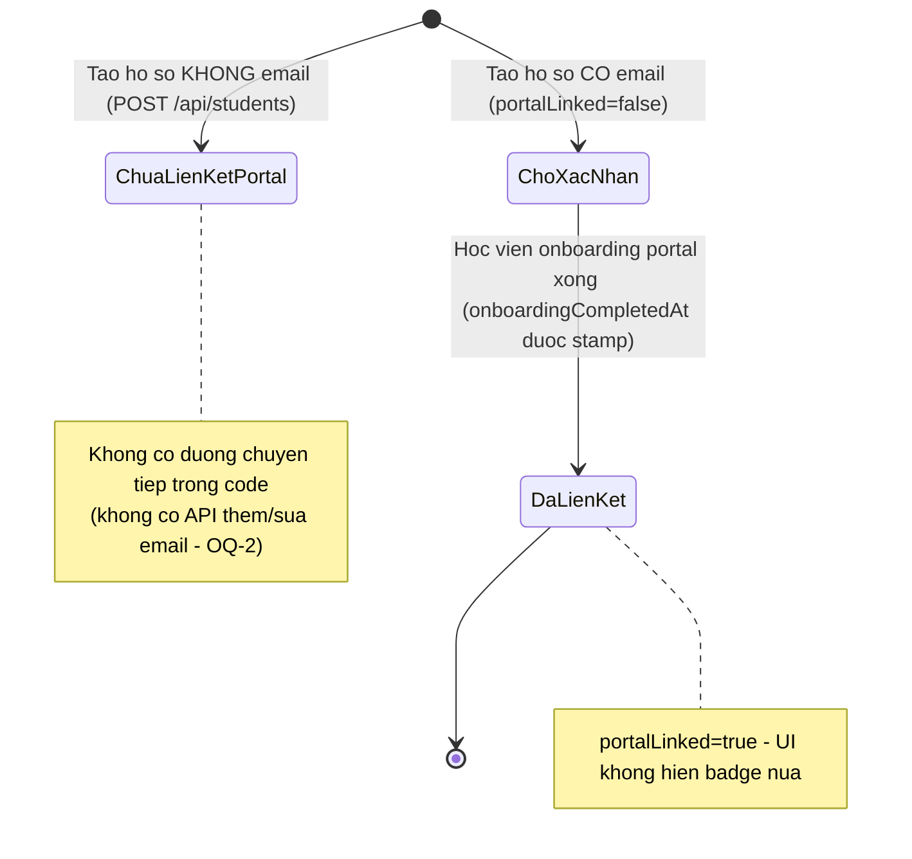

# students — States tái lập (reverse)

## Kết luận chính: bảng `student` KHÔNG có cột trạng thái

Lược ý định vẽ state machine "trạng thái hồ sơ" (active/inactive/…): schema `student` chỉ có `email` + `onboarding_completed_at` + `last_invite_email_at`, **không có cột status** (so với `student_invitation.status` và `enrollment.status` có thật). — ✅ [S5] `packages/db/src/schema/student.ts:15-71`. Trạng thái "liên kết portal" hiển thị trên UI là **derive** từ 2 field này, không phải state lưu DB. ✅ [S3] `apps/web/src/lib/repos/students.ts:97-102`.

Do đó doc này mô tả **trạng thái suy ra (derived)** duy nhất code thừa nhận: mức độ liên kết portal của hồ sơ.

## State: mức độ liên kết portal của hồ sơ học viên (derived)

> Nguồn: ✅ [S1][S3][S5] — `snapshot.ts:656` (portalLinked = onboardingCompletedAt != null), `repos/students.ts:97-102` (isPendingPortalStudent), `kernel.ts:463-694` (tạo hồ sơ), `student.ts:1241-1289` (onboarding portal — boundary).

**Ghi chú trạng thái:**

| Trạng thái | Ý nghĩa | Vào bằng | Ra bằng | Nguồn | Nhãn |
|-----------|---------|----------|---------|-------|------|
| Chưa liên kết Portal | Hồ sơ không có email — học viên không thể tự đăng nhập portal khớp hồ sơ | Tạo hồ sơ với email rỗng | Không có đường chuyển trong code (OQ-2) | `kernel.ts:526-528` (email rỗng vẫn tạo); UI badge "Chưa liên kết Portal" `index.tsx:179-185` | ✅ |
| Chờ xác nhận | Có email, `onboardingCompletedAt` NULL — học viên chưa hoàn tất portal | Tạo hồ sơ có email; hoặc provision portal chưa onboarding | Học viên hoàn tất wizard onboarding (boundary) | `snapshot.ts:656`; `repos/students.ts:97-102`; badge + nút resend `index.tsx:186-194,233-242` | ✅ |
| Đã liên kết | `onboardingCompletedAt` có giá trị | POST /api/student/onboarding hợp lệ (boundary) | Không có đường ra trong code | `student.ts:1276-1277`; `snapshot.ts:656` | ✅ |

## Trạng thái liên quan (không thuộc feature — chỉ để định ranh giới)

- **enrollment.status `invited` → `active`** (hủy lời mời chỉ trên `invited`): thuộc feature `enrollment-lifecycle`. ✅ [S8] `apps/e2e/specs/enroll-existing-student.spec.ts:166-173,302-374`; `apps/server/src/routes/kernel.ts:544-554,1382`.
- **student_invitation.status `pending` → `accepted/rejected/canceled`**: thuộc feature `student-invitations`. ✅ [S5] `packages/db/src/schema/student-invitation.ts:21-24`; auto-accept khi tạo hồ sơ trùng email `kernel.ts:530-543`.

## Trạng thái dữ liệu entryScore (mini-state)

| Giá trị | Ý nghĩa | Vào bằng | Nguồn | Nhãn |
|---------|---------|----------|-------|------|
| NULL | Chưa có điểm đầu vào | Tạo hồ sơ không entryScore (hoặc `""`) | `kernel.ts:526`; test `kernel.test.ts:5005-5016` | ✅ |
| Chuỗi <= 50 ký tự | Điểm đầu vào đã nhập (vd "7.0 IELTS") | Giáo viên nhập lúc tạo; học viên nhập ở onboarding (ghi đè nếu chưa có, không xóa giá trị cũ) | `kernel.ts:526`; `student.ts:1274-1275`; test `student.test.ts:968-995` | ✅ |

Hiển thị: NULL → snapshot `""` → UI "Chưa có". ✅ `snapshot.ts:655`; `$studentId.tsx:279-281`.
