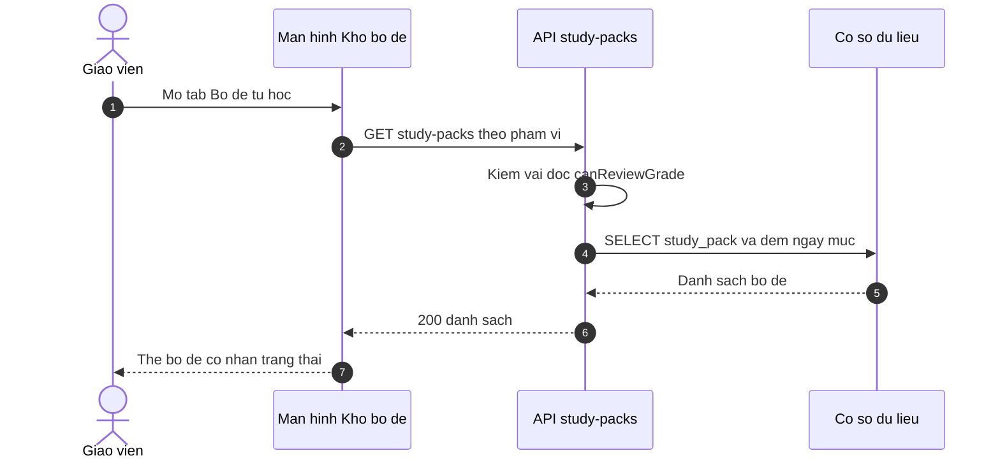
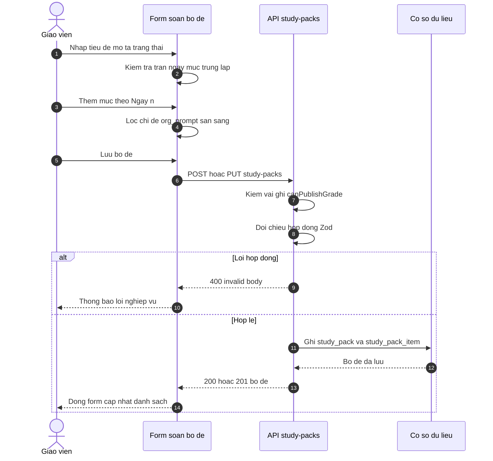
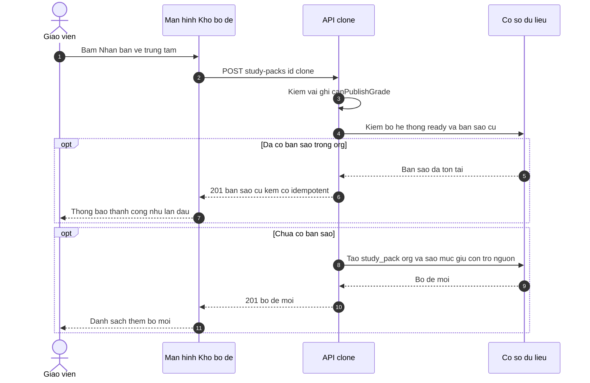
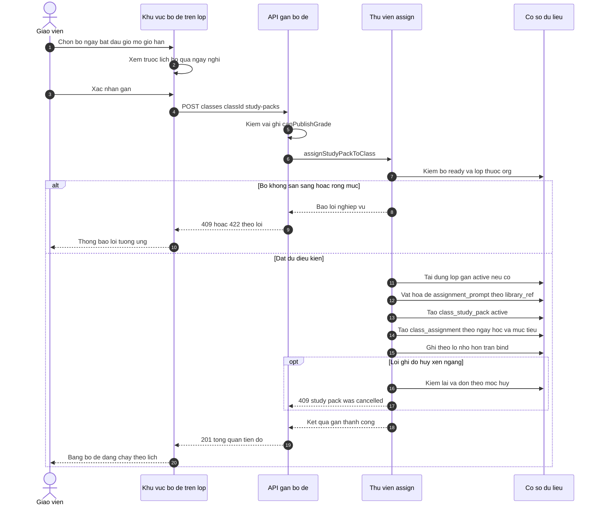
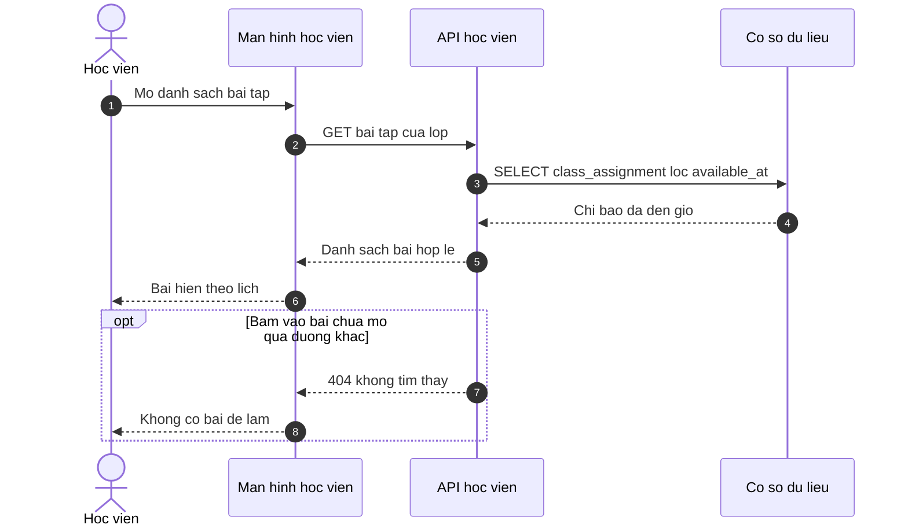
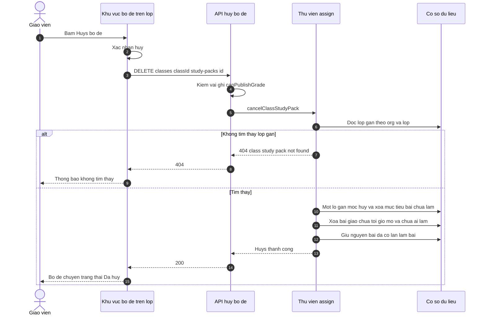
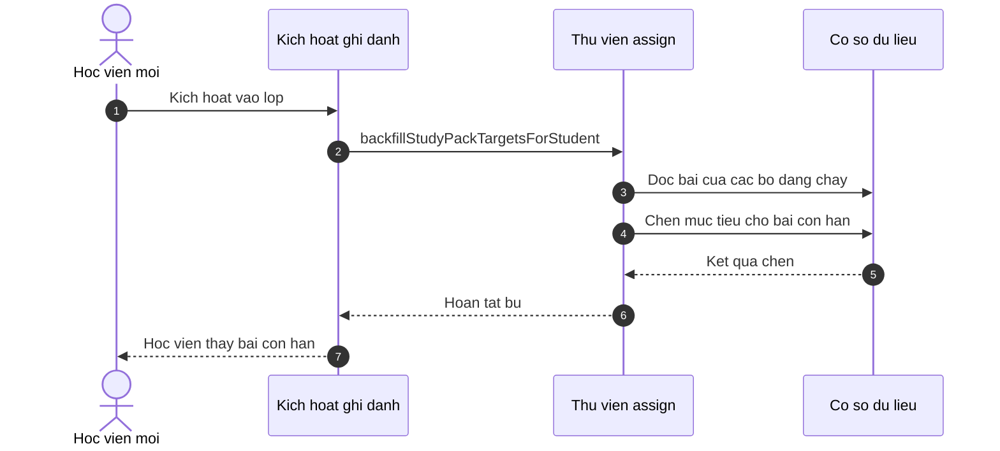
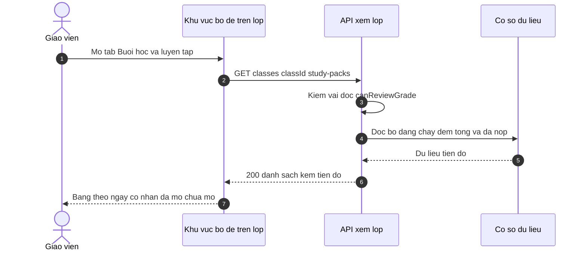
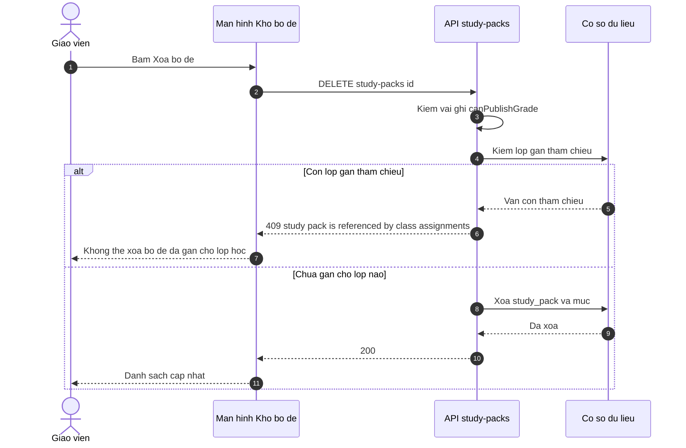

# srs flows — study-pack

Chuỗi ký hiệu: nhãn trong hình viết tiếng Việt không dấu để an toàn khi dựng
hình. Mỗi luồng F tương ứng một dòng trong spec Mục 9. Trích dẫn nằm ngay dưới
từng hình.

## F1 — Xem danh sách bộ đề

- Hai phạm vi xem: bộ của tôi và thư viện hệ thống; bộ hệ thống chỉ hiện
  `ready`. ✅ apps/web/src/routes/_auth/assignments/packs.tsx:365-378; ✅
  apps/server/src/routes/study-pack.ts:87
- Cổng đọc dùng `canReviewGrade`. ✅ apps/server/src/routes/study-pack.ts:77-78
- Thẻ đếm ngày và mục mỗi bộ. ✅ apps/server/src/lib/study-pack-clone.ts:812-900

## F2 — Tạo / sửa bộ đề của trung tâm

- Trần 366 ngày / 10 mục ngày / 200 mục kiểm ở hợp đồng :4480-4484 và
  superRefine :4508-4535. ✅ packages/api/src/contracts.ts
- Bộ lọc đề nguồn chỉ cho `org_prompt` ready (OQ-04). ✅
  apps/web/src/routes/_auth/assignments/packs.tsx:91-100
- Trạng thái mặc định "ready" khi mở form và sau lưu. ✅
  apps/web/src/routes/_auth/assignments/packs.tsx:75, :134
- Lỗi JSON/Zod gộp về hai chuỗi cửa thân yêu cầu. ✅
  apps/server/src/routes/study-pack.ts:56-70

## F3 — Nhân bản bộ đề hệ thống

- Chỉ nhân bản bộ hệ thống `ready`. ✅ apps/server/src/routes/study-pack.ts:282
- Idempotent trả bản sao cũ kèm cờ, mã 201 (OQ-11). ✅
  apps/server/src/routes/study-pack.ts:290-302
- Nhánh đua hai người nhân bản cùng lúc xử lý bằng khoá duy nhất org+source
  :348-365. ✅ apps/server/src/routes/study-pack.ts
- Mục giữ con trỏ nguồn thư viện, chưa vật hoá đề. ✅
  plans/261101-1357-533-study-pack-scheduled-release/phase-03-pack-library-and-org-api.md:71

## F4 — Gán bộ đề cho lớp

- Xem trước lịch phía khách bỏ ngày nghỉ lớp. ✅
  apps/web/src/components/classes/class-study-pack-section.tsx:41-72, :432-454
- Tái dùng lượt gán active :221-254; vật hoá :310-313; tạo lượt gán :315-331;
  nhánh đua :336-363; lịch bỏ ngày nghỉ :366-377; bài giao + thời điểm mở
  :379-417; mục tiêu :421-437; ghi lô :439-455; kiểm huỷ xen ngang :457-492.
  ✅ apps/server/src/lib/study-pack-assign.ts
- Thông điệp lỗi nghiệp vụ hiện cho giáo viên. ✅
  apps/web/src/components/classes/class-study-pack-section.tsx:163-214

## F5 — Học viên nhận bài theo giờ mở

- Bộ lọc thời điểm mở bài dùng chung mọi đường đọc. ✅
  apps/server/src/lib/assignment-visibility.ts:1-16
- Cổng 404 trước giờ trên đường làm bài. ✅
  apps/server/src/routes/student.ts:1354-1383, :918
- Không có bộ định giờ hay thông báo — quyết định ghi trong kế hoạch. ✅
  plans/261101-1357-533-study-pack-scheduled-release/plan.md:19, :27

## F6 — Huỷ bộ đề trên lớp

- Quy tắc dọn: xoá bài chưa tới giờ mở (tính tới thời điểm huỷ) và chưa có lần làm; giữ lại bài đã mở và bài đã phát sinh lần làm. ✅ apps/server/src/lib/study-pack-assign.ts:140-192, :521-566
- Mốc huỷ giữ `cancelled_at` cũ nếu huỷ lại. ✅
  apps/server/src/lib/study-pack-assign.ts:534
- Không có thông báo học viên khi bị gỡ bài (OQ-08, OQ-09). ✅ (NS4 rỗng)

## F7 — Học viên vào lớp muộn

- Ba đường kích hoạt đều gọi bù: :697, :748, :769. ✅
  apps/server/src/routes/enrollment-activation.ts
- Bù chỉ tạo mục tiêu cho bài còn hạn `due_at > now`. ✅
  apps/server/src/lib/study-pack-assign.ts:573-623, :596
- Bù không đụng bài giao thường (kiểm #572). ✅
  apps/server/src/kernel.test.ts:6712-6737

## F8 — Xem tiến độ nộp

- Đếm tổng mục và bài đã nộp :835-854; cờ mở bài theo thời điểm :827-833; sắp
  bài trong pack theo ngày học và vị trí mục :876-881. ✅ apps/server/src/lib/study-pack-assign.ts
- Bảng ngày với huy hiệu "Đã mở"/"Chưa đến giờ" và thanh tiến độ. ✅
  apps/web/src/components/classes/class-study-pack-section.tsx:352-369

## F9 — Xoá bộ đề của trung tâm

- Rào 409 khi còn tham chiếu :248-258; câu thoại UI khớp :216-227. ✅
  apps/server/src/routes/study-pack.ts; ✅ apps/web/src/routes/_auth/assignments/packs.tsx
- Phía hệ thống admin cũng đếm lượt gán trước khi xoá đề trung tâm. ✅
  apps/server/src/routes/admin-library.ts:1214-1241
