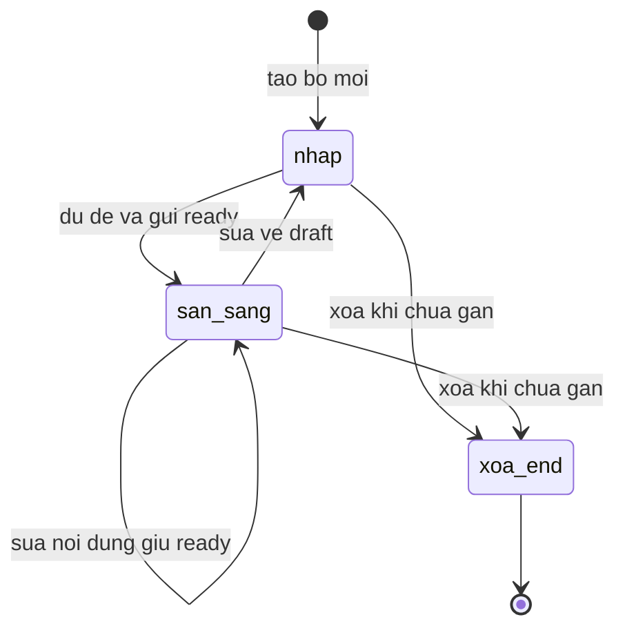
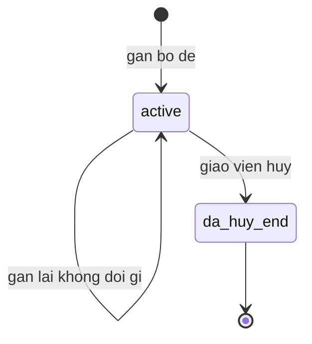
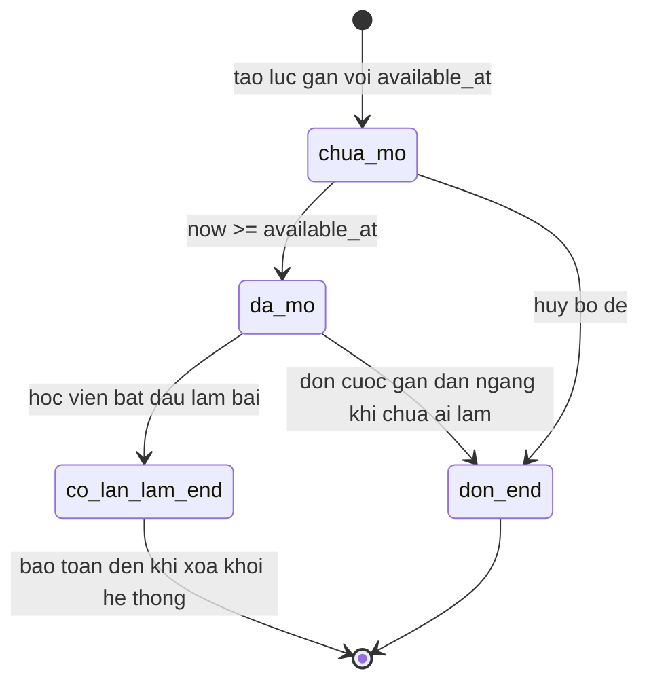

# srs states — study-pack

Ba máy trạng thái của feature. Nhãn trạng thái viết không dấu; tên trạng thái
kết thúc giữ hậu tố "end" hoặc chứa "huy" để máy kiểm hình dạng nhận diện đích
dụng.

## SM-01 — Bộ đề (study_pack.status)

- Trạng thái nhận `draft|ready`, mặc định `draft`. ✅
  packages/db/src/schema/study-pack.ts:58, :61-63
- Chuyển qua API PUT với kiểm hợp đồng: `ready` phải có ít nhất một mục. ✅
  apps/server/src/routes/study-pack.ts:163-231; ✅ packages/api/src/contracts.ts:4508-4514
- Chỉ xoá được khi chưa từng gán cho lớp. ✅
  apps/server/src/routes/study-pack.ts:248-258
- Gán lớp chỉ nhận `ready`. ✅ apps/server/src/lib/study-pack-assign.ts:213-219
- Màn soạn mặc định "Sẵn sàng" nên đường `nhap` hiếm đi qua thực tế (OQ-02). ✅
  apps/web/src/routes/_auth/assignments/packs.tsx:75, :538-541

## SM-02 — Lượt gán bộ đề vào lớp (class_study_pack.status)

- Ràng buộc duy nhất PHẦN: mỗi cặp lớp-bộ chỉ một lượt `active` cùng lúc. ✅
  packages/db/src/schema/study-pack.ts:142-144
- Gán khi đang có lượt active thì tái dùng lượt cũ (không tạo bản ghi mới). ✅
  apps/server/src/lib/study-pack-assign.ts:221-254
- Huỷ đặt `status=cancelled` và `cancelled_at`, giữ bản ghi lịch sử. ✅
  apps/server/src/lib/study-pack-assign.ts:544-552
- Huỷ rồi gán lại tạo lượt `active` MỚI — mã bài giao đổi theo lượt, tiến độ cũ
  không hồi về (INF-03). ✅ packages/db/src/schema/study-pack.ts:142-144; ✅
  apps/server/src/lib/study-pack-assign.ts:81-86
- Huỷ xen ngang lúc gán được phát hiện và dọn theo mốc. ✅
  apps/server/src/lib/study-pack-assign.ts:457-492

## SM-03 — Bài giao sinh từ bộ đề (class_assignment)

- Thời điểm mở ghi tuyệt đối lúc gán; không bộ định giờ nào đổi trạng thái —
  "mở" là kết quả lọc lúc đọc. ✅ apps/server/src/lib/study-pack-assign.ts:391-404;
  ✅ apps/server/src/lib/assignment-visibility.ts:1-16
- Học viên thấy bài chỉ khi qua bộ lọc thời điểm. ✅
  apps/server/src/routes/student.ts:1354-1383
- Khi giáo viên huỷ: chỉ bài chưa tới giờ mở và chưa có lần làm bị xoá (mốc =
  thời điểm huỷ :541); bài đã mở được giữ, cùng bài có lần làm
  được giữ nguyên bằng điều kiện NOT EXISTS lần làm. ✅
  apps/server/src/lib/study-pack-assign.ts:147-191
- Bài giao mang `class_study_pack_id` dạng con trỏ mềm, không khoá ngoại — xoá
  lượt gán không lan xuống bài giao (thiết kế giữ bằng chứng làm bài). ✅
  packages/db/src/schema/class-assignment.ts:39-45

Ghi chú: mục tiêu học viên (`class_assignment_target`) đi cùng trạng thái bài
giao — sinh lúc gán cho học viên active, bù thêm cho học viên vào muộn với điều
kiện bài còn hạn, dọn theo cùng quy tắc huỷ. ✅
apps/server/src/lib/study-pack-assign.ts:421-437, :573-623, :140-192
