# Flows — feature `syllabus` (reverse)

Mỗi flow có sequenceDiagram (tương tác) và flowchart (nhánh nghiệp vụ). Nguồn chính: [S1][S2][S3][S9][S14][S15][S24][S8].

## F1 — Tạo template giáo trình (thủ công hoặc kèm nội dung bulk)

Sequence: GV điền form → command bus POST → batch nguyên tử → snapshot refresh → mở detail.

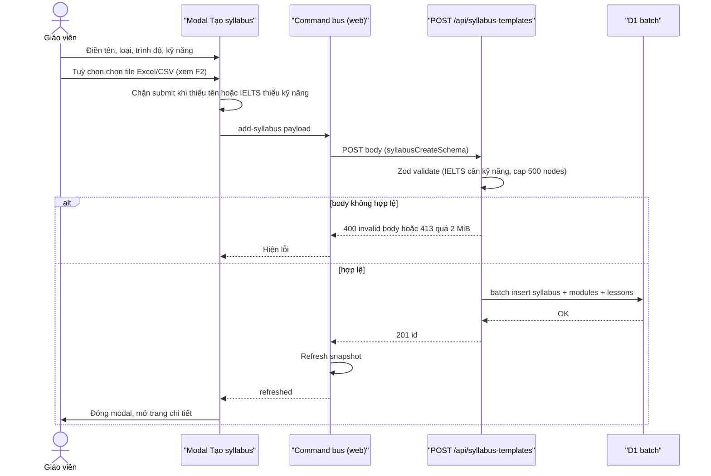

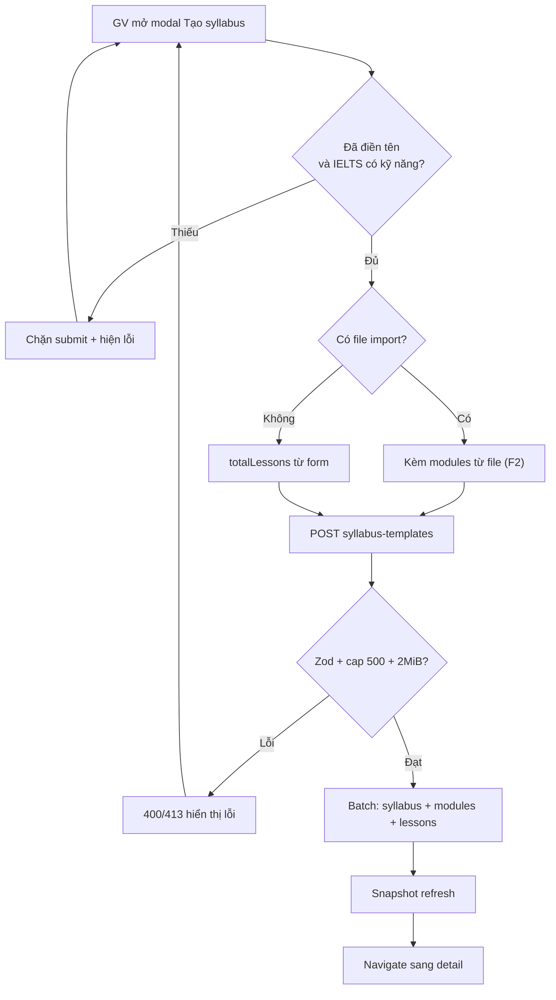

Nguồn: apps/web/src/components/modals/add-syllabus-modal.tsx:88-124; apps/server/src/routes/syllabus.ts:142-196; packages/api/src/contracts.ts:204-246.

## F2 — Parse file Excel/CSV (client-side, dùng cho F1 và F3)

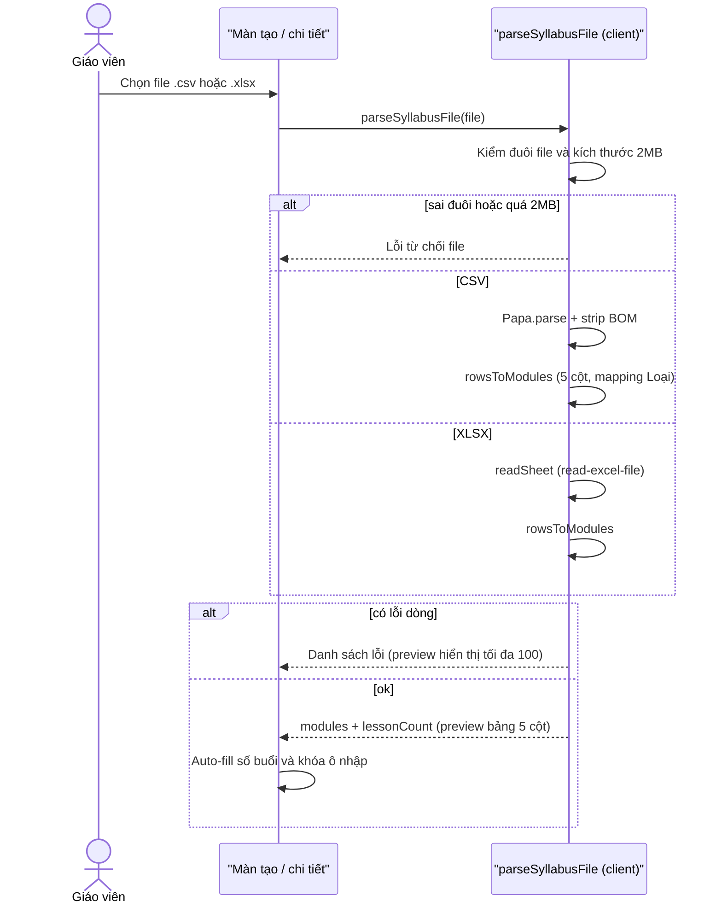

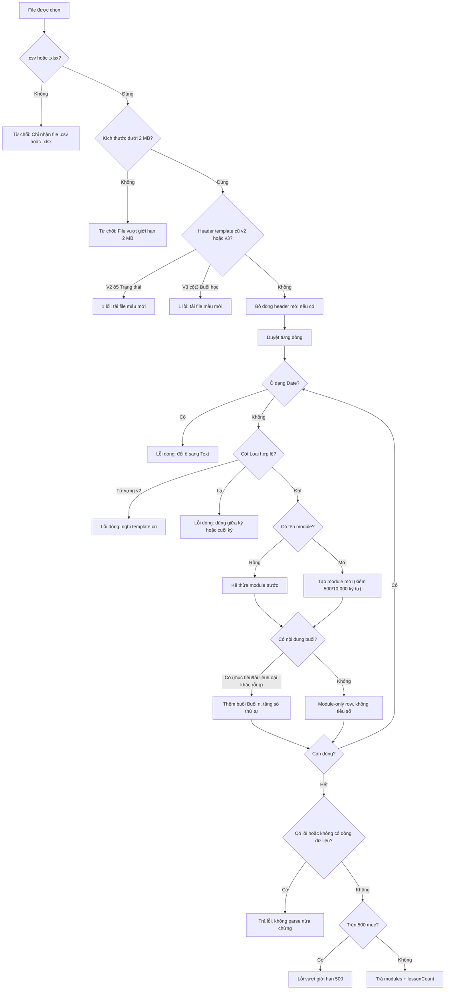

Nguồn: apps/web/src/lib/syllabus-import.ts:29-45, 70-221, 227-266; tests apps/web/src/lib/syllabus-import.test.ts:17, 61, 103, 265, 497, 641.

## F3 — Ghi đè nội dung template (replace-content)

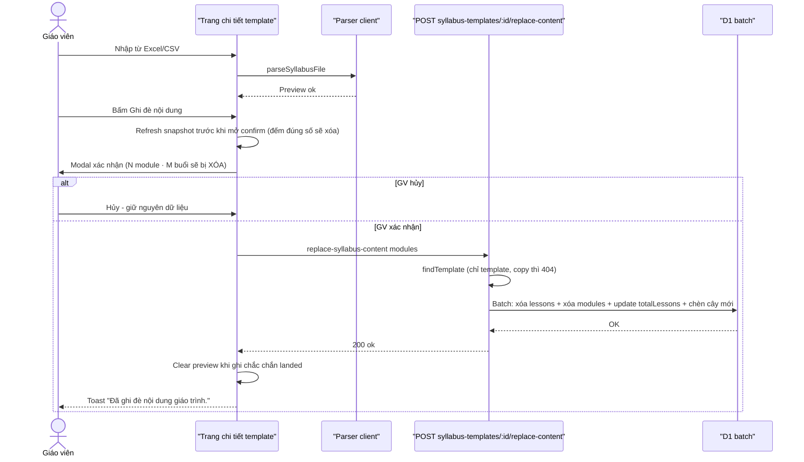

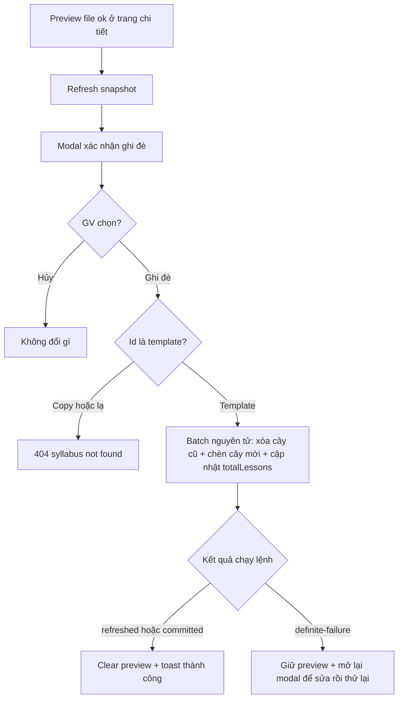

Nguồn: apps/server/src/routes/syllabus.ts:201-277; apps/web/src/routes/_auth/syllabus/$syllabusId.tsx:141-144, 444-463; e2e apps/e2e/specs/syllabus-detail-import-overwrite.spec.ts:21.

## F4 — Nhập giáo trình từ template vào lớp (deep-copy + self-heal)

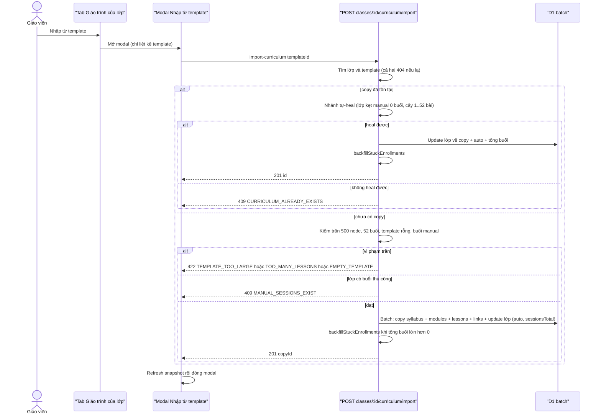

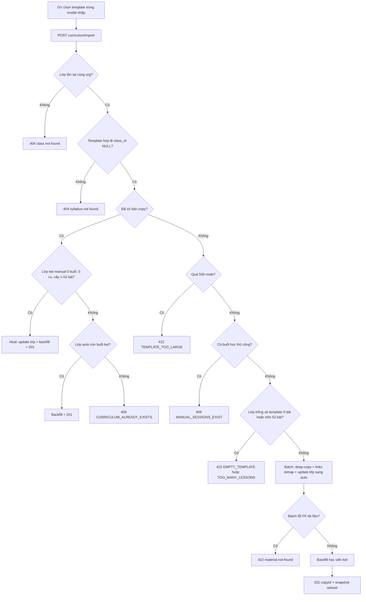

Nguồn: apps/server/src/routes/syllabus.ts:341-622; apps/server/src/lib/syllabus-curriculum.ts:133-215; apps/web/src/components/modals/import-syllabus-modal.tsx:68-88; tests apps/server/src/manual-sessions.test.ts:995, 1036, 1130, 1232, 1340, 1421; e2e apps/e2e/specs/syllabus-class-curriculum.spec.ts:128, 284.

## F5 — Gỡ giáo trình khỏi lớp

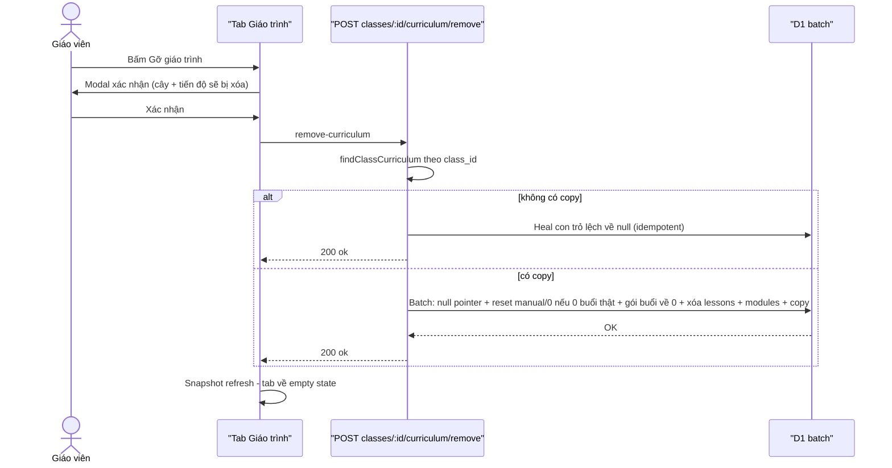

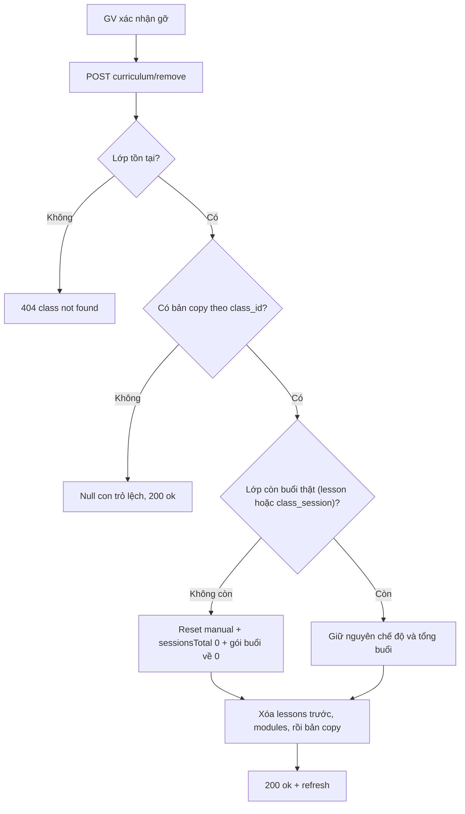

Nguồn: apps/server/src/routes/syllabus.ts:624-718; apps/web/src/components/class-detail/curriculum-management-section.tsx:83-118; tests apps/server/src/manual-sessions.test.ts:1421.

## F6 — Xóa template giáo trình

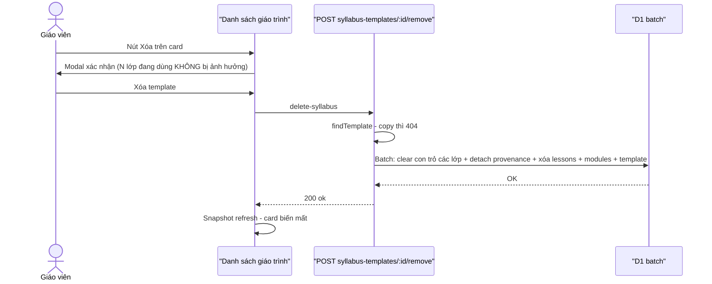

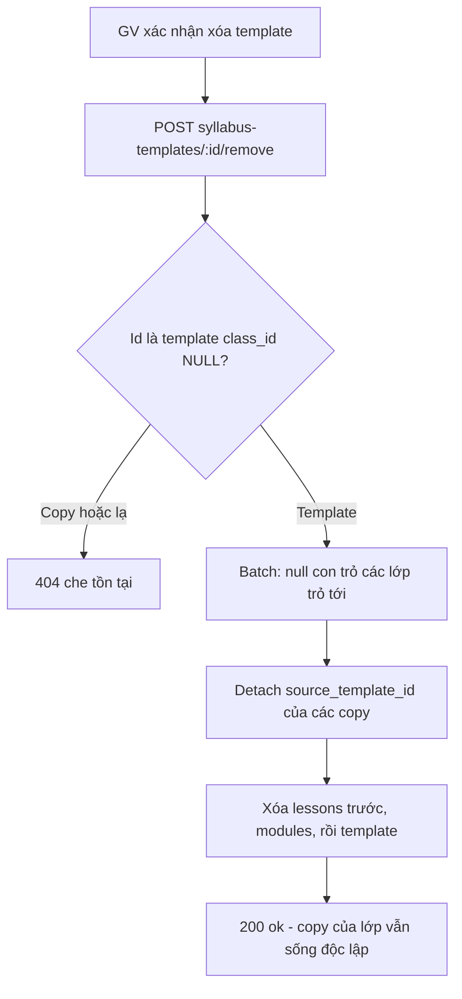

Nguồn: apps/server/src/routes/syllabus.ts:283-339; apps/web/src/components/syllabus/delete-syllabus-button.tsx:35-74; tests apps/server/src/syllabus-template-migration.test.ts:233.

## F7 — Thêm/sửa bài học kèm tài liệu ngân hàng (#655)

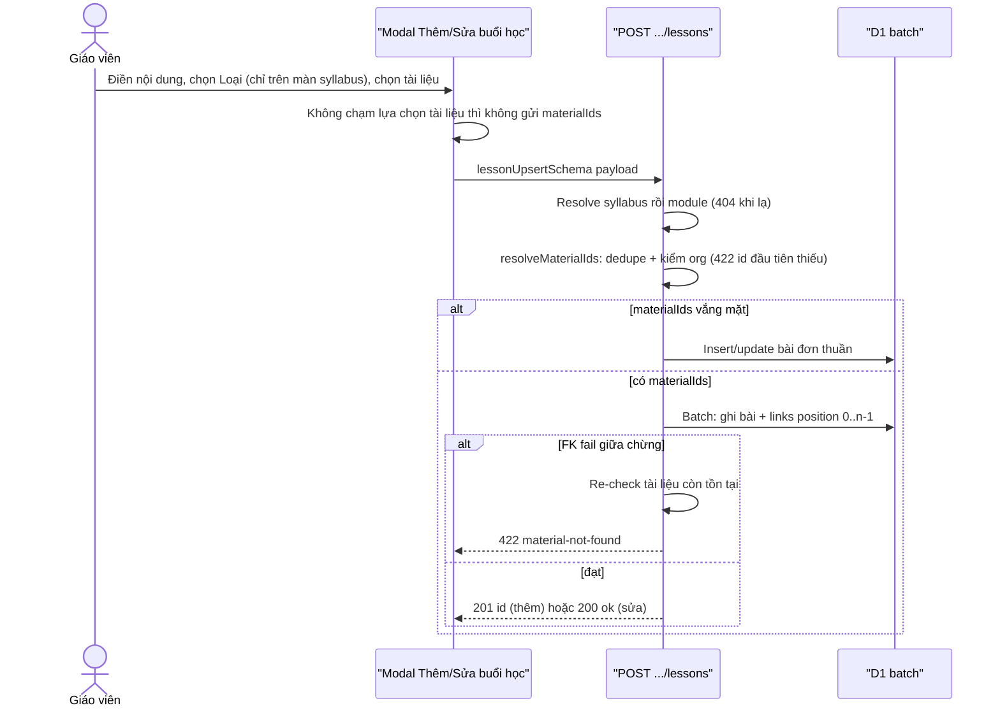

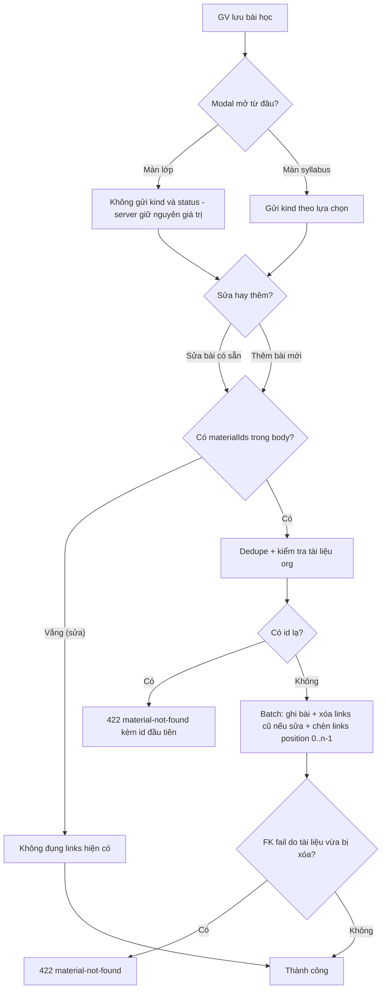

Nguồn: apps/server/src/routes/syllabus-content-routes.ts:67-115, 282-357, 418-506; apps/web/src/components/modals/add-lesson-modal.tsx:17-69; tests apps/server/src/syllabus-material-links.test.ts:241, 273, 311.

## F8 (điểm chạm đọc) — Tài liệu buổi dạy suy từ bài N

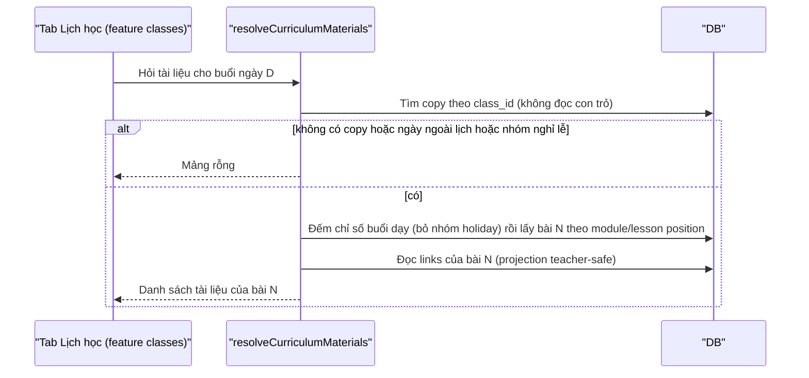

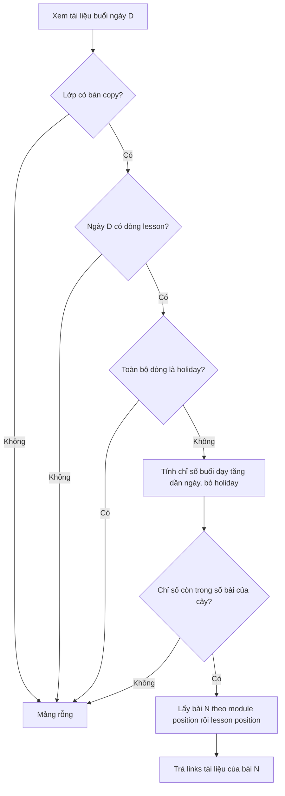

Nguồn: apps/server/src/lib/session-curriculum-materials.ts:32-111, 124-174. Ghi chú ranh giới: flow đọc này thuộc mặt hiển thị của feature classes; syllabus chỉ cung cấp cây + links.
