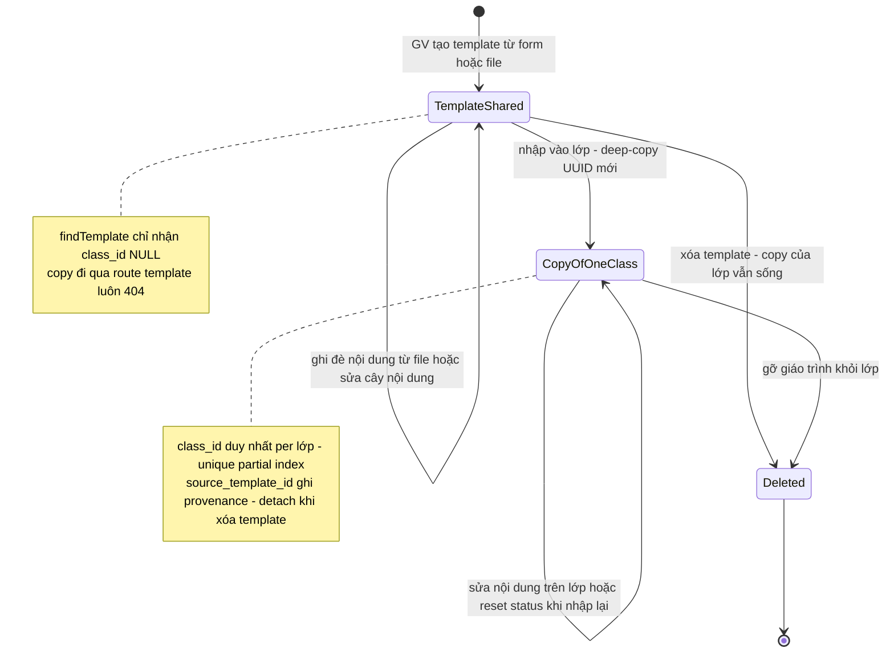
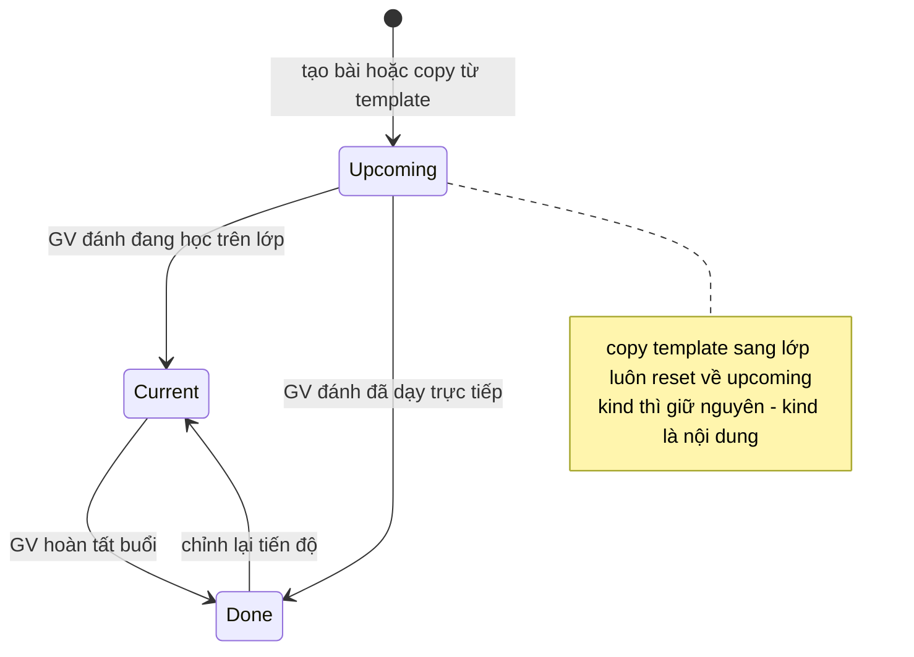
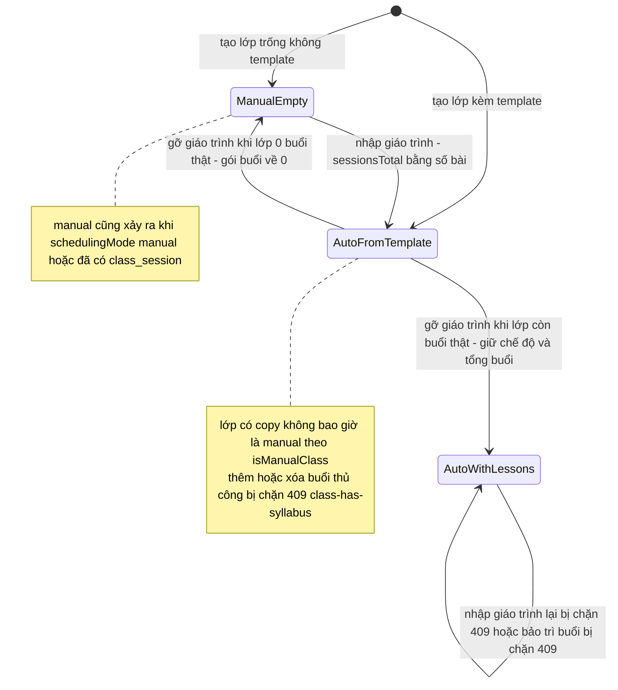

# States — feature `syllabus` (reverse)

Ba thực thể có vòng đời đa-trạng thái quan sát được trong code: **Syllabus** (template/copy), **SyllabusLesson** (tiến độ), và **Class — chế độ xếp lịch** nhìn từ góc độ giáo trình.

## S1 — Syllabus: template dùng chung ↔ bản copy của lớp

Phân loại bằng `syllabus.class_id` (NULL = template, NOT NULL = copy); chuyển trạng thái chỉ xảy ra qua import/gỡ/xóa.

Nguồn: packages/db/src/schema/syllabus.ts:29-49; apps/server/src/lib/syllabus-curriculum.ts:42-55; apps/server/src/routes/syllabus.ts:283-339, 341-622, 624-718.

## S2 — SyllabusLesson.status: tiến độ per-lớp

Nguồn: packages/db/src/schema/syllabus.ts:93-99; apps/server/src/lib/syllabus-curriculum.ts:184-198; apps/web/src/components/syllabus/lesson-status.tsx:3-8.

## S3 — Class.schedulingMode nhìn từ giáo trình (điểm chạm classes)

Nguồn: apps/server/src/lib/class-mode.ts:17-36; apps/server/src/routes/syllabus.ts:527-538, 652-662; apps/server/src/routes/kernel.ts:2425-2433, 2651-2660.
