# Luồng nghiệp vụ nghịch đảo — tuition-invoicing

> Nhãn: ✅ chắc chắn (code khẳng định: validator/hằng/guard/enum/migration/chuỗi lỗi) · 🔵 suy đoán (≥2 chỗ code hậu thuẫn) · 🟡 cần xác nhận (vì sao/mục tiêu/priority → OQ).

## F1 — Tạo hóa đơn học phí

- **Actor**: Người tài chính (giáo viên/chủ/quản trị viên).
- **Kích hoạt**: bấm "+ Tạo hóa đơn" (trang Doanh thu) hoặc "+ Tạo khoản thu" (Sổ công nợ) ✅ [S1] apps/web/src/routes/_auth/tuition/index.tsx:110-116, [S3] apps/web/src/routes/_auth/debts/index.tsx:318-326.
- **Điều kiện trước**: phiên hợp lệ + quyền tài chính; học viên đã ghi danh lớp với trạng thái hoạt động.
- **Kết quả**: 1 dòng hóa đơn mới trạng thái chưa thu, kèm mã chuyển khoản + liên kết công khai; 1 mục nhật ký thông báo phát-hành-hóa-đơn.
- **Đường lưới**: thiếu/sai dữ liệu → lỗi dưới trường, không gọi mạng ✅ [S22] apps/web/src/components/modals/add-invoice-modal.tsx:73-114; server chặn 400/404/409 ✅ [S7] apps/server/src/routes/kernel.ts:3063-3101.

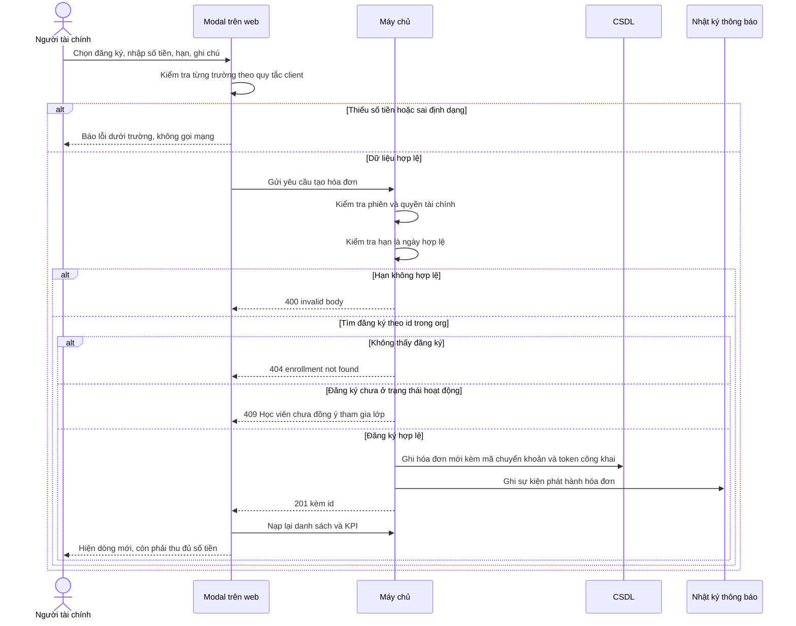

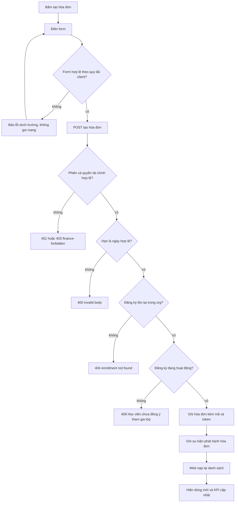

## F2 — Xem chi tiết hóa đơn + QR + quản lý liên kết công khai

- **Actor**: Người tài chính.
- **Kích hoạt**: bấm vào dòng hóa đơn trên trang Doanh thu.
- **Điều kiện trước**: hóa đơn thuộc org của phiên.
- **Kết quả**: thấy đủ trường hóa đơn, 3 ô số (phải đóng · đã thu · còn lại), QR + liên kết, lịch sử giao dịch khớp.
- **Đường lưới**: hóa đơn dòng cũ thiếu mã/token được backfill lười khi đọc (3 lần thử lại khi va chạm mã) ✅ [S14] apps/server/src/lib/payment-instructions.ts:31-54; đã đủ → ẩn nút xoay, giữ nút copy ✅ [S55] apps/web/src/routes/_auth/tuition/$invoiceId.test.tsx:252-257; id lạ → trang 404 riêng ✅ [S2] apps/web/src/routes/_auth/tuition/$invoiceId.tsx:93-103.

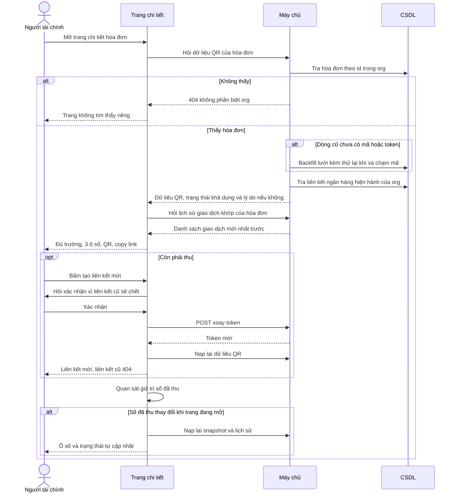

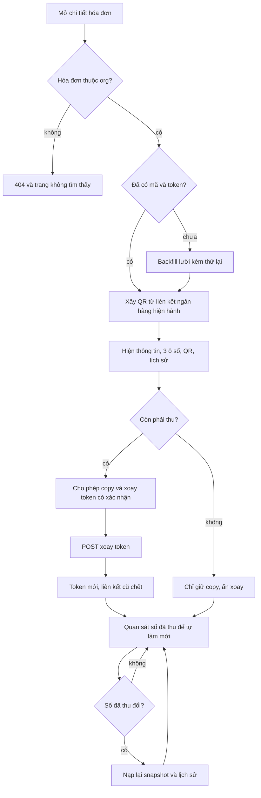

## F3 — Thu tự động: phụ huynh chuyển khoản → hệ thống tự khớp → giao diện tự heal

- **Actor**: Phụ huynh (chuyển khoản), Ngân hàng/Bank Hub (báo giao dịch), Hệ thống.
- **Kích hoạt**: giao dịch tiền vào tài khoản org có nội dung chứa mã chuyển khoản.
- **Điều kiện trước**: org đã liên kết tài khoản nhận; mã khớp mẫu tìm-kiếm không phân biệt hoa/thường theo biên từ ✅ [S15] packages/api/src/lib/payment-code.ts:9-15.
- **Kết quả**: giao dịch ghi sổ; nếu khớp → số đã thu tăng, trạng thái đủ khi đủ; webhook nhận ack để nhà cung cấp không gửi lại ✅ [S36] apps/server/src/routes/bank-hub-webhooks.ts:44-60.
- **Đường lưới**: gửi lại/quét lại → no-op nhờ khóa duy nhất ✅ [S11] apps/server/src/lib/payments/ingest-transaction.ts:100-133, [S73] apps/server/src/bank-hub-ipn.test.ts:232-249; 4 lý do chưa khớp: no_code/unknown_code/foreign_code/invoice_paid ✅ [S11] apps/server/src/lib/payments/ingest-transaction.ts:104-133, [S73] apps/server/src/bank-hub-ipn.test.ts:264-306; nội dung thường vẫn khớp (không phân biệt hoa/thường) ✅ [S73] apps/server/src/bank-hub-ipn.test.ts:378-393; hóa đơn đã đánh dấu đủ mà sổ còn thiếu vẫn nhận tiền bù vào sổ ✅ [S73] apps/server/src/bank-hub-ipn.test.ts:250-263; payload gốc chỉ giữ khi chưa khớp ✅ [S9] packages/db/src/schema/payment-transaction.ts:19-21.

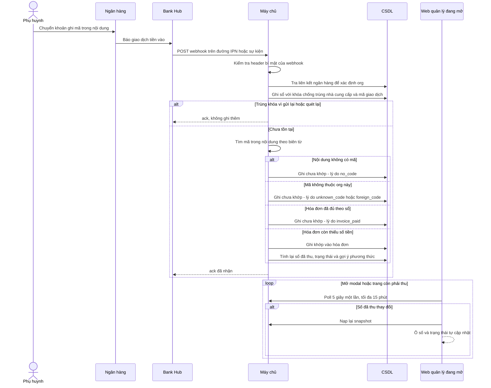

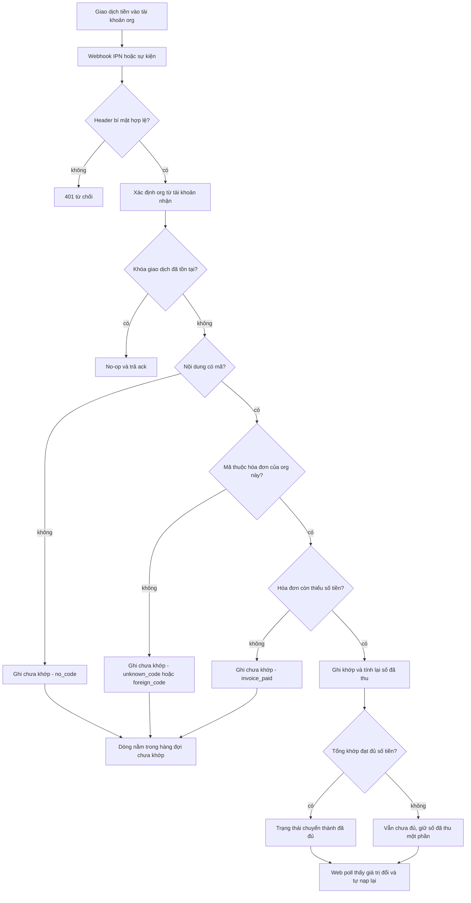

## F4 — Đánh dấu đã thu thủ công

- **Actor**: Người tài chính.
- **Kích hoạt**: nút "Đã nhận" trên dòng hóa đơn (trang Doanh thu).
- **Điều kiện trước**: hóa đơn đang hiện ở trạng thái chưa đủ.
- **Kết quả**: trạng thái đủ; ô số tiền KPI coi như thu trọn; phương thức ghi "CK" từ bảng.
- **Đường lưới**: chặn thao tác kép trong phiên (tất cả nút khóa khi đang lưu) ✅ [S33] apps/web/src/lib/use-direct-kernel-action.ts:14-31; optimistic ✅ [S32] apps/web/src/lib/data-store-reducer.ts:77-87; gửi lại sau lỗi mạng = replay an toàn, chỉ ghi đè phương thức ✅ [S7] apps/server/src/routes/kernel.ts:3119-3124.

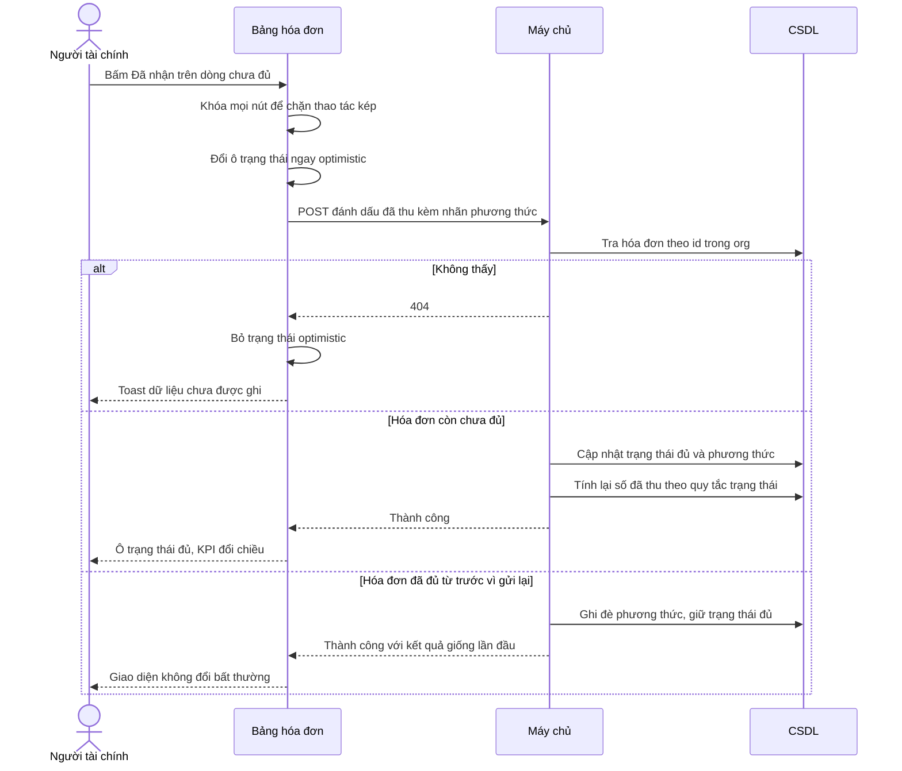

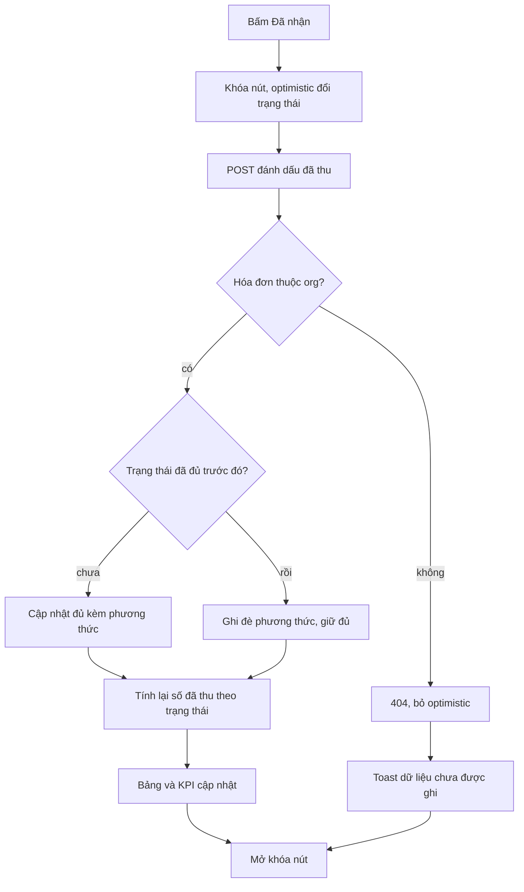

## F5 — Ghi nhận phiếu thu từng phần (Sổ công nợ)

- **Actor**: Người tài chính.
- **Kích hoạt**: nút "Thu" trên dòng học viên còn nợ.
- **Điều kiện trước**: học viên có ≥1 hóa đơn còn nợ (mặc định chọn khoản hạn sớm nhất ✅ [S24] apps/web/src/components/modals/record-payment-modal.tsx:73-85, [S18] apps/web/src/lib/tuition-from-kernel.ts:622-637).
- **Kết quả**: 1 dòng sổ provider "manual" + tính lại số đã thu; kết quả có thể một phần hoặc đủ.
- **Đường lưới**: 422 đã-đủ / vượt-còn-thiếu (kèm số còn lại cập nhật vào form) / 409 trùng khóa (giữ form, sinh khóa mới) ✅ [S24] apps/web/src/components/modals/record-payment-modal.tsx:124-191; guard chống vượt nằm trong cùng lô ghi ✅ [S12] apps/server/src/lib/payments/record-manual-payment.ts:97-196.

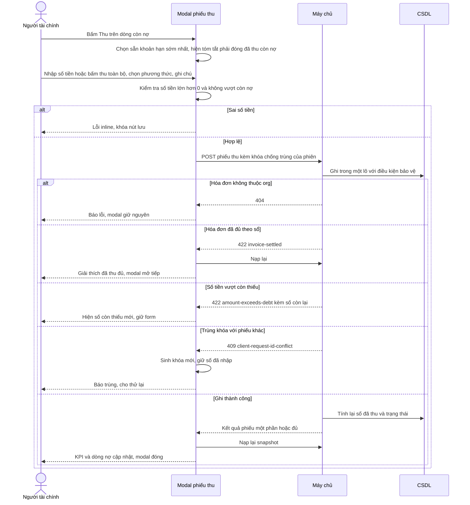

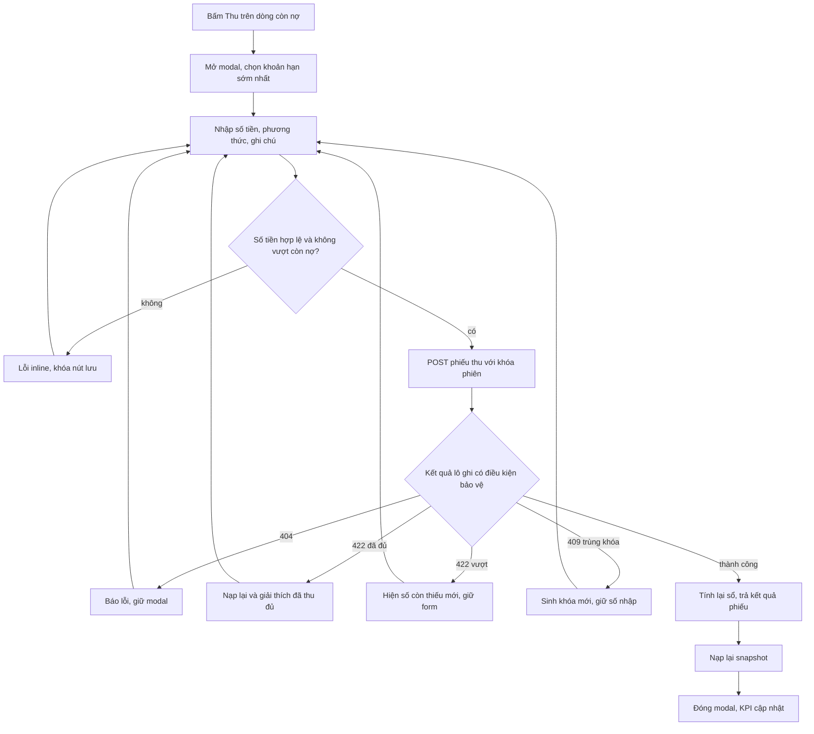

## F6 — Xử lý giao dịch chưa khớp: gán vào phiếu / bỏ qua

- **Actor**: Người tài chính.
- **Kích hoạt**: hàng đợi "Giao dịch chưa khớp" trên trang Doanh thu.
- **Điều kiện trước**: có giao dịch chưa khớp của org (tối đa 50 dòng); nội dung lạ được che ✅ [S4] apps/server/src/routes/payment-transactions.ts:47-76.
- **Kết quả**: tiền được gán vào hóa đơn còn thiếu (hoặc bị đánh dấu bỏ qua, không tính tiền); số đã thu tính lại.
- **Đường lưới**: gán vào hóa đơn đã đủ theo sổ → 409 INVOICE_ALREADY_PAID; giao dịch không còn trạng thái chưa khớp (gán 2 lần) → 404 ✅ [S4] apps/server/src/routes/payment-transactions.ts:78-130; nút gán phía client không đọc body lỗi → chỉ làm mới 🟡 [S23] apps/web/src/components/modals/invoice-payment-modal.tsx:397-414 (→ OQ-16).

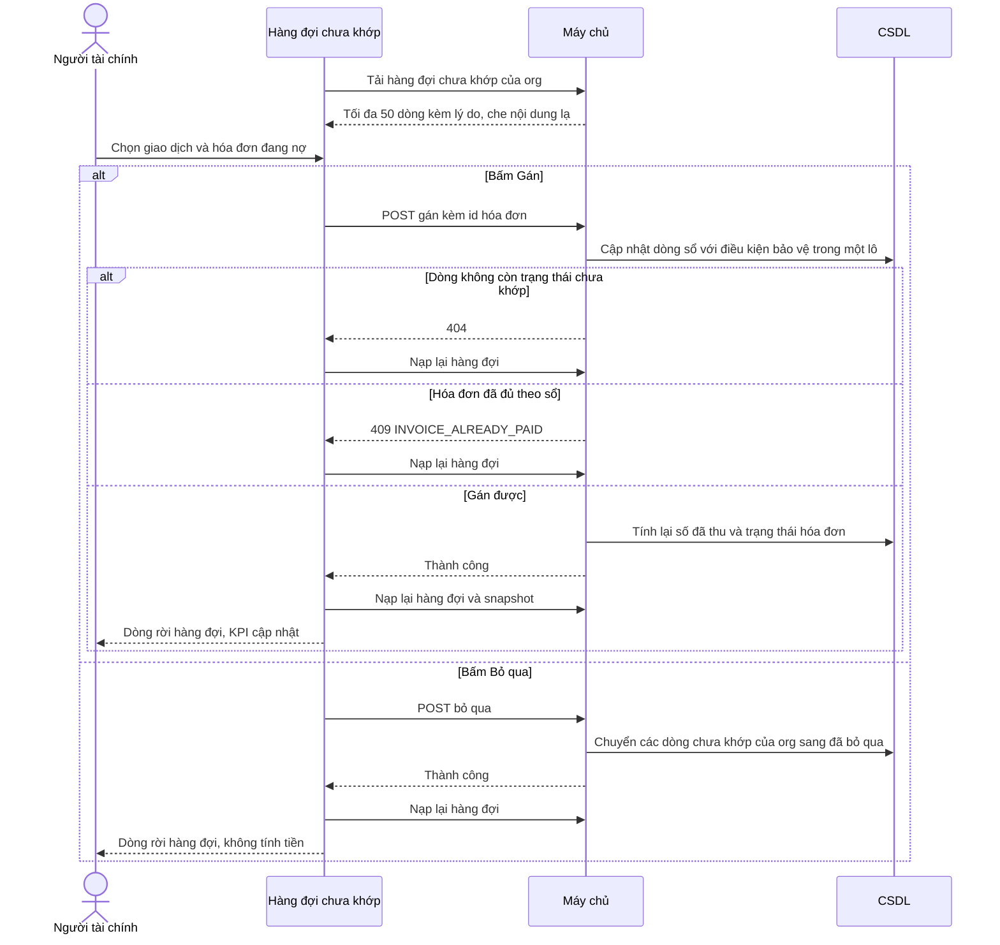

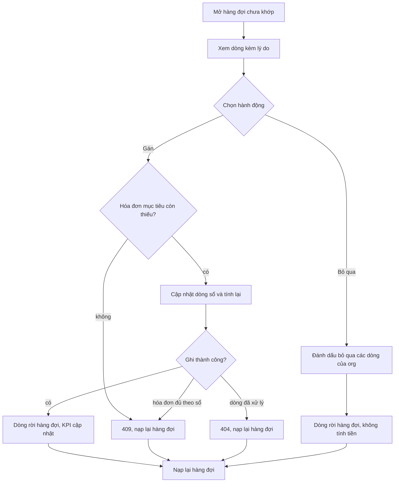

## F7 — Đối soát tài khoản ngân hàng

- **Actor**: Người tài chính + hệ thống.
- **Kích hoạt**: nút "Đối soát" cạnh hàng đợi chưa khớp.
- **Điều kiện trước**: org có liên kết tài khoản đang hoạt động (lịch sử tài khoản cũ vẫn được quét ✅ [S69] packages/db/src/schema/org-bank-link.ts:14-16).
- **Kết quả**: giao dịch mới nạp vào sổ qua cùng bộ ghép (cho phép lưu dòng không có mã); trả bộ đếm `{scanned, matched, unmatched}` ✅ [S13] packages/api/src/contracts.ts:3083-3087.
- **Đường lưới**: cooldown 60 giây → 429 "reconcile cooldown"/RECONCILE_COOLDOWN ✅ [S37] apps/server/src/routes/bank-link.ts:278-281, [S74] apps/server/src/bank-hub-reconcile.test.ts:223-229; Bank Hub trả 429 thì route cũng 429 kèm Retry-After ✅ [S74] apps/server/src/bank-hub-reconcile.test.ts:230-236; web hiển thị kết quả hoặc cảnh báo cooldown ✅ [S23] apps/web/src/components/modals/invoice-payment-modal.tsx:329-339; quét cả tài khoản cũ sau khi relink và lưu dòng không-mã ✅ [S74] apps/server/src/bank-hub-reconcile.test.ts:173-207.

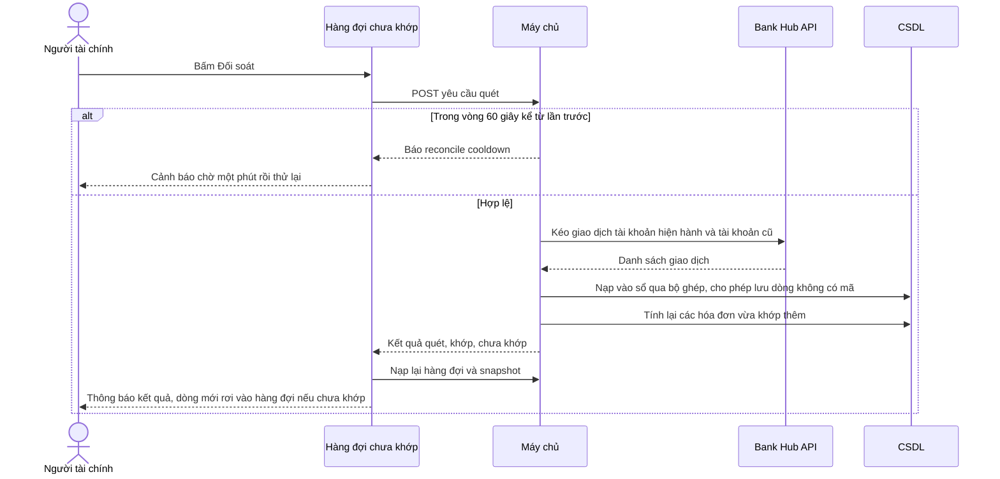

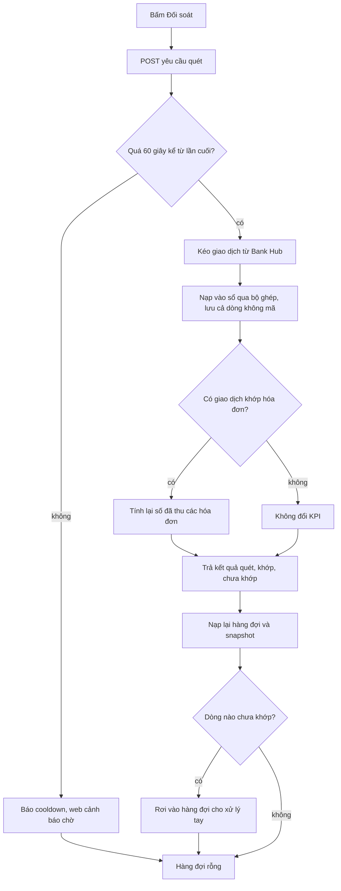

## F8 — Sổ công nợ: lọc/tìm/chọn → gửi nhắc học phí hàng loạt

- **Actor**: Người tài chính.
- **Kích hoạt**: mở `/debts`; chọn chip/lớp/từ khóa; tick dòng còn nợ; bấm "Gửi nhắc học phí".
- **Điều kiện trước**: quyền tài chính (gate web trước khi render ✅ [S27] apps/web/src/lib/use-finance-route-guard.ts:12-30).
- **Kết quả**: mỗi hóa đơn còn nợ của học viên được chọn nhận 1 thông báo; khóa chống trùng theo ngày Việt Nam; trả `{queued, skipped}` ✅ [S30] apps/server/src/lib/notifications/templates.ts:40-54.
- **Đường lưới**: chip/lớp/từ khóa sync URL; tìm không dấu debounce ✅ [S56] apps/web/src/routes/_auth/debts/index.test.tsx:208-332; gọi lại trong ngày → queued=0 ✅ [S51] apps/server/src/routes/debt-reminders.test.ts:336-366; chặn >100 hoặc trùng id → 400 ✅ [S13] packages/api/src/contracts.ts:4087-4098.

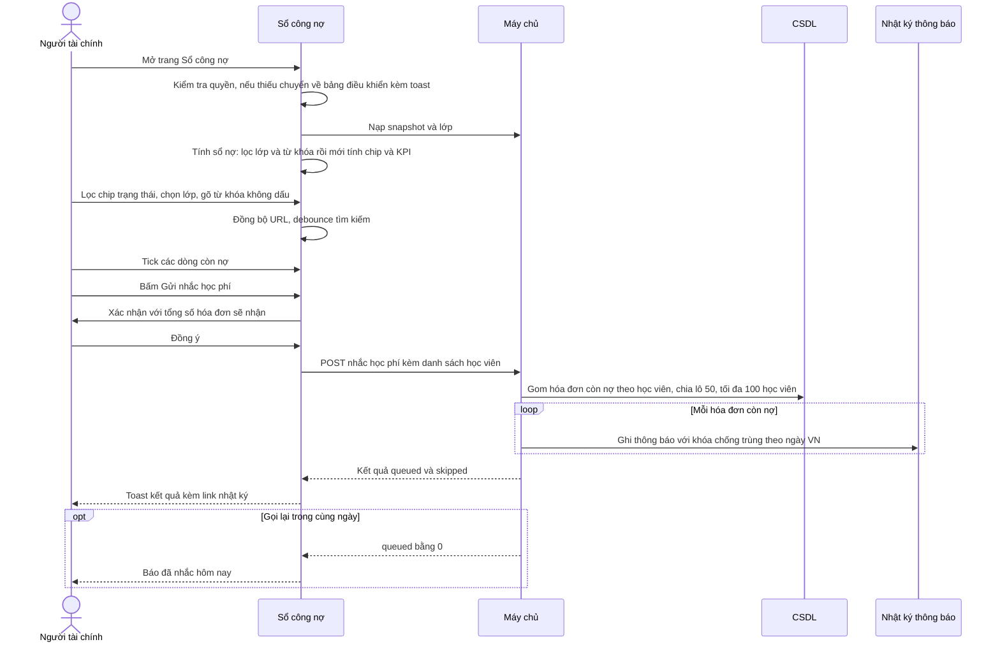

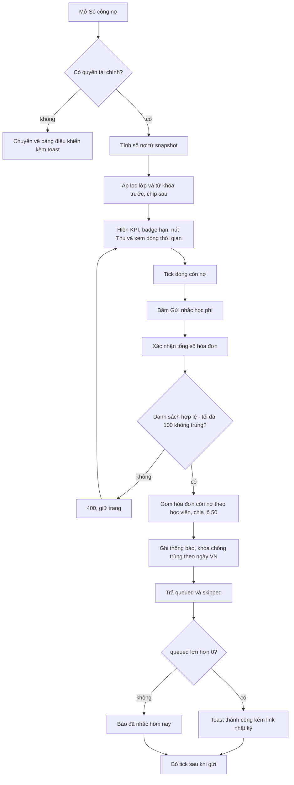

## F9 — Xem dòng thời gian hóa đơn & giao dịch theo học viên

- **Actor**: Người tài chính.
- **Kích hoạt**: nút con mắt trên dòng nợ (không kích hoạt điều hướng dòng).
- **Kết quả**: drawer với 3 ô tổng, các mục phát-hành-hóa-đơn và mục thu tiền theo tháng mới nhất trước; mục thu từ luồng ngân hàng được che nội dung/phương thức ✅ [S52] apps/server/src/routes/billing-timeline.test.ts:336-345.
- **Đường lưới**: 200 sự kiện phát hành + 200 mục thu, thu tiền đứng trước phát hành cùng mốc ✅ [S7] apps/server/src/routes/kernel.ts:3274-3387; học viên lạ/org khác → 404 không phân biệt ✅ [S52] apps/server/src/routes/billing-timeline.test.ts:356-365.

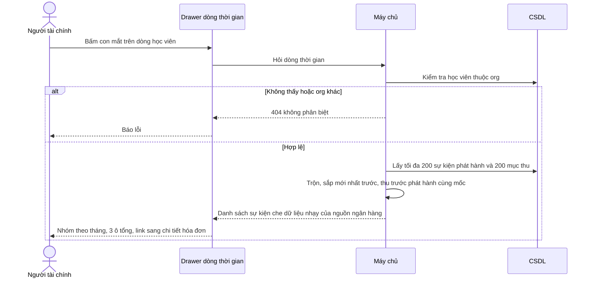

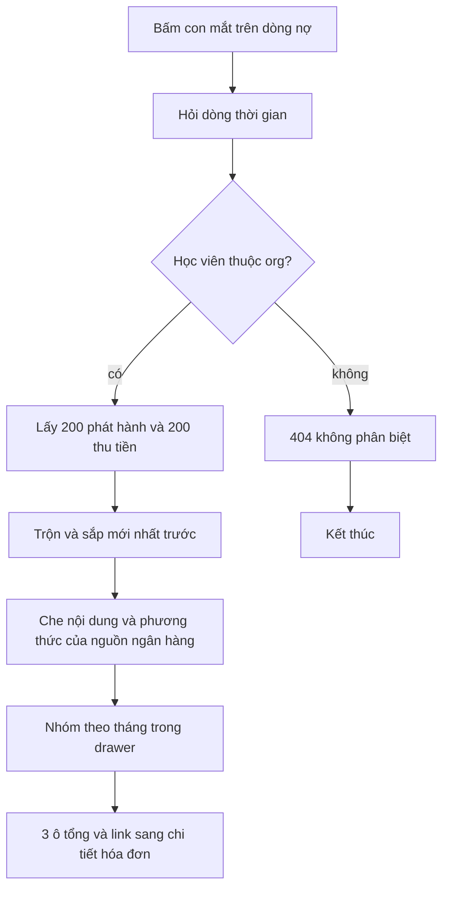

## F10 — Phụ huynh thanh toán qua liên kết công khai

- **Actor**: Phụ huynh (không đăng nhập).
- **Kích hoạt**: mở liên kết `/pay/<token>` do giáo viên chia sẻ.
- **Kết quả**: thấy số tiền, tên học viên, tổ chức, QR chuyển khoản; tiền về → giao diện tự đổi sang đã đủ (poll).
- **Đường lưới**: token không tồn tại/xoay → 404 chung; hạn đóng và ghi chú cố ý không trả về ✅ [S16] apps/server/src/routes/public-pay.ts:10-17, [S72] apps/server/src/public-pay.test.ts:66-92; đủ → trả không-khả-dụng kèm lý do; chưa liên kết tài khoản → lý do riêng ✅ [S72] apps/server/src/public-pay.test.ts:93-111; không cache ✅ [S16] apps/server/src/routes/public-pay.ts:33-38; poll 5s ≤15 phút, hết hạn hiện nút Làm mới ✅ [S21] apps/web/src/lib/repos/payments.ts:64-116, [S17] apps/web/src/routes/pay.$token.tsx:25-116.

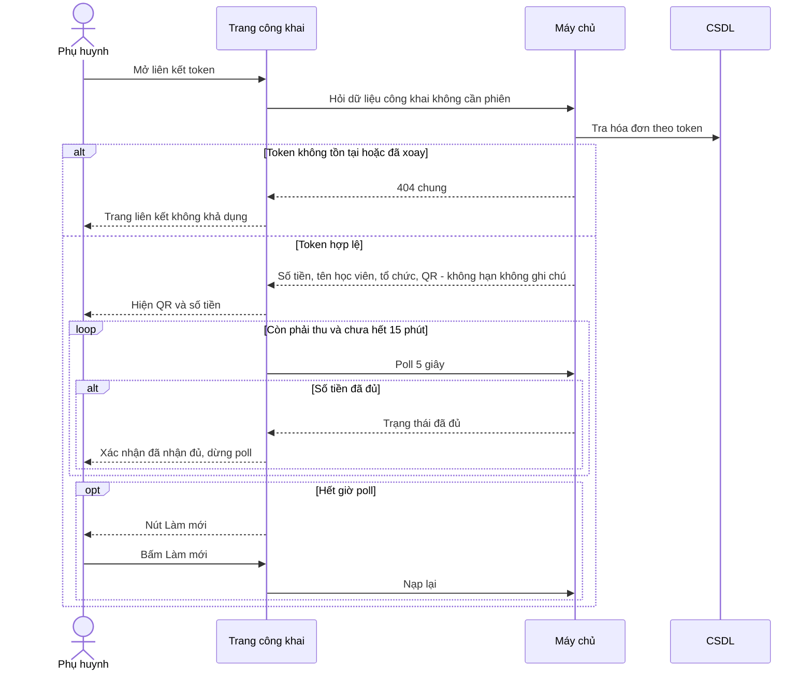

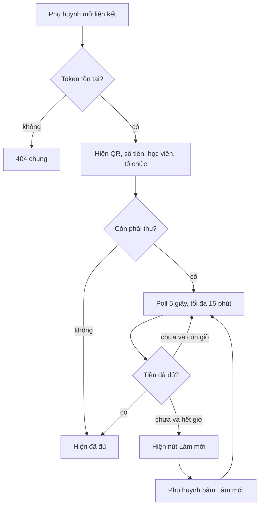
