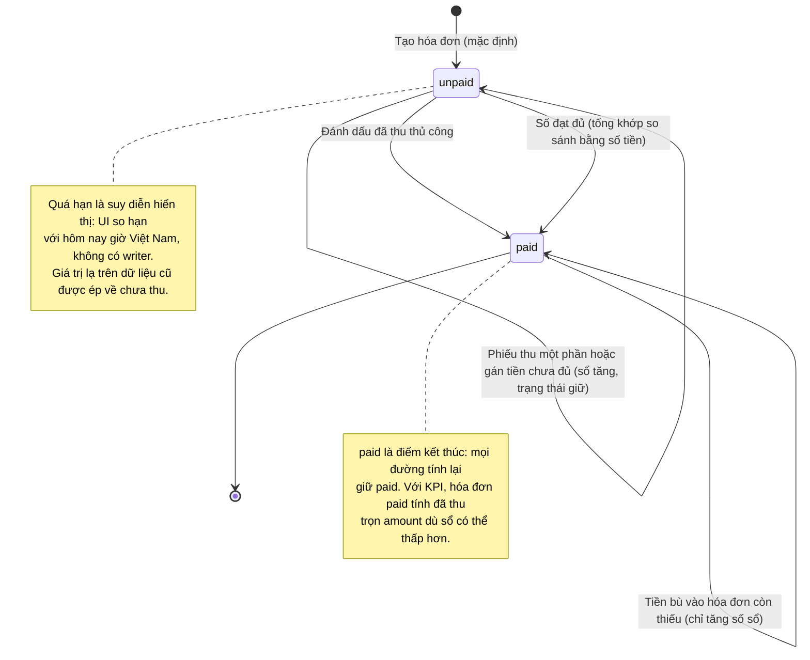

# Vòng đời trạng thái hóa đơn — tuition-invoicing

> Nhãn: ✅ chắc chắn (code khẳng định: validator/hằng/guard/enum/migration/chuỗi lỗi) · 🔵 suy đoán (≥2 chỗ code hậu thuẫn) · 🟡 cần xác nhận (vì sao/mục tiêu/priority → OQ).

## Trạng thái ghi thật của máy chủ

Máy chủ chỉ ghi hai giá trị: tạo mặc định `unpaid`, đánh dấu/tính lại có thể sang `paid`. `paid` là điểm kết thúc — mọi đường tính lại đều giữ `paid` ✅ [S10] apps/server/src/lib/payments/recompute-invoice.ts:29-32. Giá trị `overdue` trong dữ liệu KHÔNG có writer nào (NS-02); UI suy ra từ hạn so với hôm nay theo giờ Việt Nam ✅ [S18] apps/web/src/lib/tuition-from-kernel.ts:186-202. Giá trị lạ (dữ liệu cũ) được ép về chưa-thu khi hiển thị ✅ [S61] apps/web/src/lib/repos/invoices.test.ts:128-149.

## Hai lớp "đã đủ" (kết quả của state machine)

| Lớp | Định nghĩa | Ai đọc | Ai ghi |
|---|---|---|---|
| Trạng thái | cột trạng thái = `paid` | KPI web (tiền đã thu = trọn số tiền), badge, sổ nợ | mark-paid thủ công + đường tính lại khi sổ đủ ✅ [S10] apps/server/src/lib/payments/recompute-invoice.ts:29-32 |
| Sổ | tổng giao dịch khớp so sánh bằng số tiền | điều kiện nhận thêm tiền (chặn khi đủ theo sổ), ô "Còn lại" chi tiết | mỗi lần tiền vào/gán/phiếu thu ✅ [S12] apps/server/src/lib/payments/record-manual-payment.ts:97-196 |

Hệ quả: hóa đơn `paid` nhưng sổ còn thiếu vẫn nhận tiền bù qua gán/phiếu thu — số sổ tăng nhưng KPI không đổi (đã thu trọn theo trạng thái) 🟡 [S4] apps/server/src/routes/payment-transactions.ts:108-110, [S18] apps/web/src/lib/tuition-from-kernel.ts:20-32 → CF-1/OQ-09.
