# srs/vocab-hub-reverse-flows — vocab-hub

Luồng nghiệp vụ đảo ngược — draft

Ghi chú: chữ trong sơ đồ viết ASCII không dấu; tên route giữ nguyên. Nhãn
mức tin cậy đặt ở phần chứng thực, không nằm trong sơ đồ.

## F1 — Vào hub từ vựng

**Nguồn:** apps/web/src/routes/_auth/vocab/index.tsx:16-40;
apps/web/src/components/vocab/vocab-hub-decks.tsx:1-10;
apps/web/src/components/vocab/vocab-deck-list.tsx:96-218;
apps/web/src/components/layout/sidebar.tsx:88-105;
apps/server/src/routes/snapshot.ts:386-410,833-848.

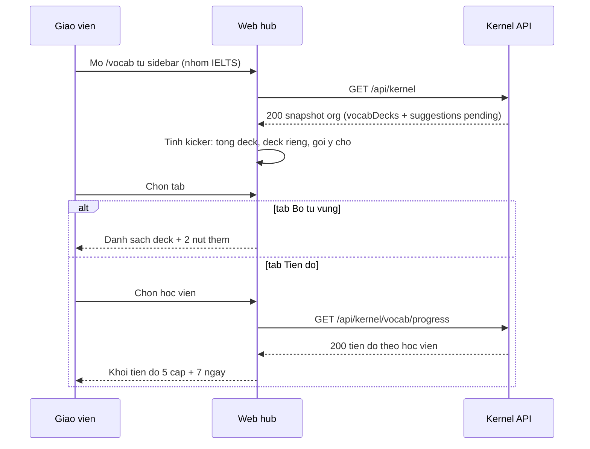

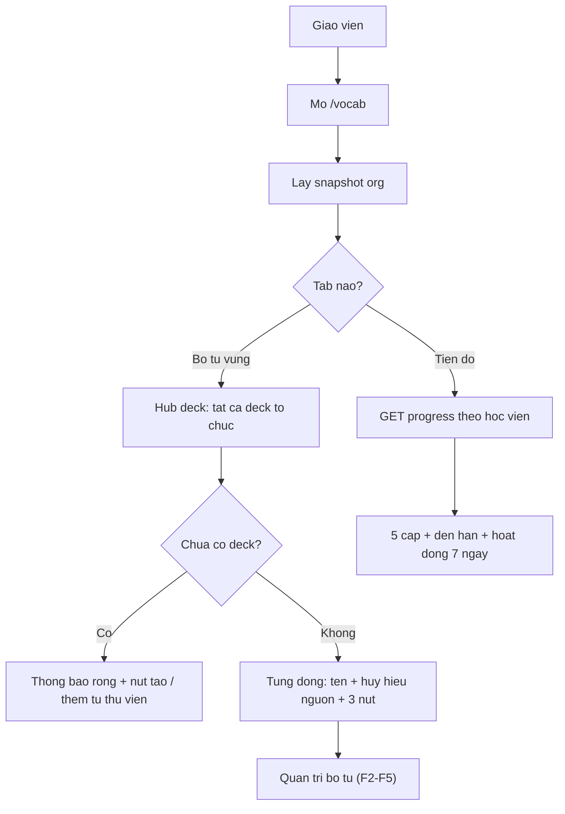

**Chứng thực:**
- Mục điều hướng không có công tắc ẩn/hiện; /vocab hợp lệ cho SW. ✅
  sidebar.tsx:88-105; routes-matcher.ts:33; negative-search #9.
- Kicker đếm gợi ý chờ từ slice pending của bản chụp. ✅ index.tsx:16-36;
  snapshot.ts:396-410.
- Hub hiện TẤT CẢ deck tổ chức; trang lớp chỉ hiện deck của lớp. ✅
  vocab-deck-list.tsx:96-115.
- Đếm gợi ý chờ theo deck trên web. ✅ vocab-deck-list.tsx:125-131.

## F2 — Tạo / xoá bộ từ vựng

**Nguồn:** apps/web/src/components/vocab/vocab-deck-list.tsx:133-173,222-287;
apps/server/src/routes/vocab-teacher.ts:135-275;
packages/api/src/contracts.ts:3140-3172;
apps/server/src/routes/vocab-teacher.test.ts:108-110,146.

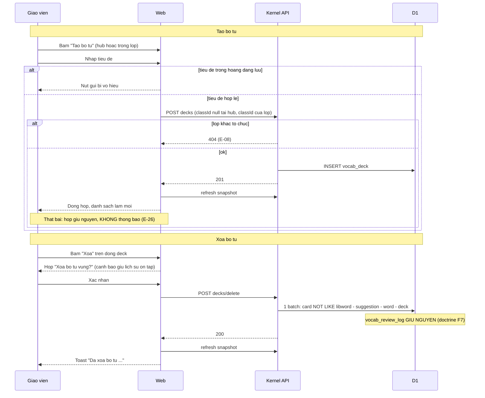

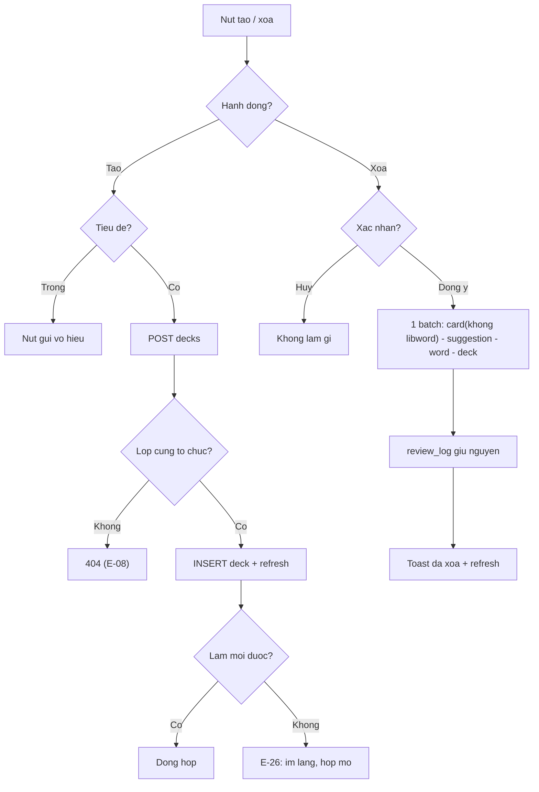

**Chứng thực:**
- Đích đích-null ở hub qua hợp đồng (classId nullable, default null) và test
  web khẳng định thân lệnh hub có đích rỗng. ✅ contracts.ts:3148-3150;
  vocab-hub.test.tsx:21.
- Lớp khác tổ chức → 404 TRƯỚC khi chèn. ✅ vocab-teacher.ts:142-156; test :401.
- Xoá giữ nhật ký; thẻ libword-* được loại trừ; test tắt PRAGMA khóa ngoại để
  chứng minh không dựa cascade. ✅ vocab-teacher.ts:209-275; test :108-110,146.
- 🔵 Thứ tự xoá card→suggestion→word→deck là TRÁNH lỗi khóa ngoại còn sót, vì
  schema đã tuyên bố "không dựa vào cascade" (schema/vocab.ts:18-20) và lô xoá
  xếp đúng thứ tự phụ thuộc (vocab-teacher.ts:246-273).
- E-26: nhánh tạo thất bại không toast — đối chiếu editor/thư viện đều có
  toast. ✅ vocab-deck-list.tsx:150-160; 🟡 OQ-03.

## F3 — Soạn từ vựng + âm thanh phát âm

**Nguồn:** apps/web/src/components/vocab/vocab-deck-editor.tsx:11-201;
apps/web/src/components/vocab/vocab-word-row.tsx:87-123;
apps/server/src/routes/vocab-teacher.ts:83-133,654-749,751-880;
packages/api/src/contracts.ts:3175-3197,2420-2423.

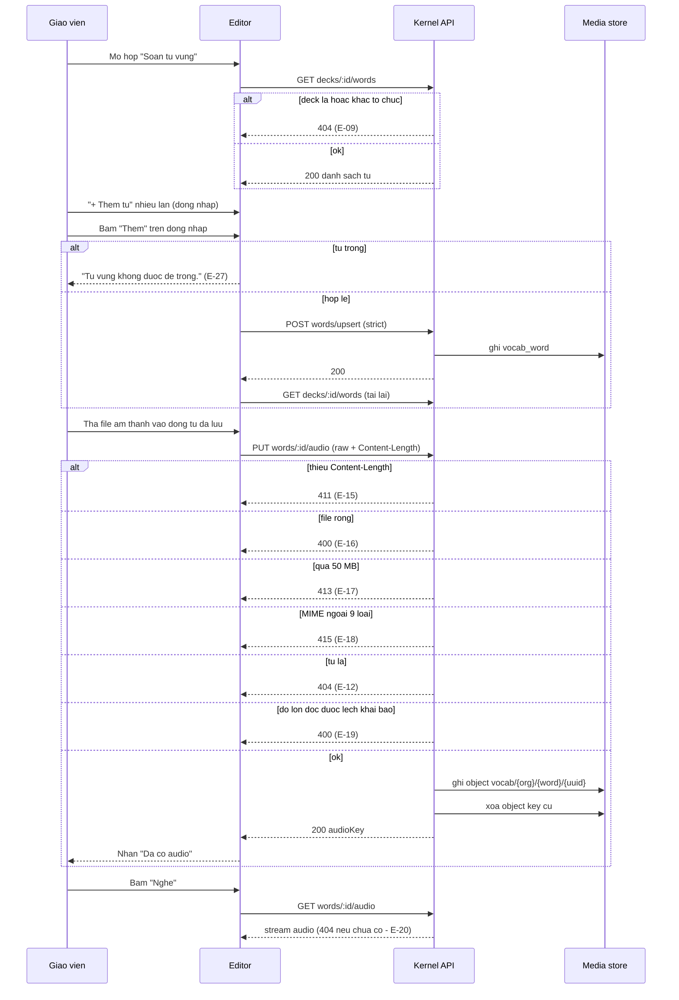

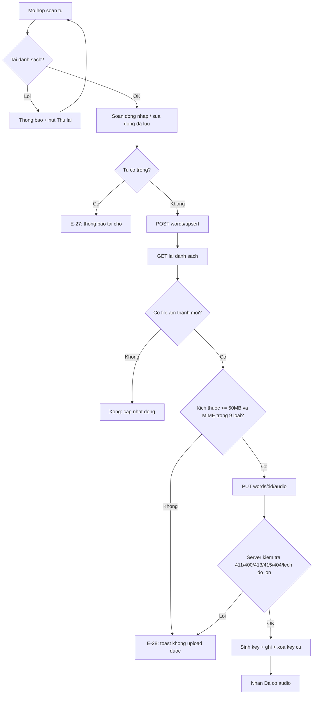

**Chứng thực:**
- Danh sách từ tải bằng lời gọi riêng mỗi lần mở hộp. ✅ editor.tsx:30-54.
- Dòng nháp chỉ sống trong phiên hộp; sửa/xoá dòng đã lưu gọi thẳng server và
  tải lại. ✅ editor.tsx:56-117.
- 9 MIME cho phép: mpeg, mp3, mp4, x-m4a, aac, wav, x-wav, webm, ogg. ✅
  vocab-teacher.ts:41-51,779-791; test 415 :237.
- Client chặn trước theo trần + MIME; hint nguyên văn "MP3/M4A/WAV · tối đa
  50 MB". ✅ vocab-word-row.tsx:92-99.
- F3: hợp đồng KHÔNG nhận audioKey từ client; server sinh
  vocab/{orgId}/{wordId}/{uuid} và xoá key cũ. ✅ contracts.ts:3175-3177;
  vocab-teacher.ts:816,827-837.
- Nhãn "Đã có audio" tính theo audioKey HOẶC audioUrl (từ nhân bản). ✅
  vocab-word-row.tsx:87-91; test vocab-library-dialog.test.tsx:320.

## F4 — Thêm bộ từ từ thư viện

**Nguồn:** apps/web/src/components/vocab/vocab-library-dialog.tsx:14-314,452-528;
apps/server/src/routes/vocab-library.ts:21-31,204-364;
apps/server/src/routes/vocab-library.test.ts:336-588;
apps/e2e/specs/vocab-library-clone.spec.ts:1-604.

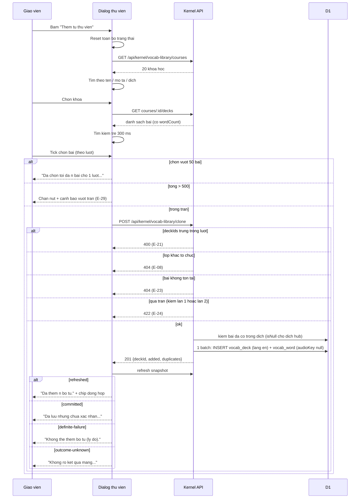

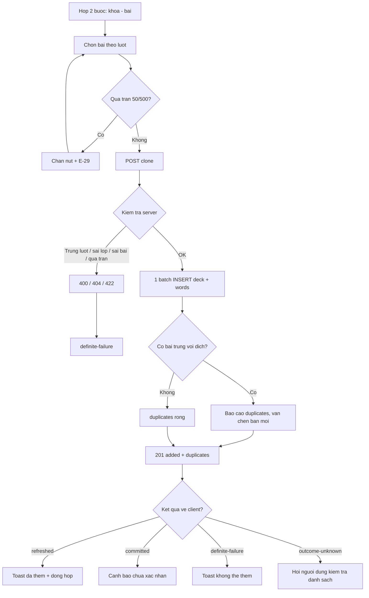

**Chứng thực:**
- Trần 50/500 kiểm 2 lần phía server (trước và sau khi đếm từ thật) → 422
  LIBRARY_CLONE_TOO_LARGE. ✅ vocab-library.ts:21-22,246-257,281-292; test :378-436.
- Trùng deckIds trong lượt → 400; lớp IDOR kiểm trước khi đụng bảng thư viện
  → 404. ✅ vocab-library.ts:220-230,234-245; test :337-348,350-359.
- Trùng với đích chỉ BÁO CÁO: đích hub dùng điều kiện isNull(class_id) —
  nhân bản lại vẫn chèn bản mới. ✅ vocab-library.ts:294-312; test :510-526,543-588;
  🟡 OQ-05.
- Chèn giữ provenance sourceLibraryDeckId, lang "en", audioKey null (URL thư
  viện chép sang audioUrl). ✅ vocab-library.ts:326-351; schema/vocab.ts:34-38.
- 4 loại kết quả ứng xử đầy đủ phía client; chip "Đã có trong hub"/"Đã có
  trong lớp". ✅ vocab-library-dialog.tsx:236-293,519-528; e2e S44.
- Duyệt thư viện là global đọc-cho-mọi-org; chưa đăng nhập → 401 đủ 4
  endpoint. ✅ vocab-library.ts:32-43; test :211-237,266-270.

## F5 — Gợi ý / thu hồi gợi ý

**Nguồn:** apps/web/src/components/vocab/vocab-suggest-dialog.tsx:10-14,68-79,84-142,150-194,218-285;
apps/server/src/routes/vocab-teacher.ts:277-496;
packages/db/src/schema/vocab.ts:159-203;
apps/server/src/routes/vocab-teacher.test.ts:453.

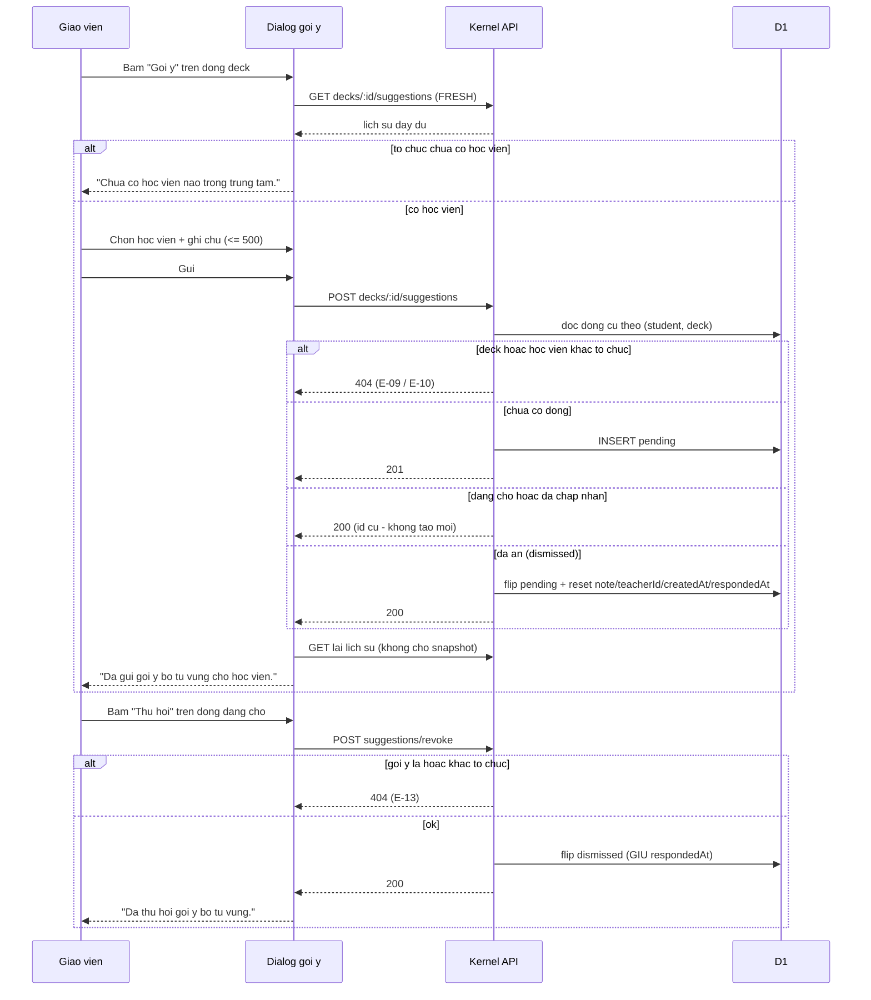

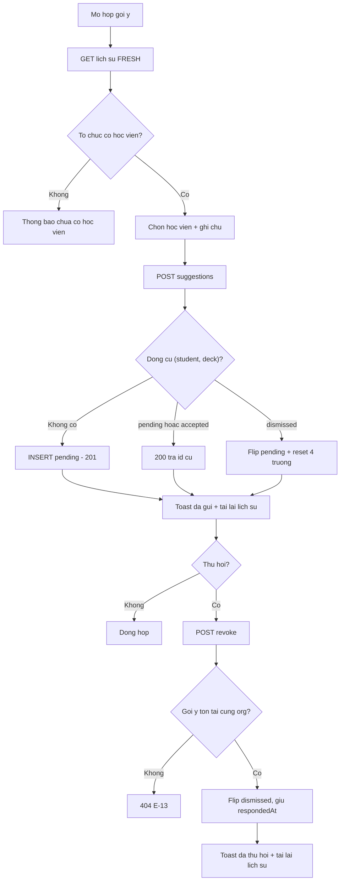

**Chứng thực:**
- Ràng buộc duy nhất (student, deck) + upsert flip. ✅ schema/vocab.ts:159-164,198-201;
  vocab-teacher.ts:397-413; test suite gợi ý :453.
- Thu hồi MỀM giữ respondedAt — không hard-delete từ phía giáo viên. ✅
  vocab-teacher.ts:484-487.
- Nhánh đua tranh có bảo vệ select-200/500 nhưng KHÔNG có test kích hoạt
  (GAP-2/E-25). ✅ vocab-teacher.ts:440-453.
- Lịch sử tải FRESH vì snapshot chỉ phơi pending. ✅ suggest-dialog.tsx:84-91,120-142;
  snapshot.ts:396-410.
- Accept/dismiss của học viên thuộc student-practice (ranh giới FR-23); mã
  SUGGESTION_ALREADY_ACCEPTED nằm ở route học viên. ✅ routes/vocab.ts:861;
  🟡 OQ-06 (thu hồi sau accepted không bị chặn).

## F6 — Xem tiến độ học từ vựng

**Nguồn:** apps/server/src/routes/vocab-teacher.ts:498-652;
apps/server/src/lib/vocab-provision.ts:72-247;
apps/web/src/components/vocab/vocab-progress-tab.tsx:33-108,129-186,284-390;
packages/api/src/contracts.ts:3422-3466.

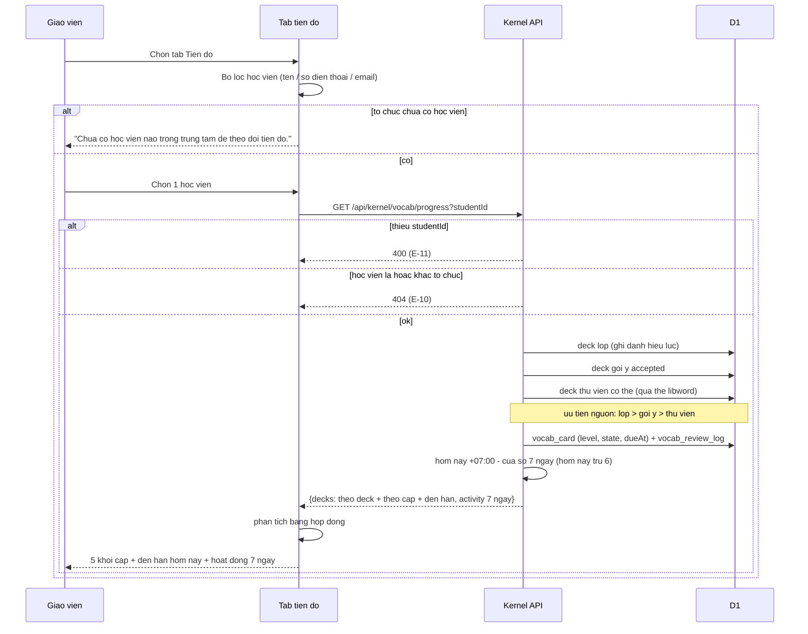

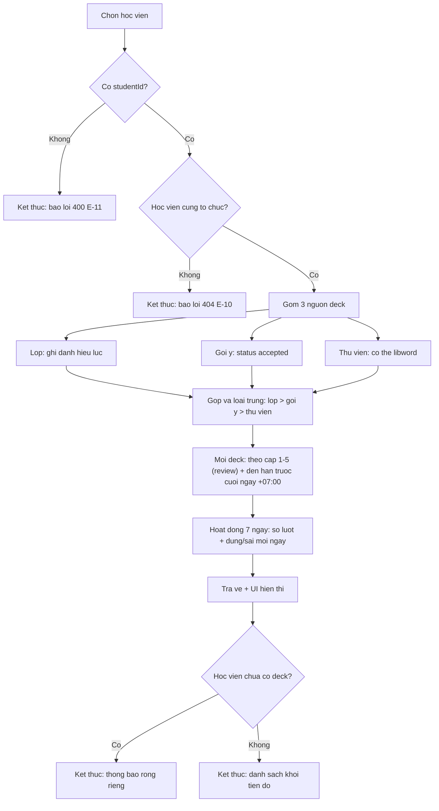

**Chứng thực:**
- 400 thiếu studentId; 404 học viên khác tổ chức. ✅ vocab-teacher.ts:501-514;
  test :453.
- Mô hình tiếp cận 3 nguồn + độ ưu tiên — chú thích RT-F1 liệt kê đúng 5 điểm
  gọi dùng chung với phía học viên. ✅ vocab-provision.ts:72-108,110-247.
- Giờ Việt Nam: "hôm nay" theo +07:00, đến hạn so với cuối ngày +07:00, cửa
  sổ 7 ngày = hôm nay − 6; gom lượt theo ngày VN bất kể múi giờ máy chủ. ✅
  vocab-teacher.ts:516-527,569-599.
- Phân bố cấp chỉ đếm thẻ đang review; mới/chưa học tính riêng. ✅
  vocab-teacher.ts:601-637; test :453,708.
- Tiến độ KHÔNG qua snapshot — endpoint riêng vì dữ liệu per-student. ✅
  progress-tab.tsx:156-178; 🔵 INF-4.
