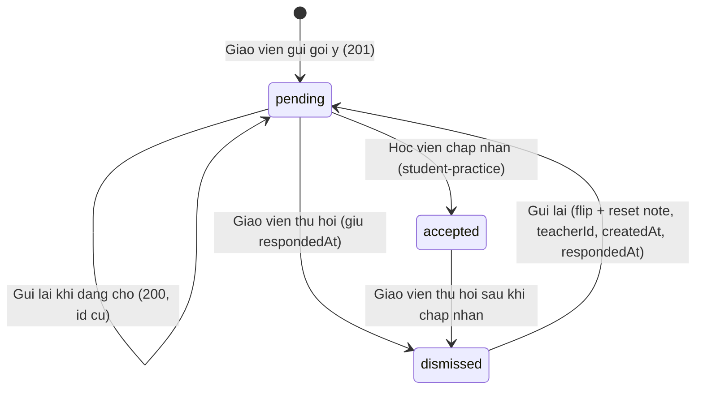
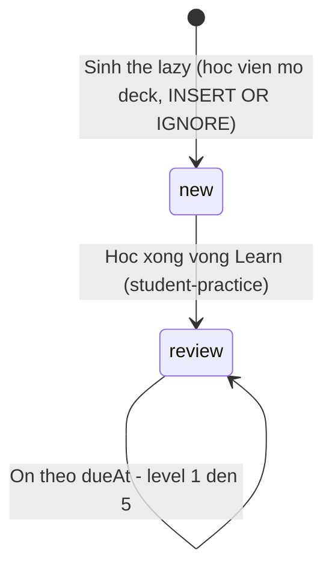
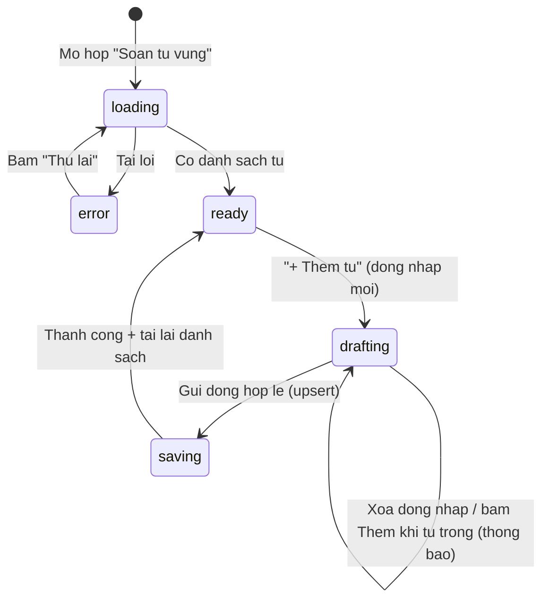

# srs/vocab-hub-reverse-states — vocab-hub

Máy trạng thái đảo ngược — draft

Chỉ liệt kê các máy trạng thái CÓ bằng chứng mã. Máy học SRS 5 cấp độ
(new/review → level 1..5, dueAt, lapses) thuộc student-practice — ở đây chỉ
vẽ khung và nháy chéo. Chữ trong sơ đồ ASCII không dấu.

Lưu ý phân mã: SM-01..SM-03 của FILE này là máy trạng thái, KHÔNG cùng họ với
SM-01..SM-10 ở spec Mục 7 (thước đo kiểm thử). Trích dẫn phải ghi rõ nguồn
(states vs Mục 7); "xem F6/SM-02" ở spec Mục 0 thuộc file states này.

## SM-01 — Trạng thái gợi ý (vocab_suggestion.status)

**Nguồn:** packages/db/src/schema/vocab.ts:159-203;
apps/server/src/routes/vocab-teacher.ts:397-413,456-496,320-323;
apps/web/src/components/vocab/vocab-suggest-dialog.tsx:10-14.

**Chứng thực:**
- Mọi chuyển trạng thái đều nằm trong 2 route gửi/thu hồi phía giáo viên hoặc
  route học viên (ranh giới). ✅ vocab-teacher.ts:397-413,484-487;
  routes/vocab.ts:861.
- accepted → dismissed ĐƯỢC PHÉP (route thu hồi không kiểm tra status hiện
  có) — được ghi thành OQ-06 vì không rõ nghiệp vụ có muốn chặn không. 🟡
- Giá trị lạ từ máy chủ được UI quy về "Đang chờ" (bộ đệm an toàn, không phải
  trạng thái thật của DB). ✅ vocab-teacher.ts:320-323.
- Xoá bộ từ xoá sạch gợi ý — không có trạng thái mồ côi. ✅
  vocab-teacher.ts:251-253.

## SM-02 — Trạng thái thẻ ghi nhớ (vocab_card.state) — khung ranh giới

**Nguồn:** packages/db/src/schema/vocab.ts:84-124;
apps/e2e/specs/vocab-srs.spec.ts:50-665 (ranh giới).

**Chứng thực:**
- state chỉ 2 giá trị new/review; level luôn 1..5; isWarning chỉ true ở level
  5; lập lịch chỉ đọc dueAt. ✅ schema/vocab.ts:91-94,105-111.
- Thẻ chỉ sinh ở phía học viên; giáo viên chỉ ĐỌC để tổng hợp tiến độ
  (BR-13). ✅ negative-search #6; schema/vocab.ts:86-87.
- Chuyển cấp độ/chấm điểm thuộc student-practice — không đặc tả ở đây. ✅
  e2e vocab-srs (S45).

## SM-03 — Vòng đời hộp soạn từ vựng (trạng thái UI cục bộ)

**Nguồn:** apps/web/src/components/vocab/vocab-deck-editor.tsx:30-175.

**Chứng thực:**
- Tải lỗi → thông báo + nút "Thử lại" quay về trạng thái tải. ✅
  editor.tsx:163-175.
- Dong nháp bị chặn ngay tại client khi ô từ trắng — không gọi mạng. ✅
  editor.tsx:74-101.
- Sau mỗi lần lưu/xoá thành công hộp tải lại danh sách từ. ✅
  editor.tsx:103-117.
- Không có trạng thái "saving-failure" riêng: thất bại mạng được cơ chế 4 loại
  kết quả tổng xử lý (FR-22); editor không toast riêng cho upsert từ (khác
  audio có toast). 🔵 (≥2 bằng chứng: data-actions.ts:293-344 đồng nhất 4
  loại; editor.tsx chỉ có toast cho audio :136).
