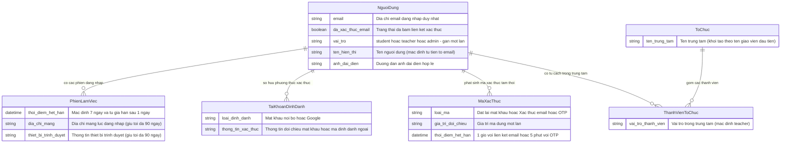

# auth-signin — Mô hình thực thể dữ liệu nghiệp vụ (ERD)

Mô hình dưới đây biểu diễn 6 thực thể dữ liệu cốt lõi tham gia vào nghiệp vụ xác thực, quản lý phiên làm việc và phân tách vai trò theo cổng ứng dụng (đặt tên `CamelCase` khớp với bảng CRUD trong `docs/auth-signin/usecases/auth-signin-usecase-index.md`).

## Từ điển thực thể nghiệp vụ

| Thực thể | Ý nghĩa nghiệp vụ | Các thuộc tính nghiệp vụ chính | Ràng buộc bảo mật / vòng đời |
|----------|-------------------|--------------------------------|------------------------------|
| `NguoiDung` | Hồ sơ định danh gốc dùng chung trên cả 3 cổng ứng dụng | `email` (duy nhất toàn hệ thống), `da_xac_thuc_email`, `vai_tro` (`student` / `teacher` / `admin`), `ten_hien_thi`, `anh_dai_dien` | Vai trò gán cố định 1 lần lúc tạo (`BR-auth-signin-001`); lưu giữ cho tới khi người dùng yêu cầu xóa (`NFR-auth-signin-009`); chỉ Chủ trung tâm và Quản trị viên hệ thống được tra cứu email (`NFR-auth-signin-010`) |
| `PhienLamViec` | Phiên đăng nhập đang có hiệu lực trên một trình duyệt/thiết bị | `thoi_diem_het_han`, `dia_chi_mang`, `thiet_bi_trinh_duyet` | Thời hạn 7 ngày, tự gia hạn sau 1 ngày hoạt động (`NFR-auth-signin-007`); hủy toàn bộ khi đổi mật khẩu (`BR-auth-signin-008`); nhật ký phiên giữ tối đa 90 ngày (`NFR-auth-signin-009`) |
| `TaiKhoanDinhDanh` | Nguồn phương thức xác thực gắn với một `NguoiDung` | `loai_dinh_danh` (mật khẩu nội bộ / Google), `thong_tin_xac_thuc` | Bằng `0` đối với Học viên chỉ đăng nhập thuần bằng mã OTP email; từ `1..2` phương thức (mật khẩu và/hoặc Google) đối với Giáo viên, Quản trị viên hoặc Học viên dùng mật khẩu/Google (`BR-auth-signin-012`) |
| `MaXacThuc` | Mã hoặc trạng thái xác thực tạm thời gắn theo định danh | `loai_ma` (đặt lại mật khẩu / OTP / dấu giãn cách gửi / dấu cổng giao dịch), `gia_tri_doi_chieu`, `thoi_diem_het_han` | Liên kết đặt lại mật khẩu có hạn 1 giờ dùng một lần (`BR-auth-signin-008`); mã OTP học viên có hạn 5 phút và giãn cách gửi 60 giây (`BR-auth-signin-009`) |
| `ToChuc` | Đơn vị trung tâm dạy học của giáo viên | `ten_trung_tam` | Tự động khởi tạo theo tên hiển thị của Giáo viên hợp lệ ở lần truy cập đầu tiên chưa có trung tâm (`FR-auth-signin-021`, `BR-auth-signin-011`) |
| `ThanhVienToChuc` | Tư cách thành viên kết nối một `NguoiDung` với một `ToChuc` | `vai_tro_thanh_vien` (mặc định Giáo viên) | Duy nhất theo cặp (`NguoiDung`, `ToChuc`); Học viên và Quản trị viên bị chặn trước khi bước khởi tạo này chạy (`FR-auth-signin-009`) |

## Bản số quan hệ (Cardinality)

| Thực thể nguồn | Thực thể đích | Bản số | Quy tắc nghiệp vụ chi phối |
|----------------|---------------|--------|----------------------------|
| `NguoiDung` | `PhienLamViec` | `1 : 0..N` | Một người dùng có thể chưa đăng nhập (`0`) hoặc đăng nhập đồng thời trên nhiều thiết bị (`N`); khi đặt lại mật khẩu thành công thì toàn bộ `N` phiên hiện hành bị xóa về `0` (`BR-auth-signin-008`). |
| `NguoiDung` | `TaiKhoanDinhDanh` | `1 : 0..N` | Bằng `0` với Học viên đăng nhập thuần bằng mã OTP email; từ `1..2` với người dùng đăng nhập bằng mật khẩu và/hoặc Google gộp chung khi đã xác minh email (`BR-auth-signin-012`). |
| `NguoiDung` | `MaXacThuc` | `1 : 0..N` | Đối chiếu nghiệp vụ qua địa chỉ `email` định danh của người dùng (hoặc phiên giao dịch xác thực), chịu giới hạn tần suất gửi (`NFR-auth-signin-006`). |
| `NguoiDung` | `ThanhVienToChuc` | `1 : 0..N` | Tài khoản Học viên/Quản trị có `0` tư cách thành viên giáo viên; tài khoản Giáo viên hợp lệ được khởi tạo tự động `1` tư cách thành viên trung tâm ở giai đoạn một trung tâm (`BR-auth-signin-011`). |
| `ToChuc` | `ThanhVienToChuc` | `1 : 0..N` | Một trung tâm quy tụ các thành viên vận hành thuộc trung tâm đó. |

<!-- wm:c3e3a8b9c06f46427bf9089e2fdafa48 -->
Tài liệu thuộc bộ AI4BA BA-Kit — bản quyền ai4ba.com
