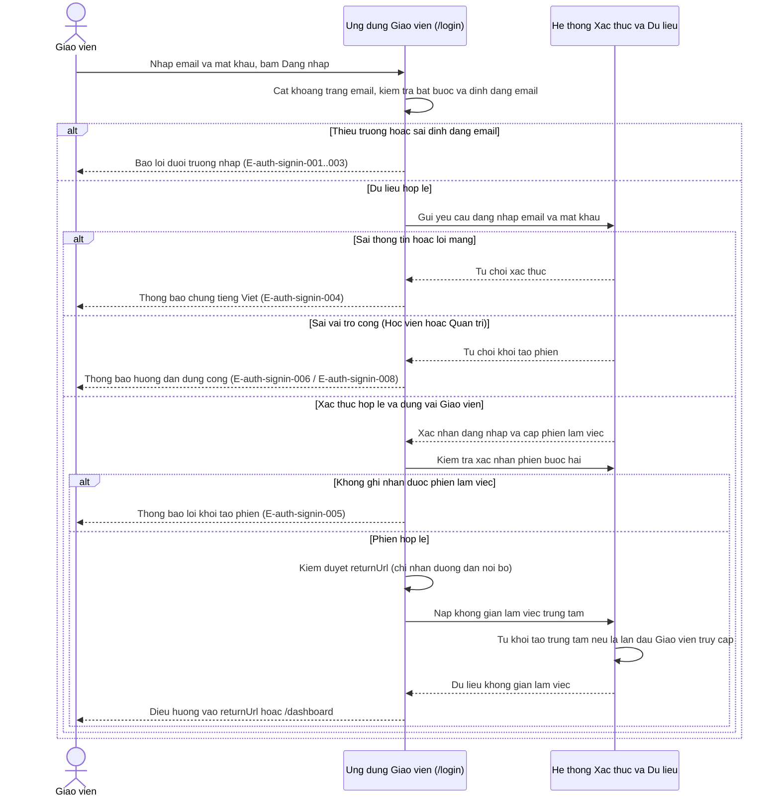
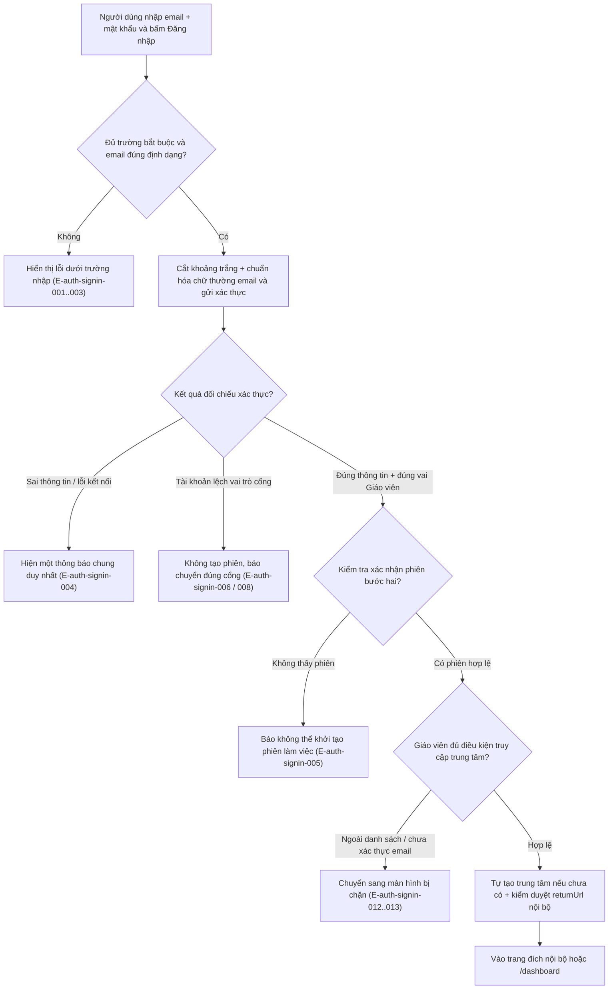
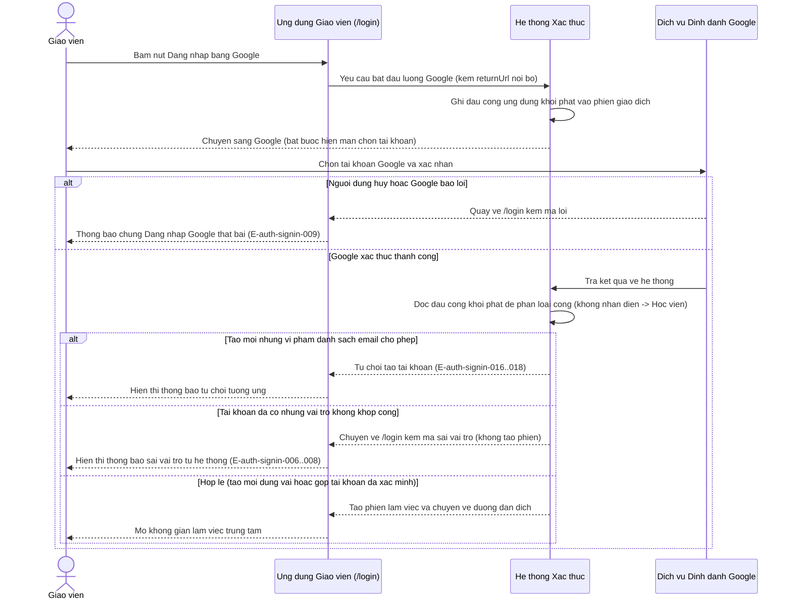
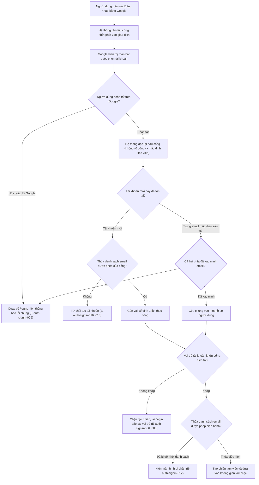
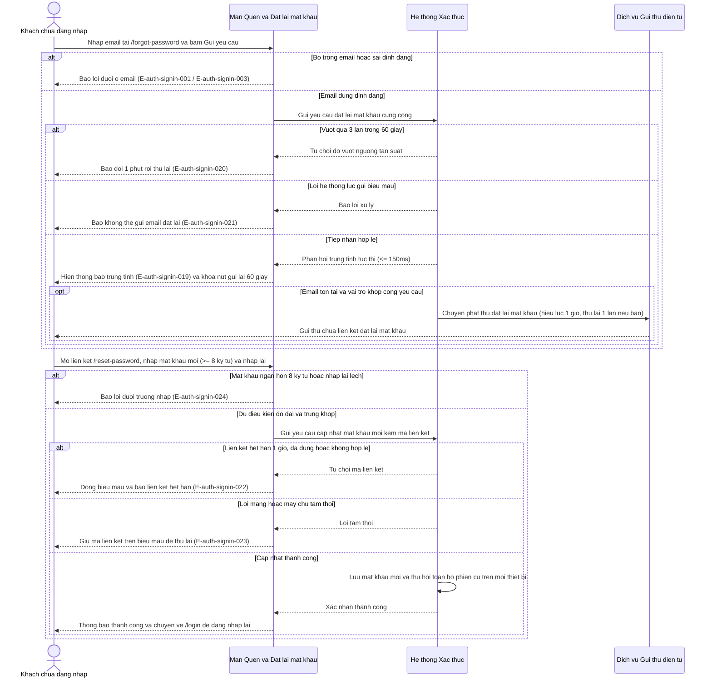
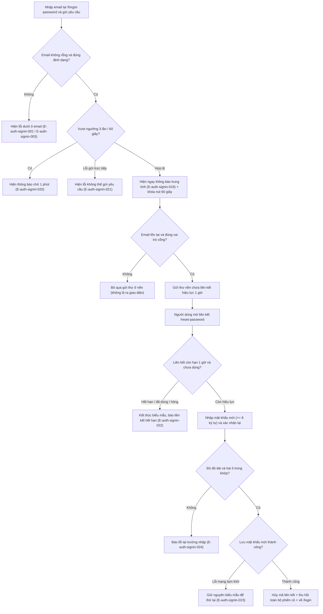
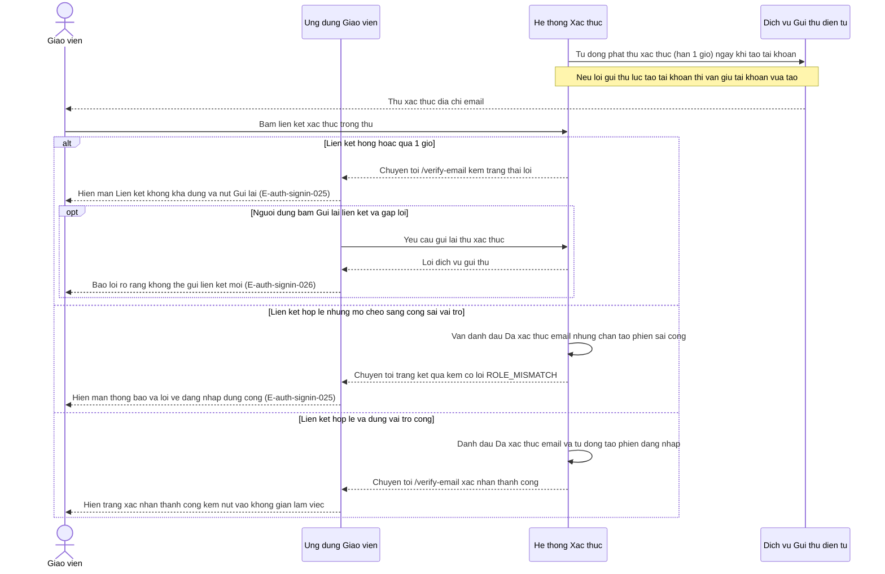
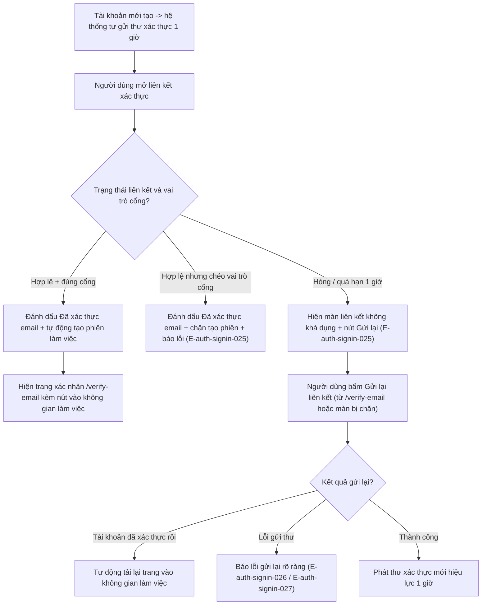
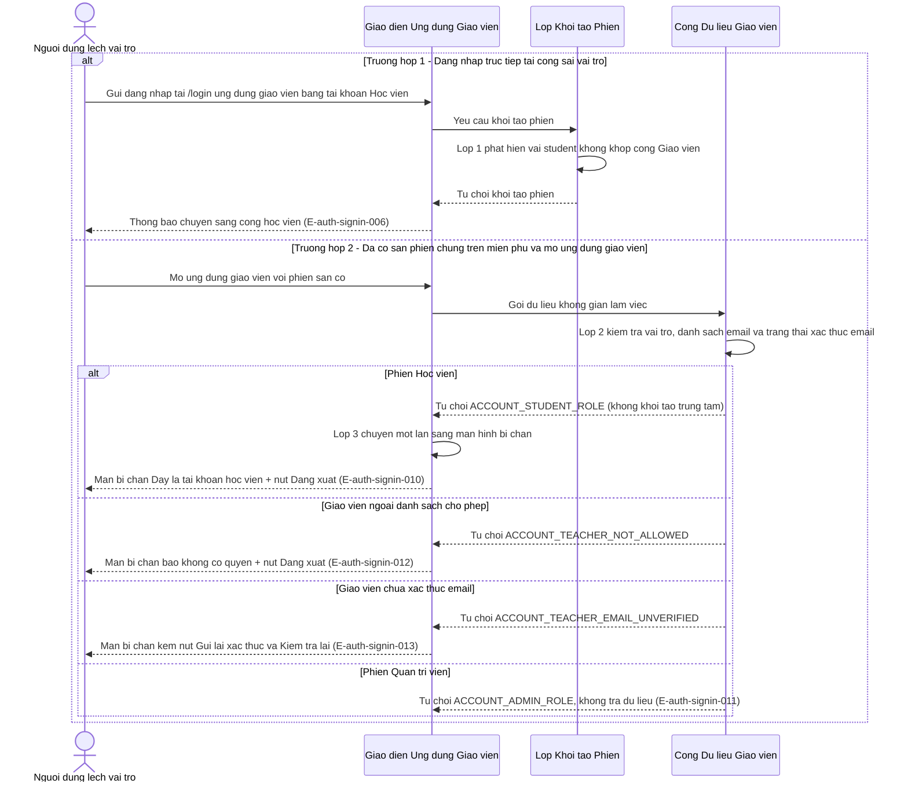
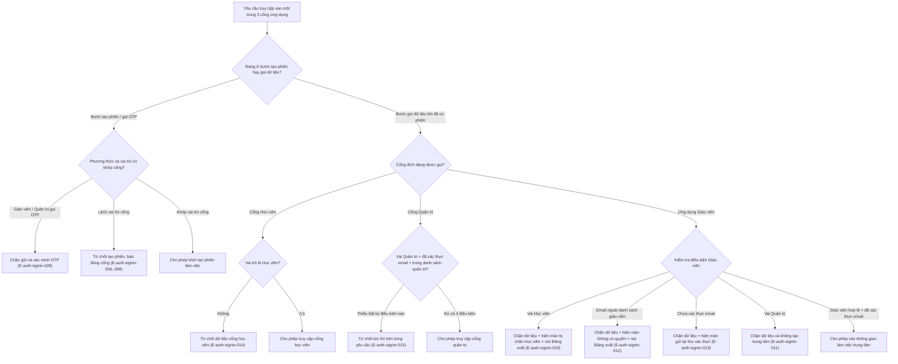

# auth-signin — Sơ đồ luồng nghiệp vụ (Sequence & Activity Flows)

Tài liệu mô hình hóa 5 luồng tương tác chính từ `docs/auth-signin/srs/auth-signin-spec.md` (Mục 9), đối chiếu trực tiếp tới các yêu cầu `FR-auth-signin-*` và mã lỗi `E-auth-signin-*`.

---

## Flow: F1 — Đăng nhập bằng email và mật khẩu
__Trigger__: Người dùng nhập email và mật khẩu trên trang `/login` rồi bấm Đăng nhập
__Related UC__: [[../usecases/uc-signin-email-password.md]]
__Related FR__: FR-auth-signin-001, FR-auth-signin-002, FR-auth-signin-003, FR-auth-signin-004, FR-auth-signin-008, FR-auth-signin-009, FR-auth-signin-021, FR-auth-signin-022, FR-auth-signin-023
__Related E__: E-auth-signin-001, E-auth-signin-002, E-auth-signin-003, E-auth-signin-004, E-auth-signin-005, E-auth-signin-006, E-auth-signin-008, E-auth-signin-012, E-auth-signin-013, E-auth-signin-029

### Sequence — F1 Đăng nhập bằng email và mật khẩu

### Activity — F1 Đăng nhập bằng email và mật khẩu

---

## Flow: F2 — Đăng nhập bằng tài khoản Google (Google OAuth)
__Trigger__: Người dùng bấm nút Đăng nhập bằng Google trên trang `/login`
__Related UC__: [[../usecases/uc-signin-google-oauth.md]]
__Related FR__: FR-auth-signin-005, FR-auth-signin-006, FR-auth-signin-007, FR-auth-signin-008, FR-auth-signin-009, FR-auth-signin-019, FR-auth-signin-020, FR-auth-signin-021
__Related E__: E-auth-signin-006, E-auth-signin-007, E-auth-signin-008, E-auth-signin-009, E-auth-signin-012, E-auth-signin-013, E-auth-signin-016, E-auth-signin-017, E-auth-signin-018

### Sequence — F2 Đăng nhập bằng Google OAuth

### Activity — F2 Đăng nhập bằng Google OAuth

---

## Flow: F3 — Quên và đặt lại mật khẩu
__Trigger__: Người dùng nhập email tại màn `/forgot-password` để yêu cầu đặt lại mật khẩu
__Related UC__: [[../usecases/uc-reset-password.md]]
__Related FR__: FR-auth-signin-014, FR-auth-signin-015, FR-auth-signin-024
__Related E__: E-auth-signin-001, E-auth-signin-003, E-auth-signin-019, E-auth-signin-020, E-auth-signin-021, E-auth-signin-022, E-auth-signin-023, E-auth-signin-024

### Sequence — F3 Quên và đặt lại mật khẩu

### Activity — F3 Quên và đặt lại mật khẩu

---

## Flow: F4 — Xác thực địa chỉ email và gửi lại liên kết
__Trigger__: Tài khoản mới được tạo tự động phát thư xác thực hoặc người dùng bấm liên kết xác thực email
__Related UC__: [[../usecases/uc-verify-email.md]]
__Related FR__: FR-auth-signin-008, FR-auth-signin-013, FR-auth-signin-016, FR-auth-signin-024
__Related E__: E-auth-signin-013, E-auth-signin-025, E-auth-signin-026, E-auth-signin-027

### Sequence — F4 Xác thực địa chỉ email

### Activity — F4 Xác thực địa chỉ email

---

## Flow: F5 — Chặn chéo vai trò 3 lớp giữa các cổng ứng dụng
__Trigger__: Người dùng đăng nhập tại cổng sai vai trò hoặc mở cổng ứng dụng khác bằng phiên dùng chung
__Related UC__: [[../usecases/uc-role-cross-block.md]]
__Related FR__: FR-auth-signin-008, FR-auth-signin-009, FR-auth-signin-010, FR-auth-signin-011, FR-auth-signin-012, FR-auth-signin-013, FR-auth-signin-017
__Related E__: E-auth-signin-006, E-auth-signin-007, E-auth-signin-008, E-auth-signin-010, E-auth-signin-011, E-auth-signin-012, E-auth-signin-013, E-auth-signin-014, E-auth-signin-015, E-auth-signin-028

### Sequence — F5 Chặn chéo vai trò (Học viên vào ứng dụng giáo viên & các cổng chéo)

### Activity — F5 Chặn chéo vai trò giữa 3 cổng

<!-- wm:c3e3a8b9c06f46427bf9089e2fdafa48 -->
Tài liệu thuộc bộ AI4BA BA-Kit — bản quyền ai4ba.com
