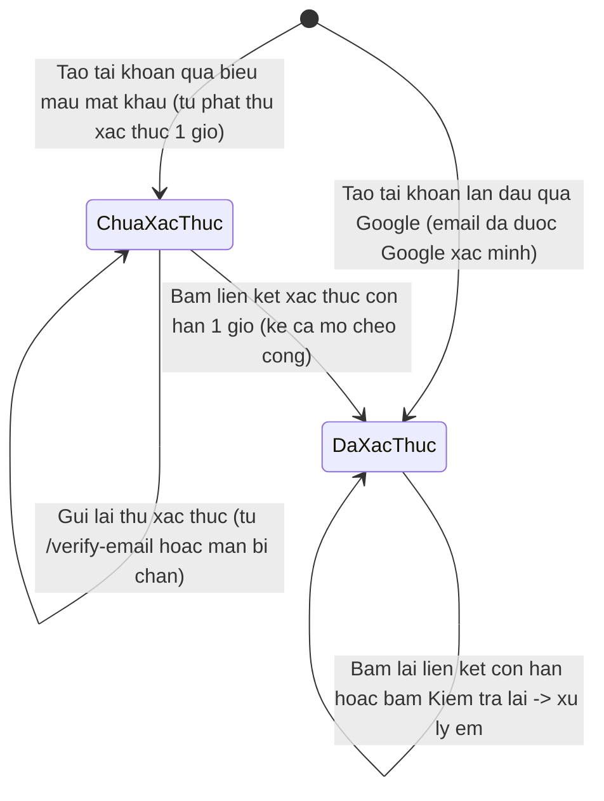
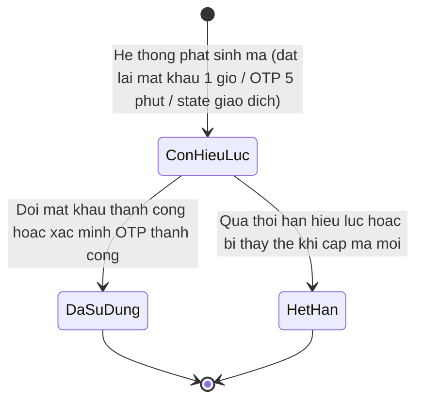
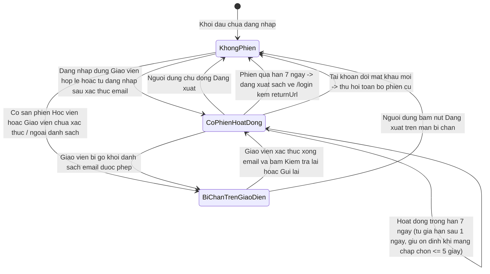

# auth-signin — Sơ đồ vòng đời trạng thái (State Diagrams)

Tài liệu đặc tả vòng đời trạng thái của 3 đối tượng có chuyển đổi trạng thái trong `auth-signin`: trạng thái xác thực email của `NguoiDung`, vòng đời `MaXacThuc` và vòng đời `PhienLamViec` (dưới góc nhìn truy cập ứng dụng giáo viên).

---

## State: NguoiDung
__Related entity__: NguoiDung (CamelCase khớp ERD `srs/auth-signin-erd.md`)
__Related UC__: [[../usecases/uc-verify-email.md]], [[../usecases/uc-signin-google-oauth.md]]
__Related BR__: BR-auth-signin-004, BR-auth-signin-007

### Bảng mô tả trạng thái & sự kiện chuyển đổi

| Trạng thái | Ý nghĩa nghiệp vụ | Sự kiện đi vào (Trigger In) | Sự kiện đi ra (Trigger Out) | Hệ quả quyền truy cập |
|------------|-------------------|-----------------------------|-----------------------------|-----------------------|
| `ChuaXacThuc` | Hồ sơ người dùng đã tạo nhưng chưa xác minh quyền sở hữu hộp thư | Tạo tài khoản lần đầu qua biểu mẫu mật khẩu (khi mở cờ đăng ký) | Bấm liên kết xác thực hợp lệ còn hạn 1 giờ (`FR-auth-signin-008`, `FR-auth-signin-016` — kể cả khi mở nhầm cổng thì trạng thái email vẫn được xác thực, chỉ chặn tạo phiên sai cổng) | Bị chặn tại cổng dữ liệu giáo viên (`E-auth-signin-013`) và cổng quản trị (`E-auth-signin-015`); được phép yêu cầu gửi lại thư xác thực |
| `DaXacThuc` | Đã xác minh quyền sở hữu địa chỉ email (trạng thái đích một chiều) | Hoàn tất xác thực qua liên kết email HOẶC tạo tài khoản/đăng nhập qua Google với email đã được Google xác minh | Không có chuyển đổi quay ngược về `ChuaXacThuc` | Mở khóa điều kiện xác thực email để vào ứng dụng giáo viên và cổng quản trị; nếu bấm lại liên kết xác thực còn hạn 1 giờ thì vẫn đưa êm tới trang xác nhận |

---

## State: MaXacThuc
__Related entity__: MaXacThuc (CamelCase khớp ERD `srs/auth-signin-erd.md`)
__Related UC__: [[../usecases/uc-reset-password.md]], [[../usecases/uc-signin-google-oauth.md]]
__Related BR__: BR-auth-signin-008, BR-auth-signin-009

### Bảng mô tả trạng thái & sự kiện chuyển đổi

| Trạng thái | Ý nghĩa nghiệp vụ | Sự kiện đi vào (Trigger In) | Sự kiện đi ra (Trigger Out) | Xử lý khi người dùng thao tác lại |
|------------|-------------------|-----------------------------|-----------------------------|-----------------------------------|
| `ConHieuLuc` | Mã một lần đang chờ người dùng sử dụng trong khung thời gian cho phép | Gửi thư đặt lại mật khẩu (1 giờ), gửi mã OTP học viên (5 phút), hoặc tạo dấu cổng giao dịch Google | Người dùng sử dụng thành công, trôi qua thời điểm hết hạn, hoặc bị thay thế khi phát hành mã OTP mới cho cùng email | Nếu gặp lỗi mạng tạm thời lúc đổi mật khẩu (`E-auth-signin-023`), mã đặt lại mật khẩu vẫn giữ ở `ConHieuLuc` để người dùng bấm lưu lại |
| `DaSuDung` | Mã một lần đã được tiêu thụ hoàn tất | Đổi mật khẩu thành công (đồng thời thu hồi mọi phiên cũ) hoặc xác minh OTP thành công | Trạng thái kết thúc | Bấm lại liên kết đặt lại mật khẩu đã dùng sẽ bị từ chối với `E-auth-signin-022` *(riêng liên kết xác thực email là liên kết tự chứa hạn 1 giờ nên bấm lại khi còn hạn vẫn xử lý êm — xem mục `NguoiDung`)* |
| `HetHan` | Mã không còn giá trị do quá hạn hoặc đã bị thay thế | Quá 1 giờ (đặt lại mật khẩu), quá 5 phút (mã OTP), hoặc bị ghi đè khi cấp mã OTP mới | Trạng thái kết thúc | Hiển thị `E-auth-signin-022` và hướng dẫn người dùng yêu cầu mã mới |

---

## State: PhienLamViec
__Related entity__: PhienLamViec (CamelCase khớp ERD `srs/auth-signin-erd.md`)
__Related UC__: [[../usecases/uc-signin-email-password.md]], [[../usecases/uc-role-cross-block.md]]
__Related BR__: BR-auth-signin-004, BR-auth-signin-008

> **Góc nhìn mô hình:** Sơ đồ biểu diễn trạng thái phiên làm việc dưới góc nhìn truy cập ứng dụng giáo viên (kết hợp giữa sự tồn tại của phiên đăng nhập và quyền mở vùng làm việc trung tâm).

### Bảng mô tả trạng thái & sự kiện chuyển đổi

| Trạng thái | Ý nghĩa nghiệp vụ | Sự kiện đi vào (Trigger In) | Sự kiện đi ra (Trigger Out) | Hành vi hiển thị |
|------------|-------------------|-----------------------------|-----------------------------|------------------|
| `KhongPhien` | Trình duyệt không có phiên đăng nhập hiệu lực | Mở ứng dụng lần đầu, bấm Đăng xuất, phiên hết hạn (`E-auth-signin-029`), bị thu hồi do đổi mật khẩu (`BR-auth-signin-008`), hoặc bị từ chối ngay lúc đăng nhập sai vai trò (`E-auth-signin-006`, `E-auth-signin-008`) | Đăng nhập thành công qua kiểm tra bước hai hoặc bấm liên kết xác thực email hợp lệ | Mọi trang nội bộ tự động đưa về `/login` kèm tham số `returnUrl` |
| `CoPhienHoatDong` | Phiên đăng nhập hợp lệ và thỏa điều kiện truy cập không gian làm việc giáo viên | Xác thực thành công đúng vai Giáo viên hợp lệ và đã xác thực email (hoặc xác thực xong email từ màn bị chặn) | Đăng xuất, hết hạn 7 ngày không hoạt động, đổi mật khẩu, hoặc bị gỡ khỏi danh sách cho phép | Mở đầy đủ không gian làm việc trung tâm; tự giữ ổn định tối đa 5 giây nếu mạng chập chờn thoáng qua (`FR-auth-signin-022`) |
| `BiChanTrenGiaoDien` | Trình duyệt đang mang phiên (do chia sẻ miền phụ hoặc tài khoản chưa đủ điều kiện) nhưng bị khóa vùng làm việc giáo viên | Cổng dữ liệu giáo viên trả về mã chặn Học viên (`E-auth-signin-010`), ngoài danh sách (`E-auth-signin-012`) hoặc chưa xác thực email (`E-auth-signin-013`) *(riêng phiên Quản trị viên `E-auth-signin-011` hiện chỉ bị chặn dữ liệu mà chưa chuyển sang màn này — xem `OQ-auth-signin-01`)* | Bấm nút Đăng xuất (`KhongPhien`) HOẶC hoàn tất xác thực email rồi bấm kiểm tra lại / bấm gửi lại phát hiện đã xác thực (`CoPhienHoatDong`) | Thay toàn bộ vùng làm việc bằng màn hình bị chặn tương ứng, không gọi lặp yêu cầu dữ liệu |

---

## Ghi chú đối tượng bất biến (Không có máy trạng thái chuyển đổi)

* **Vai trò tài khoản (`NguoiDung.vai_tro`):** Theo `BR-auth-signin-001` và `FR-auth-signin-020`, vai trò (`student` / `teacher` / `admin`) được gán cố định **đúng một lần duy nhất** tại thời điểm tạo tài khoản theo cổng ứng dụng gọi và hoàn toàn không có chuyển đổi trạng thái trong suốt vòng đời tài khoản.
* **Trạng thái khóa tài khoản (Lock/Ban):** Hệ thống không duy trì trạng thái "khóa tạm thời tài khoản"; việc thu hồi quyền truy cập của Giáo viên hoặc Quản trị viên được thực hiện tức thời thông qua danh sách email được phép (`FR-auth-signin-009`, `FR-auth-signin-011`).

<!-- wm:c3e3a8b9c06f46427bf9089e2fdafa48 -->
Tài liệu thuộc bộ AI4BA BA-Kit — bản quyền ai4ba.com
