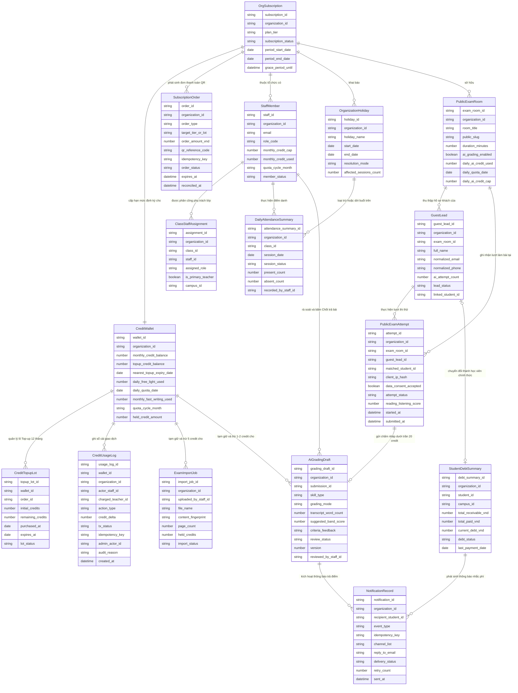

# selfomy-alignment — Entity Relationship Diagram

> Scope: Mô hình dữ liệu nghiệp vụ cho 4 chặng đồng bộ Selfomy One (`B-core → A0-lite + A-core → B-growth + A0-billing + A-mở rộng → C-core`).

## Diagram

## Entity Reference

| Entity | Purpose | Key attributes |
|--------|---------|----------------|
| `OrgSubscription` | Quản lý gói thuê bao hiện tại của tổ chức (*Dùng thử / Cơ bản / Chuyên nghiệp / Nâng cao*), chu kỳ `30 ngày` và thời hạn ân hạn `72 giờ` | `plan_tier`, `subscription_status` (`trial`/`active`/`grace_period`/`expired`), `period_end_date`, `grace_period_until` |
| `SubscriptionOrder` | Lưu trữ lịch sử từng đơn mua gói thuê bao tháng hoặc gói Top-up qua QR Bank-Hub (`15 phút`) và trạng thái đối soát bất biến `5 năm` (`NFR-selfomy-alignment-007`) | `order_type`, `order_amount_vnd`, `qr_reference_code`, `idempotency_key`, `order_status` (`pending`/`paid`/`expired`/`mismatch`/`reconciled`), `expires_at` |
| `CreditWallet` | Lưu trữ số dư Credit AI định kỳ trong tháng, tổng số dư Credit mua thêm (Top-up hạn `12 tháng`), số credit đang tạm giữ và các bộ đếm hạn mức công bằng kèm mốc ngày/tháng tự làm mới | `monthly_credit_balance`, `topup_credit_balance`, `daily_free_light_used`, `daily_quota_date`, `monthly_fast_writing_used`, `quota_cycle_month`, `held_credit_amount` |
| `CreditTopupLot` | Quản lý từng lô Credit mua thêm (`149.000đ / 100 credit`) với hạn sử dụng riêng `12 tháng` để trừ theo thứ tự lô hết hạn gần nhất trước (FEFO — `BR-selfomy-alignment-002`) | `order_id`, `initial_credits` (`100`), `remaining_credits`, `purchased_at`, `expires_at`, `lot_status` (`active`/`exhausted`/`expired`) |
| `CreditUsageLog` | Sổ cái bất biến (`append-only`, lưu tối thiểu `5 năm`) ghi nhận từng giao dịch tạm giữ, chốt trừ, hoàn trả tự động hoặc cấp bù thủ công từ Quản trị viên nền tảng | `actor_staff_id`, `charged_teacher_id`, `action_type`, `credit_delta`, `tx_status` (`reserved`/`settled`/`released`), `idempotency_key`, `admin_actor_id`, `audit_reason` |
| `StaffMember` | Đại diện nhân sự trong tổ chức theo 4 vai trò chuẩn (*Chủ trung tâm, Giáo vụ, Giáo viên đứng lớp, Trợ giảng*) và hạn mức trần Credit AI cá nhân hàng tháng | `role_code` (`Owner`/`Admin_Staff`/`Teacher`/`TA`), `monthly_credit_cap`, `monthly_credit_used`, `quota_cycle_month`, `member_status` |
| `ClassStaffAssignment` | Bảng liên kết phân công nhân sự (`Teacher`, `TA`) phụ trách từng lớp học cụ thể, xác định **Giáo viên đứng lớp phụ trách chính** (`is_primary_teacher`) để quy chiếu trần Credit tự động (`BR-selfomy-alignment-011`) | `class_id`, `staff_id`, `assigned_role`, `is_primary_teacher`, `campus_id` |
| `OrganizationHoliday` | Khai báo kỳ nghỉ lễ hoặc nghỉ đột xuất của tổ chức/lớp học (`≤ 30 ngày`) kèm phương thức xử lý các buổi học `scheduled` bị trùng (*Hủy buổi* hoặc *Dời lịch +1 buổi*) | `holiday_name`, `start_date`, `end_date`, `resolution_mode` (`cancel`/`shift_plus_one`), `affected_sessions_count` |
| `DailyAttendanceSummary` | Tổng hợp trạng thái điểm danh theo ngày của từng lớp học có ca dạy trong ngày (loại trừ buổi nghỉ lễ), phục vụ thẻ nhắc việc, điểm danh hàng loạt và tổng hợp ca dạy (`FR-selfomy-alignment-032`) | `class_id`, `session_date`, `session_status` (`pending`/`completed`/`holiday_shifted`/`cancelled`), `present_count`, `absent_count` |
| `StudentDebtSummary` | Sổ công nợ lũy kế gom theo từng Học viên chính thức qua nhiều kỳ hóa đơn và giao dịch thanh toán, hỗ trợ lọc theo cơ sở (`campus_id`) | `student_id`, `campus_id`, `total_receivable_vnd`, `total_paid_vnd`, `current_debt_vnd`, `debt_status` (`clear`/`due`/`overdue`) |
| `NotificationRecord` | Bản ghi thông báo phát đi cho học viên qua Email (từ tên miền chung Teacher OS, `Reply-To` theo tổ chức) và chuông thông báo In-app cho 4 sự kiện chính, có khóa chống gửi trùng | `event_type`, `idempotency_key`, `reply_to_email`, `delivery_status` (`queued`/`sent`/`read`/`failed`), `retry_count` (`0–3`) |
| `ExamImportJob` | Tiến trình nhập đề thi IELTS từ tệp PDF/ảnh bằng AI, lưu mã nhận diện nội dung tệp để chống trừ trùng `5 credit` và quản lý trạng thái tạm giữ/hoàn trả credit | `content_fingerprint`, `page_count` (`≤ 20`), `held_credits` (`5`), `import_status` (`processing`/`completed`/`failed_refunded`) |
| `AiGradingDraft` | Vùng lưu trữ ẩn kết quả chấm nháp Writing (`1 credit` hoặc *Chấm nhanh*) và Speaking (`2 credit`, kèm số từ văn bản ghi âm và nhãn *Chưa chấm phát âm*), có khóa lạc quan (`version`) chống ghi đè (`E-selfomy-alignment-011`) | `skill_type`, `grading_mode` (`standard`/`fast_fallback`), `transcript_word_count`, `suggested_band_score`, `review_status` (`submitted`/`ai_drafted`/`teacher_reviewing`/`manual_pending`/`published`), `version` |
| `PublicExamRoom` | Cấu hình Phòng thi ảo công khai chia sẻ cho khách vãng lai, bao gồm công tắc bật/tắt AI Writing/Speaking (mặc định TẮT) và bộ đếm trần `20 credit/ngày/phòng thi` kèm ngày làm mới `daily_quota_date` | `public_slug`, `duration_minutes` (`5–180`), `ai_grading_enabled`, `daily_ai_credit_used`, `daily_quota_date`, `daily_ai_credit_cap` (`20`) |
| `GuestLead` | Hồ sơ Học viên vãng lai đăng ký làm bài tại Phòng thi ảo công khai, theo dõi trần `1 lượt AI/khách` và liên kết sang hồ sơ Học viên chính thức khi nhập học | `normalized_email`, `normalized_phone`, `ai_attempt_count` (`0–1`), `lead_status` (`guest_registered`/`guest_tested`/`invited`/`active_student`), `linked_student_id` |
| `PublicExamAttempt` | Bản ghi từng phiên làm bài thi thử công khai của khách vãng lai, lưu dấu vết đồng ý dữ liệu cá nhân (`NFR-selfomy-alignment-006`), mã băm địa chỉ mạng (`BR-selfomy-alignment-008`) và cờ `matched_student_id` khi trùng Email học viên chính thức | `guest_lead_id`, `matched_student_id`, `client_ip_hash`, `data_consent_accepted`, `attempt_status`, `reading_listening_score` |

## Notes & Assumptions

* **Không trùng lặp thực thể nền tảng đã có:** Các thực thể cốt lõi đã có từ mốc M1–M3 (Lớp học, Buổi học, Học viên chính thức, Hóa đơn học phí, Đề thi và Bài nộp) được liên kết thông qua mã định danh nghiệp vụ trong `ClassStaffAssignment`, `DailyAttendanceSummary`, `StudentDebtSummary` và `AiGradingDraft`.
* **Quy tắc ưu tiên trừ lô Credit (FEFO):** Trong `CreditWallet`, hệ thống luôn trừ `monthly_credit_balance` về `0` trước khi trừ sang các lô `CreditTopupLot` theo thứ tự `expires_at` gần nhất trước (`BR-selfomy-alignment-002`).
* **Cô lập dữ liệu đa tổ chức và theo vai trò:** Mọi thực thể đều thuộc một tổ chức (`organization_id`); với vai trò `Teacher` và `TA`, dữ liệu hiển thị được lọc theo bảng phân công `ClassStaffAssignment` (`NFR-selfomy-alignment-005`).
