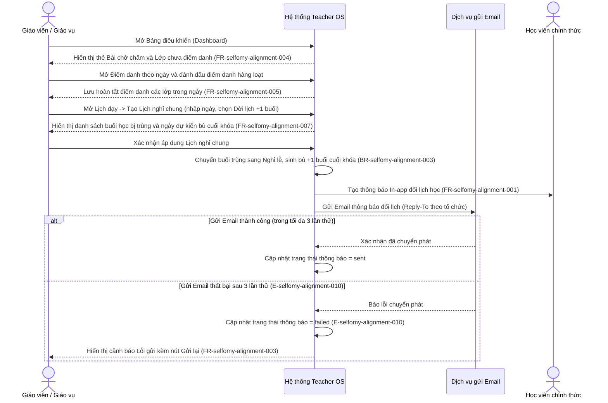
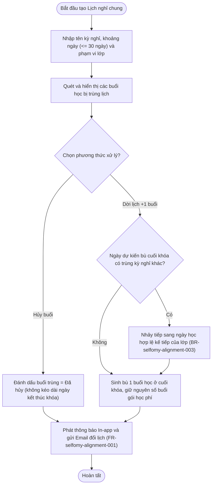
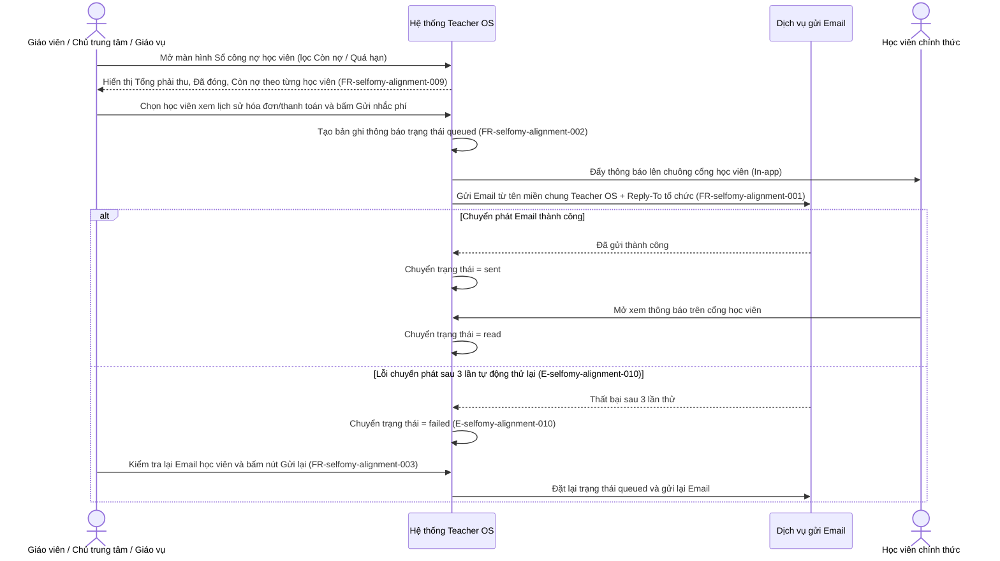
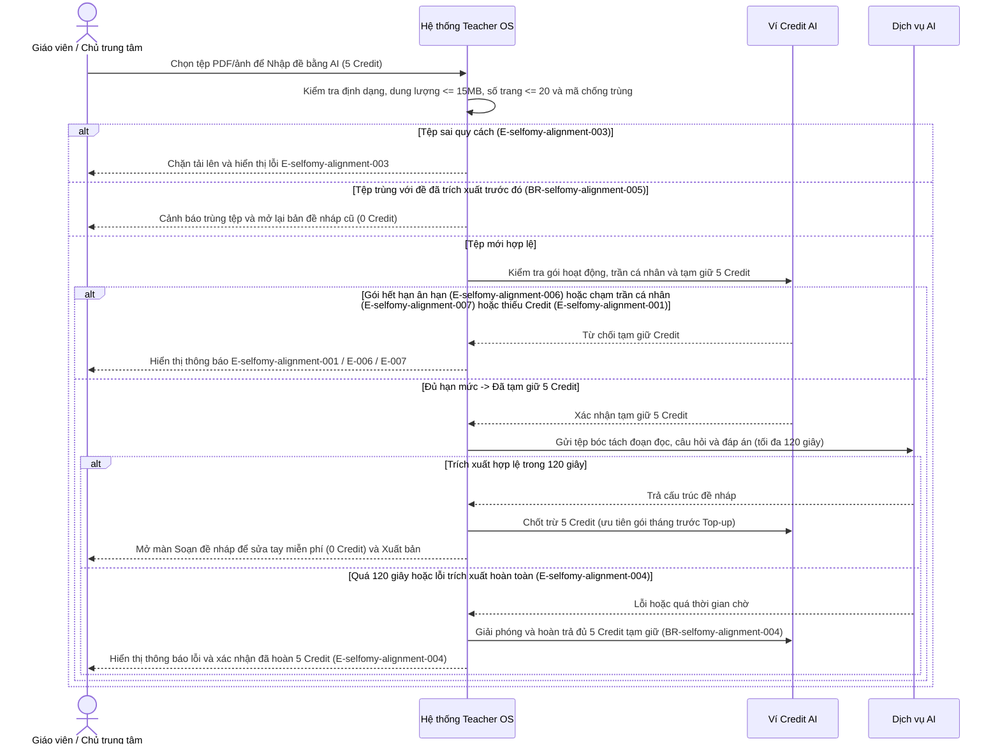
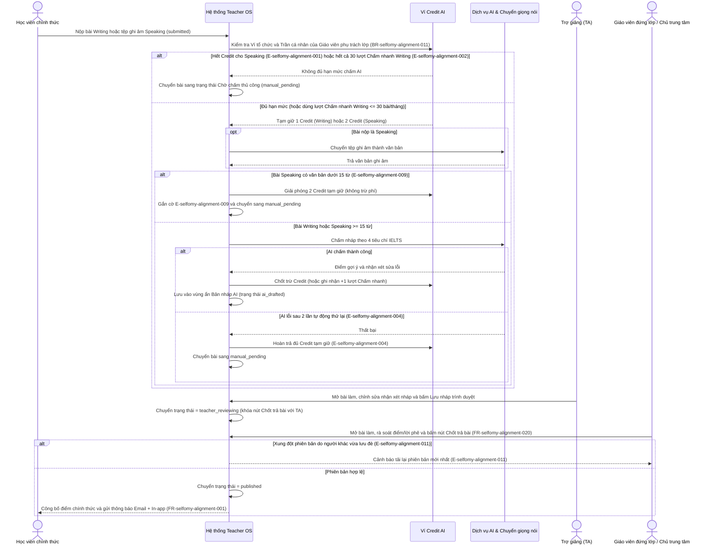
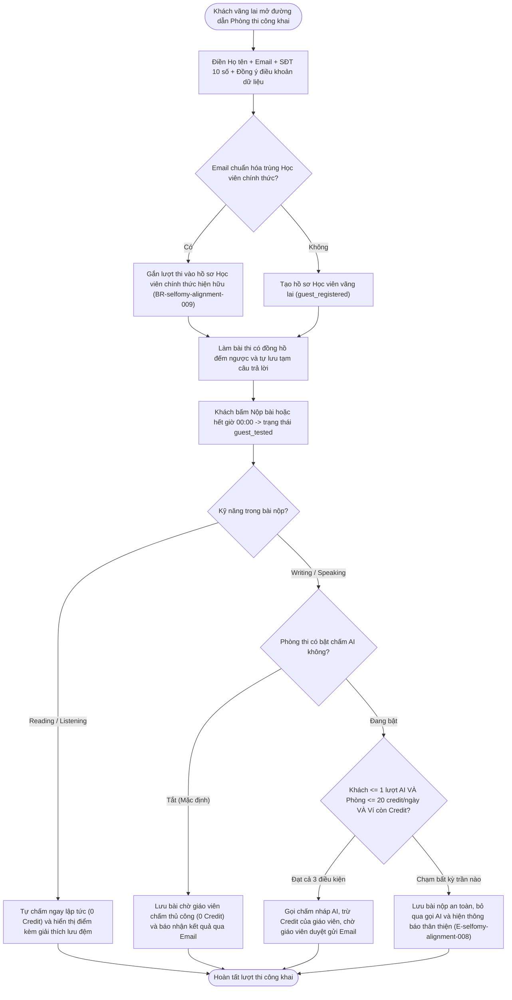
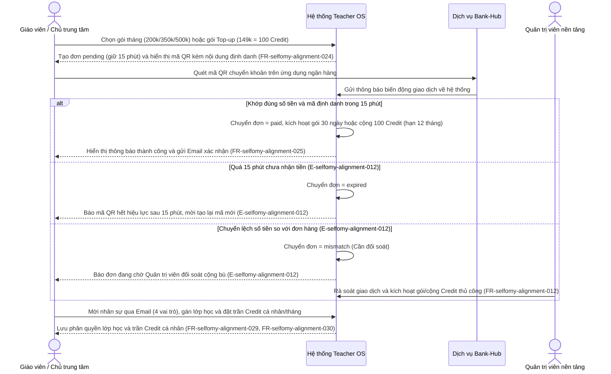

# selfomy-alignment — Flows

## Flow: Điểm danh tổng theo ngày & Tạo lịch nghỉ chung tự động dời buổi
**Trigger**: Giáo viên / Giáo vụ mở Bảng điều khiển nhắc việc để điểm danh các lớp trong ngày hoặc mở Lịch dạy tạo Lịch nghỉ chung (`uc-daily-attendance-and-holiday`).
**Related UC**: [[../usecases/uc-daily-attendance-and-holiday.md|uc-daily-attendance-and-holiday]]
**Related FR**: FR-selfomy-alignment-001, FR-selfomy-alignment-004, FR-selfomy-alignment-005, FR-selfomy-alignment-006, FR-selfomy-alignment-007, FR-selfomy-alignment-008

## Flow: Tra cứu Sổ công nợ học viên & Quản lý gửi/gửi lại thông báo Email + In-app
**Trigger**: Giáo viên / Chủ trung tâm / Giáo vụ mở Sổ công nợ học viên để kiểm tra dư nợ lũy kế và gửi thông báo nhắc phí (`uc-student-debt-and-notification`).
**Related UC**: [[../usecases/uc-student-debt-and-notification.md|uc-student-debt-and-notification]]
**Related FR**: FR-selfomy-alignment-001, FR-selfomy-alignment-002, FR-selfomy-alignment-003, FR-selfomy-alignment-009, FR-selfomy-alignment-010

## Flow: Nhập đề thi IELTS từ tệp PDF/ảnh bằng AI có kiểm tra trùng & tạm giữ Credit
**Trigger**: Giáo viên / Chủ trung tâm / Giáo viên đứng lớp tải tệp PDF hoặc ảnh đề thi lên màn hình Soạn đề để bóc tách bằng AI (`uc-ai-exam-import`).
**Related UC**: [[../usecases/uc-ai-exam-import.md|uc-ai-exam-import]]
**Related FR**: FR-selfomy-alignment-013, FR-selfomy-alignment-015, FR-selfomy-alignment-016, FR-selfomy-alignment-017

## Flow: Chấm nháp Writing/Speaking bằng AI, Trợ giảng rà soát & Giáo viên bấm "Chốt trả bài"
**Trigger**: Học viên chính thức nộp bài làm Writing hoặc tệp ghi âm Speaking, sau đó Trợ giảng và Giáo viên đứng lớp rà soát trên màn hình Chấm bài (`uc-ai-grading-review`).
**Related UC**: [[../usecases/uc-ai-grading-review.md|uc-ai-grading-review]]
**Related FR**: FR-selfomy-alignment-013, FR-selfomy-alignment-014, FR-selfomy-alignment-018, FR-selfomy-alignment-019, FR-selfomy-alignment-020, FR-selfomy-alignment-027, FR-selfomy-alignment-028

## Flow: Khách vãng lai đăng ký thi thử tại Phòng thi ảo công khai & Kiểm soát trần Credit AI
**Trigger**: Học viên vãng lai mở đường dẫn Phòng thi ảo công khai, điền thông tin liên hệ và nộp bài thi thử (`uc-public-exam-lead`).
**Related UC**: [[../usecases/uc-public-exam-lead.md|uc-public-exam-lead]]
**Related FR**: FR-selfomy-alignment-021, FR-selfomy-alignment-022, FR-selfomy-alignment-023

## Flow: Mua gói thuê bao/Top-up qua QR Bank-Hub, Quản trị viên cấp hạn mức & Phân quyền Trung tâm
**Trigger**: Giáo viên / Chủ trung tâm tạo đơn mua gói thuê bao tháng hoặc gói Top-up qua QR ngân hàng, hoặc Chủ trung tâm mời nhân sự và đặt trần Credit cá nhân (`uc-subscription-and-center-staff`).
**Related UC**: [[../usecases/uc-subscription-and-center-staff.md|uc-subscription-and-center-staff]]
**Related FR**: FR-selfomy-alignment-011, FR-selfomy-alignment-012, FR-selfomy-alignment-024, FR-selfomy-alignment-025, FR-selfomy-alignment-026, FR-selfomy-alignment-029, FR-selfomy-alignment-030

## Notes

* Mọi mã lỗi (`E-selfomy-alignment-001` đến `E-selfomy-alignment-012`) và quy tắc nghiệp vụ (`BR-selfomy-alignment-001` đến `BR-selfomy-alignment-012`) tham chiếu trực tiếp tới `docs/selfomy-alignment/srs/selfomy-alignment-spec.md`.
