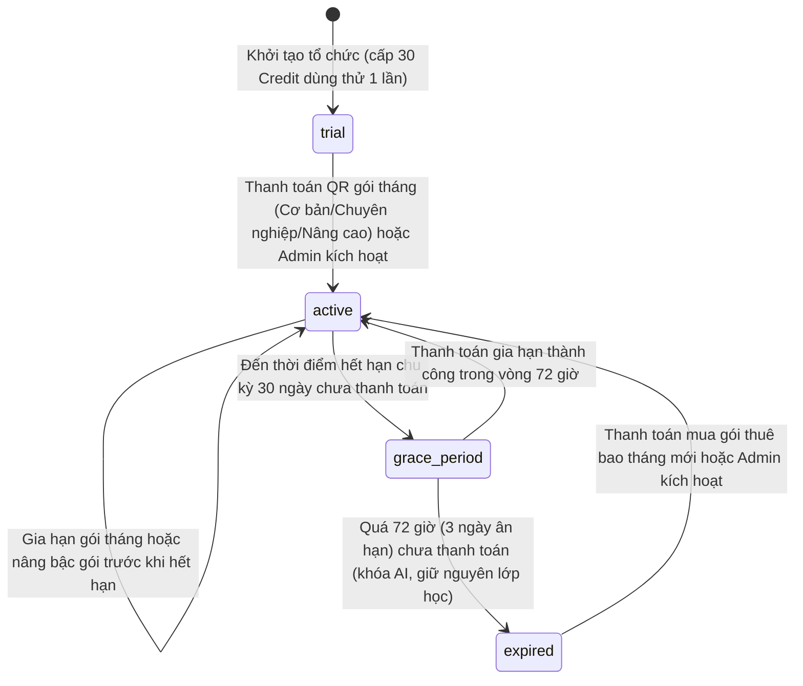
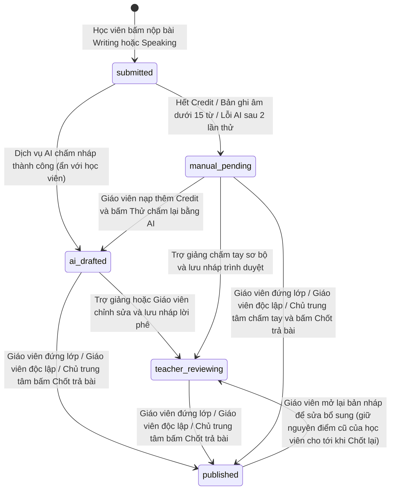
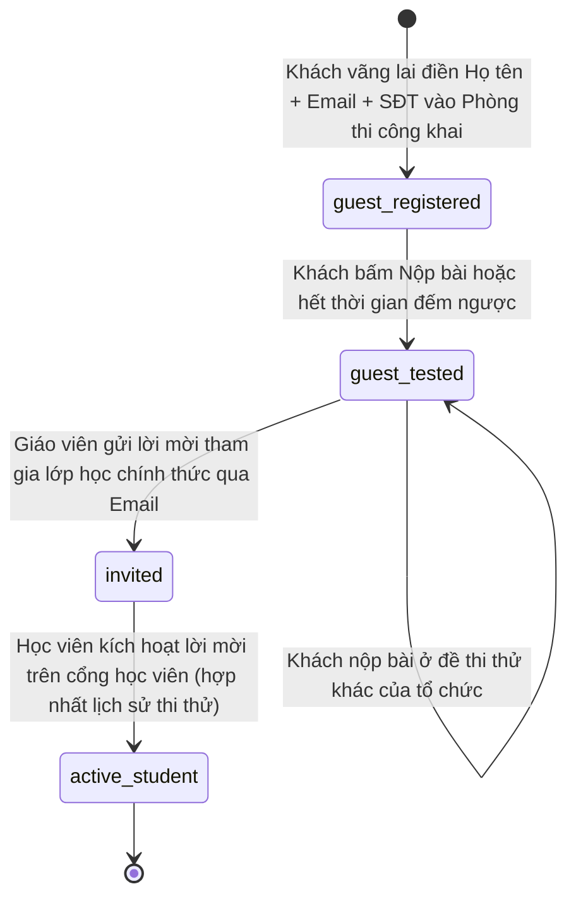
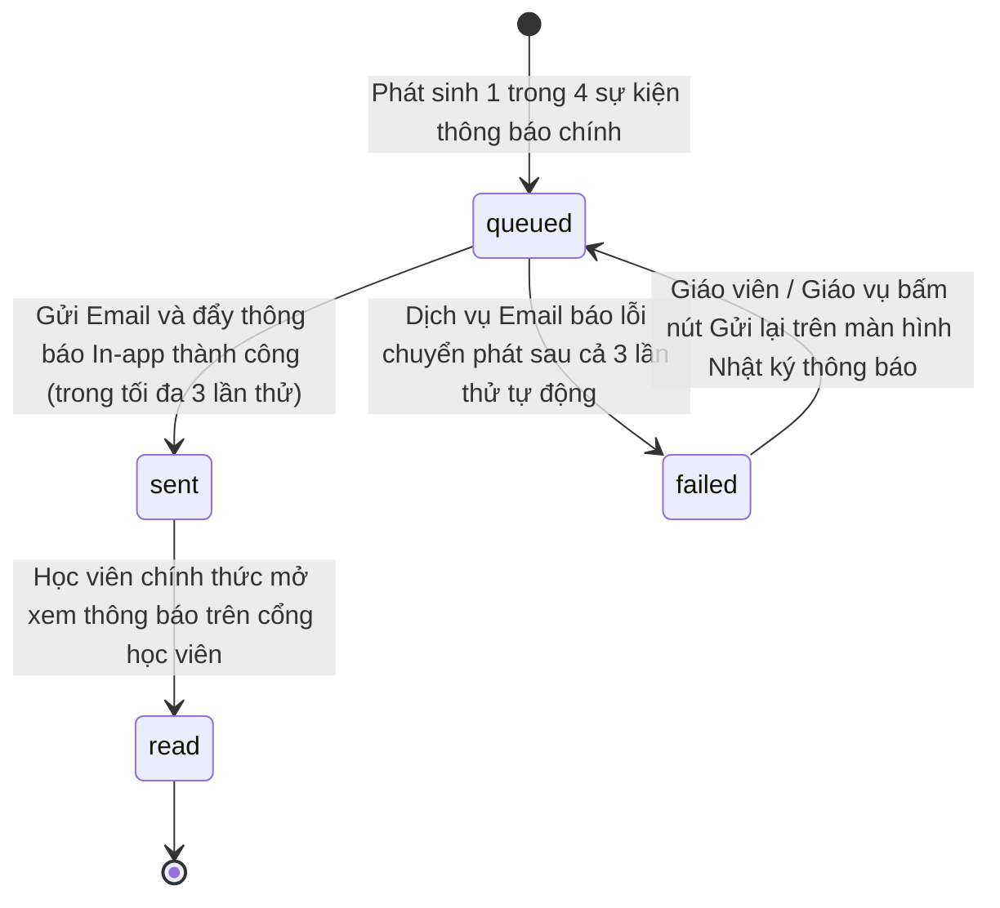
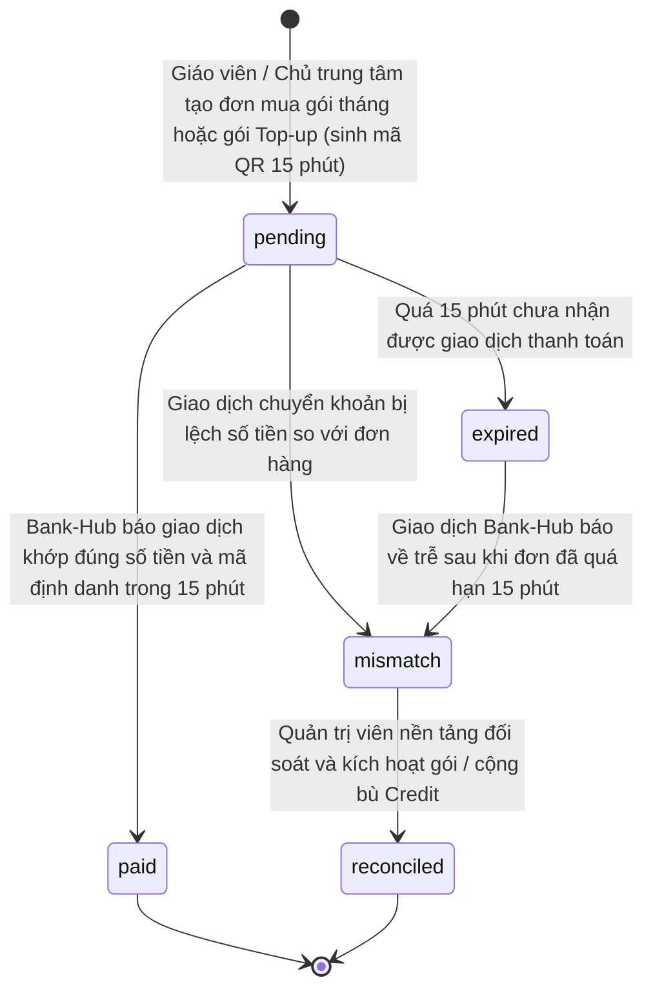
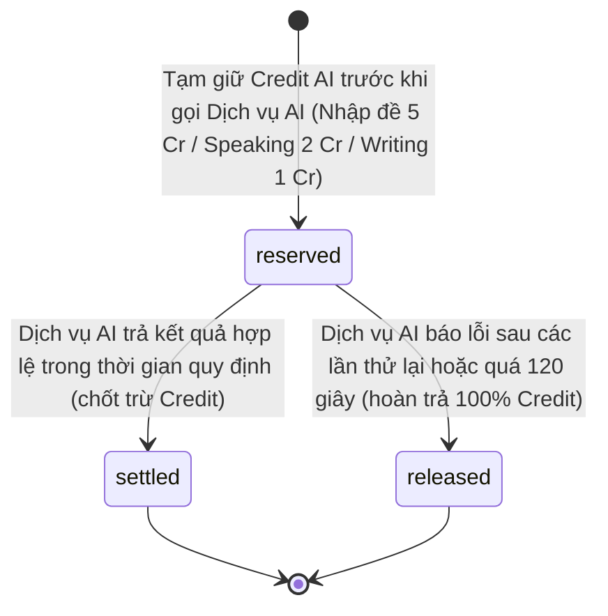

# selfomy-alignment — State Diagrams

> State diagram per entity của feature **selfomy-alignment**. Mỗi entity 1 section `## State: {Entity}`.

## State: OrgSubscription

**Related UC**: [[../usecases/uc-subscription-and-center-staff.md|uc-subscription-and-center-staff]]
**Related BR**: BR-selfomy-alignment-007, BR-selfomy-alignment-010

### Invalid transitions

| From | To | Why not |
|---|---|---|
| `active` | `trial` | Gói Dùng thử (`30 credit`) chỉ cấp một lần duy nhất cho mỗi tổ chức; sau khi đã lên gói trả phí không được quay lại gói Dùng thử |
| `expired` | `trial` | Tổ chức đã hết hạn gói thuê bao không thể quay về trạng thái Dùng thử để nhận lại `30 credit` miễn phí |
| `active` | `expired` | Khi hết chu kỳ `30 ngày`, gói thuê bao bắt buộc phải đi qua `72 giờ` ân hạn (`grace_period`) trước khi chuyển sang `expired` (`BR-selfomy-alignment-010`) |

## State: AiGradingDraft

**Related UC**: [[../usecases/uc-ai-grading-review.md|uc-ai-grading-review]]
**Related BR**: BR-selfomy-alignment-001, BR-selfomy-alignment-004, BR-selfomy-alignment-006, BR-selfomy-alignment-007

### Invalid transitions

| From | To | Why not |
|---|---|---|
| `submitted` | `published` | Đối với bài Writing và Speaking, hệ thống cấm tự động công bố kết quả thẳng cho học viên khi chưa có thao tác kiểm duyệt và bấm **"Chốt trả bài"** của giáo viên (`BR-selfomy-alignment-001`) |
| `ai_drafted` | `published` (bởi Trợ giảng) | Vai trò Trợ giảng (`TA`) bị khóa nút **"Chốt trả bài"**; Trợ giảng chỉ được chuyển bài sang `teacher_reviewing` để chờ Giáo viên đứng lớp hoặc Chủ trung tâm duyệt chốt |

## State: GuestLead

**Related UC**: [[../usecases/uc-public-exam-lead.md|uc-public-exam-lead]]
**Related BR**: BR-selfomy-alignment-008, BR-selfomy-alignment-009

### Invalid transitions

| From | To | Why not |
|---|---|---|
| `active_student` | `guest_registered` | Khi đã là Học viên chính thức trong tổ chức, không được hạ trạng thái hồ sơ ngược về khách vãng lai mới đăng ký (`BR-selfomy-alignment-009`) |
| `guest_tested` | `guest_registered` | Hồ sơ đã có kết quả bài thi thử không thể quay ngược về trạng thái chưa làm bài |

## State: NotificationRecord

**Related UC**: [[../usecases/uc-student-debt-and-notification.md|uc-student-debt-and-notification]]
**Related BR**: FR-selfomy-alignment-001, FR-selfomy-alignment-002, FR-selfomy-alignment-003, E-selfomy-alignment-010

### Invalid transitions

| From | To | Why not |
|---|---|---|
| `failed` | `read` | Bản ghi đang ở trạng thái lỗi gửi chưa chuyển phát thành công thì không thể chuyển thẳng sang trạng thái đã đọc nếu chưa qua bước gửi lại (`queued` → `sent`) |
| `read` | `queued` | Thông báo đã được học viên mở xem thành công không đưa ngược lại vào hàng đợi gửi tự động |

## State: SubscriptionOrder

**Related UC**: [[../usecases/uc-subscription-and-center-staff.md|uc-subscription-and-center-staff]]
**Related BR**: BR-selfomy-alignment-010, E-selfomy-alignment-012

### Invalid transitions

| From | To | Why not |
|---|---|---|
| `paid` | `expired` | Đơn hàng đã đối soát thanh toán thành công và cộng hạn mức không thể bị chuyển ngược sang hết hạn |
| `mismatch` | `paid` | Đơn lệch số tiền hoặc tiền về trễ sau 15 phút bắt buộc phải qua bước Quản trị viên nền tảng kiểm tra đối soát (`reconciled`) để tránh cộng nhầm hạn mức (`E-selfomy-alignment-012`) |

## State: CreditUsageLog

**Related UC**: [[../usecases/uc-ai-exam-import.md|uc-ai-exam-import]], [[../usecases/uc-ai-grading-review.md|uc-ai-grading-review]]
**Related BR**: BR-selfomy-alignment-002, BR-selfomy-alignment-004, E-selfomy-alignment-004

### Invalid transitions

| From | To | Why not |
|---|---|---|
| `released` | `settled` | Giao dịch tạm giữ đã được giải phóng hoàn trả về ví do lỗi/quá hạn không được tự động trừ lại nếu người dùng chưa bấm yêu cầu mới (`BR-selfomy-alignment-004`) |
| `settled` | `reserved` | Giao dịch đã chốt trừ thành công không quay ngược lại trạng thái tạm giữ |
