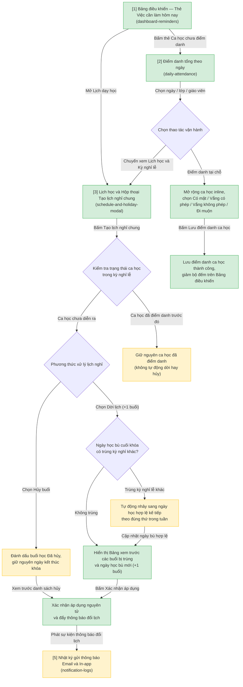
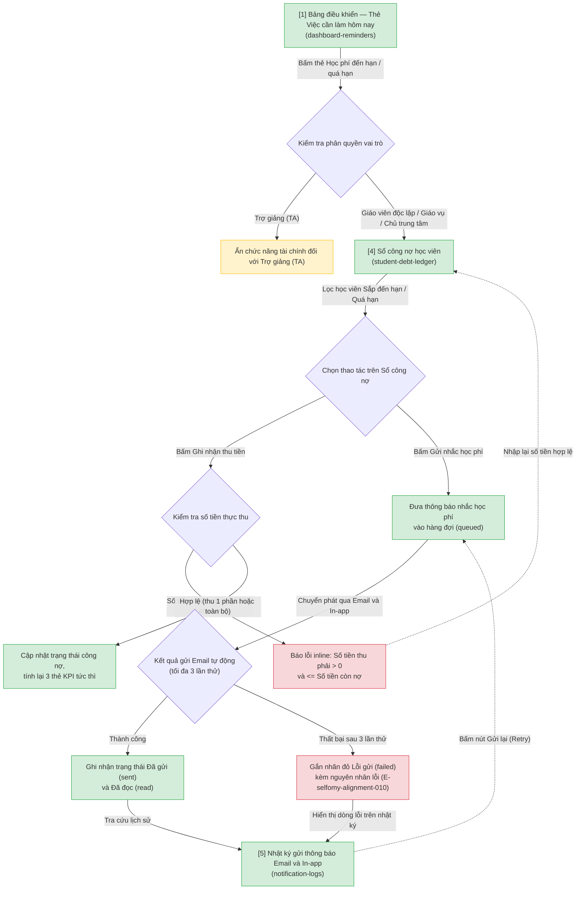
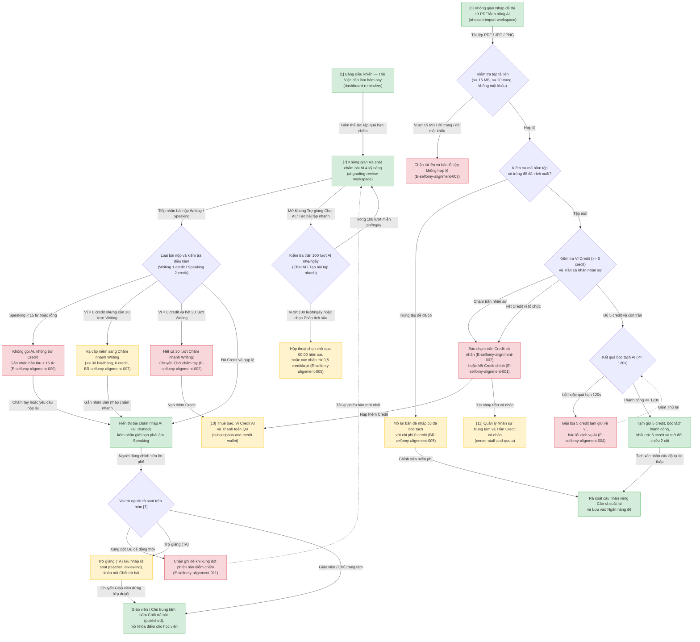
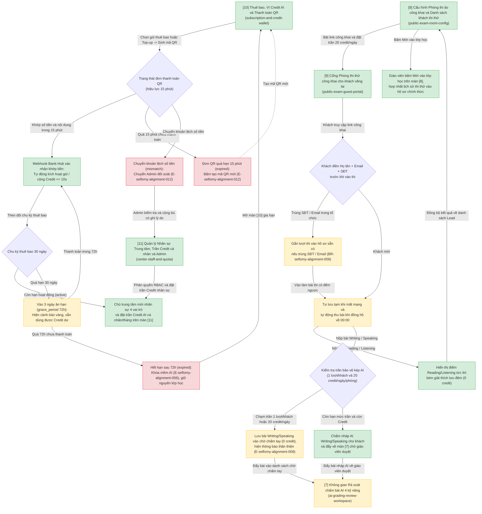

# selfomy-alignment — User Flow

> Nguồn chia flow DUY NHẤT cho feature này. `/wireframe-ascii` và `/wireframe-html` đọc file này để biết flow nào gồm những màn nào — KHÔNG tự chia flow riêng.

## 1. User Flow (tổng)

> Phủ happy / error / edge cases. `[n]` = số màn hình đối chiếu Mục 2.

### Flow: daily-ops-and-holiday-flow

### Flow: debt-and-notification-flow

### Flow: ai-teaching-assistant-flow

### Flow: growth-billing-and-center-flow

## 2. Danh sách màn hình

> Cột `Slug` = định danh máy-đọc DUY NHẤT của màn (khớp `## Screen: {slug}` bên wireframe + node KG). `[#]` chỉ để đối chiếu Mục 1/3.5.

| [#] | Slug | Màn hình | Mục đích | Thuộc flow |
|-----|------|----------|----------|------------|
| 1 | `dashboard-reminders` | Bảng điều khiển — Thẻ Việc cần làm hôm nay | Hiển thị 3 thẻ nhắc việc có bộ đếm (`Ca học hôm nay chưa điểm danh`, `Bài tập quá hạn chấm > 24h`, `Học phí đến hạn / quá hạn thu`), thanh cảnh báo ân hạn thuê bao và điều hướng 1 chạm (`Shared Screen`) | `daily-ops-and-holiday-flow` |
| 2 | `daily-attendance` | Điểm danh tổng theo ngày | Lọc ca học trong ngày qua URL params, mở rộng danh sách học viên inline tại chỗ để đánh dấu 4 trạng thái điểm danh và lưu ghi chú học vụ | `daily-ops-and-holiday-flow` |
| 3 | `schedule-and-holiday-modal` | Lịch học & Hộp thoại Tạo lịch nghỉ chung | Khai báo kỳ nghỉ lễ, chọn `Hủy buổi` hoặc `Dời lịch (+1 buổi)` kèm bảng xem trước các buổi bị trùng và ngày học bù cuối khóa (tự nhảy qua kỳ nghỉ lễ trùng) | `daily-ops-and-holiday-flow` |
| 4 | `student-debt-ledger` | Sổ công nợ học viên | Thống kê 3 thẻ KPI công nợ, lọc học viên theo trạng thái nợ, ghi nhận thu tiền một phần/toàn bộ và kích hoạt gửi thông báo nhắc học phí | `debt-and-notification-flow` |
| 5 | `notification-logs` | Nhật ký gửi thông báo Email + In-app | Tra cứu lịch sử chuyển phát của 4 sự kiện thông báo chính (`Đang chờ`, `Đã gửi`, `Lỗi gửi`, `Đã đọc`) và bấm `Gửi lại` cho các bản ghi lỗi (`Shared Screen`) | `debt-and-notification-flow` |
| 6 | `ai-exam-import-workspace` | Không gian Nhập đề thi từ PDF/Ảnh bằng AI | Tải tệp PDF/ảnh (`<= 15 MB`, `<= 20 trang`), kiểm tra chống trùng đề (`0 credit`), tạm giữ `5 credit` bóc tách AI và đối chiếu 2 cột (tài liệu gốc ↔ cây câu hỏi có nhãn vàng `Cần rà soát lại`) | `ai-teaching-assistant-flow` |
| 7 | `ai-grading-review-workspace` | Không gian Rà soát chấm bài AI 4 kỹ năng & Trợ giảng Chat AI | Đối chiếu 2 cột bài làm Writing/Speaking và điểm nháp AI 4 tiêu chí (kèm nhãn giới hạn phát âm Speaking, nhãn `Bản nháp chấm nhanh`), khung `Trợ giảng Chat AI` (`100 lượt miễn phí/ngày`), nút `Lưu nháp` (cho TA) và nút `Chốt trả bài` (cho Giáo viên/Chủ trung tâm) | `ai-teaching-assistant-flow` |
| 8 | `public-exam-room-config` | Cấu hình Phòng thi ảo công khai & Danh sách khách thi thử | Bật/tắt đường dẫn phòng thi công khai, cấu hình trần bảo vệ kép (`1 lượt/khách` & `20 credit/ngày/phòng`), quản lý danh sách `GuestLead` và mời vào lớp học chính thức | `growth-billing-and-center-flow` |
| 9 | `public-exam-guest-portal` | Cổng Phòng thi thử công khai cho khách vãng lai | Biểu mẫu thu thập Họ tên + Email + SĐT bắt buộc trước khi thi, giao diện làm bài tự lưu tạm khi mất mạng và màn hình kết quả Reading/Listening tức thì (kèm giải thích lưu đệm `0 credit`) | `growth-billing-and-center-flow` |
| 10 | `subscription-and-credit-wallet` | Thuê bao, Ví Credit AI & Thanh toán QR | Quản lý gói thuê bao tháng (`3 ngày ân hạn`), số dư Ví Credit, sinh mã QR thanh toán tự động hiệu lực `15 phút` (hỗ trợ tải QR/sao chép STK trên mobile) và sổ cái biến động Credit (`Shared Screen`) | `growth-billing-and-center-flow` |
| 11 | `center-staff-and-quota` | Quản lý Nhân sự Trung tâm, Trần Credit cá nhân & Công cụ Admin | Phân vùng Chủ trung tâm (`apps/web`): mời nhân sự 4 vai trò, gán lớp và đặt hạn mức trần Credit AI cá nhân hàng tháng; Phân vùng Quản trị viên nền tảng (`apps/admin`): kích hoạt gói, cộng/trừ Credit có ghi lý do kiểm toán và đối soát đơn QR lệch tiền | `growth-billing-and-center-flow` |

## 3. Danh sách flow

| Flow-slug | Tên flow | Màn hình gồm | Cases phủ |
|-----------|----------|--------------|-----------|
| `daily-ops-and-holiday-flow` | Vận hành lịch dạy, Điểm danh tổng & Nghỉ lễ tự động dời buổi | `dashboard-reminders`, `daily-attendance`, `schedule-and-holiday-modal` | happy (điểm danh inline 1 chạm, tạo lịch nghỉ dời `+1 buổi`), edge (chọn `Hủy buổi`, nhảy qua kỳ nghỉ lễ trùng ở cuối khóa, giữ nguyên ca học đã điểm danh, hoàn tác lịch nghỉ) |
| `debt-and-notification-flow` | Sổ công nợ học viên & Nhật ký gửi thông báo đa kênh | `dashboard-reminders`, `student-debt-ledger`, `notification-logs` | happy (thu học phí 1 phần/toàn bộ, gửi nhắc học phí Email + In-app), error (số tiền thu `<= 0` hoặc vượt nợ, lỗi gửi Email sau 3 lần thử `E-selfomy-alignment-010` và bấm `Gửi lại`), edge (ẩn màn tài chính với Trợ giảng `TA`) |
| `ai-teaching-assistant-flow` | Nhập đề PDF/Ảnh bằng AI, Rà soát chấm bài AI 4 kỹ năng & Trợ giảng Chat AI | `ai-exam-import-workspace`, `ai-grading-review-workspace` | happy (nhập đề PDF `5 credit` đối chiếu 2 cột, chấm nháp Writing `1 credit` / Speaking `2 credit` và Giáo viên bấm `Chốt trả bài`, dùng `Trợ giảng Chat AI` trong `100 lượt/ngày`), error (tệp `> 15 MB`/`> 20 trang` `E-003`, lỗi AI hoàn trả Credit `E-004`, hết Credit `E-001`/`E-002`, bản thu `< 15 từ` `E-009`, chạm trần nhân sự `E-007`, xung đột lưu đè `E-011`), edge (mở lại đề trùng `0 credit`, hạ cấp `30 lượt Chấm nhanh Writing/tháng`, vượt `100 lượt AI nhẹ/ngày` `0,5 credit/lượt`, khóa nút `Chốt trả bài` với `TA`, thu gọn 2 cột thành 2 Tab trên mobile/tablet) |
| `growth-billing-and-center-flow` | Phòng thi công khai thu Lead, Thuê bao & Ví Credit AI, Nhân sự & Cấp hạn mức Trung tâm | `public-exam-room-config`, `public-exam-guest-portal`, `subscription-and-credit-wallet`, `center-staff-and-quota` | happy (khách điền thông tin thi thử → xem điểm Reading/Listening → Giáo viên mời vào lớp hợp nhất hồ sơ, thanh toán QR kích hoạt gói/Top-up `<= 10s`, mời nhân sự 4 vai trò & đặt trần Credit cá nhân/tháng), error (đơn QR quá hạn `15 phút` hoặc lệch tiền chờ Admin đối soát `E-012`, hết hạn sau `72h` ân hạn khóa mềm AI `E-006`), edge (hợp nhất Lead trùng SĐT/Email, khôi phục phiên thi khi mất mạng & tự thu bài ở `00:00`, chạm trần bảo vệ kép `1 lượt/khách` hoặc `20 credit/ngày` chuyển chờ chấm tay `E-008`, `3 ngày ân hạn` `grace_period`) |

## 3.5. Chuyển màn (transitions)

> Nguồn DUY NHẤT cho chuyển màn màn→màn (edge NAVIGATES_TO). `/wireframe-html` + `/prototype-html` đọc bảng này để nối nút/điều hướng — KHÔNG tự suy lại từ prose/mermaid (tránh 3 nơi maintain lệch nhau). 1 dòng = 1 chuyển; đủ phủ happy + error + edge của Mục 1.

| Từ màn [#] | Đến màn [#] | Trigger | Điều kiện |
|-----------|------------|---------|-----------|
| Bảng điều khiển [1] | Điểm danh tổng theo ngày [2] | Bấm thẻ "Ca học hôm nay chưa điểm danh" | Có ca học trong ngày ở trạng thái chưa điểm danh |
| Bảng điều khiển [1] | Sổ công nợ học viên [4] | Bấm thẻ "Học phí đến hạn / quá hạn thu" | Người dùng thuộc vai trò Giáo viên độc lập, Giáo vụ hoặc Chủ trung tâm |
| Bảng điều khiển [1] | Không gian Rà soát chấm bài AI [7] | Bấm thẻ "Bài tập quá hạn chấm > 24h" | Có bài nộp ở trạng thái chờ chấm hoặc AI đã chấm nháp quá 24 giờ |
| Bảng điều khiển [1] | Thuê bao, Ví Credit AI & Thanh toán QR [10] | Bấm nút "Gia hạn ngay / Nạp thêm Credit" trên thanh cảnh báo | Tổ chức đang trong 3 ngày ân hạn (`grace_period`) hoặc số dư Credit thấp |
| Điểm danh tổng theo ngày [2] | Lịch học & Hộp thoại Tạo lịch nghỉ chung [3] | Bấm nút chuyển xem "Lịch học & Kỳ nghỉ lễ" | Người dùng cần kiểm tra lịch tuần/tháng hoặc khai báo kỳ nghỉ chung |
| Lịch học & Hộp thoại Tạo lịch nghỉ chung [3] | Nhật ký gửi thông báo [5] | Bấm liên kết "Xem trạng thái thông báo đổi lịch" sau khi xác nhận kỳ nghỉ | Đã xác nhận tạo lịch nghỉ chung và phát sự kiện thông báo hàng loạt |
| Sổ công nợ học viên [4] | (giữ nguyên) [4] | Bấm "Lưu phiếu thu" trong hộp thoại Ghi nhận thu tiền | Số tiền nhập `<= 0` hoặc vượt quá `Số tiền còn nợ` → báo lỗi inline |
| Sổ công nợ học viên [4] | Nhật ký gửi thông báo [5] | Bấm "Gửi nhắc học phí" rồi chọn "Xem nhật ký gửi" | Đã chọn ít nhất 1 học viên có khoản nợ sắp đến hạn hoặc quá hạn |
| Nhật ký gửi thông báo [5] | (giữ nguyên) [5] | Bấm nút "Gửi lại" trên dòng thông báo lỗi | Bản ghi có trạng thái `Lỗi gửi (failed)` (`E-selfomy-alignment-010`) → đưa về `Đang chờ (queued)` |
| Không gian Nhập đề thi từ PDF/Ảnh bằng AI [6] | (giữ nguyên) [6] | Tải tệp PDF/Ảnh lên hoặc bấm "Lưu vào Ngân hàng đề" | Tệp hợp lệ (`<= 15 MB`, `<= 20 trang`) hoặc mở lại bản đề nháp trùng (`0 credit`) |
| Không gian Nhập đề thi từ PDF/Ảnh bằng AI [6] | Thuê bao, Ví Credit AI & Thanh toán QR [10] | Bấm nút "Nạp thêm Credit" trên thông báo lỗi `E-selfomy-alignment-001` | Ví Credit của tổ chức `< 5 credit` không đủ để tạm giữ |
| Không gian Nhập đề thi từ PDF/Ảnh bằng AI [6] | Quản lý Nhân sự Trung tâm & Trần Credit cá nhân [11] | Bấm nút "Xem hạn mức cá nhân / Liên hệ Chủ trung tâm" (`E-selfomy-alignment-007`) | Nhân sự đã dùng hết hạn mức trần Credit AI cá nhân trong tháng |
| Không gian Rà soát chấm bài AI [7] | (giữ nguyên) [7] | Bấm "Lưu bản nháp rà soát" hoặc "Chốt trả bài" hoặc mở "Trợ giảng Chat AI" | Trợ giảng lưu nháp (`teacher_reviewing`) hoặc Giáo viên đứng lớp bấm `Chốt trả bài` (`published`) |
| Không gian Rà soát chấm bài AI [7] | Nhật ký gửi thông báo [5] | Bấm "Xem trạng thái thông báo trả bài" sau khi bấm `Chốt trả bài` | Bài làm vừa chuyển sang trạng thái `Đã trả kết quả (published)` |
| Không gian Rà soát chấm bài AI [7] | Thuê bao, Ví Credit AI & Thanh toán QR [10] | Bấm nút "Nạp thêm Credit" trên thông báo `E-selfomy-alignment-001` / `E-selfomy-alignment-002` | Hết sạch cả Credit chính lẫn 30 lượt Chấm nhanh Writing trong tháng |
| Cấu hình Phòng thi ảo công khai [8] | Cổng Phòng thi thử công khai cho khách vãng lai [9] | Bấm nút "Mở xem trước Cổng phòng thi công khai" | Phòng thi công khai đang ở trạng thái bật |
| Cổng Phòng thi thử công khai cho khách vãng lai [9] | Cấu hình Phòng thi ảo công khai [8] | Khách vãng lai hoàn tất biểu mẫu thông tin và bấm "Nộp bài thi" | Hệ thống đồng bộ hồ sơ `GuestLead` và điểm Reading/Listening về danh sách quản lý |
| Cổng Phòng thi thử công khai cho khách vãng lai [9] | Không gian Rà soát chấm bài AI [7] | Khách nộp phần thi Writing/Speaking trong phòng thi công khai | Chuyển vào hàng đợi chấm nháp AI hoặc chờ chấm tay (`E-selfomy-alignment-008` khi chạm trần) |
| Cấu hình Phòng thi ảo công khai [8] | Nhật ký gửi thông báo [5] | Bấm nút "Mời vào lớp học" tại dòng khách thi thử | Hệ thống gửi Email lời mời kích hoạt tài khoản học viên chính thức |
| Thuê bao, Ví Credit AI & Thanh toán QR [10] | (giữ nguyên) [10] | Chọn gói thuê bao/Top-up để mở hộp thoại QR hoặc bấm "Tạo mã QR mới" | Đơn thanh toán QR trong hạn `15 phút` hoặc tạo lại khi quá hạn (`E-selfomy-alignment-012`) |
| Thuê bao, Ví Credit AI & Thanh toán QR [10] | Quản lý Nhân sự Trung tâm & Công cụ Admin [11] | Đơn thanh toán QR bị lệch số tiền (`mismatch` — `E-selfomy-alignment-012`) | Đẩy sang danh sách "Cần đối soát" trên công cụ Quản trị viên nền tảng |
| Quản lý Nhân sự Trung tâm & Trần Credit cá nhân [11] | (giữ nguyên) [11] | Mời nhân sự mới, cập nhật trần Credit AI cá nhân/tháng hoặc Admin cấp hạn mức | Chủ trung tâm (`apps/web`) hoặc Quản trị viên nền tảng (`apps/admin`) lưu thay đổi |

## 4. Open Questions

- [x] `OQ-1`: Đã chốt tại `selfomy-alignment-spec.md` — Giữ nguyên quy định tự động chấm nháp ngầm (`ai_drafted`) khi học viên nộp bài Writing/Speaking, nhưng bắt buộc ẩn kết quả cho đến khi Giáo viên bấm **"Chốt trả bài"** (`BR-selfomy-alignment-001`).
- [x] `OQ-2`: Đã chốt tại `selfomy-alignment-spec.md` — Hỗ trợ đặt **Hạn mức trần Credit AI cá nhân hàng tháng** cho từng nhân sự ngay trên màn `[11] center-staff-and-quota` (`FR-selfomy-alignment-030`, `BR-selfomy-alignment-011`).

<!-- wm:c3e3a8b9c06f46427bf9089e2fdafa48 -->
Tài liệu thuộc bộ AI4BA BA-Kit — bản quyền hoangphan.blog
