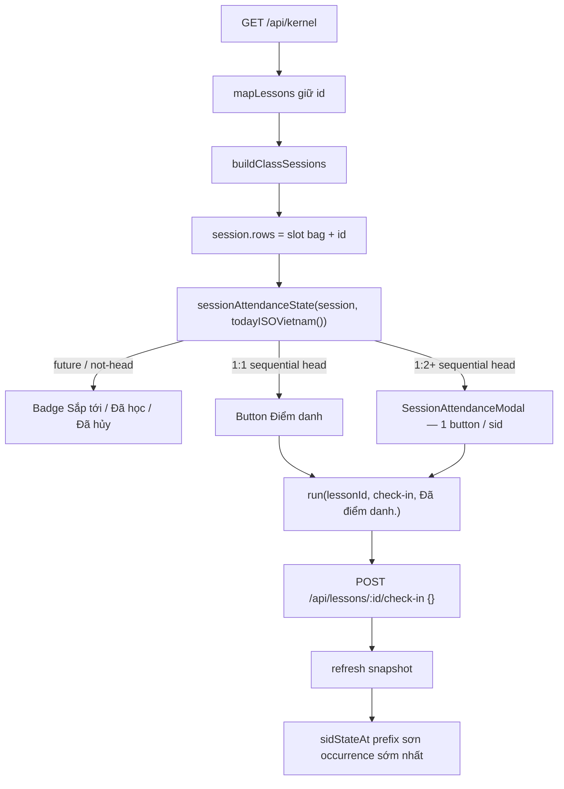

# Điểm danh tại chỗ trên tab Buổi học

## Overview

Tab **Buổi học** (`ClassScheduleTable`) hiện chỉ Badge read-only. Giáo viên phải ra `/dashboard` hoặc `/schedule` để điểm danh. Plan này thêm CTA **Điểm danh** ngay trên timeline: buổi quá khứ/hôm nay được phép; buổi tương lai khóa. Reuse `POST /api/lessons/:id/check-in` (body `{}`). Không kernel action mới. Không fan-out.

## Scope Challenge (HOLD)

- **Existing code:** `useDirectKernelAction` + copy "Điểm danh" / "Đang lưu…" / "Đã điểm danh." đã sống trên `dashboard.tsx:87-99` và `lesson-modal.tsx:172-183`. `todayISOVietnam()` (`week-grid.ts:29-34`) là mốc ngày VN. `sessionStatus` / `sidStateAt` (`class-sessions.ts:209-233`) là prefix heuristic — không đụng. `Modal` (`modal.tsx:14-99`, `max-w-[480px]`) là overlay duy nhất.
- **Requested scope:** điểm danh tại chỗ trên tab Buổi học; chỉ buổi đã/đang diễn ra; buổi chưa học disable.
- **Complexity:** ~7 file (1 extract, 1 modal mới, helper + 3 test). 3 phase bắt buộc — không gộp, không thêm phase 4.
- **Selected mode: HOLD SCOPE.** Kongming pins là binding (GO-WITH-CHANGES). Không mark-absent, không cột date, không cancel-lesson, không "Điểm danh tất cả".

## Advisory Checkpoint

Nguồn: `plans/reports/advise-kongming-session-attendance.md` — **GO-WITH-CHANGES**.

Pins giữ nguyên trong 3 phase:

1. Reuse `POST /api/lessons/:id/check-in` (upcoming→completed, body `{}`). Không kernel action mới. Không mark-absent. Không cột date. Không cancel-lesson trên tab này.
2. Sequential-only: CTA chỉ buổi upcoming sớm nhất đủ điều kiện / sid. POST đúng 1 upcoming `lessonId` / 1 sid / 1 click. **KHÔNG** iterate `session.rows`. **KHÔNG** `rowsForSid[slotIndex-1]`. **KHÔNG** "Điểm danh tất cả".
3. Date gate UI-only: `session.dateISO <= todayISOVietnam()` từ `apps/web/src/lib/week-grid.ts`. **KHÔNG BAO GIỜ** `new Date().toISOString().slice(0,10)`.
4. 1:1 = one-click button. 1:2+ = button mở Modal roster; mỗi học viên một button.
5. Tương lai: Badge tĩnh "Sắp tới". Cancelled: "Đã hủy". Fully completed: "Đã học". `sessions===null`: giữ read-only.
6. Extract `ClassScheduleTable` khỏi `$classId.tsx` **TRƯỚC** khi thêm CTA. File 474 dòng; contract `<500`.
7. Thêm `id` vào `ClassSessionLesson` Pick. **Không** đổi `sessionStatus` / `sidStateAt`.
8. a11y: bỏ `onClick` cấp `<tr>`; expand chỉ qua chevron cột Chủ đề; `stopPropagation` trên nút điểm danh.
9. Copy khớp dashboard/lesson-modal: `"Điểm danh"` / `"Đang lưu…"` / `"Đã điểm danh."`
10. Issue #87 / merge-plan phase 3 status dropdown **SUPERSEDED**. Phase 3 của plan này comment GitHub #87.
11. `useDirectKernelAction` một `pendingKey` / instance — serialize POST; không check-in song song. Table + modal **nhận** `run`/`isPending`/`busy` từ `$classId.tsx:64`, không gọi hook lần hai.

## Why sequential (load-bearing)

`ClassSession.rows` = **toàn bộ** lesson rows của slot (mọi enrollment × mọi occurrence cùng weekday+time). Test khóa việc này: `class-sessions.test.ts:76-80` — mỗi Tue occurrence gắn **13** Tue rows.

`sessionStatus` / `sidStateAt` (`class-sessions.ts:209-233`) là **prefix count**: `slotIndex <= completed` → completed. Check-in **bất kỳ** upcoming row của sid đều sơn occurrence chưa đánh dấu **sớm nhất**, không phải "dòng đang nhìn".

Bind `rowsForSid[slotIndex-1]` trong khi giữ prefix → UI hiện ngày A, POST id của occurrence khác → ngày sai. `/schedule` và dashboard đã tuần tự (mỗi card/modal = 1 enrollment = 1 `lesson.id`). Sửa identity theo ngày thật cần cột `date` trên `lesson` — **out of scope**.

Hệ quả implement:

- `firstUpcomingLessonId(session, sid)` lấy **một** upcoming id của sid từ slot bag (`rows.find(r => r.sid===sid && r.status==="upcoming")?.id`). Cùng bag → cùng id trên mọi occurrence của slot.
- CTA chỉ hiện khi session là **sequential head** của sid: `sidStateAt === "upcoming"` **và** `slotIndex === completed + cancelled + 1`.
- Click trên buổi 5 khi buổi 1 chưa điểm danh sẽ sơn buổi 1 — vì vậy buổi 5 không được có CTA.

## Design Decisions

| # | Quyết định | Lý do | Reject |
|---|------------|-------|--------|
| D1 | Reuse `check-in`, body `{}` | Kernel + CSRF + 409 matrix đã khóa (`kernel.ts:646-690`, `data-actions.ts:5`) | Kernel action mới / mark-absent |
| D2 | Sequential head + 1 id / click | `rows` là slot bag, không phải occurrence (`class-sessions.ts:56-57,167`) | Fan-out `for (row of session.rows)`; bind `rowsForSid[slotIndex-1]`; "Điểm danh tất cả" |
| D3 | Date gate `dateISO <= todayISOVietnam()` | Server không có cột date (`schema/lesson.ts`); UTC slice lệch ngày lúc 07:00 VN | `toISOString().slice(0,10)`; chặn theo giờ bắt đầu |
| D4 | 1:1 one-click; 1:2+ Modal | Khớp dashboard (1 enrollment / click); roster không nhồi vào cell | Inline chips; expand-row thành form; dropdown gộp |
| D5 | Extract table trước CTA | `$classId.tsx` 474 dòng; contract `<500` (`class-detail-sessions-tab.contract.test.ts:66-68`) | Nhét CTA vào route |
| D6 | Thread hook từ route | `useDirectKernelAction` là `useState` per-instance (`use-direct-kernel-action.ts:13-33`), không phải process-global | Gọi hook lần 2 trong table/modal → notes + attendance song song |
| D7 | Bỏ `tr.onClick` | Nested interactive + bubble vào expand (`$classId.tsx:356-376`) | Chỉ `stopPropagation` mà giữ row-button |

## Non-goals

- `mark-absent` / write path `absent`
- Cột `date` trên `lesson` / migration DB
- `cancel-lesson` trên tab Buổi học
- Đổi `sessionStatus` / `sidStateAt` prefix
- Bulk "Điểm danh tất cả" / iterate `session.rows`
- Status dropdown Issue #87 (superseded)
- Inline-edit topic (merge-tabs P3 khác)
- CTA trên legacy `sessions === null`

## Cross-Plan Dependencies

| Quan hệ | Plan | Ý nghĩa |
|---------|------|---------|
| **Blocks** | `260826-1611-merge-class-detail-schedule-and-curriculum-tabs` | Merge-tabs **phase 3** (`phase-03-timeline-mutations-inline-edit-and-status.md`) đề xuất dropdown + `for (row of session.rows) check-in` — **SUPERSEDED**. Cook plan này trước. Merge-tabs P3 phải bỏ dropdown/fan-out; inline-edit topic (nếu còn) không thuộc slice này. |

`blockedBy: []`. Không đợi plan khác.

## Data flow

## Phases

| # | Phase | Effort | Depends | Status |
|---|-------|--------|---------|--------|
| 1 | [Helper + extract ClassScheduleTable](./phase-01-start.md) | 0.5d | — | pending |
| 2 | [CTA điểm danh + modal roster](./phase-02-attendance-cta-and-roster-modal.md) | 0.75d | 1 | pending |
| 3 | [Tests, e2e, ghi chú issue #87](./phase-03-tests-e2e-and-issue-87-note.md) | 0.5d | 2 | pending |

Tổng **1.75d**. Không gộp. Không thêm phase 4.

## File ownership (không song song đụng cùng file)

| File | P1 | P2 | P3 |
|------|----|----|----|
| `apps/web/src/lib/class-sessions.ts` | owner | — | — |
| `apps/web/src/lib/class-sessions.test.ts` | owner | — | — |
| `apps/web/src/routes/_auth/classes/$classId.tsx` | extract | thread hook props | — |
| `apps/web/src/components/class-detail/class-schedule-table.tsx` | create (no CTA) | CTA + a11y | — |
| `apps/web/src/components/class-detail/session-attendance-modal.tsx` | — | create | — |
| `apps/web/src/lib/class-detail-sessions-tab.contract.test.ts` | path/line-count | a11y selectors nếu đổi | — |
| `apps/e2e/specs/class-operations.spec.ts` | — | — | owner |
| `apps/web/src/lib/kernel-runtime.contract.test.ts` | — | — | owner |
| GitHub issue #87 | — | — | comment |

## Test matrix

| Tầng | Phủ | File |
|------|-----|------|
| Unit | `sessionIsEligibleDate`; `firstUpcomingLessonId` không index-bind; sequential head chỉ occurrence sớm nhất; 1:2 mixed | `class-sessions.test.ts` (P1) |
| Contract | 3 tab; extract path; lineCount `$classId.tsx` `<500`; 4-col + legacy 5-col | `class-detail-sessions-tab.contract.test.ts` (P1, chỉnh P2 nếu markup đổi) |
| Contract | table/modal `void run` + `disabled={busy \|\| isPending(...)}` | `kernel-runtime.contract.test.ts` (P3) |
| E2E | Giữ 12 "Sắp tới" (start tomorrow); CTA trên Buổi học khi `startDate<=today`; không phá count | `class-operations.spec.ts` (P3) |
| Không đụng | `data-actions.ts`, `kernel.test.ts` command lock, reducer tests — action set không đổi | — |

## Success Criteria

- [ ] Tab Buổi học: 1:1 **sequential head** (buổi chưa chốt sớm nhất, `dateISO <= todayISOVietnam()`) → button "Điểm danh" one-click → toast "Đã điểm danh." → Badge "Đã học". **Không** hứa hàng hôm nay luôn có nút nếu backlog buổi trước còn upcoming.
- [ ] 1:2+: button mở `SessionAttendanceModal`; mỗi sid một button hoặc Badge; **không** "Điểm danh tất cả".
- [ ] Trên **tab này**, buổi `dateISO > todayISOVietnam()`: chỉ Badge "Sắp tới", 0 CTA. Write path `/schedule` + `POST /check-in` vẫn upcoming-only (không date-gate) — không đổi trong slice này.
- [ ] Cancelled / fully completed: Badge "Đã hủy" / "Đã học", 0 CTA.
- [ ] Legacy `sessions===null`: DataTable 5 cột read-only, 0 CTA.
- [ ] Mỗi click = đúng 1 `POST /api/lessons/:id/check-in` body `{}` với **enrollment** lesson id (không syllabus `sessionLessonInfo.lessonId`). Không iterate `rows` trong JSX.
- [ ] `$classId.tsx` `<500` dòng sau extract.
- [ ] E2E lớp start-tomorrow: 0 button "Điểm danh" trên tab + count Badge "Sắp tới" ổn định khi Playwright `timezoneId: "Asia/Ho_Chi_Minh"`. Sau check-in `/schedule` vẫn 1 "Đã học" + 11 "Sắp tới".
- [ ] Issue #87 comment: **chỉ** status dropdown/fan-out superseded; inline-edit topic vẫn thuộc #87.
- [ ] Không file server/schema/data-actions mới.

## Risks

| Risk | L×I | Mitigation | Rollback |
|------|-----|------------|----------|
| Chọn nhầm `lessonId` từ slot bag (Kongming next risk) | H×H | Helper + unit test cấm index-bind; CTA chỉ sequential head | Revert helper; Badge-only |
| Timezone off-by-one (`toISOString` lúc 00:00–07:00 VN) | M×H | Chỉ `todayISOVietnam()`; test so sánh chuỗi `YYYY-MM-DD` | — |
| `$classId.tsx` ≥500 sau CTA | M×H | Extract P1 **trước** CTA; contract giữ line count trên route | Extract đã là rollback line-count |
| E2E 12 "Sắp tới" vỡ vì CTA thay Badge | H×M | Create-class UI `startDate` = tomorrow (`add-class-modal.tsx:53-54`) → toàn bộ future → Badge. CTA test dùng POST `/api/classes` `startDate` ≤ hôm nay | Giữ test cũ nguyên |
| Check-in không hoàn tác (409) | H×M | 1 id / click; serialize `busy`; không fan-out | Không undo được — đúng kernel |
| Hai hook instance → POST song song | M×H | Thread `run` từ `$classId.tsx:64` | — |

## Rollback

- **P1:** xóa file extract, đưa `ClassScheduleTable` về route; bỏ `id` khỏi Pick; xóa helper mới.
- **P2:** xóa modal + CTA; Badge như cũ; chevron/row click có thể giữ bản a11y nếu đã tách.
- **P3:** revert e2e/contract. Comment #87 để lại (không hại).

Không migration. Không data backfill.

## Open questions

None — pin Kongming + red-team đã khóa copy/recipe.

## Red Team Review

### Session — 2026-08-26

**Reviewers:** Security Adversary + Assumption Destroyer + Failure Mode Analyst (Standard tier)
**Reports:** `reports/red-team-security.md`, `reports/red-team-assumptions.md`, `reports/red-team-failures.md`
**Findings:** 25 (capped/deduped below). Applied accepted plan edits before this table.

| # | Finding | Severity | Disposition | Applied To |
|---|---------|----------|-------------|------------|
| 1 | Date-gate UI-only ≠ write-path lock | Critical | Accept (copy only) | plan.md Success — khóa trên tab này; `/schedule`+API không đổi |
| 2 | Sequential head ≠ hàng hôm nay nếu backlog | Critical | Accept (copy only) | plan.md Success — backlog-first |
| 3 | Đòi cột date / server sequential | Critical | Reject | HOLD SCOPE + Kongming UI-only |
| 4 | Dashboard weekday dump / ACL role chết | High | Reject | Invariant sẵn; ngoài slice |
| 5 | `firstUpcomingLessonId` bag order | Critical | Accept (partial) | P1 sort `id`; không persist `createdAt` |
| 6 | Syllabus `info.lessonId` vs enrollment id | High | Accept | `enrollmentLessonId`; cấm `info.lessonId` |
| 7 | Modal snapshot stale → 409 | High | Accept | P2 `modalIndex` + live `sessions.find` |
| 8 | `goto /classes` không heal kernel cache | Critical | Accept | P3 chỉ `page.reload()` |
| 9 | E2E UTC evening / `getDay()` máy | High | Accept | Playwright TZ VN + helper UTC-from-ISO |
| 10 | Issue #87 comment nuốt inline-edit | Medium | Accept | Template tách 2 phần |
| 11 | 1:2 mixed copy fixture 288-303 | High | Accept | P1 equal vs divergent tests |
| 12 | Extract/contract lệch commit | Medium | Accept | P1 cùng commit path |
| 13 | Focus trap khi nút disable | High | Accept | P2 focus Close |
| 14 | CSRF 403 vs 401 | High | Accept | P3 mã lỗi |
| 15 | Empty-body lock / intercept e2e | Medium | Reject | `kernel.test.ts` + `kernelCommand` đã khóa; không nới P3 |
| 16 | `busy` khóa notes / rewrite hook | High | Reject | Hook hiện tại; bus đã serialize |
| 17 | Pass `id` trên bag là catalog | High | Reject (partial) | Cần id để POST; Accept contract cấm `session.rows` JSX |

### Whole-Plan Consistency Sweep

- Files reread: plan.md, phase-01-start.md, phase-02-attendance-cta-and-roster-modal.md, phase-03-tests-e2e-and-issue-87-note.md
- Decision deltas: enrollmentLessonId; live modalIndex; Playwright TZ; reload-only; weekday UTC-from-ISO; honest tab-only future lock; #87 split comment
- Reconciled stale: P3 `goto`/`writing`/`[1,3]`; P1 mixed test; P2 snapshot session
- Unresolved contradictions: 0

## Validation Log

### Verification Results
- **Tier:** Standard (3 phases)
- **Claims checked:** 18
- **Verified:** 16 | **Failed:** 0 | **Unverified:** 2 (line-number drift ±2 trên helper; hành vi đúng)
- Failures: none blocking

### Session 1 — 2026-08-26
**Trigger:** hard mode post-red-team. Pin Kongming + accepted findings khóa quyết định sản phẩm. Interview còn lại ở handoff.

## References

- `plans/reports/researcher-session-attendance-domain.md`
- `plans/reports/researcher-session-attendance-ux.md`
- `plans/reports/scout-session-attendance-files.md`
- `plans/reports/advise-kongming-session-attendance.md`
- `apps/web/src/routes/_auth/classes/$classId.tsx` (`ClassScheduleTable` 246-474)
- `apps/web/src/lib/class-sessions.ts`
- `apps/web/src/lib/class-detail-sessions-tab.contract.test.ts`
- `apps/web/src/lib/use-direct-kernel-action.ts`
- `apps/e2e/specs/class-operations.spec.ts`
- `plans/260826-1611-merge-class-detail-schedule-and-curriculum-tabs/phase-03-timeline-mutations-inline-edit-and-status.md`

<!-- slug: in-place-attendance-on-bui-hc-tab -->
