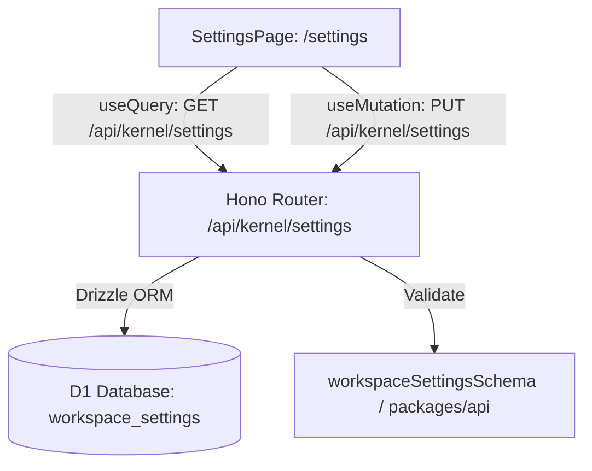

# Persist Workspace Settings qua Kernel (#179)

## Overview

Sau khi PR #178 (issue #167) trung thực hóa UI Cài đặt bằng cách disable các control giả lập `useState` local không lưu được, issue #179 thực hiện bước tiếp theo: xây dựng tầng lưu trữ bền vững (persistence) cho cấu hình workspace trong kernel.

Cấu hình gồm:
1. **Gói & Đơn giá**: Đơn giá mặc định / buổi học (`defaultUnitPrice`, mặc định `"400.000đ"`).
2. **Mẫu tin Zalo (3 mẫu)**: Mẫu nhắc lịch `tplReminder`, mẫu nhắc nợ `tplDebt`, mẫu báo cáo tuần `tplReport`.
3. **Quy tắc vắng & nhắc nhở (7 quy tắc)**: `absenceNoticeHours`, `unexcusedDeduct`, `maxAbsencesBeforeAlert`, `reminderSchedule`, `overdueDebtReminder`, `packageEndReminder`, `preferredChannel`.

## Architecture & Flow



## Goals

| # | Goal | Priority |
|---|------|----------|
| 1 | [Kernel Schema & API Endpoints](./phase-01-kernel-schema-and-api.md) | Completed |
| 2 | [Web Settings Persistence & UI Re-enable](./phase-02-web-settings-persistence.md) | Completed |
| 3 | [Contract Tests & E2E Verification](./phase-03-e2e-and-contract-verification.md) | Completed |
| 4 | Cập nhật `apps/web/src/routes/_auth/settings.tsx`: nạp dữ liệu từ query, bật lại controls, nút "Lưu thay đổi", bỏ nhãn "Chưa mở" | P1 |
| 5 | Giữ nguyên phạm vi: không can thiệp Xóa tài khoản (#174 đã xong), xuất file DataTab giữ nhãn honest | P2 |
| 6 | Unit tests, contract tests và E2E verification xanh 100% | P1 |
- [x] `GET /api/kernel/settings` trả về cấu hình mặc định nếu org chưa lưu, hoặc cấu hình đã lưu.
- [x] `PUT /api/kernel/settings` nhận payload hợp lệ, upsert vào DB và trả về settings mới nhất.
- [x] Truy cập `/settings`: các input/select/textarea tại tab Tài khoản, Mẫu tin Zalo, Quy tắc có thể nhập/chọn.
- [x] Bấm nút "Lưu thay đổi" hiển thị trạng thái thành công; F5 reload giữ nguyên giá trị đã lưu.
- [x] Bỏ nhãn "Chưa mở" tại các tab đã được persist.
- [x] `pnpm test` (server & web) pass; `pnpm check` pass; `pnpm check-types` pass.

## Phases

| Phase | Name | Status |
|-------|------|--------|
| 1 | [Kernel Schema & API Endpoints](./phase-01-kernel-schema-and-api.md) | Pending |
| 2 | [Web Settings Persistence & UI Re-enable](./phase-02-web-settings-persistence.md) | Pending |
| 3 | [Contract Tests & E2E Verification](./phase-03-e2e-and-contract-verification.md) | Pending |

## Success Criteria

- [ ] `GET /api/kernel/settings` trả về cấu hình mặc định nếu org chưa lưu, hoặc cấu hình đã lưu.
- [ ] `PUT /api/kernel/settings` nhận payload hợp lệ, upsert vào DB và trả về settings mới nhất.
- [ ] Truy cập `/settings`: các input/select/textarea tại tab Tài khoản, Mẫu tin Zalo, Quy tắc có thể nhập/chọn.
- [ ] Bấm nút "Lưu thay đổi" hiển thị trạng thái thành công; F5 reload giữ nguyên giá trị đã lưu.
- [ ] Bỏ nhãn "Chưa mở" tại các tab đã được persist.
- [ ] `pnpm test` (server & web) pass; `pnpm check` pass; `pnpm check-types` pass.

## Verification Commands

```bash
pnpm --filter @teacher-os/db run db:generate
pnpm --filter server test
pnpm --filter web test
pnpm check
pnpm check-types
```
