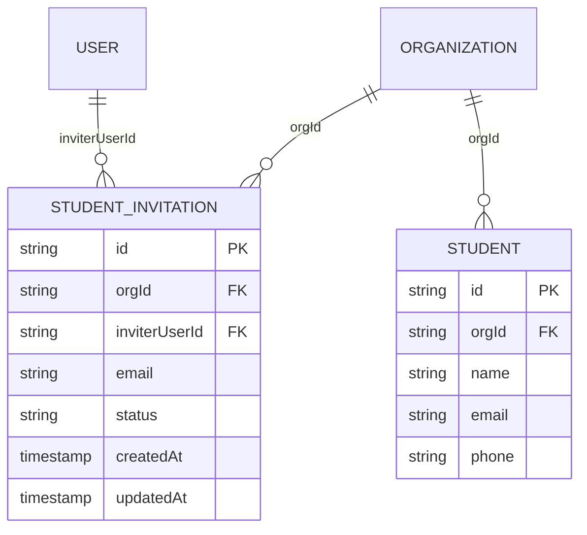

# Phase 1: Database Schema & Migration

## Context Links
- Schema định nghĩa học viên: `packages/db/src/schema/student.ts`
- Schema tổ chức & thành viên: `packages/db/src/schema/organization.ts`, `packages/db/src/schema/membership.ts`
- Migration 0023 trước đó: `packages/db/src/migrations/0023_special_inertia.sql`

## Overview
Phase 1 thiết lập nền tảng dữ liệu cho toàn bộ tính năng:
1. Tạo bảng `student_invitation` lưu trữ lời mời tham gia tổ chức từ giáo viên.
2. Cập nhật schema `student`: Thay thế `uniqueIndex("student_email_uq")` (đang là unique toàn cục trên toàn database) thành `uniqueIndex("student_org_email_uq")` (unique theo cặp `(org_id, lower(trim(email)))`). Điều này cho phép một tài khoản học viên (email) có thể tồn tại và học tập tại nhiều tổ chức giáo viên khác nhau.
3. Sinh file migration D1 mới (`0024_...`) và viết test migration kiểm chứng tính an toàn.

## Key Insights
- Trước PR #257, email học viên không có ràng buộc unique. Khi thêm PR #257, index `student_email_uq` được đặt toàn cục trên biểu thức `lower(trim(email))`. Điều này xung đột trực tiếp với mô hình đa tổ chức (Multi-Org): nếu Học viên A học Giáo viên 1 và muốn học thêm Giáo viên 2, hệ thống sẽ từ chối chèn record học viên vào Org 2 do vi phạm unique index.
- Việc chuyển thành `uniqueIndex("student_org_email_uq").on(table.orgId, sql`lower(trim(${table.email}))`).where(sql`trim(${table.email}) != ''`)` giữ vững tính toàn vẹn: trong cùng 1 tổ chức, giáo viên không thể có 2 học viên trùng email; nhưng 2 tổ chức khác nhau có thể chứa cùng 1 email học viên.
- Bảng `student_invitation` cần có partial unique index `(org_id, lower(trim(email))) WHERE status = 'pending'` để ngăn việc gửi nhiều lời mời trùng lặp đang chờ xử lý cho cùng một học viên trong cùng một tổ chức.

## Requirements
- [ ] Schema `student_invitation` trong `packages/db/src/schema/student-invitation.ts` với đầy đủ các trường: `id`, `org_id`, `inviter_user_id`, `email`, `status` (`pending`, `accepted`, `rejected`, `canceled`), `created_at`, `updated_at`.
- [ ] Cập nhật `packages/db/src/schema/student.ts`: thay `student_email_uq` thành `student_org_email_uq` scoped theo `org_id`.
- [ ] Export bảng mới từ `packages/db/src/schema/index.ts`.
- [ ] Chạy `pnpm run db:generate` sinh migration file mới (migration 0024).
- [ ] Viết test migration `packages/db/src/migrations/student-multi-org-migration.test.ts` hoặc tương đương trong `apps/server/src/` để đảm bảo:
  - Cho phép chèn cùng email vào 2 org khác nhau.
  - Chặn chèn trùng email trong cùng 1 org.
  - Chặn gửi 2 lời mời `pending` trùng email trong cùng 1 org.

## Architecture

## Related Code Files
- **Modify:** `packages/db/src/schema/student.ts`
- **Modify:** `packages/db/src/schema/index.ts`
- **Create:** `packages/db/src/schema/student-invitation.ts`
- **Create:** `packages/db/src/migrations/0024_*.sql` (auto-generated)
- **Create:** `apps/server/src/student-multi-org-migration.test.ts`

## Implementation Steps
1. Tạo file `packages/db/src/schema/student-invitation.ts`:
   - Khai báo bảng `student_invitation` với các cột:
     - `id`: `text("id").primaryKey()`
     - `orgId`: `text("org_id").notNull().references(() => organization.id, { onDelete: "cascade" })`
     - `inviterUserId`: `text("inviter_user_id").notNull().references(() => user.id, { onDelete: "cascade" })`
     - `email`: `text("email").notNull()`
     - `status`: `text("status").$type<"pending" | "accepted" | "rejected" | "canceled">().notNull().default("pending")`
     - `createdAt`: `integer("created_at", { mode: "timestamp_ms" }).default(...).notNull()`
     - `updatedAt`: `integer("updated_at", { mode: "timestamp_ms" })`
   - Khai báo các index:
     - `index("student_invitation_org_idx").on(table.orgId)`
     - `index("student_invitation_email_idx").on(table.email)`
     - `uniqueIndex("student_invitation_org_email_pending_uq").on(table.orgId, sql`lower(trim(${table.email}))`).where(sql`status = 'pending'`))`
2. Sửa file `packages/db/src/schema/student.ts`:
   - Thay `uniqueIndex("student_email_uq").on(sql`lower(trim(${table.email}))`).where(sql`trim(${table.email}) != ''`)`
   - Bằng `uniqueIndex("student_org_email_uq").on(table.orgId, sql`lower(trim(${table.email}))`).where(sql`trim(${table.email}) != ''`)`
3. Export bảng `studentInvitation` trong `packages/db/src/schema/index.ts`.
4. Chạy `pnpm run db:generate` sinh file migration 0024. Kiểm tra file SQL sinh ra có chứa câu lệnh drop index cũ và tạo index mới cùng lệnh `CREATE TABLE student_invitation`.
5. Tạo test `apps/server/src/student-multi-org-migration.test.ts` kiểm thử toàn diện các ràng buộc mới:
   - Insert email `"alex@gmail.com"` vào Org 1 -> thành công.
   - Insert email `"alex@gmail.com"` vào Org 2 -> thành công (Multi-org).
   - Insert tiếp email `"alex@gmail.com"` vào Org 1 -> lỗi unique constraint.
   - Tạo lời mời pending cho `"alex@gmail.com"` ở Org 1 -> thành công.
   - Tạo thêm lời mời pending cho `"alex@gmail.com"` ở Org 1 -> lỗi unique constraint.
   - Tạo lời mời pending cho `"alex@gmail.com"` ở Org 2 -> thành công.

## Todo List
- [ ] Tạo schema `packages/db/src/schema/student-invitation.ts`
- [ ] Cập nhật schema `packages/db/src/schema/student.ts` với scoped unique index
- [ ] Re-export trong `packages/db/src/schema/index.ts`
- [ ] Chạy `pnpm run db:generate` và kiểm tra file migration
- [ ] Viết và chạy test `student-multi-org-migration.test.ts`

## Success Criteria
- [ ] Schema biên dịch sạch không có lỗi TypeScript (`pnpm check-types`).
- [ ] Migration áp dụng trơn tru trên database SQLite/libSQL.
- [ ] Test migration chứng minh cùng 1 email có thể tồn tại ở 2 tổ chức khác nhau nhưng bị chặn trong cùng 1 tổ chức.

## Risk Assessment
- **Rủi ro:** Khi đổi index từ toàn cục sang theo `org_id`, nếu dữ liệu hiện hữu có duplicate trong cùng 1 org thì migration sẽ fail.
- **Giảm thiểu:** Dữ liệu hiện tại đã tuân thủ index toàn cục cũ nên chắc chắn không có duplicate trong cùng 1 org. Migration chuyển đổi index là an toàn 100%.

## Security Considerations
- Bảng lời mời lưu trữ email học viên; không lưu trữ mật khẩu hoặc token nhạy cảm dạng plaintext.
- Mọi quan hệ đều có cascade delete với `organization.id` và `user.id`, đảm bảo không để lại dữ liệu mồ côi (orphaned data) khi xoá tổ chức hoặc người dùng.
