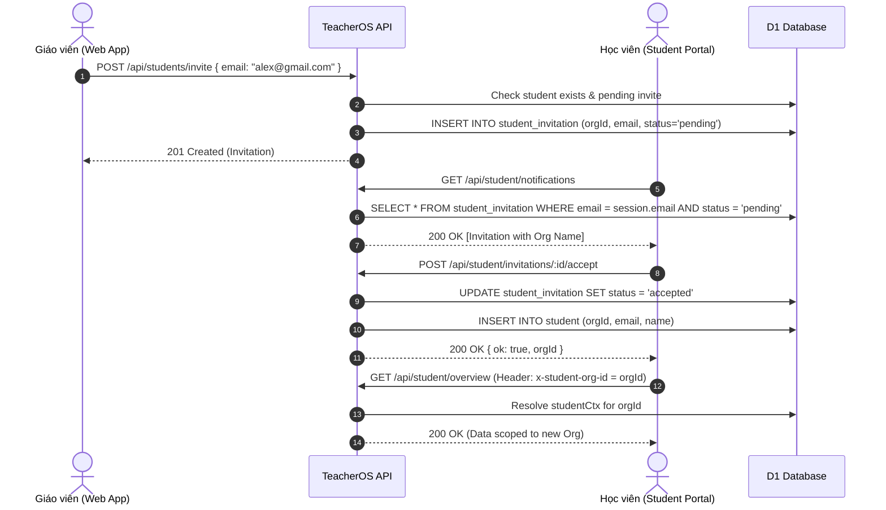

# Phase 2: Server Invitation & Multi-Org Bridge

## Context Links
- Contracts định nghĩa API: `packages/api/src/contracts.ts`
- Kernel routes (Giáo viên): `apps/server/src/routes/kernel.ts`
- Student routes & bridge (Học viên): `apps/server/src/routes/student.ts`
- Tests bridge hiện có: `apps/server/src/student.test.ts`

## Overview
Phase 2 triển khai toàn bộ các endpoint và logic nghiệp vụ phía server:
1. Định nghĩa Zod schemas và types trong `packages/api/src/contracts.ts`.
2. Phía Giáo viên: Thêm các route trong `kernel.ts` để gửi lời mời học viên (`POST /api/students/invite`), xem danh sách lời mời (`GET /api/students/invitations`), và huỷ lời mời (`DELETE /api/students/invitations/:id`).
3. Phía Học viên: Thêm các route trong `student.ts` để đọc danh sách thông báo lời mời (`GET /api/student/notifications`), chấp nhận lời mời (`POST /api/student/invitations/:id/accept`), từ chối lời mời (`POST /api/student/invitations/:id/reject`), và liệt kê danh sách tổ chức học viên đã tham gia (`GET /api/student/orgs`).
4. Nâng cấp middleware `requireStudent` trong `apps/server/src/routes/student.ts`: Bỏ cơ chế ném 403 `STUDENT_AMBIGUOUS` khi email khớp nhiều hơn 1 record `student`. Thay vào đó, resolve `orgId` active từ header `x-student-org-id` (hoặc cookie `active_student_org_id`), fallback về record mới nhất.

## Key Insights
- Khi học viên chấp nhận lời mời (`accept`), hành động này phải diễn ra trong database transaction:
  1. Kiểm tra lời mời có tồn tại, đúng email người dùng đang đăng nhập (`session.email`), và có status là `pending`.
  2. Cập nhật `status = 'accepted'`.
  3. Kiểm tra xem trong `invitation.orgId` đã có record `student` cho email này chưa; nếu chưa, chèn một record `student` mới cho tổ chức đó với `name: session.userName`, `email: session.email`.
- Không bắt buộc học viên phải logout hay refresh phiên đăng nhập: token session Better-Auth gắn với `user.id`. Dữ liệu `studentCtx` được resolve động theo request header `x-student-org-id`.
- Chặn giáo viên mời chính mình hoặc mời học viên đã có trong tổ chức: Trả về HTTP 409 `STUDENT_ALREADY_IN_ORG` nếu email đã là học viên của org đó, và 409 `INVITATION_ALREADY_PENDING` nếu đã có lời mời pending chưa hết hạn.

## Requirements
- [ ] Schema Zod trong `packages/api/src/contracts.ts`:
  - `studentInviteSchema`: `z.object({ email: z.string().trim().email() })`
  - `studentInvitationItemSchema`: Thông tin lời mời hiển thị cho giáo viên và học viên.
  - `studentOrgItemSchema`: `{ id: string, name: string, isCurrent: boolean }`
- [ ] Routes giáo viên:
  - `POST /api/students/invite`: Nhận email, tạo lời mời `pending`, trả về 201 kèm lời mời.
  - `GET /api/students/invitations`: Trả về danh sách lời mời của `ctx.orgId`.
  - `DELETE /api/students/invitations/:id`: Huỷ lời mời pending của org.
- [ ] Routes học viên:
  - `GET /api/student/notifications`: Trả về các lời mời `pending` gửi tới email của học viên (`emailVerified === true`), kèm tên giáo viên/tổ chức mời.
  - `POST /api/student/invitations/:id/accept`: Chấp nhận lời mời, tự động tạo học viên trong org đích nếu chưa có.
  - `POST /api/student/invitations/:id/reject`: Từ chối lời mời (`status = 'rejected'`).
  - `GET /api/student/orgs`: Trả về danh sách các tổ chức học viên đang tham gia, đánh dấu `isCurrent: true` cho org hiện tại.
- [ ] Cải tiến `requireStudent` middleware:
  - Đọc header `x-student-org-id`.
  - Nếu có nhiều record `student`: chọn record có `orgId == x-student-org-id`; nếu không khớp hoặc không truyền, chọn record mới nhất (`created_at DESC`).
  - Xoá bỏ hoàn toàn nhánh ném lỗi `STUDENT_ERROR_CODES.AMBIGUOUS`.
- [ ] Bộ test hoàn chỉnh trong `apps/server/src/student-invitation.test.ts` kiểm thử toàn bộ luồng mời, nhận thông báo, accept, reject và multi-org resolve.

## Architecture & Data Flow

## Related Code Files
- **Modify:** `packages/api/src/contracts.ts`
- **Modify:** `apps/server/src/routes/kernel.ts`
- **Modify:** `apps/server/src/routes/student.ts`
- **Modify:** `apps/server/src/student.test.ts`
- **Create:** `apps/server/src/student-invitation.test.ts`

## Implementation Steps
1. Sửa `packages/api/src/contracts.ts`:
   - Thêm `studentInviteSchema = z.object({ email: z.string().trim().email("Email không hợp lệ") })`.
   - Thêm types: `StudentInviteInput`, `StudentInvitationItem`, `StudentOrgItem`.
   - Thêm error codes mới nếu cần: `STUDENT_INVITATION_ERROR_CODES`.
2. Sửa `apps/server/src/routes/kernel.ts`:
   - Thêm route `POST /students/invite`:
     - Lấy `ctx = c.get("kernelCtx")`.
     - Validate body bằng `studentInviteSchema`.
     - Query DB: nếu đã có student với email trong `ctx.orgId` -> trả 409 `{ error: "Học viên này đã ở trong tổ chức của bạn" }`.
     - Query DB: nếu đã có invitation với status `pending` trong `ctx.orgId` -> trả 409 `{ error: "Lời mời đang chờ học viên phản hồi" }`.
     - Insert vào `studentInvitation`: `id: crypto.randomUUID(), orgId: ctx.orgId, inviterUserId: ctx.userId, email: normalizedEmail`.
     - Trả về 201 với thông tin lời mời vừa tạo.
   - Thêm route `GET /students/invitations`:
     - Query danh sách invitations thuộc `ctx.orgId`, sắp xếp `createdAt DESC`.
     - Trả về danh sách JSON.
   - Thêm route `DELETE /students/invitations/:id`:
     - Kiểm tra invitation tồn tại trong `ctx.orgId` và có status `pending`.
     - Cập nhật `status = 'canceled'` (hoặc delete row). Trả về 200 `{ ok: true }`.
3. Sửa `apps/server/src/routes/student.ts`:
   - Thêm route `GET /notifications`:
     - Xác thực session của học viên.
     - Query các rows từ `studentInvitation` có `lower(trim(email)) = normalizedEmail AND status = 'pending'`, join với `organization` để lấy `orgName` và `user` để lấy `inviterName`.
     - Trả về danh sách notification/invitations.
   - Thêm route `POST /invitations/:id/accept`:
     - Tìm invitation theo id và email học viên, status `pending`.
     - Trong transaction: set `status = 'accepted'`, chèn `student` vào org đó nếu chưa có.
     - Trả về 200 `{ ok: true, orgId: invitation.orgId }`.
   - Thêm route `POST /invitations/:id/reject`:
     - Set `status = 'rejected'`. Trả về 200 `{ ok: true }`.
   - Thêm route `GET /orgs`:
     - Query tất cả các rows `student` của `normalizedEmail`, join với `organization` lấy `o.id, o.name`.
     - Đánh dấu `isCurrent: row.orgId === currentOrgId`.
     - Trả về danh sách orgs.
   - Cập nhật middleware `requireStudent`:
     - Lấy `requestedOrgId = c.req.header("x-student-org-id")`.
     - Khi `rows.length >= 1`:
       - Tìm row có `row.orgId === requestedOrgId`.
       - Nếu không tìm thấy hoặc không truyền, chọn `rows[0]` (được sort theo `createdAt DESC`).
       - Set `studentCtx` với record tìm được.
       - Xoá bỏ check `if (rows.length > 1) return c.json({ error: STUDENT_ERROR_CODES.AMBIGUOUS }, 403)`.
4. Tạo test `apps/server/src/student-invitation.test.ts`:
   - Test 1: Teacher gửi invite hợp lệ -> 201; gửi lại cùng email -> 409.
   - Test 2: Teacher huỷ invite -> invite thành canceled.
   - Test 3: Student query notifications -> nhận đúng danh sách invite pending.
   - Test 4: Student accept invite -> record student được tạo ở org giáo viên, invite chuyển accepted.
   - Test 5: Student reject invite -> invite chuyển rejected, không có student record nào được tạo.
   - Test 6: Multi-org resolve: Student thuộc Org A và Org B -> truyền header `x-student-org-id: orgB` -> trả dữ liệu của Org B; truyền `orgA` -> trả dữ liệu của Org A.

## Todo List
- [ ] Thêm Zod schemas & types vào `packages/api/src/contracts.ts`
- [ ] Cài đặt 3 routes lời mời cho giáo viên trong `apps/server/src/routes/kernel.ts`
- [ ] Cài đặt các routes notifications, accept, reject, orgs trong `apps/server/src/routes/student.ts`
- [ ] Cập nhật middleware `requireStudent` hỗ trợ header `x-student-org-id` và bỏ chặn AMBIGUOUS
- [ ] Viết test suite `student-invitation.test.ts` và chạy xanh toàn bộ

## Success Criteria
- [ ] API giáo viên gửi, lấy và huỷ lời mời phản hồi đúng mã trạng thái HTTP.
- [ ] Học viên nhận được thông báo lời mời từ đúng email của mình.
- [ ] Chấp nhận lời mời tự động kích hoạt tạo record học viên trong tổ chức đó.
- [ ] Header `x-student-org-id` chuyển đổi chính xác ngữ cảnh tổ chức mà không phát sinh lỗi 403 AMBIGUOUS.
- [ ] Toàn bộ unit tests mới pass 100%.

## Risk Assessment
- **Rủi ro:** Khi học viên thuộc nhiều tổ chức, nếu frontend quên gửi header `x-student-org-id`, hệ thống có thể chọn nhầm tổ chức.
- **Giảm thiểu:** Fallback mặc định là chọn tổ chức được tham gia gần đây nhất (`createdAt DESC`), đồng thời endpoint `GET /orgs` luôn báo rõ `isCurrent` để UI đồng bộ state.

## Security Considerations
- Chỉ giáo viên (`ctx.orgId`) mới được gửi và huỷ lời mời của chính tổ chức mình.
- Học viên chỉ có thể xem và accept/reject lời mời gửi tới chính email đã xác thực (`session.emailVerified === true`) của họ.
- Ngăn chặn triệt để việc tấn công IDOR bằng cách luôn kiểm tra quyền sở hữu `inviterUserId` / `orgId` và `email`.
