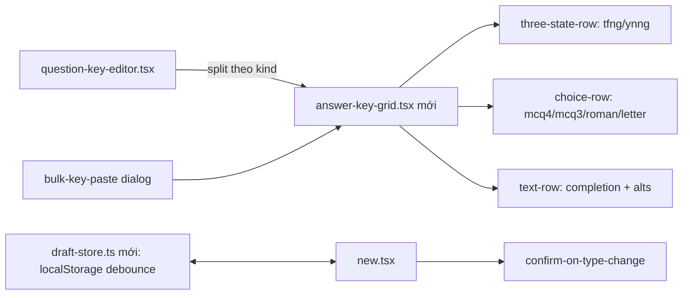

# Phase 1: Authoring quick wins — key grid, chống mất dữ liệu, autosave

## Context Links

- [Research authoring UI/UX](./reports/research-authoring-ui-ux.md) — §2 nguyên tắc P3/P4/P6/P7, §4 nhóm ưu tiên 1.
- [Scout codebase](./reports/scout-codebase.md) — vị trí file, rủi ro 2/3/6.

## Overview

- **Priority:** P1 — không đổi schema, không đổi contract, tác động ngay trên 8/22 dạng reading-listening.
- **Mô tả:** Thay ô nhập đáp án text tự do bằng **answer-key grid** (một hàng/câu, chip chọn) cho các kind đóng; thêm **chống mất dữ liệu** khi đổi part/type (xác nhận + giữ field dùng chung trong cùng skill); thêm **autosave draft** vào localStorage; thêm **paste nhiều dòng** để điền key hàng loạt; validation hiển thị **tại dòng câu** khi blur.

## Key Insights

- Kind đóng đã có sẵn tập giá trị chuẩn: `ASSIGNMENT_ANSWER_CHOICES` (`packages/api/src/contracts.ts:309-316`) — grid chỉ cần render đúng kind (`KIND` map `assignment-presets.ts:40-63`), không cần logic mới.
- Reset khi đổi part/type (`apps/web/src/routes/_auth/assignments/new.tsx:207-237`) giữ `passage/prompt/title` nhưng xóa `intro/transcript/cueTopic/cuePoints/imageUrl/items`. `transcript` là tài nguyên dùng chung mọi dạng listening — xóa khi đổi dạng trong cùng skill là mất mát không cần thiết.
- `TYPE_HINTS` (`assignment-presets.ts:71-82`) đã chứa câu lệnh giới hạn từ chuẩn IELTS — dùng làm dữ liệu cho chip preset, không viết lại text.
- `qStartOf()` (`assignment-presets.ts:287-288`) cho số câu thật (reading 1/14/27, listening 1/11/21/31) — grid phải hiển thị số này, không phải 1..n.

## Requirements

**Functional**
- FR1: Với kind `tfng/ynng` — mỗi câu là một hàng grid: số câu thật + 3 chip toggle (TRUE/FALSE/NOT GIVEN hoặc YES/NO/NOT GIVEN), chọn 1.
- FR2: Với kind `mcq4/mcq3/roman/letter` (khi chưa có option bank của Phase 2) — mỗi câu một hàng: stem input thu gọn + hàng chips A/B/C(/D) hoặc i–viii hoặc A–H.
- FR3: Phím tắt trên hàng đang focus: phím số/thư chọn chip; `Enter` thêm câu; `Backspace` trên hàng rỗng xóa câu và đánh số lại.
- FR4: Với kind `text` — giữ input đáp án + `alts` hiện có nhưng xếp thành hàng grid thống nhất (số câu thật + ô text + ô alt).
- FR5: **Bất kỳ thay đổi skill/part/type nào** khi `items` có nội dung → dialog xác nhận (thay đổi skill đi qua nhánh `emptyComposer` tại `new.tsx:207-213` hiện xóa sạch không hỏi — phải được gate như part/type). Luật carry-over: trong cùng skill giữ `transcript`; `intro` vẫn reset khi part/type đổi (intro là câu lệnh theo-từng-type qua `TYPE_HINTS` — giữ sẽ chuyển sai giới hạn từ/bank text sang dạng khác, tái mở leak mà red-team #269 đã chặn); `imageUrl` giữ nguyên hành vi #269: reset trên mọi part/type change.
- FR6: Autosave draft `/assignments/new` vào localStorage (debounce ~1s, key `assignment-draft`, kèm `schemaVersion`), khôi phục kèm banner "Đã phục hồi bản nháp — Hủy/Tiếp tục". **Ưu tiên nguồn khôi phục:** preview draft sessionStorage (`takePreviewDraft()` tại `new.tsx:131`, tiêu thụ-destructive) thắng banner — banner chỉ hiện khi KHÔNG có preview draft; thao tác đọc draft phục hồi phải không-phá-hủy cho đến khi giáo viên chọn "Tiếp tục"; xóa draft khi bấm "Hủy" **và** khi lưu thành công (mọi nhánh kết quả, không chỉ `refreshed`); TTL 7 ngày, draft hết hạn bỏ qua. Nhân tiện sửa bug sẵn có: gọi `savePreviewDraft` (`new.tsx:373-392`) đang bỏ sót `transcript` dù `PreviewDraft` có field này.
- FR7: Paste vào ô "Thêm key hàng loạt": mỗi dòng `số. giá trị` hoặc `số. giá trị / alt1 / alt2` — **map theo số câu đã parse**: dòng số `n` ghi vào câu hiển thị `Q{n}` (index `n − qStart`); dòng ngoài phạm vi part hoặc trùng số → báo lỗi tại dòng kèm tóm tắt, dòng hợp lệ vẫn áp dụng; không map-theo-thứ-tự im lặng.
- FR8: Chip preset word-limit (dữ liệu từ `TYPE_HINTS`) chèn câu lệnh chuẩn vào `intro` — một chạm thay vì gõ lại.
- FR9: Lỗi validation từng câu (thiếu stem/answer khi ready, answer ngoài choice set, **và cap độ dài: stem ≤ 500, answer ≤ 200, alts ≤ 500** — khớp `contracts.ts:382-385`) hiển thị tại hàng tương ứng khi blur/save — không popup toàn trang.
- FR10: Nút "Thêm câu" vô hiệu hóa khi đã đủ 40 câu (`questions.max(40)` tại `contracts.ts:388`) kèm thông báo — hiện không có gate nào (`question-key-editor.tsx:207-213`).

**Non-functional**
- Không đổi payload gửi server (`new.tsx` `canSave` giữ nguyên tập kiểm tra); không đổi contract.
- Grid render tối đa 40 câu (giới hạn `questions` max(40) trong contract) không lag.

## Architecture

- `answer-key-grid.tsx` nhận `kind, qStart, items, onChange` — state vẫn nằm ở `new.tsx` (không đưa react-form vào trong phase này để giảm rủi ro).
- Draft store tách file để Phase 3/4 tái dùng; draft lưu nguyên `ComposerValue` JSON.

## Related Code Files

- Modify: `apps/web/src/routes/_auth/assignments/new.tsx` (reset logic + confirm ngoài updater + draft restore + sửa savePreviewDraft thiếu transcript)
- Modify: `apps/web/src/components/assignments/question-key-editor.tsx` (tách render theo kind sang grid)
- Create: `apps/web/src/components/assignments/answer-key-grid.tsx`
- Create: `apps/web/src/lib/assignment-draft-store.ts`
- Modify: `apps/web/src/components/assignments/assignment-presets.ts` (export WORD_LIMIT_PRESETS từ TYPE_HINTS)
- Modify: `apps/e2e/specs/assignment-prompt-create.spec.ts` (test grid + confirm + draft)

## Implementation Steps

1. Tạo `answer-key-grid.tsx` với 3 row-renderer theo kind; số câu hiển thị `qStart + index`; wired `aria-label` per chip.
2. Thay phần render key trong `question-key-editor.tsx` bằng grid; giữ `emptyItem()` shape `{stem, opts, answer, alts}` nguyên vẹn.
3. Phím tắt: handler keydown trên row (1..4 / a..d / t-f-n mapping theo kind), focus quản lý bằng `data-qindex`.
4. Sửa `handleFieldChange` trong `new.tsx`: **hoist quyết định xác nhận ra ngoài `setValue` updater** — updater phải thuần (React StrictMode double-gọi updater, confirm trong updater sẽ bắn 2 lần); đọc state hiện tại qua biến `value`, nếu đổi skill/part/type và có nội dung → `window.confirm` trước, rồi mới dispatch patch/reset rõ ràng. Cùng skill: giữ `transcript`, reset `intro` + `items` + `imageUrl` (giữ nguyên ngữ nghĩa #269).
5. Tạo `assignment-draft-store.ts` (save debounce, load phi-phá-hủy, clear, TTL, schemaVersion) + banner phục hồi trong `new.tsx` theo luật ưu tiên FR6; sửa gọi `savePreviewDraft` bổ sung `transcript`; clear khi submit thành công ở mọi nhánh kết quả và khi bấm Hủy/resetAll.
6. Dialog paste key hàng loạt: parse `/^\s*(\d+)[.\)]\s*(.+)$/`, target index = số − qStart; ngoài phạm vi/trùng số → liệt kê lỗi theo dòng, áp dụng phần hợp lệ; tách alt bằng `/` (đúng convention `alts` hiện có).
7. Chip word-limit: row chips phía trên ô `intro` cho các kind completion, click chèn text `TYPE_HINTS[type]` vào intro nếu intro rỗng hoặc thay thế câu lệnh cũ.
8. E2E: mở rộng `assignment-prompt-create.spec.ts` — tạo đề tfng bằng grid clicks, refresh giữa chừng → draft phục hồi, đổi type → dialog xác nhận xuất hiện, đổi skill khi có passage+items → confirm, paste key lệch số → báo lỗi theo dòng.

## Todo List

- [x] `answer-key-grid.tsx` + 3 row kind
- [x] Tích grid vào `question-key-editor.tsx`
- [x] Phím tắt + focus quản lý
- [x] Confirm dialog + carry-over reset logic
- [x] `assignment-draft-store.ts` + banner phục hồi
- [x] Paste key hàng loạt + parse `/` alts
- [x] Chip word-limit từ TYPE_HINTS
- [x] E2E mở rộng + `pnpm test` xanh

## Success Criteria

- Tạo đề tfng 6 câu chỉ bằng click + phím tắt ≤ 30s (kiểm tay trong e2e flow).
- Refresh giữa chừng soạn → draft phục hồi đủ items/intro/transcript; Xem trước rồi quay lại → preview draft thắng banner; bấm Hủy trên banner → draft bị xóa, không resurrect.
- Đổi tfng→sent (cùng skill) giữ transcript, reset intro/items, có confirm khi items có nội dung; đổi skill Reading→Listening khi đang có passage+items → confirm xuất hiện (nhánh `emptyComposer` được gate).
- Verification: `pnpm test` (web vitest + server) và `pnpm --filter e2e exec playwright test assignment-prompt-create.spec.ts` pass.

## Risk Assessment

- ChipFilter re-fire onChange cho option đã chọn (đã có guard ở `new.tsx:214-221`) — grid phải không phá guard này; test riêng thao tác click trùng chip.
- Draft phục hồi stale sau khi schema composer đổi — `schemaVersion` trong draft, bỏ qua draft lệch version; TTL 7 ngày tránh banner resurrect vô hạn.
- Hai store draft (sessionStorage preview + localStorage autosave) xung đột ngữ nghĩa — đã chốt precedence ở FR6; review lại khi đụng code mount.
- Phím tắt đụng shortcut trình duyệt — chỉ bind khi row focus, không dùng modifier.

## Security Considerations

- Draft localStorage chỉ chứa nội dung soạn thảo (không token/P II nhạy cảm); giới hạn size ≤ ~200KB, catch QuotaExceeded im lặng.
- Không đổi đường xác thực/ủy quyền.

## Next Steps

- Phase 2 dựng trên grid: choice-row chuyển từ chips tĩnh sang dropdown theo `optionBank`.
