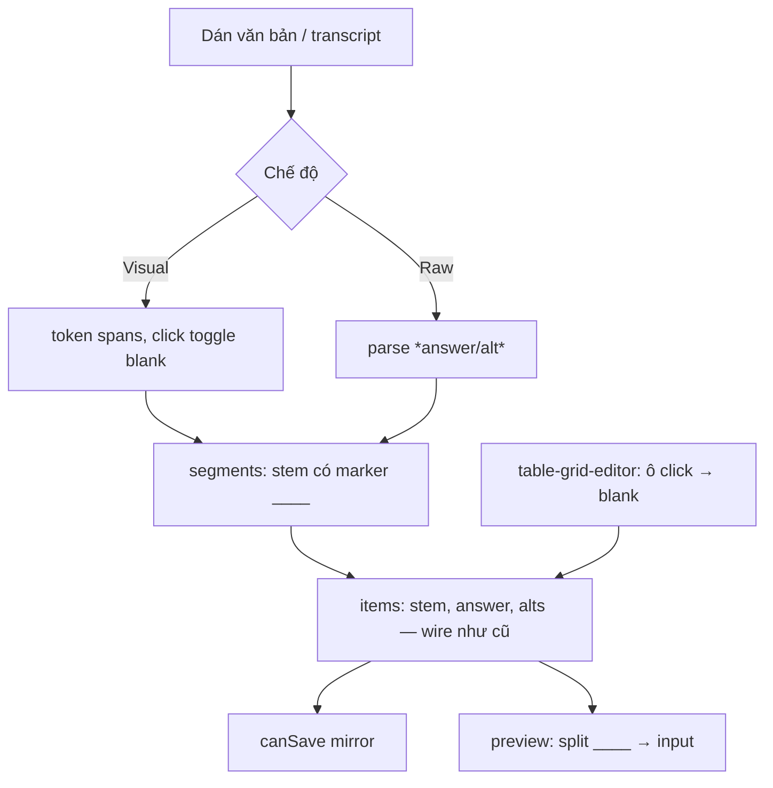

# Phase 3: Cloze click-to-blank cho 10 dạng completion

## Context Links

- [Research authoring UI/UX](./reports/research-authoring-ui-ux.md) — Family D + nguyên tắc P2 (H5P asterisk syntax, Cloze Generator select-to-blank, ISLCollective transcript gaps).
- [Scout codebase](./reports/scout-codebase.md) — data model `questions` JSON `{stem, opts, answer, alts}`; preview renderer tự render stem hiện tại.

## Overview

- **Priority:** P1 — xóa **nhập kép** cho nhóm đông nhất: 10/22 dạng reading-listening (9 dạng completion `sent, note, summary, flowchart, tablecomp, form, notes, sent4, flow` + `shortans` hưởng key grid Phase 1; `shortans` không có khối nội dung).
- **Mô tả:** Cloze editor: giáo viên dán đoạn văn bản (summary/notes/các câu/transcript snippet), **click vào từ để biến thành chỗ trống đánh số** — đáp án tự sinh từ từ được chọn; văn bản được **chia segment thành các câu** `{stem, answer, alts}` hiện có nên **không đổi schema**. Bảng (`tablecomp`) có editor lưới riêng: click ô để tạo chỗ trống. Có chế độ "text thô" dùng cú pháp `*đáp án/alt*` cho power user (tương thích H5P).

## Key Insights

- Data model giữ nguyên: mỗi câu vẫn `{stem, answer, alts}`. **Convention marker:** stem chứa đúng một marker `____` (≥4 gạch dưới) tại vị trí chỗ trống; renderer tách stem theo marker để render input; stem không có marker render nguyên văn (backward compatible với đề cũ).
- Contract hiện chỉ yêu cầu `stem.trim()` + `answer.trim()` khi ready (không kiểm tra marker, `stem` cap 500, `questions` cap 40) — web validation siết marker ≥2 + caps tại hàng trước (tránh dập đề cũ stem tự do: 0 marker vẫn hợp lệ).
- H5P dùng `*answer/alt*` ngay trong text: cùng semantics với `alts` phân cách `/` đã có — chế độ thô parse trực tiếp sang `{stem, answer, alts}`.
- Transcript listening (`form/notes/sent4/flow`) là nguồn dán tự nhiên: cùng editor, placeholder gợi ý dán transcript.

## Requirements

**Functional**
- FR1: `cloze-editor.tsx` — hai chế độ:
  - **Visual:** textarea dán → nút "Chuyển sang chọn chỗ trống" → văn bản render thành token từ; click token toggle blank (số thứ tự = thứ tự click); từ bị click lưu làm answer; click lại bỏ blank và gộp câu.
  - **Raw:** ô text với cú pháp `*answer/alt1/alt2*` inline; parse trực tiếp và liệt kê blanks tìm được ngay dưới ô.
- FR2: Nút "Áp vào câu hỏi": chia văn bản thành segments — mỗi segment kết thúc tại blank kế tiếp; segment i → `items[i].stem` (chứa marker `____` thay cho từ), `answer` = từ tại blank, số câu items = số blanks (tự thêm/xóa items); giữ `alts` đã nhập qua popover trên blank. **Cap trước khi ghi items (khớp contract `contracts.ts:382,388`):** segment > 500 ký tự sau trim → báo lỗi tại segment và chặn apply (gợi ý thêm blank/chia câu); tổng blanks > 40 → chặn apply kèm thông báo; cả hai cap mirror vào `canSave`.
- FR3: Alt editing: click blank đang có → popover sửa answer + alts (`/` separator) — đồng bộ cả visual/raw.
- FR4: `table-grid-editor.tsx` cho `tablecomp`: bảng r×c nhập trực tiếp (thêm/xóa hàng/cột, tổng ô trống ≤ 40), click ô → ô trống; áp vào items: mỗi ô trống một câu, stem = `[table] r{hàng} c{cột}: <tiêu đề hàng> / <tiêu đề cột>` (prefix không chứa marker — tablecomp **được miễn quy tắc marker**, xem FR7), answer = nội dung đã xóa; stem kết quả phải ≤ 500 ký tự.
- FR5: Preview render stem theo marker: text trước marker → input (width theo độ dài answer + 4ch) → text sau; các câu completion render liên tiếp theo thứ tự để tái hiện đoạn văn. Riêng `tablecomp`: preview parse prefix `[table] r{h} c{c}:` để render từng câu thành hàng "Hàng h — Cột c: [input]" (bố cục dạng danh sách có nhãn, không tái tạo lưới đầy đủ trong phase này).
- FR6: Word-limit chips (Phase 1) hiển thị kèm editor; `intro` vẫn là câu lệnh.
- FR7: Web validation từng câu (mirror `canSave`): stem rỗng khi ready → lỗi tại hàng; **≥ 2 marker `____` → lỗi** (một câu một chỗ trống); **0 marker là hợp lệ** (đề cũ không marker và stem sinh từ tablecomp — backward compatible, đây không phải lỗi); cap độ dài stem ≤ 500 / answer ≤ 200 / alts ≤ 500; tổng items ≤ 40. `countBlanks(stem)` helper dùng chung composer + preview.

**Non-functional**
- Tokenize 20.000 ký tự (cap `passage`) phải tức thời (<50ms) — render token bằng memoized spans, không re-render toàn cây khi toggle 1 token.
- Editor hoạt động cả mobile viewport (chỉ require click/tap).
- Cap số blank = 40 (`questions.max(40)`) enforce ở editor + canSave, không đợi 400 chung chung từ server (`apps/server/src/routes/assignments/index.ts:43-46` trả `{error: "invalid body"}` không kèm field).

## Architecture

- Pure functions tách file để test unit: `parseClozeRaw(text)` → segments; `segmentsToItems(segments)`; `splitStemByMarker(stem)` → `[before, after]`.
- Không đổi payload/contract trong phase này (marker là convention nội bộ stem string).

## Related Code Files

- Create: `apps/web/src/components/assignments/cloze-editor.tsx`
- Create: `apps/web/src/components/assignments/table-grid-editor.tsx`
- Create: `apps/web/src/lib/cloze.ts` (parse/segment/split helpers — pure)
- Create: `apps/web/src/lib/cloze.test.ts` (vitest unit cho helpers)
- Modify: `apps/web/src/components/assignments/question-key-editor.tsx` (kind text → nhúng cloze/table editor theo type, còn `shortans` giữ text-row)
- Modify: `apps/web/src/components/assignments/student-preview-paper.tsx`, `prompt-preview-aside.tsx` (render marker)
- Modify: `apps/web/src/routes/_auth/assignments/new.tsx` (mirror validation FR7 trong canSave/fieldErrors)
- Modify: `apps/e2e/specs/assignment-prompt-reading-types.spec.ts` (summary qua cloze; leak-check preview giữ nguyên)

## Implementation Steps

1. `cloze.ts` helpers + unit test: `parseClozeRaw`, `segmentsToItems`, `splitStemByMarker`, `countBlanks`; edge: blank ở đầu/cuối câu, từ chứa dấu câu, `*` literal.
2. `cloze-editor.tsx` visual mode: tokenize (split giữ khoảng trắng), state `blanks: Map<tokenIndex, {answer, alts}>`; click toggle; đếm blanks ↔ số câu dự kiến.
3. Raw mode: textarea + live parse hiển thị "tìm thấy N chỗ trống".
4. "Áp vào câu hỏi": validate caps (segment ≤ 500, blanks ≤ 40) → sinh items theo FR2; confirm khi sẽ ghi đè items có nội dung; wired vào `new.tsx` setValue.
5. Popover alts trên blank (visual) + gợi ý raw syntax (placeholder `*đáp án/alt*`).
6. `table-grid-editor.tsx`: grid input, hàng/cột +/−, ô blank ↔ answer; áp vào items theo FR4.
7. Preview render theo marker (FR5) cả hai surface; đề cũ không marker render nguyên văn.
8. Web validation FR7 + lỗi tại hàng trong grid.
9. E2E: dán summary 4 blanks → apply → save ready → preview hiển thị 4 input đúng vị trí; tablecomp tạo bảng 2×3 với 2 ô trống; segment > 500 ký tự hoặc > 40 blanks → chặn apply với thông báo.

## Todo List

- [x] `cloze.ts` + unit test
- [x] `cloze-editor.tsx` visual mode
- [x] Raw mode + parse
- [x] Apply → items + confirm ghi đè
- [x] Popover alts
- [x] `table-grid-editor.tsx`
- [x] Preview render marker (2 surfaces)
- [x] Validation FR7 mirror
- [x] E2E summary + tablecomp

## Success Criteria

- Soạn summary 4 chỗ trống bằng click, không gõ đáp án lần nào; save ready; preview hiển thị đúng 4 input tại đúng vị trí từ.
- Đề summary cũ (stem không marker) vẫn preview/save không lỗi.
- Verification: `pnpm test` (bao gồm `cloze.test.ts`) + `pnpm --filter e2e exec playwright test assignment-prompt-reading-types.spec.ts` pass.

## Risk Assessment

- Marker `____` va chạm đề cũ có sẵn gạch dưới trong stem → đếm marker: 0 marker OK (backward), ≥2 marker báo lỗi tại hàng; 1 marker hợp lệ.
- Tokenize tiếng Việt/dấu câu không liên quan (nội dung tiếng Anh) — nhưng giữ split bằng whitespace thuần để hành vi đoán được.
- Chế độ raw `*` literal trong văn bản học thuật (vd footnotes) — escape `\*` trong helper + test.
- Chia segment làm lệch `qStart` mapping nếu giáo viên apply 2 lần — confirm ghi đè luôn hiện khi items có nội dung (step 4).

## Security Considerations

- Cloze text render bằng text node thuần (không dangerouslySetInnerHTML) — marker split là string ops.
- Giới hạn tokens render một lần ≤ 5000, còn lại gợi ý rút ngắn.

## Next Steps

- Phase 4 dùng chung popover/validate row layer; thêm `pin` vào question item cho diagram/map.
