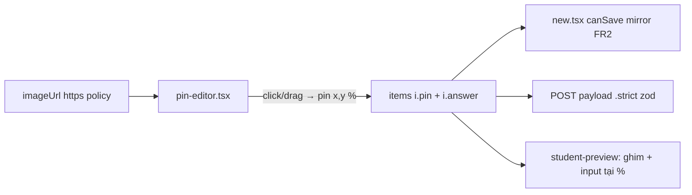

# Phase 4: Ảnh ghim nhãn cho diagram (Reading) + map (Listening)

## Context Links

- [Research authoring UI/UX](./reports/research-authoring-ui-ux.md) — Family E + nguyên tắc P5 (Wordwall label-the-diagram).
- [Scout codebase](./reports/scout-codebase.md) — rủi ro 5: gate `imageUrl` khi ready chỉ áp reading+diagram, listening `map` chưa bị chặn; `ASSIGNMENT_IMAGE_SRC_PATTERN` https-only dùng chung.

## Overview

- **Priority:** P2 — 2 dạng đặc biệt (`diagram`, `map`) hiện nhập đáp án như key text mù, không có cách gán nhãn lên ảnh.
- **Mô tả:** Sau khi có ảnh (URL https như hiện tại), giáo viên **click lên ảnh đặt ghim đánh số** (số = `qStart+i`), kéo dời được, toạ độ lưu % theo từng câu (field `pin` mới trong question item — JSON `questions` nên **không đổi cột DB**). Contract siết: `diagram`/`map` status `ready` phải có đủ pin + answer. Preview vẽ ghim + input tại đúng vị trí.

## Key Insights

- `questions` là JSON string trong cột `questions` (`packages/db/src/schema/assignment-prompt.ts`) — thêm field optional vào item là thay đổi **contract zod** chứ không phải migration DB.
- **Đường đọc dữ liệu sẽ strip `pin` nếu không sửa:** `parseQuestions` trong `apps/server/src/routes/snapshot.ts:76-110` tái cấu trúc item chỉ còn `{stem, opts, answer, alts}`; inner zod question object (`contracts.ts:380-387`) KHÔNG `.strict()` → zod **strip im lặng** field lạ thay vì 400. Phase này phải: thêm `pin` vào `parseQuestions` + `AssignmentQuestion` interface + thêm `.strict()` cho inner object (biến strip thành 400 rõ ràng).
- `map` là type-id dùng chung: writing task1 "Bản đồ" (không có câu hỏi, không cần ảnh — `contracts.ts:273`) và listening s2 map labelling — **mọi rule phải skill-qualified**: `(skill=reading, type=diagram)` và `(skill=listening, type=map)`; `imageBasedPairs`/`bankablePairs` phải là set cặp, không phải type-id trần (writing `map` KHÔNG bị gate ảnh/pin/bank).
- URL ảnh đã có policy dùng chung `isAssignmentImageUrl` (`contracts.ts:345-357`) — pin editor tái dùng, không viết regex mới.
- Kéo dời ghim: bắt đầu bằng click-để-đặt + nút xóa ghim; drag là nâng cấp trong phase nếu còn thời gian (không chặn done).

## Requirements

**Functional**
- FR1: Question item schema: `pin: z.object({ x: z.number().min(0).max(100), y: z.number().min(0).max(100) }).nullish()` — toạ độ % tâm ghim.
- FR2: Contract `superRefine` **skill-qualified**: `(skill === "reading" && type === "diagram") || (skill === "listening" && type === "map")` + status `ready` →
  - `imageUrl` bắt buộc (mở rộng gate hiện có `contracts.ts:449-456` từ reading+diagram sang cả listening+map; writing task1 `map` KHÔNG thuộc gate);
  - mỗi câu phải có `pin` và `answer` (answer: diagram = text theo word-limit, map = letter từ bank — `(listening, map)` đã nằm trong bankablePairs từ Phase 2).
- FR3: `pin-editor.tsx`: khung ảnh (aspect tự nhiên, max-height cố định) + click đặt ghim thứ `items.length` (số hiển thị `qStart+i`); click ghim → chọn câu đó (đồng bộ highlight hàng trong answer-key-grid); nút "đặt lại ghim" trên hàng; ghim kéo dời (pointer events) cập nhật %.
- FR4: Nhập đáp án ghim: diagram → ô text trong hàng grid (kèm word-limit chips); map → dropdown/chips từ `optionBank` (Phase 2; `(listening, map)` là bankable).
- FR5: Preview (student-preview-paper): vẽ ghim số tại %, cạnh ghim input điền (diagram) hoặc select nhãn (map); click ghim phía composer ↔ highlight tương ứng preview không bắt buộc (one-way là đủ).
- FR6: Reset logic (Phase 1): đổi sang/khỏi diagram/map → reset `imageUrl` + items (pin thuộc câu, câu reset thì pin mất) — nhất quán với luật Phase 1 "imageUrl reset trên mọi part/type change"; không cần thêm.
- FR7: Đề cũ `diagram` không có `pin`: hiện **không có edit flow** (route chỉ insert, không có đường load prompt vào composer) nên rule pin chỉ áp khi tạo mới; đề cũ không pin vẫn hiển thị preview như hiện tại (thumbnail + key text) — không vỡ. Không xây edit flow trong phase này.

**Non-functional**
- Ghim đặt bằng click phải hoạt động trên ảnh scale bất kỳ: tính % từ bounding rect, không px cố định.
- Ảnh lỗi load (URL chết): editor vẫn cho nhập key text như trước + cảnh báo.

## Architecture

- Ghim là dữ liệu của câu (không mảng riêng) → xóa câu tự mất ghim, thứ tự = thứ tự câu — đúng mô hình dữ liệu hiện có.

## Related Code Files

- Modify: `packages/api/src/contracts.ts` (field `pin` + superRefine FR2 + `.strict()` cho inner question object + `AssignmentQuestion` interface)
- Modify: `apps/server/src/routes/snapshot.ts` (`parseQuestions` chuyển tiếp `pin` có type-guard)
- Create: `apps/web/src/components/assignments/pin-editor.tsx`
- Modify: `apps/web/src/components/assignments/assignment-presets.ts` (`emptyItem` thêm `pin: null`; `imageBasedPairs` = {(reading, diagram), (listening, map)})
- Modify: `apps/web/src/routes/_auth/assignments/new.tsx` (mirror FR2; luồng ảnh lỗi load)
- Modify: `apps/web/src/lib/repos/assignment-prompts.ts` + `apps/web/src/lib/mock-data.ts` (shape question item thêm `pin`)
- Modify: `apps/web/src/components/assignments/question-key-editor.tsx` (nhúng pin-editor cho diagram/map; map dùng bank dropdown)
- Modify: `apps/web/src/components/assignments/student-preview-paper.tsx`, `prompt-preview-aside.tsx` (vẽ ghim)
- Modify: `apps/e2e/specs/assignment-prompt-reading-types.spec.ts` (diagram + pin; **round-trip đọc lại pin từ snapshot**; giữ leak-check URL https)
- Create: `apps/e2e/specs/assignment-prompt-map-listening.spec.ts` (map + gate audioName + pin + bank)

## Implementation Steps

1. Contract: thêm `pin` optional + superRefine FR2 skill-qualified + `.strict()` inner question object + `AssignmentQuestion`; sync `emptyItem`.
2. Snapshot: `parseQuestions` giữ `pin` (type-guard số 0–100) — thiếu bước này ghim lưu được nhưng biến mất ngay lần reload đầu.
3. `pin-editor.tsx`: render ảnh (onError fallback), click đặt ghim (% từ bounding rect), danh sách ghim đồng bộ items; pointer drag nâng cấp.
4. Tích `question-key-editor.tsx`: diagram/map → pin-editor cạnh answer-key-grid; chọn ghim ↔ focus hàng; map đọc bank từ Phase 2.
5. `new.tsx` mirror FR2 trong `canSave`/`fieldErrors` (thiếu ảnh / thiếu pin / thiếu answer khi ready) — chỉ với đúng (skill, type) cặp.
6. Preview vẽ ghim: div absolute %, số `qStart+i`, input/select cạnh ghim; container `position:relative` đúng aspect ảnh.
7. E2E diagram: URL ảnh + 3 ghim + key text → ready → **mở lại từ ngân hàng đề assert pin còn** (round-trip qua snapshot); E2E map: bank (Phase 2) + ghim + audioName gate; writing task1 map không bị gate ảnh (regression).

## Todo List

- [x] Contract `pin` + superRefine skill-qualified + `.strict()` inner + AssignmentQuestion + emptyItem sync
- [x] Snapshot `parseQuestions` giữ pin
- [x] `pin-editor.tsx` đặt/dời/xóa ghim theo %
- [x] Tích key editor (diagram text, map bank)
- [x] canSave mirror + lỗi tại hàng
- [x] Preview vẽ ghim (2 surfaces)
- [x] E2E diagram + map + round-trip snapshot + regression writing map

## Success Criteria

- Tạo đề diagram: dán URL ảnh, click 3 điểm đặt ghim, điền key, save `ready` không 400; **mở lại từ ngân hàng đề → ghim còn nguyên** (round-trip qua snapshot); preview ghim nằm đúng vị trí tương đối trên mọi viewport (kiểm 2 width trong e2e).
- Map listening thiếu pin/ảnh/audioName → blocked với lỗi đúng field; writing task1 map vẫn lưu bình thường không bị đòi ảnh/pin.
- Đề diagram cũ không pin vẫn load/preview như cũ.
- Verification: `pnpm test` + `pnpm --filter e2e exec playwright test assignment-prompt-reading-types.spec.ts assignment-prompt-map-listening.spec.ts` pass.

## Risk Assessment

- Ghim % lệch nếu ảnh bị CSS crop (object-fit) — khóa container theo aspect-ratio tự nhiên, cấm crop.
- Inner question object hiện KHÔNG `.strict()` → server cũ strip `pin` im lặng (không 400): phase này thêm `.strict()` inner biến strip thành 400 rõ ràng; contract+web+server+snapshot cùng PR (ràng buộc chung của plan) nên cửa sổ lệch bản chỉ tồn tại trong lúc deploy.
- Đề cũ không pin — chỉ siết khi tạo mới + status ready (FR7); không tồn tại edit flow nên không có đường re-save bị chặn.

## Security Considerations

- `pin` là số 0–100 trong schema — không có đường injection; URL ảnh vẫn qua `isAssignmentImageUrl` (https-only, ≤500).
- Preview render `` tiếp tục đi qua verify scheme https ở đường client draft (giữ nguyên cơ chế hiện có).

## Next Steps

- Hết 4 phase. Hướng sau research đã xếp hàng: upload ảnh/audio thật, AI draft, import Word/PDF, field `explanation`.
