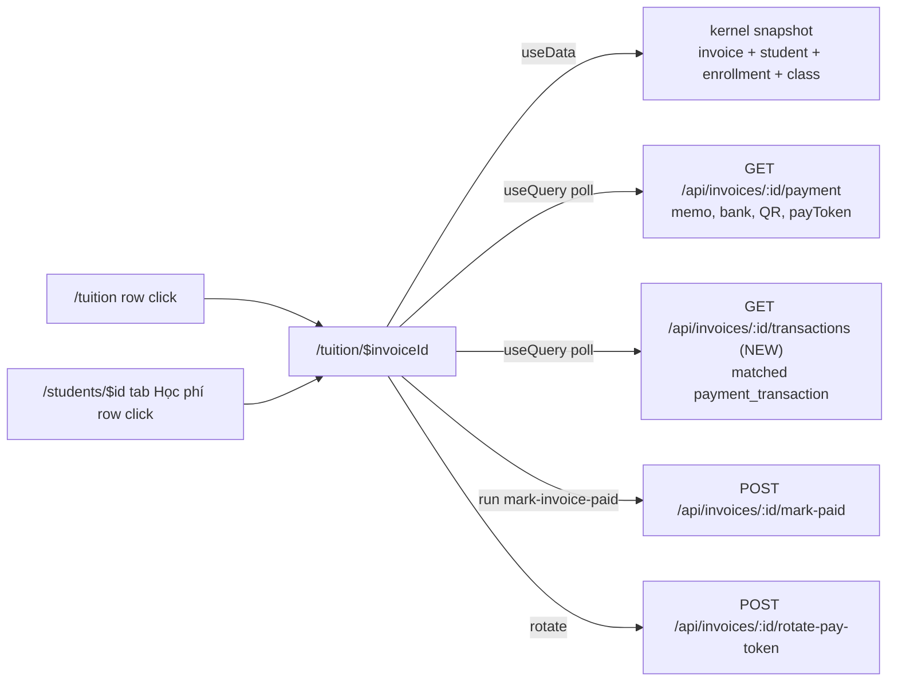

# Trang chi tiết hóa đơn: click dòng hóa đơn để xem toàn bộ thông tin

## Overview

Hiện tại bảng "Hóa đơn" ở `/tuition` và tab "Học phí" trong hồ sơ học viên chỉ hiện một phần thông
tin (mã rút gọn, loại, số tiền, ngày, trạng thái); ghi chú bị giấu trong `title` tooltip, còn mã
chuyển khoản, link `/pay`, lịch sử tiền về chỉ xem được rải rác hoặc không xem được. Plan này thêm
trang **`/tuition/$invoiceId`**: click (hoặc Enter/Space) trên một dòng hóa đơn sẽ điều hướng tới
trang chi tiết, hiển thị **mọi thông tin hóa đơn đang có** và đủ hành động thu tiền.

Dữ liệu lấy từ 3 nguồn:

1. **Kernel snapshot** (đã có trên client — `data.invoices`, `data.students`, `data.enrollments`,
   `data.classes`): id, mã `INV-…`, học viên, enrollment → lớp, loại, ghi chú, số tiền, đã thu,
   còn lại, trạng thái (effective — "Quá hạn" suy ra từ `due`), ngày lập, hạn đóng, phương thức,
   thời điểm tạo `createdAt`.
2. **`GET /api/invoices/:id/payment`** (đã có, #320): mã chuyển khoản (memo `TOS…`), ngân hàng
   nhận, QR VietQR, `payToken` → link công khai `/pay/<token>`, lý do không thu được (`PAID` /
   `NO_BANK_LINK`).
3. **`GET /api/invoices/:id/transactions`** (MỚI): các giao dịch ngân hàng đã khớp vào hóa đơn
   (`payment_transaction` với `match_status = 'matched'`) — số tiền, nội dung CK, mã tham chiếu,
   ngày giao dịch, thời điểm ghi nhận.

## Quyết định đã chốt với user (2026-10-08)

1. **Lịch sử giao dịch:** thêm API mới `GET /api/invoices/:id/transactions` (org-scoped, không
   trả `raw`/`bankAccountXid`/`providerTxnId`) để trang detail có bảng lịch sử giao dịch.
2. **Hành động:** trang detail có đủ hành động — QR + thông tin chuyển khoản inline, "Đã nhận",
   "Sao chép link thanh toán", "Tạo link mới" (có xác nhận) — giống modal "Thu học phí".
3. **Điểm vào:** dòng hóa đơn ở `/tuition` **và** tab "Học phí" của hồ sơ học viên đều click được;
   nút trong dòng (`Thu học phí`, `Đã nhận`) chặn propagation để không kích hoạt điều hướng.

## Scope Challenge (Step 0 — HOLD SCOPE)

- **Existing:** `DataTable` đã hỗ trợ `onClick` + phím Enter/Space trên row
  (`apps/web/src/components/ui/data-table.tsx:43-55`); precedent chặn propagation cho nút trong
  row tại `apps/web/src/components/class-detail/class-roster-tab.tsx:152-160`; layout trang detail
  theo `apps/web/src/routes/_auth/students/$studentId.tsx` (notFound component, Card white);
  logic copy link / rotate token / polling nằm trong
  `apps/web/src/components/modals/invoice-payment-modal.tsx:37-150`.
- **Requested:** click dòng → trang detail, hiển thị **hết** thông tin hiện có — deliver đủ.
- **Complexity:** ~18 files (1 contract, 1 server route + 1 server test, 1 repo web, 1 hook + 1
  actions component tách từ modal kèm unit test mới, 1 status-cell dùng chung 3 surface,
  2 route mới/di chuyển, 2 route sửa row click, 1 app-shell, 1 routes-matcher + test drift-guard,
  2 test web cập nhật path, 1 test web route detail mới, 1 e2e spec mới, CHANGELOG), 3 phases.
- **Mode:** auto → fast-with-scout (codebase đã scout, không cần research ngoài; không `--yagni`).

## Goals

| # | Goal | Priority |
|---|------|----------|
| 1 | Click/Enter trên dòng hóa đơn ở `/tuition` và tab Học phí hồ sơ học viên mở `/tuition/$invoiceId`; nút trong dòng vẫn hoạt động như cũ | P1 |
| 2 | Trang detail hiển thị đủ mọi trường hóa đơn từ snapshot + thông tin chuyển khoản + lịch sử giao dịch đã khớp | P1 |
| 3 | Trang detail có hành động "Đã nhận", copy link `/pay`, tạo link mới — tái dùng logic modal, không nhân bản | P1 |
| 4 | API mới `GET /api/invoices/:id/transactions` org-scoped, 404 cho id lạ/khác org, không lộ PII thô | P1 |

## Non-goals

- Sửa/xóa hóa đơn (chưa có API update/delete — follow-up riêng nếu cần).
- Hiển thị giao dịch `unmatched`/`ignored` trên trang detail (vẫn ở hàng "Giao dịch chưa khớp" của `/tuition`).
- Hiển thị `raw` webhook payload, `bankAccountXid`, `providerTxnId` (PII/nội bộ — giữ đúng chính sách retention #320).
- Đổi app student (`apps/student`) hay trang công khai `/pay/<token>`.
- Làm cho tab "Tuition" của roster lớp (aggregate theo học viên, không phải dòng hóa đơn) click được.

## Phases

| # | Phase | Status | Effort |
|---|-------|--------|--------|
| 1 | [API lịch sử giao dịch theo hóa đơn](./phase-01-invoice-transactions-api.md) | Pending | 1.5h |
| 2 | [UI trang chi tiết hóa đơn + row click](./phase-02-invoice-detail-ui.md) | Pending | 3.5h |
| 3 | [E2E + gate local + screenshot 3 viewport](./phase-03-e2e-and-gate.md) | Pending | 2h |

Phụ thuộc: Phase 2 cần contract + endpoint của Phase 1; Phase 3 cần Phase 1–2.

## Kiến trúc



## Bố cục trang (desktop 1440; 375 xếp 1 cột)

```
← Doanh thu
┌──────────────────────────────────────────────────────────────┐
│ INV-1A2B3C4D  [Thu một phần] còn 300.000đ     [Đã nhận]       │
│ Học phí tháng 10 · Nguyễn Văn A                                │
└──────────────────────────────────────────────────────────────┘
┌ THÔNG TIN HÓA ĐƠN ──────────────┐ ┌ THANH TOÁN CHUYỂN KHOẢN ──┐
│ Mã hóa đơn   INV-1A2B3C4D       │ │ PaymentQrPanel (QR, bank,  │
│ Mã đầy đủ    <uuid> (mono)      │ │ memo TOS…, số tiền còn)    │
│ Loại         Học phí            │ │ [Sao chép link thanh toán] │
│ Ngày lập     07/10              │ │ [Tạo link mới]             │
│ Tạo lúc      07/10/2026 09:12   │ └────────────────────────────┘
│ Hạn đóng     15/10/2026 (đỏ nếu quá hạn)
│ Phương thức  CK
│ Ghi chú      …
├ SỐ TIỀN ────────────────────────┤
│ Tổng 500.000đ · Đã thu 200.000đ · Còn 300.000đ · Progress     │
├ HỌC VIÊN & LỚP ─────────────────┤
│ Avatar Tên → /students/$id · Lớp → /classes/$id (— nếu legacy)│
└─────────────────────────────────┘
┌ LỊCH SỬ GIAO DỊCH ───────────────────────────────────────────┐
│ Ngày GD | Số tiền | Nội dung CK | Mã tham chiếu | Ghi nhận lúc │
│ (empty: "Chưa có giao dịch chuyển khoản nào khớp…")           │
└──────────────────────────────────────────────────────────────┘
```

## Success Criteria

- [x] Click và Enter/Space trên dòng hóa đơn ở `/tuition` → URL `/tuition/<id>`; click nút "Thu học phí"/"Đã nhận" trong dòng KHÔNG điều hướng (modal/mark-paid vẫn chạy).
- [x] Click dòng ở tab "Học phí" hồ sơ học viên → `/tuition/<id>`.
- [x] Trang detail hiện: mã rút gọn + UUID, trạng thái effective (kể cả "Thu một phần" + "còn X"), loại, ngày lập, `createdAt` (giờ VN), hạn đóng, phương thức, ghi chú, tổng/đã thu/còn lại + progress, học viên (link), lớp (link hoặc "—"), QR + memo + bank, link `/pay`, bảng lịch sử giao dịch.
- [ ] Invoice mark-paid thủ công (`status=paid`, `paidAmount=0`) hiện "Đã thu" đủ số tiền theo rule `tuitionTotals`, lịch sử giao dịch rỗng có giải thích.
- [x] id không tồn tại/khác org → notFound "Không tìm thấy hóa đơn" + link về `/tuition`; API trả 404. Deep-link trực tiếp `/tuition/<id>` trả HTTP 200 (prefix `/tuition/` trong `routes-matcher.ts`).
- [x] IPN về khi trang detail đang mở → badge, số tiền còn lại và lịch sử giao dịch tự cập nhật không reload (paidAmount-watch + poll transactions).
- [x] Topbar title "Doanh thu" trên cả `/tuition` và `/tuition/<id>`; sidebar "Doanh thu" active.
- [x] `pnpm check`, `pnpm check-types`, `pnpm --filter web test`, `pnpm --filter server test` xanh.
- [x] E2E spec mới pass, các spec `/tuition` cũ không vỡ: `E2E_API_PORT=8100 E2E_WEB_PORT=8101 E2E_STUDENT_PORT=8103 pnpm --filter e2e e2e`.
- [x] Screenshot 3 viewport (1440×900, 768×1024, 375×812) lưu `plans/261008-1209-invoice-detail-page/screenshots/`, keyboard focus OK theo `REVIEW.md`.

## Rủi ro chính

| Rủi ro | Giảm thiểu |
|--------|-----------|
| Di chuyển `tuition.tsx` → `tuition/index.tsx` đổi route id (`/_auth/tuition` → `/_auth/tuition/`), vỡ `routeTitles`, drift-guard `routes-matcher.test.ts` và 2 test đọc path file; prod worker/vite dùng `isValidAppRoute` (`routes-matcher.ts`) nên thiếu prefix `/tuition/` → deep-link `/tuition/<id>` trả HTTP 404 | Thêm `"/tuition/"` vào `VALID_DYNAMIC_PREFIXES` (`apps/web/src/routes-matcher.ts`) + case test; cập nhật `app-shell.tsx` theo id thực trong `routeTree.gen.ts`; sửa `kernel-runtime.contract.test.ts:284,475` và import `empty-states.test.tsx:106`; e2e assert deep-link HTTP 200 |
| Row `onClick` nuốt click của nút trong dòng | Bọc cell hành động bằng wrapper `stopPropagation` (click + keydown Enter/Space) theo precedent roster |
| Kernel snapshot KHÔNG tự poll (`staleTime: Infinity`, không `refetchInterval`) — khi IPN về giữa chừng, header/badge/số tiền đứng im vì snapshot stale | Watch `paidAmount` từ payment query (so giá trị trước/sau bằng ref, chỉ invalidate khi ĐỔI GIÁ TRỊ) → invalidate `invoiceTransactionsQueryKey(id)` + `["kernel"]`; e2e khoá "IPN về khi trang mở → cập nhật không reload" |
| Tách hook khỏi modal có thể đổi timing poll | Unit test hook TRƯỚC khi refactor (poll gating + cap, `confirmRotate` reset, invalidation); giữ nguyên `openedAt`, `POLL_INTERVAL_MS`, cap 15 phút; reset `openedAt` khi tab visible lại (trang detail sống lâu hơn modal) |
| Lộ PII giao dịch | DTO chỉ trả field hiển thị; matched rows đã có `raw=""`; tenant predicate trên cả invoice lẫn transaction |

## Dependencies

- Không chặn/bị chặn bởi plan nào đang mở. Dựa trên #320 (payment ledger), #340 (remaining label), #343 (`createdAt`, route Doanh thu).

## Validation Log

### Session — 2026-10-08
- **Phỏng vấn user:** 3 quyết định đã chốt (xem "Quyết định đã chốt").
- **Claims kiểm chứng với source:**
  - Không có endpoint giao dịch theo hóa đơn — `payment-transactions.ts:45-74` chỉ trả `unmatched`; `kernel.ts:1479-1487` `/payment` không kèm giao dịch → cần API mới. ✔
  - `payment_transaction` có index `invoice_id` (`packages/db/src/schema/payment-transaction.ts`) → query theo hóa đơn không cần migration. ✔
  - `DataTable` hỗ trợ row `onClick` + Enter/Space (`data-table.tsx:43-55`). ✔
  - Precedent chặn propagation nút trong row (`class-roster-tab.tsx:152-160`). ✔
  - `DataProvider` không render trước khi có snapshot (`data-provider.tsx:177-178`) → không flash notFound. ✔
  - Route id thay đổi khi chuyển sang thư mục: `students/index.tsx` sinh id `/_auth/students/` (`routeTree.gen.ts:484-485`). ✔
  - 2 test web tham chiếu path `tuition.tsx` (`kernel-runtime.contract.test.ts:284,475`, `empty-states.test.tsx:106`). ✔
  - Helper e2e: `seedInvoice` cứng `enrollment_id=''` (`tuition-bank-transfer.spec.ts:36-63`), IPN qua `simulateIpn` (`:79`). ✔ (đã điều chỉnh Phase 3)
- **Red-team:** không chạy (mode auto → fast-with-scout); không có auth mới ngoài 1 GET org-scoped theo đúng pattern `/payment`.
- **Recommendation:** proceed.

## Red Team Review

### Session — 2026-10-08
**Findings:** 10 sau dedup (10 accepted, 0 rejected) — 3 reviewer song song: Security Adversary,
Failure Mode Analyst, Assumption Destroyer. Tất cả finding đều có evidence `file:line`.
**Severity breakdown:** 1 Critical, 3 High, 6 Medium

| # | Finding | Severity | Disposition | Applied To |
|---|---------|----------|-------------|------------|
| 1 | `VALID_DYNAMIC_PREFIXES` thiếu `"/tuition/"` → drift-guard test đỏ + prod deep-link `/tuition/<id>` HTTP 404 (worker.ts/vite.config dùng `isValidAppRoute`) | Critical | Accept | Phase 2, Phase 3 |
| 2 | Chỉ dẫn "commit routeTree.gen.ts" trái `.gitignore:12` (file gitignored, drift guard biết rõ) | High | Accept | Phase 2 |
| 3 | Kernel snapshot KHÔNG poll (`staleTime: Infinity`, không refetchInterval) — invalidation `paidAmount` là linchpin nhưng chôn trong mệnh đề phụ, không step/test; risk table viện dẫn "poll snapshot" không tồn tại | High | Accept | Phase 2, plan.md Risks |
| 4 | Safety net refactor modal là phantom: `payment-qr-panel.test.tsx` không render modal; rotate/copy/confirmRotate zero coverage; precedent fetch-mock sai; mock router thiếu `useParams` | High | Accept | Phase 2 |
| 5 | Payable-gate của modal mâu thuẫn SC "link /pay luôn hiển thị" (payable=false khi paid/no-bank) | Medium | Accept | Phase 2 |
| 6 | Thiếu test student-role → 403 cho endpoint mới (threat model có thật: app.ts bootstrap 403 student) | Medium | Accept | Phase 1 |
| 7 | Mâu thuẫn path screenshot (plan.md "screenshots/" vs Phase 3 plan folder) | Medium | Accept | plan.md |
| 8 | Phase 3 under-specified: seeding class/enrollment, locator strict-mode theo số tiền, thiếu case Enter-trên-nút | Medium | Accept | Phase 3 |
| 9 | Filter `?ky=` mất qua link "← Doanh thu" (vi phạm convention URL-first của AGENTS.md) | Medium | Accept | Phase 2 |
| 10 | Poll cliff 15 phút im lặng vĩnh viễn trên trang có vòng đời dài; thiếu InvoiceStatusCell trong Files list + nhãn badge lệch giữa tab Học phí và `/tuition` | Medium | Accept | Phase 2 |

**Fact-check tổng:** các claim chính của plan (DataTable onClick+keyboard, DataProvider null trước
snapshot, route id đổi qua thư mục, 3 test tham chiếu path cũ, harness test server, seedInvoice/
simulateIpn, helpers format/tuition) đều VERIFIED với file:line — không có claim "không tồn tại".

### Whole-Plan Consistency Sweep
- Files reread: plan.md, phase-01, phase-02, phase-03 (sau khi áp accepted findings).
- Decision deltas: routes-matcher vào Phase 2/3; bỏ commit routeTree.gen.ts; paidAmount-watch
  thành step riêng; unit test hook trước refactor; payable 3 trạng thái; student-role 403;
  screenshot path chuẩn hoá; seeding e2e chi tiết; `?ky=` giữ qua search; InvoiceStatusCell
  dùng chung 3 surface.
- Reconciled stale references: risk row "nhân bản logic modal" → thay bằng risk snapshot-poll +
  test-trước-refactor; complexity count 14 → ~18 files.
- Unresolved contradictions: 0.

### Session cook — 2026-10-08
- Phase 1: `invoice-transactions.test.ts` 8 test (401/403 student/404 lạ+cross-org/matched-only/
  ordering/DTO keys/ISO/empty) + endpoint trong `kernel.ts`; 19/19 test liên quan xanh.
- Phase 2: characterization test modal 7 case TRƯỚC refactor (tìm ra export thiếu
  `InvoiceStatusCell`... không — tìm ra `InvoiceDetailRoute` thiếu `export`, mock router cần
  `useParams`); tách `useInvoicePayment` + `InvoicePaymentActions` + `usePaidAmountWatch`;
  `InvoiceStatusCell` dùng chung 3 surface; routes-matcher + test; `?ky=` giữ qua URL.
- Phase 3: e2e `invoice-detail.spec.ts` 9 test (9/9), full suite 150 pass; sửa flake xid
  (`ba-e2e-1` hardcode → đọc xid thật từ DB) ở cả `tuition-bank-transfer.spec.ts`; 3 screenshot.
- Gates: `pnpm check` xanh (2 warning pre-existing), `check-types` 7/7, web 1349/1349,
  server 19/19, e2e 150 pass. Simplifier scoped chạy (Step 3.S) — 6 file gọn, gates giữ xanh.
