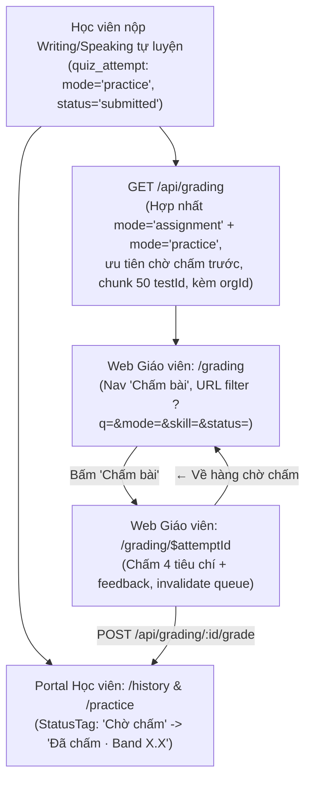

# Hàng chờ chấm bài Writing/Speaking tự luyện & lớp học (#383)

## Overview

Triển khai hàng chờ chấm bài tập trung cho giáo viên tại `/grading` trên `apps/web` và endpoint `GET /api/grading` trên `apps/server`, hợp nhất cả bài nộp giao theo lớp (`mode='assignment'`) và bài tự luyện (`mode='practice'`) của hai kỹ năng chấm tay (`writing`, `speaking`). Bật mục điều hướng `Chấm bài` trong nhóm `IELTS` trên sidebar giáo viên (kèm đăng ký `/grading` vào `VALID_EXACT_ROUTES` của `routes-matcher.ts`), bổ sung bộ lọc URL chuẩn (`?q=&mode=&skill=&status=`) có tách riêng nhãn `Luyện tập`, cập nhật trang chấm chi tiết `/grading/$attemptId` cho bài tự luyện, đổi nhãn trạng thái bài tự luyện chưa chấm ở Lịch sử học viên từ `'Đã nộp — tự luyện'` về `'Chờ chấm'`, và khóa luồng bằng E2E test đầu-cuối + kiểm tra giao diện 3 viewport × 2 theme.

Kế hoạch này được biên soạn theo chuẩn **Handover Plan Contract (`--advice` + `--tdd`)**: mỗi phase tách thành từng task tuần tự có điều kiện kiểm chứng cơ học (`Verify`) và nhúng nguyên văn khối `## Failure Protocol` để executor dừng ngay và tham vấn `kongming` khi bất kỳ bước kiểm chứng nào thất bại.

## Advisor Scope Lock (Kongming Checkpoint 1 & 2 — GO)

- **Trong phạm vi (In-scope):**
  - Contract `gradingQueueItemSchema` và `gradingQueueResponseSchema` trong `packages/api/src/contracts.ts`.
  - Route `GET /api/grading` (và hàm xuất khẩu `loadGradingQueue(db, orgId, branchLimit?)`) trong `apps/server/src/routes/grading.ts` dùng cùng nguồn `skill` với `loadGradableAttempt` (`assignmentPrompt.skill` cho `assignment`, `assignmentTest.skill` cho `practice`), truy vấn `assignmentPrompt.part` qua `assignmentTestPart` theo từng chunk tối đa 50 `testId` (tránh giới hạn bind parameter của Cloudflare D1, không nhân bản dòng khi đề có nhiều part, fallback `part: ""` khi đề không có part), dùng chung `toQuizAttemptGrade`, ưu tiên bài chờ chấm trước bài đã chấm (`(gradeScores IS NOT NULL AND gradedAt IS NOT NULL) ASC, submittedAt DESC, id DESC`) để giới hạn dòng không bao giờ cắt mất bài chờ chấm.
  - Repo client `apps/web/src/lib/repos/grading.ts` (`gradingQueueQueryKey`, `fetchGradingQueue`, `gradingQueueQueryOptions`) + unit test trong `apps/web/src/lib/repos/grading.test.ts`.
  - Mục nav `Chấm bài` (`/grading`, icon `PenLine`) trong nhóm `IELTS` của `apps/web/src/components/layout/sidebar.tsx` + `ACTIVE_KEY_BY_PREFIX` + `ROUTE_CRUMBS` trong `apps/web/src/components/layout/app-shell.tsx` + `VALID_EXACT_ROUTES["/grading"] = true` trong `apps/web/src/routes-matcher.ts` (+ cập nhật `sidebar.test.tsx`, `routes-matcher.test.ts`).
  - Trang `apps/web/src/routes/_auth/grading/index.tsx` với bộ lọc URL (`q`, `mode`, `skill`, `status`), `validateSearch` chuẩn hóa giá trị lạ về `undefined` và không đẩy giá trị mặc định lên URL, debounce search 300ms, `ChipFilter` kèm `counts` chéo nhóm (`aria-hidden`), gập bộ lọc dưới `lg`, và bảng `DataTable` có `aria-label={`Chấm bài của ${item.student.name}`}` trên link hành động từng dòng.
  - Cập nhật `apps/web/src/routes/_auth/grading/$attemptId.tsx`: link quay lại `/grading` (`← Về hàng chờ chấm`) khi `data.practice || !data.classId` (giữ nguyên link `/classes` trong card lỗi khi không có `data`), ẩn `· Hạn ...` khi `data.due` rỗng, và invalidate `gradingQueueQueryKey` sau khi lưu điểm (+ unit test trong `apps/web/src/routes/_auth/grading/index.test.tsx`).
  - Cập nhật `apps/student/src/components/history/history-list.tsx` (bỏ nhánh `'Đã nộp — tự luyện'`, hiển thị `'Chờ chấm'` cho cả `practice`) và `apps/student/src/components/practice/skill-catalog.tsx` (hiển thị `'Lần gần nhất'` + `'Chờ chấm'` khi lượt nộp Writing/Speaking gần nhất đang chờ chấm).
  - Kiểm thử E2E (`apps/e2e/specs/teacher-grade-submission.spec.ts`), kiểm chứng 3 viewport (1440×900, 768×1024, 375×812) + 320px × 2 theme (light/dark) cho `/grading`, và cập nhật `CHANGELOG.md` + `docs/system-architecture.md`.
- **Ngoài phạm vi (Out-of-scope):**
  - Không thay đổi `apps/server/src/routes/snapshot.ts` (bài `practice` tiếp tục tách khỏi tiến độ lớp).
  - Không thêm migration DB hay sửa schema Drizzle.
  - Không làm phân trang server-side, phân công giáo viên, hay chấm hàng loạt.

## Architecture / Flow

## Goals

| # | Goal | Priority |
|---|------|----------|
| 1 | Cung cấp API `GET /api/grading` an toàn đa tổ chức (IDOR-safe), an toàn giới hạn tham số D1 (chunk 50), khớp 100% điều kiện của `loadGradableAttempt` và không bao giờ cắt mất bài chờ chấm | P1 |
| 2 | Triển khai trang hàng chờ `/grading` chuẩn DESIGN.md v2 & REVIEW.md, bật mục nav `Chấm bài` trong nhóm `IELTS`, hỗ trợ bài tự luyện trên `/grading/$attemptId` | P1 |
| 3 | Đồng bộ nhãn `'Chờ chấm'` cho bài tự luyện ở portal học viên, kiểm chứng E2E toàn luồng, kiểm tra giao diện 3 viewport × 2 theme và cập nhật tài liệu | P1 |

## Phases

| # | Phase | Status |
|---|-------|--------|
| 1 | [Phase 1: Contract & API hàng chờ chấm (`GET /api/grading`)](./phase-01-start.md) | Pending |
| 2 | [Phase 2: Giao diện hàng chờ chấm giáo viên (`/grading`) & điều hướng](./phase-02-web-grading-queue-ui.md) | Pending |
| 3 | [Phase 3: Nhãn `'Chờ chấm'` phía học viên, E2E, Visual Check & Docs](./phase-03-student-status-and-e2e.md) | Pending |

## Success Criteria

- [ ] `GET /api/grading` trả danh sách bài nộp `writing`/`speaking` đã nộp của tổ chức hiện tại cho cả `mode='assignment'` và `mode='practice'` (nhãn `className: "Luyện tập"`), chia chunk 50 `testId` khi tra `assignmentPrompt.part`, không nhân bản dòng khi đề nhiều part, ưu tiên bài chưa chấm lên đầu và bảo toàn bài chờ chấm khi vượt giới hạn nhánh.
- [ ] Sidebar giáo viên hiển thị mục `Chấm bài` trong nhóm `IELTS` dẫn tới `/grading`, active cho cả `/grading` và `/grading/$attemptId`; `isValidAppRoute("/grading")` trả `true`.
- [ ] Trang `/grading` lọc theo từ khóa (`q`, debounce 300ms), nguồn bài (`mode`: `Tất cả` / `Bài tập lớp` / `Luyện tập`), kỹ năng (`skill`: `Tất cả` / `Writing` / `Speaking`), trạng thái (`status`: `Tất cả` / `Chờ chấm` / `Đã chấm`) lưu trên URL, đạt đầy đủ checklist `REVIEW.md` ở 3 viewport × 2 theme + 320px không tràn ngang.
- [ ] Trang `/grading/$attemptId` hiển thị link `← Về hàng chờ chấm` (trỏ tới `/grading`) và ẩn `· Hạn ...` khi chấm bài tự luyện; lưu điểm xong tự làm mới dữ liệu hàng chờ.
- [ ] Lịch sử học viên (`/history`) và catalog Luyện tập (`/practice/$skill`) hiển thị `'Chờ chấm'` cho cả bài tự luyện chưa chấm (không còn `'Đã nộp — tự luyện'`).
- [ ] Toàn bộ gates xanh: `pnpm check`, `pnpm check-types`, unit tests (`server`, `web`, `student`) và E2E (`teacher-grade-submission.spec.ts` + `student-history.spec.ts`).

## Red Team Review

| # | Lens | Severity | Finding & Evidence | Disposition |
|---|---|---|---|---|
| 1 | Failure Mode / D1 | High | `inArray(assignmentTestPart.testId, testIds)` trong `apps/server/src/routes/grading.ts` có thể vượt trần bind parameter của Cloudflare D1 (`apps/server/src/lib/vocab-provision.ts:251-252`) khi có >50 đề tự luyện khác nhau. | **Accept** — Chia `testIds` thành từng chunk tối đa 50 và khóa bằng unit test với >50 đề tự luyện trong Phase 1 (Task 1.2 & 1.3). |
| 2 | Failure Mode / SPA 404 | High | `apps/web/src/routes-matcher.ts:4-24` chưa có `"/grading": true` trong `VALID_EXACT_ROUTES`, và `apps/web/src/routes-matcher.test.ts:83` đang assert `isValidAppRoute("/grading") === false`, khiến điều hướng trực tiếp tới `/grading` trả 404. | **Accept** — Bổ sung `"/grading": true` vào `VALID_EXACT_ROUTES` và cập nhật `routes-matcher.test.ts` trong Phase 2 (Task 2.1). |
| 3 | Assumption / Truncation | Medium | `GRADING_QUEUE_BRANCH_LIMIT = 500` nếu là hằng số cứng không cho phép unit test kiểm chứng biên cắt giới hạn mà không phải seed >500 dòng (`apps/server/src/routes/grading.ts`). | **Accept** — Xuất khẩu `loadGradingQueue(db, orgId, branchLimit = GRADING_QUEUE_BRANCH_LIMIT)` và thêm unit test với `branchLimit = 2` (1 bài chờ chấm cũ + 3 bài đã chấm mới hơn) trong Phase 1. |
| 4 | Assumption / A11y & E2E | Medium | Link hành động `"Chấm bài"` ở từng dòng trên `/grading` trùng tên accessible với mục nav `"Chấm bài"` trên `apps/web/src/components/layout/sidebar.tsx:53`, dễ gây lỗi strict mode cho Playwright locator. | **Accept** — Đặt `aria-label={`Chấm bài của ${item.student.name}`}` trên link từng dòng (như `class-assignments-tab.tsx:82`) và scope rõ locator trong E2E (Phase 2 & 3). |
| 5 | Scope / Handover Contract | Medium | Thiếu bước kiểm chứng cơ học cho 3 viewport × 2 theme (`REVIEW.md:7-12`) và cập nhật `CHANGELOG.md` + `docs/system-architecture.md:30`. | **Accept** — Thêm Task 3.4 (kiểm chứng 3 viewport × 2 theme + 320px bằng Playwright) và Task 3.5 (cập nhật `CHANGELOG.md` + `docs/system-architecture.md`) vào Phase 3. |

### Whole-Plan Consistency Sweep (Red Team)
- Đã đồng bộ toàn bộ 5 findings đã chấp nhận vào `plan.md`, `phase-01-start.md`, `phase-02-web-grading-queue-ui.md`, và `phase-03-student-status-and-e2e.md`.
- Không còn mâu thuẫn giữa mô tả tổng quan, chữ ký hàm `loadGradingQueue`, danh sách file sửa đổi, và các bước `Verify`.

## Validation Log

### Verification Results
- Claims checked: 24
- Verified: 24 | Failed: 0 | Unverified: 0
- Tier: Standard (3 phases — Fact Checker + Contract Verifier)
- Key verified facts:
  - `packages/db/src/schema/quiz-attempt.ts:44-108`: `mode`, `assignmentId` nullable, `testId`, `gradeScores`, `gradedAt`.
  - `apps/server/src/routes/grading.ts:112-288`: `loadGradableAttempt` lấy `assignmentTest.skill` cho `practice`, `assignmentPrompt.skill` cho `assignment`, và `assignmentPrompt.part` qua `assignmentTestPart`.
  - `apps/web/src/routes-matcher.ts:4-44`: cần thêm `"/grading": true` vào `VALID_EXACT_ROUTES`.
  - `apps/student/src/components/history/history-list.tsx:21-42`: `StatusTag` đang có nhánh `isPracticeAwaiting` hiển thị `"Đã nộp — tự luyện"`.

### Whole-Plan Consistency Sweep
- Đã rà soát toàn bộ `plan.md`, `phase-01-start.md`, `phase-02-web-grading-queue-ui.md`, `phase-03-student-status-and-e2e.md`: mọi đường dẫn file, tên symbol, câu lệnh test và khối `## Failure Protocol` đều thống nhất, không còn mâu thuẫn.

<!-- slug: 383-grading-queue-practice -->