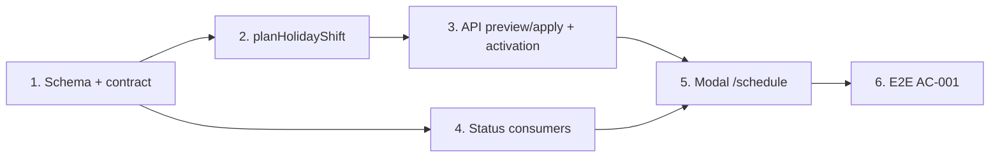

# Plan: TOS-11 — Lịch nghỉ chung, xem trước và Dời lịch (+1 buổi)

## Overview

Giáo viên/chủ trung tâm mở **Lịch dạy** (`/schedule`), bấm **+ Tạo lịch nghỉ**, nhập tên kỳ nghỉ (2–100 ký tự), khoảng ngày (≤ 30 ngày), phạm vi (toàn tổ chức hoặc lớp chọn lọc) và phương thức **Dời lịch (+1 buổi vào cuối khóa)**. Hệ thống trả **Bảng xem trước**: mỗi buổi bị trùng kèm ngày học bù mới ở cuối khóa (đúng thứ trong tuần và khung giờ chuẩn của lớp). Bấm **Xác nhận áp dụng & Dời buổi** thì trong một batch nguyên tử:

1. Mọi dòng `lesson` `upcoming` của buổi trùng chuyển sang `status = "holiday"` (hiển thị "Nghỉ lễ — Đã dời lịch").
2. Với mỗi buổi bị dời, sinh dòng `lesson` `upcoming` mới cho đúng các enrollment có mặt ở buổi gốc, vào ngày học hợp lệ kế tiếp sau buổi cuối của lớp.
3. Gói học phí không đổi: `session_package` không có cột done/remaining, số buổi còn lại derive từ dòng `completed` (invariant 6) nên không bị hao hụt.
4. Ghi 1 dòng vào feed `notif` của tổ chức. Email/In-app cho học viên sẽ do TOS-19 nối vào (xem D5).

Nguồn: Jira [TOS-11](https://teacher-os.atlassian.net/browse/TOS-11) (subtask của TOS-9 / US-002 · AC-001), `docs/selfomy-alignment/userstories/us-002.md#AC-001`, wireframe `docs/selfomy-alignment/ascii-wireframe/daily-ops-and-holiday-flow.md` (Screen `schedule-and-holiday-modal`), FR-selfomy-alignment-007/008, BR-selfomy-alignment-003 (`docs/selfomy-alignment/srs/selfomy-alignment-spec.md:49-50,95`).

## Scope Challenge

- **Đã có trong repo:**
  - `lesson` có `date` là occurrence identity (mọi dòng cùng `classId + date` là một buổi vật lý), `status` là text (`upcoming | completed | absent | cancelled`). Thêm giá trị `holiday` không cần đổi cột.
  - Lịch chuẩn của lớp: `class.schedule` JSON `{days,start,end}`, parse bằng `parseStoredSchedule` (`packages/api/src/skeleton.ts`). Sinh buổi: `generateScheduleLessons` (`apps/server/src/routes/enrollment-activation.ts`).
  - Điểm cắm có sẵn: `excludeNonTeachingSessions` (`apps/server/src/routes/daily-attendance.ts:49`) đã chờ story này.
  - Màn `/schedule` (`apps/web/src/routes/_auth/schedule.tsx`), `Modal`, `Field`, `ChipMulti`, `Badge`.
- **Chưa có:** bảng kỳ nghỉ, endpoint xem trước/áp dụng, hộp thoại, feed thông báo học viên (thuộc TOS-19).
- **Độ phức tạp:** 1 migration (3 bảng), 1 module thuần ở `@teacher-os/api`, 1 route server, 1 hộp thoại web, rà ~8 điểm đọc `lesson.status`, E2E. Không có công nghệ mới.
- **Mode:** HOLD SCOPE, plan auto mức fast + scout (không research ngoài).

## Quyết định đã chốt (2026-10-26)

| # | Quyết định | Lý do |
|---|---|---|
| D1 | **Thuật toán đầy đủ ngay trong TOS-11:** chỉ đụng buổi mà mọi dòng còn `upcoming`; buổi có dòng đã điểm danh giữ nguyên; ngày bù nhảy qua mọi kỳ nghỉ đã khai báo có hiệu lực với lớp. TOS-12 chỉ thêm nhãn `(*)` / "Giữ nguyên — Đã diễn ra" trên bảng xem trước và E2E 2 scenario của AC-002. | Bảng holiday có sẵn sau phase 1; bỏ qua sẽ sinh dữ liệu sai mà TOS-12 phải sửa lại. (User chọn.) |
| D2 | **Lưu 3 bảng:** `organization_holiday` (tên, from/to, phạm vi, phương thức, cờ gửi thông báo, người tạo), `organization_holiday_class` (lớp được chọn khi phạm vi = lớp), `holiday_session_shift` (holidayId, classId, `originalDate`, `makeupDate`). Không thêm cột vào `lesson`. | Bảng shift là nguồn cho nhãn "Đã dời sang dd/MM" trên lịch và cho hoàn tác ở TOS-13, không phải đoán ngược từ lesson. |
| D3 | **Buổi gốc → `status = "holiday"`**, giá trị mới, khác `cancelled` (TOS-13 dùng `cancelled` cho "Hủy buổi"). Mọi chỗ đọc `status` phải coi `holiday` là "không diễn ra" (phase 4). | AC phân biệt "Nghỉ lễ — Đã dời lịch" với "Đã hủy". |
| D4 | **Ngày bù:** quét từ `max(max(date)` của mọi nhóm buổi không `cancelled`/`holiday` **kể cả buổi sắp bị dời**, `vietnamToday`) `+ 1`; chọn ngày có thứ ∈ `schedule.days`, không thuộc kỳ nghỉ nào có hiệu lực với lớp (kể cả kỳ đang tạo), **chưa có dòng lesson nào (`enrollmentId` bất kỳ, mọi trạng thái)**. Ngày bị loại vì kỳ nghỉ → ghi vào `skippedHolidayDates`. Buổi bù thứ k xếp nối sau buổi bù k−1. `time = schedule.start`, `dur` theo cùng công thức của `generateScheduleLessons`. Lớp có schedule legacy hoặc chưa có `date` → không dời được, hiển thị dòng "Không tự dời được (lịch cũ)" và bỏ qua. | Đúng "theo đúng thứ trong tuần và khung giờ chuẩn của lớp". Lớp legacy không có occurrence identity. (Thống nhất sau red-team I1 — không bắt đầu từ trước buổi cuối kể cả khi có ngày trống do `moveDate`.) |
| D5 | **Thông báo:** checkbox "Gửi thông báo" mặc định bật, lưu vào `organization_holiday.notify`. Khi áp dụng thì ghi 1 dòng `notif` cho tổ chức ("Đã tạo lịch nghỉ X: dời N buổi của M lớp"). Gửi Email + In-app cho học viên là việc của TOS-19 (US-004), đọc từ bảng holiday/shift. | Cổng học viên chưa có feed thông báo sự kiện, chưa có email sự kiện. (User chọn.) |
| D6 | **Học viên kích hoạt sau khi kỳ nghỉ đã áp dụng:** `activateEnrollment` áp các dòng `holiday_session_shift` của lớp theo `createdAt ASC`, tuần tự lên tập dòng cộng dồn (chuỗi kỳ nghỉ nối nhau — I3): dòng rơi vào `originalDate` thành `holiday`, thêm dòng `upcoming` tại `makeupDate`. **Tổng quát hóa (I6):** lớp chưa có dòng shift nào nhưng có kỳ nghỉ hiệu lực (chưa có học viên lúc apply, hoặc lớp tạo sau) → chạy `planHolidayShift` trên dòng vừa sinh và tự sinh shift trong batch, guard chống lệch đọc + retry ≤ 3 (I2b). | Cả lớp phải chung một lịch; học viên vào sau không được có buổi vào ngày nghỉ — kể cả học viên đầu tiên của lớp. (User chọn; tổng quát hóa theo red-team I6.) |
| D7 | **Một endpoint tính toán, hai cách gọi:** `POST /api/holidays/preview` và `POST /api/holidays` cùng gọi hàm thuần `planHolidayShift`. Endpoint áp dụng tính lại từ DB, không tin bảng preview của client; preview trả `planHash` (SHA-256 ổn định của danh sách shift), apply phải gửi lại — lệch → 409 `stale-preview` (I7). Batch nguyên tử với **guard INSERT CASE** (`holiday_session_shift.originalDate` về `NULL` khi count lệch → NOT NULL fail → rollback toàn batch, kiểu `payments/ingest-transaction.ts:117-125`) — guard UPDATE kiểu `rosterCountGuard` không rollback được INSERT (C1); `holiday_session_shift` có unique `(classId, originalDate)` + uniqueIndex `(classId, makeupDate)` (C3). Buổi bù sinh bằng `INSERT…SELECT` từ dòng `holiday` (~3 câu/shift, I5); vượt ~500 câu → 422 `too-large`. `fromDate` < hôm nay (VN) → 422 `past-range` (I2). | Tránh race với điểm danh đồng thời; preview chỉ là hiển thị. (Chốt lại sau red-team C1/C3/I2/I5/I7.) |
| D8 | **Quyền:** mọi thành viên của tổ chức có quyền kernel hiện nay (repo chưa tách vai trò Giáo vụ/Trợ giảng). Ràng buộc vai trò theo NFR-005 để story phân quyền. | Không có cơ chế role ở `kernelCtx` hôm nay. |

## Non-goals

- Phương thức "Hủy buổi (không bù)" và "Xóa kỳ nghỉ (Hoàn tác)" → TOS-13. Contract `mode` chỉ nhận `"shift"` ở ticket này; radio "Hủy buổi" chưa hiển thị.
- Chế độ xem Tháng/Ngày, sự kiện vận hành, cảnh báo 35 ngày theo kịch bản AC-004 → TOS-14. Ticket này vẫn validate 2–100 ký tự và ≤ 30 ngày vì là input của AC-001.
- Nhãn `(*)` và "Giữ nguyên — Đã diễn ra" trên bảng xem trước, E2E AC-002 → TOS-12 (dữ liệu trả về đã có cờ, xem phase 2).
- Gửi Email / In-app cho học viên, màn `notification-logs` → TOS-19.
- Phân quyền theo vai trò trung tâm → story phân quyền.

## Phases

| # | Phase | Ước lượng | Trạng thái | Phụ thuộc |
|---|---|---|---|---|
| 1 | [phase-01-holiday-schema-and-contracts.md](phase-01-holiday-schema-and-contracts.md): 3 bảng + migration, zod contract | 3h | completed | — |
| 2 | [phase-02-shift-planner-pure-module.md](phase-02-shift-planner-pure-module.md): `planHolidayShift` thuần + unit test | 4h | completed | 1 |
| 3 | [phase-03-holiday-api-routes.md](phase-03-holiday-api-routes.md): preview/apply, notif, áp shift khi kích hoạt enrollment | 6h | completed | 2 |
| 4 | [phase-04-holiday-status-consumers.md](phase-04-holiday-status-consumers.md): coi `holiday` là không diễn ra ở server/web/student + khóa edit buổi holiday (C2) | 4h | completed | 1 |
| 5 | [phase-05-schedule-holiday-modal-ui.md](phase-05-schedule-holiday-modal-ui.md): nút + hộp thoại + bảng xem trước + nhãn trên lịch tuần | 6h | completed | 3, 4 |
| 6 | [phase-06-e2e-ac-001.md](phase-06-e2e-ac-001.md): E2E AC-001, 3 viewport, keyboard | 3h | completed | 5 |

Tổng ≈ 3 ngày (đã tính +0.5 ngày vá sau red-team 2026-10-26). Phase 4 chạy song song được với 2–3 (file tách rời).

## Điều chỉnh sau red-team kongming (2026-10-26)

Red-team trả NO-GO có điều kiện với 3 Critical / 7 Important; đã vá vào plan các điểm:

- **C1 (nguyên tử):** apply guard bằng INSERT-CASE gây lỗi NOT NULL để rollback toàn batch, kèm test rollback thật trên runtime test; không tin guard UPDATE-only.
- **C2 (edit route):** `sessions/:date/edit` + `/lessons/:id/edit` khóa nhóm có dòng `holiday` (409 `holiday-locked`); `moveDate` nhóm makeupDate cập nhật `holiday_session_shift.makeupDate` cùng batch.
- **C3 (trùng ngày bù):** `uniqueIndex (classId, makeupDate)` + điều kiện "ngày bù chưa có dòng nào" trong guard.
- **I1/I2:** điểm bắt đầu ngày bù và `past-range` chốt như D4/D7.
- **I2b/I3/I6:** activation áp shift cộng dồn theo `createdAt ASC`, guard + retry ≤ 3, tự sinh shift cho lớp chưa có học viên.
- **I4:** `class-detail-view.tsx` + `buildClassSessionsV2` index + `sessionOrdinal` thống nhất định nghĩa (phase 4).
- **I5:** `INSERT…SELECT`, ngưỡng ~500 câu → 422 `too-large`.
- **I7:** `planHash` preview → apply; lệch → 409.
- **M1:** thêm cột `organization_holiday.notifiedAt` (nullable) cho TOS-19; AC-001 vế thông báo đạt một phần — ghi rõ trong PR/Jira.
- **M2/M3** (`schedule-conflicts` `classEnd` không tính buổi bù; `moveDate` vẫn chọn được ngày nằm trong kỳ nghỉ): ghi nhận nợ kỹ thuật, xử lý ở TOS-14. **M4:** `notif.time` theo pattern hiện có. **M5:** `daily-attendance.ts` dùng helper chung. **M6:** effort phase 5 +1h.

## Acceptance criteria (từ AC-001)

- [x] Hộp thoại nhận Tên (2–100 ký tự), Từ/Đến ngày (Đến ≥ Từ, ≤ 30 ngày), Phạm vi (toàn tổ chức | lớp chọn), phương thức "Dời lịch (+1 buổi vào cuối khóa)"; input sai thì cảnh báo inline và khóa nút xác nhận.
- [x] Trước khi xác nhận, Bảng xem trước liệt kê từng buổi trùng (lớp, ngày gốc, buổi thứ mấy, trạng thái) và ngày bù mới đúng thứ + khung giờ chuẩn của lớp. Không có buổi nào trùng → cảnh báo và khóa nút.
- [x] Sau khi xác nhận: buổi gốc `upcoming` → "Nghỉ lễ — Đã dời lịch"; buổi bù `upcoming` được tạo; buổi đã điểm danh không bị đổi.
- [x] Số buổi đã học / còn lại của mọi học viên trong lớp bị ảnh hưởng không đổi trước và sau khi áp dụng (BR-003).
- [x] Có 1 dòng `notif` mới cho tổ chức khi `notify = true`; Toast thành công.
- [x] Ngày nghỉ không còn hiện ca cần điểm danh ở `/attendance` và không tính vào nhắc việc dashboard.
- [x] `pnpm check`, `pnpm check-types`, test các package bị đụng, E2E AC-001 xanh.

## Rủi ro chính

| Rủi ro | Giảm thiểu |
|---|---|
| Sót một chỗ đọc `lesson.status` khiến buổi `holiday` hiện như buổi cần dạy/điểm danh. | Phase 4 liệt kê theo grep, thêm test cho từng nơi; grep lại `"upcoming"`/`"cancelled"` trước khi đóng phase. |
| Race: GV điểm danh buổi đang được dời. | D7: guard `status='upcoming'` trong WHERE của batch, lệch số dòng → 409. |
| Contract "class fields immutable" của `lesson.date` (`packages/db/src/schema/lesson.ts`). | Không đổi `class.sessionsTotal/startDate/schedule`; buổi bù là dòng mới, số buổi không phải `holiday` vẫn bằng `sessionsTotal`. Ghi bổ sung vào docstring `lesson`. Backfill/`conforms` chỉ chạy cho lớp `date IS NULL` nên không ảnh hưởng. |
| D1 kéo một phần logic AC-002 sang đây. | TOS-12 nhận cờ `skippedHolidayDates`/`keptCompleted` có sẵn từ planner, chỉ làm UI + E2E. |

## Unresolved questions

- Không còn câu hỏi chặn. Sau khi merge cần cập nhật TOS-12/TOS-13/TOS-19 về điểm nối (bảng `holiday_session_shift`, cờ `notify`).
