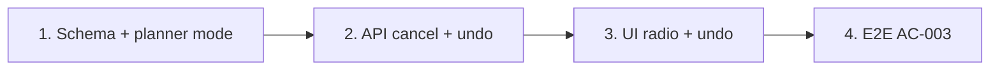

# Plan: TOS-13 — Hủy buổi (không bù) và Hoàn tác kỳ nghỉ tương lai

## Overview

AC-003 của US-002:

1. **Hủy buổi (không bù):** chọn phương thức "Hủy buổi" và xác nhận → các buổi chưa diễn ra trong khoảng nghỉ chuyển sang **Đã hủy (`cancelled`)**, không sinh buổi bù, không kéo dài ngày kết thúc khóa.
2. **Xóa kỳ nghỉ (Hoàn tác):** với kỳ nghỉ tương lai đã sinh buổi bù, bấm "Xóa kỳ nghỉ (Hoàn tác)" và xác nhận → thu hồi các buổi bù chưa diễn ra ở cuối khóa và khôi phục buổi gốc về **Đã lên lịch (`upcoming`)**.

Nền tảng từ TOS-11 ([#445](https://github.com/vinh19410/teacher-os/issues/445)): bảng `organization_holiday` (cột `mode` đã nhận `"shift" | "cancel"`), `holiday_session_shift` (cặp ngày gốc → ngày bù, D2 nói rõ là nguồn cho hoàn tác), `planHolidayShift`, route `POST /api/holidays/preview` và `POST /api/holidays`, snapshot `holidays`/`holidayShifts`, hộp thoại + nhãn trên lịch tuần. TOS-12 hoàn thiện nhãn "Giữ nguyên — Đã diễn ra" trên Bảng xem trước, nhãn này áp dụng nguyên cho phương thức Hủy buổi.

Nguồn: Jira [TOS-13](https://teacher-os.atlassian.net/browse/TOS-13) (subtask TOS-9 / US-002 · AC-003), FR-selfomy-alignment-008, wireframe `docs/selfomy-alignment/ascii-wireframe/daily-ops-and-holiday-flow.md` (mục [3] nút `Xóa nghỉ lễ`, mục [8] phương thức).

## Scope Challenge

- **Có sẵn:** trạng thái `cancelled` đã được mọi nơi đọc coi là "không diễn ra"; luồng cancel một buổi lẻ ở `apps/server/src/routes/kernel.ts`; guard batch kiểu `rosterCountGuard`.
- **Còn thiếu:** biết dòng `cancelled` nào do kỳ nghỉ nào gây ra (để hoàn tác không khôi phục nhầm buổi GV đã hủy tay), endpoint xóa kỳ nghỉ, radio "Hủy buổi", nút hoàn tác + hộp thoại xác nhận.
- **Độ phức tạp:** 1 migration (1 bảng mới), mở rộng planner, 1 route `DELETE`, UI, E2E. Không công nghệ mới.
- **Mode:** fast + scout, HOLD SCOPE.

## Quyết định

| # | Quyết định | Lý do |
|---|---|---|
| D1 | **Bảng mới `holiday_session_cancel`** (`id`, `orgId`, `holidayId` FK cascade, `classId` FK cascade, `date`, `createdAt`, unique `(classId, date)`) ghi buổi bị hủy bởi kỳ nghỉ. Không làm `holiday_session_shift.makeupDate` nullable. | Phân biệt hủy do kỳ nghỉ với hủy tay; đổi nullability trên SQLite phải rebuild bảng, bảng riêng gọn hơn. |
| D2 | **Planner nhận `mode`**: `shift` giữ nguyên hành vi TOS-11; `cancel` trả `cancellations: {classId, className, date, sessionOrdinal, enrollmentIds}[]` và không tính ngày bù. `keptCompleted`/`unsupported` dùng chung. Lớp lịch legacy vẫn hủy được (không cần ngày bù) nhưng chỉ khi các dòng có `date`. | Một nguồn tính toán cho preview/apply. |
| D3 | **Kỳ nghỉ "tương lai"** = `fromDate > hôm nay (giờ Việt Nam, todayISOVietnam)`. Kỳ nghỉ đã bắt đầu → không có nút, API trả 422 `holiday-started`. | AC chỉ cho hoàn tác kỳ nghỉ chưa diễn ra; tránh khôi phục buổi đã qua. |
| D4 | **Điều kiện hoàn tác:** mọi buổi bù của kỳ nghỉ còn toàn dòng `upcoming` (chưa điểm danh, chưa bị kỳ nghỉ khác dời/hủy). Nếu có buổi bù đã bị đụng → 409 `makeup-touched` kèm danh sách, không đổi gì. | AC nói "thu hồi các buổi học bù chưa diễn ra"; buổi bù bị đụng mà vẫn thu hồi sẽ mất điểm danh hoặc phá chuỗi dời của kỳ nghỉ khác. |
| D5 | **Hoàn tác trong 1 batch nguyên tử:** shift → buổi gốc `holiday` → `upcoming`, xóa dòng lesson `upcoming` tại `makeupDate`; cancel → buổi `cancelled` ghi trong `holiday_session_cancel` → `upcoming`; xóa `organization_holiday` (cascade bảng con); ghi `notif` "Đã xóa kỳ nghỉ «X»: khôi phục N buổi". Guard số dòng như TOS-11 D7, lệch → 409. | BR-003: tổng buổi không-`holiday`/không-`cancelled` sau hoàn tác bằng trước khi tạo kỳ nghỉ. |
| D6 | **Không dồn lại buổi bù của kỳ nghỉ khác** sau khi hoàn tác (ví dụ kỳ nghỉ B từng nhảy qua ngày của kỳ nghỉ A). | Số buổi vẫn đúng; dồn lịch tự động sẽ đổi ngày học đã thông báo cho học viên mà không có preview. |
| D7 | **Học viên kích hoạt sau** (mở rộng D6 của TOS-11): dòng sinh ra rơi vào ngày trong `holiday_session_cancel` của lớp → `cancelled`. | Cả lớp chung một lịch. |
| D8 | **Xác nhận hoàn tác** dùng dữ liệu snapshot (`holidayShifts` + `holidayCancels` mới) để hiện "Khôi phục N buổi gốc, thu hồi M buổi bù"; API vẫn tính lại từ DB. | Không cần endpoint preview riêng. |

## Non-goals

- Sửa kỳ nghỉ (đổi tên/khoảng ngày). Muốn đổi thì hoàn tác rồi tạo lại.
- Hoàn tác kỳ nghỉ đã bắt đầu hoặc đã qua.
- Dồn lại lịch các kỳ nghỉ khác (D6). Email/In-app cho học viên → TOS-19.
- Chế độ xem Tháng/Ngày → TOS-14 (nút hoàn tác nằm trong component thẻ kỳ nghỉ dùng chung, TOS-14 tái dùng).

## Phases

| # | Phase | Ước lượng | Trạng thái | Phụ thuộc |
|---|---|---|---|---|
| 1 | [phase-01-cancel-schema-and-planner-mode.md](phase-01-cancel-schema-and-planner-mode.md): bảng `holiday_session_cancel`, contract `mode`, planner chế độ cancel | 3h | completed | #445, #446 |
| 2 | [phase-02-cancel-apply-and-undo-api.md](phase-02-cancel-apply-and-undo-api.md): apply cancel, `DELETE /api/holidays/:id`, kích hoạt enrollment, snapshot `holidayCancels` | 5h | completed | 1 |
| 3 | [phase-03-cancel-radio-and-undo-ui.md](phase-03-cancel-radio-and-undo-ui.md): radio Hủy buổi, nút Xóa kỳ nghỉ (Hoàn tác) + hộp thoại xác nhận | 4h | completed | 2 |
| 4 | [phase-04-e2e-ac-003.md](phase-04-e2e-ac-003.md): E2E 2 scenario AC-003 | 2h | completed | 3 |

## Acceptance criteria (từ AC-003)

- [x] Chọn "Hủy buổi" → Bảng xem trước ghi "→ Hủy buổi (không bù)" cho mỗi buổi trùng; xác nhận → buổi `upcoming` trong khoảng thành `cancelled`, không có lesson mới, ngày buổi cuối của lớp không đổi; buổi đã điểm danh giữ nguyên.
- [x] Kỳ nghỉ tương lai phương thức Dời lịch → "Xóa kỳ nghỉ (Hoàn tác)" → buổi bù chưa diễn ra bị xóa, buổi gốc về `upcoming`, kỳ nghỉ biến mất khỏi lịch.
- [x] Kỳ nghỉ tương lai phương thức Hủy buổi → hoàn tác khôi phục đúng các buổi do kỳ nghỉ này hủy, không khôi phục buổi hủy tay.
- [x] Kỳ nghỉ đã bắt đầu không có nút hoàn tác; API trả 422. Buổi bù đã điểm danh → 409, dữ liệu không đổi.
- [x] Org khác gọi xóa kỳ nghỉ → 404.
- [x] `pnpm check`, `pnpm check-types`, test package bị đụng, E2E AC-003 xanh.

## Rủi ro

| Rủi ro | Giảm thiểu |
|---|---|
| Hoàn tác khôi phục nhầm buổi GV hủy tay cùng ngày. | D1: chỉ khôi phục ngày có trong `holiday_session_cancel` của kỳ nghỉ đó, WHERE `status='cancelled'`. |
| Xóa nhầm lesson không phải buổi bù tại `makeupDate`. | Planner TOS-11 đảm bảo ngày bù chưa có buổi; DELETE thêm điều kiện `status='upcoming'` và guard số dòng = số enrollment của shift. |
| Race: GV điểm danh buổi bù trong lúc hoàn tác. | Guard trong batch → 409. |

## Unresolved questions

- D6 (không dồn lịch kỳ nghỉ khác sau hoàn tác) là lựa chọn mặc định của plan — cần người duyệt xác nhận.
