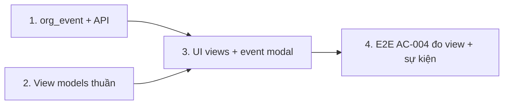

# Plan: TOS-14 — Lịch dạy Tháng / Tuần / Ngày, sự kiện vận hành, giới hạn kỳ nghỉ

## Scope split (2026-10-26, kongming advisory)

Issue gốc ghi `blockedBy #445` vì 2 deliverable phụ thuộc code TOS-11 chưa merge: (1) thẻ kỳ nghỉ
hiển thị trong 3 view (cần `holidays` trong snapshot), (2) test/E2E validation hộp thoại "Tạo lịch
nghỉ chung" (cần `holidayDraftSchema` + dialog của #445). #445 đang được implement song song, chưa
merge, ETA không rõ. Quyết định: **tách 2 deliverable đó sang follow-up issue** (blocked by #445),
plan này chỉ giữ phần độc lập — view Tháng/Ngày, màu lớp, `org_event` + API, E2E đổi view + đo ≤2s.
View-model dùng union mở rộng `kind: "lesson" | "event"` (không định nghĩa type holiday — follow-up
sẽ thêm `"holiday"` cùng adapter thật khi #445 merge). Kỷ luật migration: commit migration riêng,
trước merge kiểm develop đã có `0046` của #445 chưa, có thì regenerate (không rename tay journal).

## Overview

AC-004 của US-002:

1. Trên màn Lịch dạy `[3]`, chuyển giữa **Tháng / Tuần / Ngày**, thêm **sự kiện vận hành** ngoài lịch lớp (ví dụ "Họp chuyên môn giáo viên"); ca học hiện **mã màu theo từng khóa/lớp** cùng sự kiện vừa tạo trong **≤ 2 giây**.
2. Hộp thoại "Tạo lịch nghỉ chung": tên < 2 ký tự hoặc khoảng ngày 35 ngày (> 30) → cảnh báo kiểm tra hợp lệ và khóa nút xác nhận.

Hiện `/schedule` (`apps/web/src/routes/_auth/schedule.tsx`) chỉ có lưới tuần (`?week=`), màu block theo **loại buổi** (`typeBlockClass`), chưa có thực thể sự kiện. Validation tên/khoảng ngày của hộp thoại "Tạo lịch nghỉ chung" do TOS-11 ([#445](https://github.com/vinh19410/teacher-os/issues/445)) dựng trong `holidayDraftSchema` + hộp thoại — ticket này **không** khóa lại kịch bản đó nữa, phần đã chuyển sang follow-up (xem Scope split); phần E2E còn lại chỉ đo đổi view + tạo sự kiện.

Nguồn: Jira [TOS-14](https://teacher-os.atlassian.net/browse/TOS-14) (subtask TOS-9 / US-002 · AC-004), FR-selfomy-alignment-006/007 (`docs/selfomy-alignment/srs/selfomy-alignment-spec.md:48-49`), wireframe `docs/selfomy-alignment/ascii-wireframe/daily-ops-and-holiday-flow.md` (Screen `schedule-and-holiday-modal`, mục [1]).

## Scope Challenge

- **Có sẵn:** `schedule-week.ts` (chọn buổi theo ngày, gom theo lớp, block dự chiếu cho lớp chưa có dòng), `week-grid.ts` (toán ngày UTC, `todayISOVietnam`), `ClassSessionModal`, snapshot kernel có `lessons`/`classes` (+ `holidays`/`holidayShifts` sau TOS-11).
- **Chưa có:** view Tháng/Ngày, màu theo lớp, bảng + API sự kiện vận hành.
- **Độ phức tạp:** 1 migration (1 bảng), 1 route nhỏ, 2 view mới thuần client (dữ liệu đã có trong snapshot), tách route `/schedule` thành shell + 3 view.
- **Mode:** fast + scout, HOLD SCOPE.

## Quyết định

| # | Quyết định | Lý do |
|---|---|---|
| D1 | **URL:** `?view=month|week|day&date=yyyy-mm-dd`; mặc định `week` + hôm nay. `?week=` cũ vẫn đọc được và được thay bằng `view=week&date=` (replace, không thêm history). Param rác → scrub như hiện nay. | Quy ước filter sống trong URL (AGENTS.md); link cũ không gãy. |
| D2 | **Màu theo lớp:** 8 token mới `--class-1..8` (+ `-soft`) trong `packages/ui/src/styles/globals.css`, có biến thể dark, đạt tương phản text theo `DESIGN.md`. Lớp chọn màu bằng hash ổn định của `class.id` → index. Loại buổi (1:1, trial, mock…) chuyển thành badge nhỏ trong block. Không thêm cột màu vào `class`. | AC đòi phân biệt theo khóa/lớp; hash ổn định không cần migration hay UI chọn màu. |
| D3 | **Sự kiện vận hành = bảng `org_event`:** `id`, `orgId` FK cascade, `title` (2–100), `date`, `startTime`, `endTime` (HH:mm, `end > start`), `note` (≤ 500, tùy chọn), `createdByUserId`, `createdAt`; index `(orgId, date)`. API `POST /api/events`, `DELETE /api/events/:id`; snapshot thêm `events`. | AC chỉ cần tạo; thêm xóa để sửa được nhập nhầm. Không lặp lại, không gán học viên, không thông báo. |
| D4 | **Sự kiện không ảnh hưởng buổi học:** không chặn trùng giờ với ca học, không tính vào đếm buổi, không hiện ở `/attendance` hay nhắc việc dashboard. Hiển thị màu trung tính (`muted`) + icon để tách khỏi ca học. | Sự kiện là thông tin vận hành, không phải buổi dạy. |
| D5 | **View Tháng:** lưới 6×7 bắt đầu Thứ Hai; mỗi ô hiện tối đa 3 mục (ca học theo màu lớp, sự kiện; thẻ kỳ nghỉ ghép thêm ở follow-up sau khi #445 merge) + "+N" mở view Ngày. **View Ngày:** danh sách theo giờ của mọi ca học và sự kiện trong ngày (kỳ nghỉ ghép ở follow-up); bấm ca mở `ClassSessionModal` như view Tuần. Ở 375px view Tháng thu gọn thành chấm màu, bấm ngày mở view Ngày. | Mật độ đọc được ở 3 viewport. |
| D6 | **≤ 2 giây:** dữ liệu lấy từ snapshot đã tải, đổi view chỉ tính toán client; sau khi tạo sự kiện cập nhật snapshot tại chỗ (optimistic từ response) thay vì tải lại toàn bộ. E2E đo từ lúc click đến lúc phần tử hiển thị < 2000ms. | Đúng ngưỡng AC, đo được. |
| D7 | ~~**Validation kỳ nghỉ**~~ → chuyển sang follow-up (blocked by #445): cần `holidayDraftSchema` (2–100 ký tự, ≤ 30 ngày tính cả hai đầu) của TOS-11; wireframe ghi `1..120` là cũ, SRS + AC thắng. | Một nguồn luật cho client/server. |

## Non-goals

- Sửa sự kiện, sự kiện lặp, mời người tham dự, thông báo sự kiện.
- Cho người dùng tự chọn màu lớp.
- Kéo thả buổi học giữa các ngày.
- Thay đổi thuật toán dời buổi (TOS-11/12) hay hoàn tác (TOS-13).

## Phases

| # | Phase | Ước lượng | Trạng thái | Phụ thuộc |
|---|---|---|---|---|
| 1 | [phase-01-org-event-schema-and-api.md](phase-01-org-event-schema-and-api.md): bảng `org_event`, contract, `POST/DELETE /api/events`, snapshot `events` | 4h | pending | — |
| 2 | [phase-02-calendar-view-models.md](phase-02-calendar-view-models.md): hàm thuần view Tháng/Ngày, màu theo lớp, parse URL | 4h | pending | — |
| 3 | [phase-03-schedule-views-ui.md](phase-03-schedule-views-ui.md): bộ chuyển view, view Tháng/Ngày, màu lớp ở view Tuần, hộp thoại sự kiện | 6h | pending | 1, 2 |
| 4 | [phase-04-holiday-validation-and-e2e.md](phase-04-holiday-validation-and-e2e.md): E2E AC-004 đổi view + đo ≤2 giây tạo sự kiện (validation kỳ nghỉ đã chuyển sang follow-up) | 2h | pending | 3 |

Phase 1 và 2 chạy song song được (file tách rời).

## Acceptance criteria (từ AC-004)

- [ ] `/schedule` có bộ chuyển Tháng / Tuần / Ngày; trạng thái nằm trong URL; điều hướng trước/sau/hôm nay theo đơn vị của view.
- [ ] Ca học mỗi lớp có màu riêng ổn định giữa các view và các lần tải; sự kiện hiển thị trong cả 3 view. *(kỳ nghỉ hiển thị trong 3 view → follow-up, chờ #445)*
- [ ] Tạo sự kiện "Họp chuyên môn giáo viên" → xuất hiện trong view đang mở trong ≤ 2 giây; không ảnh hưởng ca học, điểm danh, nhắc việc.
- [ ] *(→ follow-up, chờ #445)* Hộp thoại Tạo lịch nghỉ chung: tên 1 ký tự hoặc khoảng 35 ngày → cảnh báo inline, nút xác nhận khóa; sửa về hợp lệ thì mở khóa.
- [ ] 3 viewport + bàn phím đạt theo `REVIEW.md`; `pnpm design:compare` không lệch ngoài ý muốn.
- [ ] `pnpm check`, `pnpm check-types`, test package bị đụng, E2E AC-004 xanh.

## Rủi ro

| Rủi ro | Giảm thiểu |
|---|---|
| Đổi màu block từ theo loại sang theo lớp làm vỡ test/screenshot hiện có. | Cập nhật `schedule.test.tsx` và baseline `design:compare` trong cùng PR, ghi rõ trong PR body kèm screenshot trước/sau. |
| Tách `schedule.tsx` (315 dòng) xung đột với TOS-12/TOS-13 đang sửa thẻ kỳ nghỉ. | View-model chỉ chứa `kind: "lesson" \| "event"`, không đụng code kỳ nghỉ; rebase lên `develop` trước phase 3. |
| View Tháng chậm với org nhiều lớp. | Index buổi theo `date` một lần (Map) trong view-model, không lọc lại mỗi ô; test hiệu năng đơn vị với 50 lớp × 24 buổi. |

## Unresolved questions

- D2 đổi ngữ nghĩa màu từ loại buổi sang lớp (loại buổi thành badge) — cần người duyệt xác nhận.
