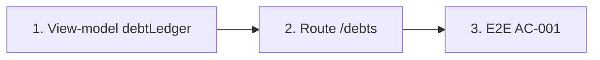

# Plan: TOS-15 — Sổ công nợ học viên, KPI và bộ lọc

## Overview

AC-001 của US-003: người dùng có quyền tài chính mở **Sổ công nợ học viên** `[4]`, chọn chip trạng thái ("Quá hạn", "Còn nợ / Sắp đến hạn ≤ 7 ngày", "Đã thu đủ") hoặc gõ tìm học viên → bộ lọc đồng bộ lên URL (ô tìm kiếm debounce 300ms), bảng trả về học viên kèm **Tổng phải thu / Tổng đã đóng / Tổng còn nợ hiện tại** trong ≤ 2 giây; 3 thẻ KPI đầu trang ("Tổng phải thu kỳ này", "Tổng đã thu", "Tổng còn nợ quá hạn") hiện tổng VNĐ và số học viên.

Nguồn: Jira [TOS-15](https://teacher-os.atlassian.net/browse/TOS-15) (subtask TOS-10 / US-003 · AC-001), FR-selfomy-alignment-009, NFR-selfomy-alignment-001, wireframe `docs/selfomy-alignment/ascii-wireframe/debt-and-notification-flow.md` (screen `student-debt-ledger`, mục [3]–[8]).

## Scope Challenge

- **Có sẵn:** snapshot kernel đã trả `invoices` (kèm `paidAmount` tính lại từ ledger `payment_transaction`), `students`, `enrollments`, `classes`. Helper `invoiceReceived`, `effectiveInvoiceStatus`, `rosterDebtByStudent`, `studentTuitionSummary` ở `apps/web/src/lib/tuition-from-kernel.ts` đã chốt quy ước "đã thu" (mark-paid thủ công tính đủ `amount`, partial clamp `min(paidAmount, amount)`). Chip filter + URL search param có mẫu ở `/assignments` và `apps/web/src/components/ui/chip-filter.tsx`.
- **Còn thiếu:** view-model gom theo học viên + trạng thái nợ + KPI; route `/debts`; mục sidebar.
- **Độ phức tạp:** chỉ client-side trên snapshot đã tải, không migration, không endpoint mới. Đây là nền cho TOS-16/17/18.
- **Mode:** fast + scout, HOLD SCOPE.

## Quyết định

| # | Quyết định | Lý do |
|---|---|---|
| D1 | **Route mới `/_auth/debts`** (sidebar "Công nợ", ngay dưới "Doanh thu"), không nhồi vào `/tuition`. | Wireframe tách `[4] student-debt-ledger` thành màn riêng; `/tuition` giữ vai trò doanh thu + hóa đơn. |
| D2 | **Tính toàn bộ phía client** từ snapshot bằng hàm thuần `debtLedger(...)` trong `tuition-from-kernel.ts`. | Cùng pattern `/tuition`, `/schedule`; đổi filter không gọi mạng nên ≤ 2 giây là mặc nhiên. Snapshot polling/refetch sau mutation giữ số đúng. |
| D3 | **Một dòng = một học viên** (có trong `students`) có ≥ 1 hóa đơn khớp lọc lớp. Phải thu = Σ`amount`; Đã đóng = Σ`invoiceReceived`; Còn nợ = Phải thu − Đã đóng. Hóa đơn chỉ được coi là **còn nợ (open)** khi `invoiceRemaining(inv) = Math.max(0, inv.amount - invoiceReceived(inv)) > 0`. Hạn đóng hiển thị (`nextDue`) = `due` hợp lệ (`isValidDue`) sớm nhất trong các hóa đơn còn nợ (`null` nếu không có). `openInvoiceIds` sort theo `isValidDue` trước (`due` tăng dần), rồi `createdAt`, `id`. | Đúng định nghĩa "lũy kế qua nhiều kỳ thu" của FR-009; tái dùng quy ước đã có, tránh lọt hóa đơn overpay-clamped (`remaining = 0`) hoặc `due = ""` làm lệch `nextDue` và TOS-16. |
| D4 | **Trạng thái nợ của học viên** (ưu tiên từ trên xuống trên các hóa đơn có `invoiceRemaining > 0`): `overdue` nếu có hóa đơn còn nợ thỏa `effectiveInvoiceStatus(inv, todayISO) === "overdue"` (`inv.status === "overdue"` hoặc `isValidDue(due) && due < todayISO`); `due_soon` nếu có hóa đơn còn nợ với `isValidDue(due) && due >= todayISO && due <= addDaysISO(todayISO, 7)`; `due` nếu còn nợ khác (`due > todayISO + 7` hoặc `!isValidDue(due)`); `clear` nếu Còn nợ = 0. Chip: Tất cả · Quá hạn · Còn nợ / Sắp đến hạn ≤ 7 ngày (gộp `due_soon` + `due`) · Đã thu đủ. Badge trên dòng bảng: `overdue` → `"Quá hạn"`, `due_soon` → `"Sắp đến hạn"`, `due` → `"Còn nợ"`, `clear` → `"Đã thu đủ"`. | Khớp nhãn chip của AC-001 và nhãn badge của TOS-16 AC-002; `todayISOVietnam` là nguồn "hôm nay" chung. |
| D5 | **KPI tính trên tập dòng sau khi lọc lớp + tìm kiếm, trước chip trạng thái**: "Tổng phải thu kỳ này" = Σ Phải thu + tổng số HV có hóa đơn; "Tổng đã thu" = Σ Đã đóng + số HV `clear`; "Tổng còn nợ quá hạn" = Σ `invoiceRemaining` của các hóa đơn quá hạn (`effectiveInvoiceStatus === "overdue"`) + số HV `overdue`. | Wireframe mô tả KPI theo bộ lọc hiện tại; nếu tính sau chip thì bấm "Đã thu đủ" sẽ làm KPI quá hạn luôn = 0, mất ý nghĩa. |
| D6 | **URL:** `?status=overdue|due|clear&q=&lop=<classId>` (hỗ trợ alias tương thích wireframe `due_soon → due`, `paid → clear`); giá trị lạ rơi về mặc định (parse non-throw như `/tuition?ky=`). Ô tìm kiếm debounce 300ms, `replace: true`; bấm chip hoặc đổi lớp flush ngay `query` đang gõ lên URL. Tìm theo tên, email, SĐT học viên (bỏ dấu qua `normalizeVi`, không phân biệt hoa thường). | Quy ước list có bộ lọc trong `AGENTS.md` và `REVIEW.md`. |
| D7 | **Lọc lớp** dựa trên `invoice.eid → enrollment.classId` (chỉ nhận enrollment có `classId` tồn tại trong `classes`); hóa đơn legacy `eid = ""` hoặc dangling `eid` chỉ hiện khi "Tất cả lớp". `classNames` lấy unique theo thứ tự `classes` từ các hóa đơn của dòng (fallback sang enrollment `active` của học viên nếu chỉ có hóa đơn `eid = ""`). | Cùng edge đã chấp nhận ở `rosterDebtByStudent` và `studentTuitionSummary`. |

## Non-goals

- Ghi nhận thu tiền (TOS-16), validation số tiền + phân quyền 403 (TOS-17), dòng thời gian + nhắc phí (TOS-18). Ở plan này cột "Thao tác" chỉ có chỗ trống cho nút `Thu` / `(eye)`.
- Nút "+ Tạo khoản thu" trên màn mới: tái dùng `AddInvoiceModal` sẵn có, không đổi form.
- Lọc theo cơ sở (`campus_id`) — chưa có khái niệm cơ sở.

## Phases

| # | Phase | Ước lượng | Trạng thái | Phụ thuộc |
|---|---|---|---|---|
| 1 | [phase-01-debt-ledger-view-model.md](phase-01-debt-ledger-view-model.md): `debtLedger` thuần, trạng thái nợ, KPI, parse URL | 4h | completed | — |
| 2 | [phase-02-debts-route-ui.md](phase-02-debts-route-ui.md): route `/debts`, 3 KPI, chip, tìm kiếm, lọc lớp, bảng | 5h | completed | 1 |
| 3 | [phase-03-e2e-ac-001.md](phase-03-e2e-ac-001.md): E2E lọc + KPI + đo 2 giây | 2h | completed | 2 |

## Acceptance criteria (từ AC-001)

- [x] `/debts` liệt kê mỗi học viên có hóa đơn một dòng với Phải đóng / Đã thu / Còn nợ / Hạn đóng đúng theo D3 (bao gồm hóa đơn thu một phần qua ledger và hóa đơn mark-paid thủ công).
- [x] Bấm chip trạng thái → URL đổi `?status=…`, bảng chỉ còn học viên đúng trạng thái; mở lại URL đó → cùng kết quả.
- [x] Gõ tìm kiếm → URL đổi `?q=…` sau ~300ms (không đổi theo từng phím); tìm được theo tên không dấu.
- [x] 3 thẻ KPI hiện tổng VNĐ + số học viên đúng theo D5 và cập nhật theo lọc lớp / tìm kiếm.
- [x] Đổi bộ lọc hiển thị kết quả ≤ 2 giây (E2E đo).
- [x] Verify 3 viewport (1440×900, 768×1024, 375×812) + keyboard focus theo `REVIEW.md`; lưu screenshot 3 viewport vào `plans/261026-2038-tos-15-debt-ledger-kpi-filters/screenshots/` và chạy `pnpm design:compare -- --screens t-tuition`.
- [x] `pnpm check`, `pnpm check-types`, `pnpm --filter web test`, E2E AC-001 xanh.

## Rủi ro

| Rủi ro | Giảm thiểu |
|---|---|
| Lệch số giữa `/debts` và `/tuition` / tab roster. | Mọi con số đi qua `invoiceReceived` + `effectiveInvoiceStatus`; test so `debtLedger` với `tuitionTotals` trên cùng fixture. |
| Org nhiều hóa đơn làm bảng chậm. | Hàm thuần O(n) + `useMemo`; nếu cần thì phân trang sau, không trong scope. |

## Validation Log

### Session 1 — 2026-10-26

- **D5 (Phạm vi tính KPI):** Xác nhận tính KPI sau lọc lớp (`lop`) và tìm kiếm (`q`), **trước** chip trạng thái (`status`) để 3 thẻ KPI (đặc biệt "Tổng còn nợ quá hạn") giữ nguyên ngữ cảnh tổng quan khi người dùng chuyển qua lại giữa các chip trạng thái.
- **D4 (Gộp chip `due` + `due_soon` và bộ nhãn Badge):** Xác nhận chip `"Còn nợ / Sắp đến hạn ≤ 7 ngày"` (`status=due`) lọc cả `due_soon` (≤ 7 ngày) và `due` (> 7 ngày hoặc chưa có hạn), đồng thời bảng hiển thị đủ 4 nhãn badge riêng biệt (`"Quá hạn"`, `"Sắp đến hạn"`, `"Còn nợ"`, `"Đã thu đủ"`) để tương thích 100% với AC-002 của TOS-16.

### Verification Results
- **Tier:** Standard (3 phases — Fact Checker + Contract Verifier, 10 claims/phase, tổng 30 claims)
- **Claims checked:** 30
- **Verified:** 22 | **Failed:** 5 | **Unverified (Ambiguous/Partial):** 3

#### Failures & Resolutions
1. [Fact Checker] `apps/web/src/lib/` không có sẵn helper bỏ dấu tiếng Việt (`normalizeVi` nằm ở `apps/web/src/components/command-search/search-index.ts:85` và file đó kéo theo `TEACHER_NAV`). → Giải pháp: định nghĩa `normalizeVi` tại `tuition-from-kernel.ts` (hoặc dùng chung) và giữ nguyên hành vi NFD + `đ/Đ`.
2. [Fact Checker] `apps/web/src/components/command-search/search-index.ts:179-193` tự động sinh `navItems()` từ `TEACHER_NAV` trong `sidebar.tsx`, không cần sửa `search-index.ts`. Ngược lại, bắt buộc phải cập nhật `ACTIVE_KEY_BY_PREFIX` trong `sidebar.tsx:135-148`, `ROUTE_CRUMBS` trong `app-shell.tsx:31-52`, `VALID_EXACT_ROUTES` trong `routes-matcher.ts:4-26` và `validStaticRoutes` trong `routes-matcher.test.ts:15-37`.
3. [Contract Verifier] `ChipFilter` (`packages/ui/src/components/web-kit/chip-filter.tsx:15,33-35`) đọc `counts` theo khóa là **nhãn hiển thị tiếng Việt** (`opt`), không phải theo mã `"all" | "overdue" | "due" | "clear"`. → Giải pháp: map `counts` sang nhãn chip trong `DebtsRoute`.
4. [Contract Verifier] Phase 2 thiếu nhãn badge cho `status = "due"` và dùng `"Xong"` thay vì `"Đã thu đủ"`, mâu thuẫn với TOS-16 (`plans/261026-2038-tos-16-record-tuition-payment/plan.md:66-67`). → Giải pháp: chốt 4 nhãn `"Quá hạn"` / `"Sắp đến hạn"` / `"Còn nợ"` / `"Đã thu đủ"`.
5. [Fact Checker] Kịch bản E2E Phase 3 Bước 4 giả định gõ `q` tự động reset chip `status` về `"Tất cả"`, trái với D6; đồng thời `AddInvoiceModal` đòi hỏi `enrollment.status === "active"`. → Giải pháp: cập nhật Bước 4 bấm chip `"Tất cả"` trước khi gõ tìm kiếm và seed lớp + active enrollment trong setup E2E.

### Whole-Plan Consistency Sweep
- Files reread: `plan.md`, `phase-01-debt-ledger-view-model.md`, `phase-02-debts-route-ui.md`, `phase-03-e2e-ac-001.md`
- Decision deltas checked: 8
- Reconciled stale references: 8
- Unresolved contradictions: 0

## Red Team Review

### Session — 2026-10-26 (pipeline `ak-vibe --ship --beta --advice`, issue #449)
**Findings:** 10 cụm sau dedupe từ 3 reviewer song song (`RT_Security`, `RT_Assumptions`, `RT_Failures`) — **8 accepted, 2 rejected (out-of-scope)**
**Severity breakdown:** 3 Critical, 4 High, 3 Medium

| # | Finding | Severity | Disposition | Applied To |
|---|---|---|---|---|
| 1 | Hóa đơn `unpaid` có `paidAmount >= amount` (overpay clamp `#340`) khiến `effectiveInvoiceStatus !== "paid"` dù nợ = 0, làm lọt vào `openInvoiceIds` và gán sai `overdue` | Critical | Accept — chỉ coi hóa đơn là còn nợ khi `invoiceRemaining(inv) = Math.max(0, amount - invoiceReceived(inv)) > 0` | `plan.md` D3/D4, `phase-01` |
| 2 | Nhãn badge cột Hạn đóng thiếu nhánh `status = "due"` và dùng `"Xong"` mâu thuẫn với TOS-16 (`"Còn nợ"`, `"Đã thu đủ"`) | Critical | Accept — chốt 4 badge: `"Quá hạn"`, `"Sắp đến hạn"`, `"Còn nợ"`, `"Đã thu đủ"` | `plan.md` D4, `phase-02` |
| 3 | E2E Phase 3: `seedStudent` thiếu active enrollment cho `AddInvoiceModal`; Bước 4 gõ `q` khi đang ở `status=clear` ra 0 dòng; Bước 2 đo `performance.now()` trên dòng A đã có sẵn | Critical | Accept — seed lớp + active enrollment; Bước 4 chọn chip `"Tất cả"` trước khi gõ `q`; Bước 2 chờ `rows` về đúng 1 dòng | `phase-03` |
| 4 | So sánh chuỗi `due` khi `due = ""` làm `nextDue` nhận `""` và thiếu hàm `addDaysISO` cho mốc `+ 7 ngày` | High | Accept — thêm `addDaysISO` UTC-anchored; chỉ xét `isValidDue(due)` cho `nextDue` và ưu tiên đầu mảng `openInvoiceIds` | `plan.md` D3/D4, `phase-01` |
| 5 | Lọc `classId` với dangling `eid`, thứ tự `classNames`, và điều kiện khớp `tuitionTotals` | High | Accept — chỉ nhận enrollment có lớp trong `classes`; deduplicate `classNames` kèm fallback active enrollment khi `eid = ""` | `plan.md` D7, `phase-01` |
| 6 | Lệch danh sách file Phase 1 & 2: `normalizeVi`, `search-index.ts` (không cần sửa), thiếu `ACTIVE_KEY_BY_PREFIX`, `ROUTE_CRUMBS`, `routes-matcher.ts` + `.test.ts` | High | Accept — cập nhật chính xác danh sách file và export `validateDebtsSearch` | `phase-01`, `phase-02` |
| 7 | `ChipFilter.counts` nhận khóa là nhãn hiển thị tiếng Việt, không phải mã `all/overdue/due/clear`; hỗ trợ alias URL `due_soon`/`paid` và không trim khoảng trắng cuối khi đang gõ | High | Accept — map `counts` theo nhãn chip trong `DebtsRoute`, thêm alias trong `validateDebtsSearch` | `plan.md` D6, `phase-01`, `phase-02` |
| 8 | Race condition giữa debounce 300ms và click chip/select lớp; thiếu `aria-live="polite"`, nút `"Xóa bộ lọc"` trên thanh lọc và `stopPropagation` (`onClick` + `onKeyDown`) ở cột Thao tác | Medium | Accept — flush `query` khi đổi chip/lớp; thêm `aria-live`, nút `"Xóa bộ lọc"` và `stopPropagation` | `phase-02` |
| 9 | Web guard `beforeLoad` của TOS-17 và phạm vi `BillingTimelineDrawer` / `POST /api/debt-reminders` của TOS-18 | Medium | **Reject (Out of Scope)** — thuộc phạm vi của #451 (TOS-17) và #452 (TOS-18), đã khóa trong Non-goals của #449 | — |
| 10 | Đổi đích thẻ nhắc việc `"Học phí đến hạn / quá hạn thu"` trên `/dashboard` từ `/tuition` sang `/debts` | Medium | **Reject (Out of Scope)** — `/tuition` đang được khóa bởi unit test `reminder-cards.test.tsx:63` của TOS-6 (#439) | — |

### Whole-Plan Consistency Sweep (sau Red-Team)
- Files reread: `plan.md`, `phase-01-debt-ledger-view-model.md`, `phase-02-debts-route-ui.md`, `phase-03-e2e-ac-001.md`
- Decision deltas checked: 8 accepted findings
- Reconciled stale references: toàn bộ 3 file phase đã được cập nhật đồng bộ với D3–D7 và chuẩn hóa theo Handover Plan Contract (`--advice`) kèm khối `## Failure Protocol`.
- Unresolved contradictions: 0
