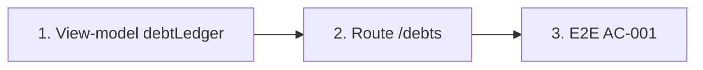

# Plan: TOS-15 — Sổ công nợ học viên, KPI và bộ lọc

## Overview

AC-001 của US-003: người dùng có quyền tài chính mở **Sổ công nợ học viên** `[4]`, chọn chip trạng thái ("Quá hạn", "Còn nợ / Sắp đến hạn ≤ 7 ngày", "Đã thu đủ") hoặc gõ tìm học viên → bộ lọc đồng bộ lên URL (ô tìm kiếm debounce 300ms), bảng trả về học viên kèm **Tổng phải thu / Tổng đã đóng / Tổng còn nợ hiện tại** trong ≤ 2 giây; 3 thẻ KPI đầu trang ("Tổng phải thu kỳ này", "Tổng đã thu", "Tổng còn nợ quá hạn") hiện tổng VNĐ và số học viên.

Nguồn: Jira [TOS-15](https://teacher-os.atlassian.net/browse/TOS-15) (subtask TOS-10 / US-003 · AC-001), FR-selfomy-alignment-009, NFR-selfomy-alignment-001, wireframe `docs/selfomy-alignment/ascii-wireframe/debt-and-notification-flow.md` (screen `student-debt-ledger`, mục [3]–[8]).

## Scope Challenge

- **Có sẵn:** snapshot kernel đã trả `invoices` (kèm `paidAmount` tính lại từ ledger `payment_transaction`), `students`, `enrollments`, `classes`. Helper `invoiceReceived`, `effectiveInvoiceStatus`, `rosterDebtByStudent`, `studentTuitionSummary` ở `apps/web/src/lib/tuition-from-kernel.ts` đã chốt quy ước "đã thu" (mark-paid thủ công tính đủ `amount`, partial clamp `min(paidAmount, amount)`). Chip filter + URL search param có mẫu ở `/assignments` và `apps/web/src/components/ui/chip-filter.tsx`.
- **Còn thiếu:** view-model gom theo học viên + trạng thái nợ + KPI; route `/debts`; mục sidebar.
- **Độ phức tạp:** chỉ client-side trên snapshot đã tải, không migration, không endpoint mới. Đây là nền cho TOS-16/17/18.
- **Mode:** fast + scout, HOLD SCOPE.

## Quyết định

| # | Quyết định | Lý do |
|---|---|---|
| D1 | **Route mới `/_auth/debts`** (sidebar "Công nợ", ngay dưới "Doanh thu"), không nhồi vào `/tuition`. | Wireframe tách `[4] student-debt-ledger` thành màn riêng; `/tuition` giữ vai trò doanh thu + hóa đơn. |
| D2 | **Tính toàn bộ phía client** từ snapshot bằng hàm thuần `debtLedger(...)` trong `tuition-from-kernel.ts`. | Cùng pattern `/tuition`, `/schedule`; đổi filter không gọi mạng nên ≤ 2 giây là mặc nhiên. Snapshot polling/refetch sau mutation giữ số đúng. |
| D3 | **Một dòng = một học viên** có ≥ 1 hóa đơn. Phải thu = Σ`amount`; Đã đóng = Σ`invoiceReceived`; Còn nợ = Phải thu − Đã đóng. Hạn đóng hiển thị = `due` sớm nhất trong các hóa đơn còn nợ. | Đúng định nghĩa "lũy kế qua nhiều kỳ thu" của FR-009; tái dùng quy ước đã có, không định nghĩa lại "đã thu". |
| D4 | **Trạng thái nợ của học viên** (ưu tiên từ trên xuống): `overdue` nếu có hóa đơn còn nợ với `due < hôm nay (VN)`; `due_soon` nếu có hóa đơn còn nợ với `due ≤ hôm nay + 7`; `due` nếu còn nợ khác; `clear` nếu Còn nợ = 0. Chip: Tất cả · Quá hạn · Còn nợ / Sắp đến hạn ≤ 7 ngày (gộp `due_soon` + `due`) · Đã thu đủ. | Khớp nhãn chip của AC; `todayISOVietnam` là nguồn "hôm nay" chung. |
| D5 | **KPI tính trên tập dòng sau khi lọc lớp + tìm kiếm, trước chip trạng thái**: "Tổng phải thu kỳ này" = Σ Phải thu + số HV; "Tổng đã thu" = Σ Đã đóng + số HV `clear`; "Tổng còn nợ quá hạn" = Σ phần còn nợ của hóa đơn quá hạn + số HV `overdue`. | Wireframe mô tả KPI theo bộ lọc hiện tại; nếu tính sau chip thì bấm "Đã thu đủ" sẽ làm KPI quá hạn luôn = 0, mất ý nghĩa. |
| D6 | **URL:** `?status=overdue|due|clear&q=&lop=<classId>`; giá trị lạ rơi về mặc định (parse non-throw như `/tuition?ky=`). Ô tìm kiếm debounce 300ms, `replace: true`. Tìm theo tên, email, SĐT học viên (bỏ dấu, không phân biệt hoa thường). | Quy ước list có bộ lọc trong `AGENTS.md`. |
| D7 | **Lọc lớp** dựa trên `invoice.enrollmentId → enrollment.classId`; hóa đơn legacy `eid = ""` chỉ hiện khi "Tất cả lớp". | Cùng edge đã chấp nhận ở `rosterDebtByStudent`. |

## Non-goals

- Ghi nhận thu tiền (TOS-16), validation số tiền + phân quyền 403 (TOS-17), dòng thời gian + nhắc phí (TOS-18). Ở plan này cột "Thao tác" chỉ có chỗ trống cho nút `Thu` / `(eye)`.
- Nút "+ Tạo khoản thu" trên màn mới: tái dùng `AddInvoiceModal` sẵn có, không đổi form.
- Lọc theo cơ sở (`campus_id`) — chưa có khái niệm cơ sở.

## Phases

| # | Phase | Ước lượng | Trạng thái | Phụ thuộc |
|---|---|---|---|---|
| 1 | [phase-01-debt-ledger-view-model.md](phase-01-debt-ledger-view-model.md): `debtLedger` thuần, trạng thái nợ, KPI, parse URL | 4h | pending | — |
| 2 | [phase-02-debts-route-ui.md](phase-02-debts-route-ui.md): route `/debts`, 3 KPI, chip, tìm kiếm, lọc lớp, bảng | 5h | pending | 1 |
| 3 | [phase-03-e2e-ac-001.md](phase-03-e2e-ac-001.md): E2E lọc + KPI + đo 2 giây | 2h | pending | 2 |

## Acceptance criteria (từ AC-001)

- [ ] `/debts` liệt kê mỗi học viên có hóa đơn một dòng với Phải đóng / Đã thu / Còn nợ / Hạn đóng đúng theo D3 (bao gồm hóa đơn thu một phần qua ledger và hóa đơn mark-paid thủ công).
- [ ] Bấm chip trạng thái → URL đổi `?status=…`, bảng chỉ còn học viên đúng trạng thái; mở lại URL đó → cùng kết quả.
- [ ] Gõ tìm kiếm → URL đổi `?q=…` sau ~300ms (không đổi theo từng phím); tìm được theo tên không dấu.
- [ ] 3 thẻ KPI hiện tổng VNĐ + số học viên đúng theo D5 và cập nhật theo lọc lớp / tìm kiếm.
- [ ] Đổi bộ lọc hiển thị kết quả ≤ 2 giây (E2E đo).
- [ ] Verify 3 viewport (1440×900, 768×1024, 375×812) + keyboard focus theo `REVIEW.md`; `pnpm design:compare` cho route mới.
- [ ] `pnpm check`, `pnpm check-types`, `pnpm --filter web test`, E2E AC-001 xanh.

## Rủi ro

| Rủi ro | Giảm thiểu |
|---|---|
| Lệch số giữa `/debts` và `/tuition` / tab roster. | Mọi con số đi qua `invoiceReceived` + `effectiveInvoiceStatus`; test so `debtLedger` với `tuitionTotals` trên cùng fixture. |
| Org nhiều hóa đơn làm bảng chậm. | Hàm thuần O(n) + `useMemo`; nếu cần thì phân trang sau, không trong scope. |

## Cần người duyệt xác nhận

- D5: KPI tính trước chip trạng thái (để KPI không về 0 khi chọn chip).
- D4: chip "Còn nợ / Sắp đến hạn ≤ 7 ngày" gộp cả nợ chưa tới hạn > 7 ngày.
