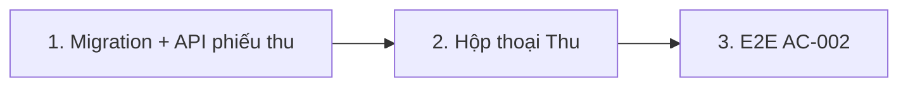

# Plan: TOS-16 — Ghi nhận thu học phí một phần / toàn bộ

## Overview

AC-002 của US-003 (Scenario Outline): học viên có khoản thu Phải đóng 4.500.000 — thu 2.000.000 → Đã đóng 2.000.000, Còn nợ 2.500.000, trạng thái **Còn nợ (`due`)**; thu tiếp 2.500.000 → Đã đóng 4.500.000, Còn nợ 0, trạng thái **Đã hoàn tất (`clear`)**. 3 thẻ KPI đầu trang tính lại tức thì.

Nền tảng từ TOS-15: màn `/debts`, `debtLedger` (cột "Thao tác" chờ nút `Thu`). Nền tảng sẵn có từ #320/#345: ledger `payment_transaction` là nguồn sự thật của `invoice.paid_amount`, `recomputeInvoiceStatement` tính lại idempotent (không bao giờ `+=`), trang chi tiết hóa đơn đã liệt kê giao dịch matched.

Nguồn: Jira [TOS-16](https://teacher-os.atlassian.net/browse/TOS-16) (subtask TOS-10 / US-003 · AC-002), FR-selfomy-alignment-009/010, wireframe `debt-and-notification-flow.md` mục [9]–[14].

## Scope Challenge

- **Có sẵn:** ledger + recompute (thu một phần qua chuyển khoản đã chạy), `mark-invoice-paid` (thu đủ thủ công, không ghi ledger), `InvoicePaymentModal` (QR chuyển khoản).
- **Còn thiếu:** cách ghi một khoản thu **thủ công một phần**. Hiện `mark-paid` chỉ đặt `status = paid` mà không có số tiền.
- **Độ phức tạp:** 1 migration (thêm 3 cột nullable/default vào `payment_transaction`), 1 route `POST`, 1 hộp thoại, E2E.
- **Mode:** fast + scout, HOLD SCOPE.

## Quyết định

| # | Quyết định | Lý do |
|---|---|---|
| D1 | **Phiếu thu thủ công = 1 dòng `payment_transaction`** với `provider = "manual"`, `providerTxnId = <uuid>`, `matchStatus = "matched"`, `invoiceId` = hóa đơn được thu, `content` = ghi chú (≤ 255), `transactionDate` = hôm nay VN. Sau insert gọi `recomputeInvoiceStatement` trong cùng `db.batch`. | Một nguồn sự thật duy nhất cho "Đã đóng" (ledger), không thêm bảng song song; replay/đối soát giữ nguyên tính idempotent; trang chi tiết hóa đơn và TOS-18 timeline đọc được ngay. |
| D2 | **Migration cộng thêm** vào `payment_transaction`: `method text not null default ''` (`transfer` / `cash` / `other`; dòng bank-hub để rỗng = chuyển khoản QR), `recorded_by text` (userId, null với dòng bank-hub). | Wireframe [11] yêu cầu phương thức; cần biết ai ghi phiếu cho đối soát. Cột additive, không rebuild bảng. |
| D3 | **Route `POST /api/invoices/:id/payments`** body `{ amount: int > 0, method: "transfer"|"cash"|"other", note?: string ≤ 255 }`. Kiểm tra trong cùng statement: hóa đơn thuộc org (404 nếu không), chưa `paid`, `amount ≤ amount_invoice − ledger_sum` → nếu sai trả 422 `amount-exceeds-debt` kèm `remaining`. Insert dùng `INSERT … SELECT … WHERE` để 2 phiếu đồng thời không vượt nợ. | Ràng buộc toàn vẹn dữ liệu phải ở server; UI inline error thuộc TOS-17. |
| D4 | **Trạng thái `due` / `clear`** là trạng thái công nợ suy ra (Còn nợ > 0 / = 0), không thêm giá trị mới vào `invoice.status` (vẫn `unpaid` / `paid`). Hộp thoại hiển thị câu "Số dư còn nợ sau giao dịch này: X VND → Trạng thái chuyển sang: Còn nợ / Đã thu đủ". | Không phá contract `InvoiceStatus` đang dùng ở `/tuition`, roster, student portal. |
| D5 | **Học viên nhiều khoản còn nợ:** nút `Thu` trên dòng học viên mở hộp thoại có select "Khoản thu" (mặc định khoản có `due` sớm nhất); số liệu Phải đóng / Đã thu / Nợ theo khoản đang chọn. Học viên chỉ 1 khoản → không hiện select. | Thu tiền luôn gắn một hóa đơn cụ thể (ledger theo `invoiceId`); tránh tự phân bổ ngầm. |
| D6 | **Làm mới KPI:** sau 201 gọi refetch snapshot qua command bus như `mark-invoice-paid` (`useDirectKernelAction`), không cộng trừ cục bộ. | Cùng cơ chế `/tuition`; số liệu luôn khớp server. |
| D7 | **Hóa đơn mark-paid thủ công cũ** (`status = paid`, `paidAmount = 0`) không mở được hộp thoại thu (đã xong). Nút "Đã nhận" ở `/tuition` giữ nguyên. | Không đổi hành vi đang chạy. |

## Non-goals

- Inline error + khóa nút Lưu khi nhập ≤ 0 / vượt nợ, phân quyền 403 → TOS-17.
- Dòng thời gian, nhắc phí → TOS-18. Sửa / xóa phiếu thu đã lưu, in biên lai.
- Đổi `InvoicePaymentModal` (QR) hay luồng webhook bank-hub.

## Phases

| # | Phase | Ước lượng | Trạng thái | Phụ thuộc |
|---|---|---|---|---|
| 1 | [phase-01-manual-payment-schema-and-api.md](phase-01-manual-payment-schema-and-api.md): migration, contract, `POST /api/invoices/:id/payments` | 5h | pending | #449 |
| 2 | [phase-02-record-payment-dialog.md](phase-02-record-payment-dialog.md): hộp thoại Ghi nhận thu tiền trên `/debts` | 5h | pending | 1 |
| 3 | [phase-03-e2e-ac-002.md](phase-03-e2e-ac-002.md): E2E 2 dòng Examples | 2h | pending | 2 |

## Acceptance criteria (từ AC-002)

- [ ] Thu 2.000.000 trên khoản 4.500.000 → dòng học viên: Đã thu 2.000.000, Còn nợ 2.500.000, badge "Còn nợ"; KPI đổi ngay sau khi lưu.
- [ ] Thu tiếp 2.500.000 → Đã thu 4.500.000, Còn nợ 0, badge "Đã thu đủ"; `invoice.status = paid`; KPI đổi ngay.
- [ ] Phiếu thu xuất hiện ở trang chi tiết hóa đơn `/tuition/$invoiceId` (danh sách giao dịch) với phương thức + ghi chú.
- [ ] API: org khác → 404; hóa đơn đã `paid` hoặc amount vượt nợ → 422, DB không đổi; 2 request song song tổng vượt nợ → đúng 1 thành công.
- [ ] `pnpm check`, `pnpm check-types`, test package bị đụng, E2E AC-002 xanh.

## Rủi ro

| Rủi ro | Giảm thiểu |
|---|---|
| Code đọc ledger giả định mọi dòng là bank-hub (đối soát, `UnmatchedTransactions`, `/transactions`). | Grep mọi chỗ đọc `paymentTransaction`; lọc theo `provider` ở chỗ chỉ dành cho bank-hub (đối soát, retention `raw`); test hồi quy `bank-hub-webhooks`, `payment-transactions`. |
| Migration trùng số với plan TOS-11…14 đang chạy song song. | Sinh migration bằng `drizzle-kit` lúc implement trên `develop` mới nhất, không đặt số tay. |

## Cần người duyệt xác nhận

- D1/D2: dùng chung bảng `payment_transaction` cho phiếu thu thủ công (thay vì bảng `payment_receipt` riêng).
