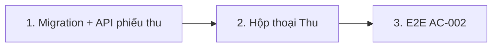

# Plan: TOS-16 — Ghi nhận thu học phí một phần / toàn bộ

## Overview

AC-002 của US-003 (Scenario Outline): học viên có khoản thu Phải đóng 4.500.000 — thu 2.000.000 → Đã đóng 2.000.000, Còn nợ 2.500.000, trạng thái **Còn nợ (`due`)**; thu tiếp 2.500.000 → Đã đóng 4.500.000, Còn nợ 0, trạng thái **Đã hoàn tất (`clear`)**. 3 thẻ KPI đầu trang tính lại tức thì.

Nền tảng từ TOS-15: màn `/debts`, `debtLedger` (cột "Thao tác" chờ nút `Thu`). Nền tảng sẵn có từ #320/#345: ledger `payment_transaction` là nguồn sự thật của `invoice.paid_amount`, `recomputeInvoiceStatement` tính lại idempotent (không bao giờ `+=`), trang chi tiết hóa đơn đã liệt kê giao dịch matched.

Nguồn: Jira [TOS-16](https://teacher-os.atlassian.net/browse/TOS-16) (subtask TOS-10 / US-003 · AC-002), FR-selfomy-alignment-009/010, wireframe `debt-and-notification-flow.md` mục [9]–[14].

## Scope Challenge

- **Có sẵn:** ledger + recompute (thu một phần qua chuyển khoản đã chạy), `mark-invoice-paid` (thu đủ thủ công, không ghi ledger), `InvoicePaymentModal` (QR chuyển khoản).
- **Còn thiếu:** cách ghi một khoản thu **thủ công một phần**. Hiện `mark-paid` chỉ đặt `status = paid` mà không có số tiền.
- **Độ phức tạp:** 1 migration (thêm 2 cột `method`, `recorded_by` vào `payment_transaction`), 1 route `POST`, 1 hộp thoại, E2E.
- **Mode:** fast + scout, HOLD SCOPE.

## Quyết định

| # | Quyết định | Lý do |
|---|---|---|
| D1 | **Phiếu thu thủ công = 1 dòng `payment_transaction`** với `provider = "manual"`, `providerTxnId = clientRequestId` (uuid do hộp thoại sinh 1 lần khi mở, gửi trong body — `UNIQUE(provider, provider_txn_id)` biến retry/replay thành no-op, idempotent như luồng QR #320), `matchStatus = "matched"`, `invoiceId` = hóa đơn được thu, `content` = ghi chú (≤ 255), `transactionDate` = `"<hôm nay VN> 00:00:00"` (cùng format `yyyy-mm-dd HH:mm:ss` với dòng bank). Sau insert chạy `recomputeInvoiceStatement` **vô điều kiện** (idempotent nên vô hại trên nhánh bị chặn) trong cùng `db.batch`. | Một nguồn sự thật duy nhất cho "Đã đóng" (ledger), không thêm bảng song song; idempotency tái dùng unique index sẵn có thay vì uuid mỗi request; trang chi tiết hóa đơn và TOS-18 timeline đọc được ngay. |
| D2 | **Migration cộng thêm** vào `payment_transaction`: `method text not null default ''` (`transfer` / `cash` / `other`; dòng bank-hub để rỗng = chuyển khoản QR), `recorded_by text` (userId, null với dòng bank-hub). | Wireframe [11] yêu cầu phương thức; cần biết ai ghi phiếu cho đối soát. Cột additive, không rebuild bảng. |
| D3 | **Route `POST /api/invoices/:id/payments`** body `{ clientRequestId: uuid, amount: int > 0, method: "transfer"|"cash"|"other", note?: string ≤ 255 }`. Insert `INSERT … SELECT … WHERE` trong batch với **guard nguyên tử**: `invoice.status <> 'paid'` và `amount ≤ amount_invoice − (SELECT SUM(amount) … WHERE invoice_id AND match_status = 'matched')` (đúng fragment `LEDGER_SUM` của recompute — dòng `unmatched` reason `invoice_paid` có `invoiceId` set không bị tính). Chốt "chưa paid" **bên trong** WHERE để race với `mark-paid` (ghi status không ghi ledger) bị chặn ở cùng statement. Sau batch đọc kết quả bằng `.returning({ id })` trên INSERT…SELECT (mảng rỗng = guard chặn hoặc trùng key — đọc được như nhau trên D1 `meta.changes` lẫn libsql `rowsAffected`): rỗng → tra lại `(provider='manual', providerTxnId=clientRequestId, orgId, invoiceId, amount)`: khớp đủ → 200 phiếu cũ; trùng key nhưng khác hóa đơn/số tiền → 409 không kèm payload (chống IDOR — index unique toàn cục); không trùng → đọc lại invoice phân loại 422 `invoice-settled` (đã `paid`) hoặc 422 `amount-exceeds-debt` kèm `remaining` hiện tại. | Ràng buộc toàn vẹn ở server; guard nguyên tử chốt cả manual-vs-manual lẫn manual-vs-mark-paid (khi INSERT thắng chạy trước); tra phiếu cũ scoped chống IDOR; UI inline error thuộc TOS-17. |
| D4 | **Trạng thái `due` / `clear`** là trạng thái công nợ suy ra (Còn nợ > 0 / = 0), không thêm giá trị mới vào `invoice.status` (vẫn `unpaid` / `paid`). Hộp thoại hiển thị câu "Số dư còn nợ sau giao dịch này: X VND → Trạng thái chuyển sang: Còn nợ / Đã thu đủ"; **badge** trên bảng vẫn do `debtStatusOf` quyết định (4 giá trị `overdue | due_soon | due | clear` — seed E2E phải due > +7 ngày mới hiện "Còn nợ"). | Không phá contract `InvoiceStatus` đang dùng ở `/tuition`, roster, student portal. |
| D5 | **Học viên nhiều khoản còn nợ:** nút `Thu` trên dòng học viên mở hộp thoại có select "Khoản thu" chỉ khi `row.openInvoiceIds.length > 1` (đã sort theo `due` tăng dần — mặc định phần tử đầu); số liệu Phải đóng / Đã thu / Nợ tra `data.invoices` theo id trong `openInvoiceIds` của **chính dòng đó** (tôn trọng scope filter lớp đang active, không đọc lại toàn bộ invoices của student). Học viên ≤ 1 khoản → không hiện select. | Thu tiền luôn gắn một hóa đơn cụ thể (ledger theo `invoiceId`); tránh tự phân bổ ngầm. |
| D6 | **Làm mới KPI:** sau 201 gọi refetch snapshot qua command bus như `mark-invoice-paid` (`useDirectKernelAction`), không cộng trừ cục bộ. | Cùng cơ chế `/tuition`; số liệu luôn khớp server. |
| D7 | **Hóa đơn mark-paid thủ công cũ** (`status = paid`, `paidAmount = 0`) không mở được hộp thoại thu (đã xong). Nút "Đã nhận" ở `/tuition` giữ nguyên. | Không đổi hành vi đang chạy. |
| D8 | **`recomputeInvoiceStatement` nhận `methodHint` optional** (mapping `transfer→"Chuyển khoản"`, `cash→"Tiền mặt"`, `other→"Khác"`): khi ledger vừa đủ và invoice chưa `paid`, `invoice.method` = methodHint của phiếu thu cuối; đường bank-hub/assign không truyền → giữ hành vi cũ `'Chuyển khoản'`. Test cũ pin giá trị recompute được cập nhật theo. | Tránh thu đủ tiền mặt bị đóng dấu "Chuyển khoản" (hardcode viết thời chỉ có transfer); `invoice.method` phản ánh đúng kênh thu. |

## Non-goals

- Inline error + khóa nút Lưu khi nhập ≤ 0 / vượt nợ, phân quyền 403 → TOS-17.
- Dòng thời gian, nhắc phí → TOS-18. Sửa / xóa phiếu thu đã lưu, in biên lai.
- Đổi `InvoicePaymentModal` (QR) hay luồng webhook bank-hub.

## Phases

| # | Phase | Ước lượng | Trạng thái | Phụ thuộc |
|---|---|---|---|---|
| 1 | [phase-01-manual-payment-schema-and-api.md](phase-01-manual-payment-schema-and-api.md): migration, contract, `POST /api/invoices/:id/payments` | 5h | pending | #449 |
| 2 | [phase-02-record-payment-dialog.md](phase-02-record-payment-dialog.md): hộp thoại Ghi nhận thu tiền trên `/debts` | 5h | pending | 1 |
| 3 | [phase-03-e2e-ac-002.md](phase-03-e2e-ac-002.md): E2E 2 dòng Examples | 2h | pending | 2 |

## Acceptance criteria (từ AC-002)

- [ ] Seed due +10 ngày (ngoài cửa sổ `due_soon` +7): thu 2.000.000 trên khoản 4.500.000 → dòng học viên: Đã thu 2.000.000, Còn nợ 2.500.000, badge "Còn nợ"; KPI đổi ngay sau khi lưu (refresh được await trước khi hộp thoại đóng).
- [ ] Thu tiếp 2.500.000 → Đã thu 4.500.000, Còn nợ 0, badge "Đã thu đủ"; `invoice.status = paid`; KPI đổi ngay.
- [ ] Thu đủ bằng Tiền mặt → `invoice.method = "Tiền mặt"` (không phải "Chuyển khoản").
- [ ] Gửi lại đúng `clientRequestId` (retry) trên cùng hóa đơn, cùng số tiền → vẫn 1 dòng ledger, response 200 với phiếu cũ; cùng key nhưng khác hóa đơn/số tiền → 409, không trả payload phiếu (chống IDOR — unique index toàn cục không gắn org).
- [ ] Phiếu thu xuất hiện ở trang chi tiết hóa đơn `/tuition/$invoiceId` (danh sách giao dịch) với phương thức + ghi chú.
- [ ] API: org khác → 404; hóa đơn đã `paid` hoặc amount vượt nợ → 422, DB không đổi; 2 request song song tổng vượt nợ → đúng 1 thành công; nếu `mark-paid` commit trước statement INSERT (guard trong batch) → không có dòng manual nào được ghi, route trả 422 `invoice-settled` (test tất định tuần tự: mark-paid trước, ghi phiếu sau).
- [ ] `pnpm check`, `pnpm check-types`, test package bị đụng, E2E AC-002 xanh.

## Rủi ro

| Rủi ro | Giảm thiểu |
|---|---|
| Code đọc ledger giả định mọi dòng là bank-hub (đối soát, `UnmatchedTransactions`, `/transactions`). | Grep mọi chỗ đọc `paymentTransaction`; lọc theo `provider` ở chỗ chỉ dành cho bank-hub (đối soát, retention `raw`); test hồi quy `bank-hub-webhooks`, `payment-transactions`. |
| Migration trùng số với plan TOS-11…14 đang chạy song song. | Sinh migration bằng `drizzle-kit` lúc implement trên `develop` mới nhất, không đặt số tay. **Trước khi merge: rebase develop, chạy lại generate, tự reconcile `_journal.json` + snapshot; test áp migration như `bank-hub-migration.test.ts`.** |
| Overpay qua bank QR sau khi thu đủ tiền mặt (ledger > amount, `paid_amount` thô không clamp — clamp nằm ở UI consumer). | Pre-existing hành vi bank-hub/assign; ghi nhận cho TOS-18 đọc `paid_amount` phải qua helper clamp; không đổi recompute trong scope này. |
| Route assign chưa có guard tổng — overpay qua gán giao dịch ngầm khi có phiếu thu manual một phần. | Pre-existing route; ghi nhận ranh giới, test manual-vs-assign ghi nhận hành vi hiện tại; guard chung để TOS-17. |
| Hóa đơn mark-paid nhầm (status `paid`, ledger 0) là dead-end: không ghi phiếu được (422), không sửa được trong scope. | Pre-existing (D7 giữ nguyên "Đã nhận"); route mới trả 422 `invoice-settled` và UI heal bằng refetch; xử lý gốc thuộc TOS-17/18. |
| Route ghi tiền chưa có guard membership role — mọi kernel write route hiện cùng posture (chỉ gate account-level); TOS-48 mở mời nhân sự trước TOS-17 sẽ lộ. | Phân quyền tài chính là non-goal đã duyệt (TOS-17 `requireFinanceRole` gắn cả họ route `/api/invoices*`); không guard riêng lẻ route này. |

## Cần người duyệt xác nhận

- D1/D2: dùng chung bảng `payment_transaction` cho phiếu thu thủ công (thay vì bảng `payment_receipt` riêng).

## Red Team Review

### Session — 2026-10-26
**Findings:** 25 raw → 13 unique sau dedup (7 accepted, 6 rejected)
**Severity breakdown:** 2 Critical, 5 High, 6 Medium

| # | Finding | Severity | Disposition | Applied To |
|---|---------|----------|-------------|------------|
| 1 | TOCTOU: chốt `status = paid` ngoài batch → race với `mark-paid` ra cặp (`paid`, `paid_amount` < amount) | Critical | **Accept** — guard `status <> 'paid'` + ledger_sum đưa vào WHERE của INSERT…SELECT; test `Promise.all(manual, mark-paid)` | D3, phase-01 |
| 2 | Badge E2E sai: `DebtStatus` có 4 giá trị, due +5 ngày rơi `due_soon` ("Sắp đến hạn") | Critical | **Accept** — seed due +10 ngày; D4 ghi rõ badge do `debtStatusOf` quyết định | D4, phase-03 |
| 3 | Không idempotency: `providerTxnId` uuid mỗi request vô hiệu unique index, retry mạng ghi 2 phiếu | High | **Accept** — `clientRequestId` do hộp thoại sinh 1 lần/lần mở, dùng làm `providerTxnId`; conflict → 200 phiếu cũ | D1, D3, phase-01, phase-02 |
| 4 | Thu đủ Tiền mặt bị recompute ghi `invoice.method = "Chuyển khoản"` (hardcode thời chỉ có transfer) | High | **Accept** — D8: `recomputeInvoiceStatement` nhận `methodHint` optional; test cũ pin giá trị sai được cập nhật | D8, phase-01 |
| 5 | Guard `ledger_sum` không lọc `match_status='matched'` — dòng `unmatched` reason `invoice_paid` có `invoiceId` set bị tính nhầm | Medium | **Accept** — guard dùng đúng fragment `LEDGER_SUM`; fixture test riêng | D3, phase-01 |
| 6 | "insert = 0 → không chạy recompute" không thể nhánh mid-batch (D1/libsql) | Medium | **Accept** — recompute chạy vô điều kiện trong batch (idempotent, vô hại), phân loại 422 sau batch bằng row count | D1, D3, phase-01 |
| 7 | `transactionDate` "hôm nay VN" lệch format `yyyy-mm-dd` vs bank `yyyy-mm-dd HH:mm:ss` | Medium | **Accept** — chốt `"<hôm nay VN> 00:00:00"` | D1, phase-01 |
| 8 | Phase-02 trỏ sai file transport: `repos/payments.ts` chỉ là query helper; dispatch phải qua `data-actions.ts` + `kernelCommand` ở `repos/kernel.ts` + reducer | Medium | **Accept** — sửa Files list, reducer no-op như `create-report` | phase-02 |
| 9 | 422 không có recovery path (decision table: 422 `reconcile: "none"`, không refetch; `remaining` stale) | Medium | **Accept** — modal xử lý theo `KernelCommandResult`: `amount-exceeds-debt` cập nhật `remaining`, `invoice-settled` refetch + đóng | phase-02 |
| 10 | D5 thiếu nguồn per-invoice + sai phạm khi filter lớp active | Medium | **Accept** — dùng `row.openInvoiceIds` + tra `data.invoices` theo scope dòng | D5, phase-02 |
| 11 | Migration "3 cột" vs D2 định nghĩa 2; rủi ro trùng số journal với plan song song | Medium | **Accept** — sửa 2 cột; thêm bước rebase + reconcile `_journal.json` + test áp migration | plan.md, phase-01 |
| 12 | Route ghi tiền không có guard membership role | Medium | **Reject** — non-goal đã duyệt (TOS-17 `requireFinanceRole` cho cả họ `/api/invoices*`); mọi kernel write route hiện cùng posture, guard riêng lẻ bất nhất; ghi vào Rủi ro | Rủi ro |
| 13 | Mark-paid trên hóa đơn đang thu một phần / mark-paid nhầm là dead-end; gợi ý cho phép thu tiếp trên `paid ∧ ledger < amount` hoặc flag `markedPaidUnsettled` | High→Medium | **Reject (scope)** — D7 giữ nguyên hành vi "Đã nhận" (pre-existing, TOS-16 không làm tệ hơn; guard #1 chặn race tạo corrupt); xử lý gốc thuộc TOS-17/18; ghi vào Rủi ro | Rủi ro |
| 14 | Overpay qua bank QR sau thu đủ manual (`paid_amount` thô > amount, không clamp) + assign route chưa có guard tổng | Medium | **Reject (scope)** — hành vi bank-hub/assign pre-existing, UI consumer đã clamp; đổi recompute/assign là mở scope; ghi vào Rủi ro cho TOS-18 | Rủi ro |

**Reviewer:** 3 subagent (Security Adversary × Fact Checker; Failure Mode Analyst × Fact Checker; Assumption Destroyer × Contract Verifier) — mọi finding đều có bằng chứng `file:line` từ codebase, pass evidence filter.

### Whole-Plan Consistency Sweep
- Files reread: plan.md, phase-01-manual-payment-schema-and-api.md, phase-02-record-payment-dialog.md, phase-03-e2e-ac-002.md.
- Decision deltas checked: 11 (clientRequestId, guard nguyên tử, format transactionDate, methodHint/D8, batch mechanics, seed due +10, badge debtStatusOf, file transport phase-02, heal-422, openInvoiceIds, migration 2 cột).
- Reconciled stale references: 6 ("3 cột"→2; "<uuid>" mỗi request→clientRequestId; "status=paid→422" pre-batch→phân loại post-batch; test path `routes/payment-transactions.test.ts`→`src/payment-transactions.test.ts`; due +5→+10; "422 giữ hộp thoại" chung→phân theo error code).
- Unresolved contradictions: 0.

### Advisory receipt (kongming — sau plan gates)
**GO** kèm 2 điều kiện đã áp: (1) AC race viết lại tất định tuần tự (`mark-paid` trước → 422 `invoice-settled`; guard chỉ thắng khi INSERT chạy trước — cặp `(paid, paid_amount < amount)` là hành vi hợp lệ của luồng tuần tự, `bank-hub-ipn.test.ts:250-262` pin); (2) tra phiếu cũ theo `clientRequestId` scoped `orgId + invoiceId + amount`, lệch → 409 trống (IDOR). Cảnh báo triển khai đã nêu trong plan: đọc kết quả bằng `.returning({id})` (không row count), `methodHint` giữ nguyên 2 callers cũ, migration chỉ sửa `_journal.json`/snapshot, remaining ở hộp thoại lấy từ `invoiceRemaining` clamp, seed E2E do `isoInDaysFromTodayVN`.
