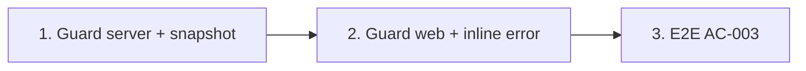

# Plan: TOS-17 — Validation số tiền thu và phân quyền tài chính

## Overview

AC-003 của US-003 có hai scenario:

1. **Số tiền không hợp lệ:** trong hộp thoại Ghi nhận thu tiền (nợ 2.500.000), nhập `0` hoặc `3.000.000` → lỗi inline dưới ô tiền, nút "Lưu phiếu thu học phí" bị khóa.
2. **Phân quyền:** người dùng có vai trò **Trợ giảng (TA)** hoặc **Giáo viên đứng lớp** truy cập trực tiếp URL Sổ công nợ hoặc gọi API công nợ → 403 và điều hướng về Bảng điều khiển (NFR-selfomy-alignment-005).

Nền tảng: TOS-15 (`/debts`, `debtLedger`), TOS-16 (hộp thoại `record-payment-modal`, `POST /api/invoices/:id/payments` đã trả 422 `amount-exceeds-debt` phía server).

Nguồn: Jira [TOS-17](https://teacher-os.atlassian.net/browse/TOS-17) (subtask TOS-10 / US-003 · AC-003), FR-selfomy-alignment-009/029, NFR-selfomy-alignment-005, wireframe `debt-and-notification-flow.md` mục "Kiểm tra số tiền thu hợp lệ".

## Scope Challenge

- **Có sẵn:** `membership.role` (mặc định `"teacher"`, mọi org hiện tại đều 1 thành viên = giáo viên độc lập / chủ org); middleware kernel đặt `kernelCtx { orgId, userId }`; mẫu guard `require-admin.ts`.
- **Còn thiếu:** role trong `kernelCtx`, guard tài chính cho route server + snapshot, guard route web, inline validation.
- **Ràng buộc quan trọng:** hệ thống 4 vai trò trung tâm (mời nhân sự, phân công lớp) là **TOS-48 / US-010**, đang **tạm hoãn** theo spec (`FR-029` chờ trung tâm đối tác). Hiện chưa có giao diện tạo thành viên TA / Giáo viên đứng lớp.
- **Độ phức tạp:** không migration (role là text sẵn có), 1 middleware, sửa snapshot, guard web, UI validation, E2E.
- **Mode:** fast + scout, HOLD SCOPE.

## Quyết định

| # | Quyết định | Lý do |
|---|---|---|
| D1 | **Allowlist vai trò tài chính** `FINANCE_ROLES = ["teacher", "owner", "admin"]` trong `packages/auth/src/role.ts` (hàm `canAccessFinance(role)`); mọi role khác (kể cả lạ / rỗng) bị chặn. Giá trị `"teacher"` hiện có = **giáo viên độc lập (chủ org)** nên vẫn được phép. Giáo viên đứng lớp dùng giá trị mới **`"class_teacher"`**, Trợ giảng dùng **`"ta"`**. | Least privilege; không đổi quyền của mọi org đang chạy. Tránh trùng nghĩa: `"teacher"` trong DB không phải "Giáo viên đứng lớp" của FR-029. |
| D2 | **`kernelCtx` thêm `role`** (đọc từ membership đầu tiên như `orgId`). Middleware `requireFinanceRole` gắn vào: mọi route `/api/invoices*` (kể cả `POST /invoices/:id/payments` của TOS-16), `paymentTransactionRoutes`, `bank-link`. Bị chặn → `403 { error: "finance-forbidden" }`. | AC: "gọi API công nợ" phải 403, không chỉ ẩn UI. |
| D3 | **Snapshot:** với role không có quyền tài chính, `invoices` trả `[]` và thêm field `viewer: { role, canAccessFinance }` cho mọi role. | Snapshot là API công nợ ngầm (dữ liệu Sổ công nợ tính từ đây); chặn ở nguồn để không rò dữ liệu qua đường khác (NFR-005: "cả trên giao diện lẫn truy vấn dữ liệu"). |
| D4 | **Web guard:** `beforeLoad` của `/debts` và `/tuition` (kèm `/tuition/$invoiceId`) đọc `viewer.canAccessFinance`; false → `redirect({ to: "/dashboard" })` + toast "Bạn không có quyền xem Sổ công nợ". Sidebar + ⌘K ẩn "Doanh thu" và "Công nợ". | AC "điều hướng về Bảng điều khiển [1]". |
| D5 | **Inline validation** trong `record-payment-modal`: số tiền rỗng / ≤ 0 / > nợ của khoản đang chọn → lỗi đỏ dưới ô "Số tiền thu phải lớn hơn 0 và không vượt quá số tiền còn nợ", `aria-invalid` + `aria-describedby`, nút Lưu `disabled`. Hiện lỗi khi người dùng đã chạm ô (không đỏ ngay lúc mở). Đổi khoản thu → kiểm tra lại. | Đúng câu chữ wireframe; không làm phiền trước khi nhập. Server 422 của TOS-16 vẫn là lưới an toàn. |
| D6 | **Test vai trò bằng seed DB** (`membership.role = "ta"` / `"class_teacher"`), vì UI mời nhân sự thuộc TOS-48. | Cho phép nghiệm thu AC ngay bây giờ mà không kéo TOS-48 vào scope. |

## Non-goals

- Mời nhân sự, phân công lớp, cô lập dữ liệu lớp cho TA / Giáo viên đứng lớp (TOS-48).
- Chặn các màn khác ngoài tài chính (lớp, chấm bài…) theo vai trò.
- Đổi tên giá trị role `"teacher"` hiện có.

## Phases

| # | Phase | Ước lượng | Trạng thái | Phụ thuộc |
|---|---|---|---|---|
| 1 | [phase-01-finance-role-guard-server.md](phase-01-finance-role-guard-server.md): `canAccessFinance`, role trong `kernelCtx`, middleware 403, snapshot | 4h | pending | #449, #450 |
| 2 | [phase-02-web-guard-and-inline-validation.md](phase-02-web-guard-and-inline-validation.md): redirect `/debts` `/tuition`, ẩn sidebar, inline error hộp thoại | 4h | pending | 1 |
| 3 | [phase-03-e2e-ac-003.md](phase-03-e2e-ac-003.md): E2E 2 scenario | 2h | pending | 2 |

## Acceptance criteria (từ AC-003)

- [ ] Nợ 2.500.000, nhập `0` hoặc `3.000.000` → lỗi inline dưới ô tiền, nút "Lưu phiếu thu học phí" disabled; sửa về 2.500.000 → lỗi mất, nút bật.
- [ ] Thành viên role `ta` / `class_teacher` mở `/debts` hoặc `/tuition` → về `/dashboard` + thông báo; sidebar không có "Doanh thu" / "Công nợ".
- [ ] Cùng thành viên gọi `GET /api/invoices/:id/transactions`, `POST /api/invoices`, `POST /api/invoices/:id/payments`, route payment-transactions → 403; snapshot trả `invoices: []`.
- [ ] Giáo viên độc lập hiện tại (`role = teacher`) không đổi hành vi (hồi quy E2E tuition hiện có xanh).
- [ ] `pnpm check`, `pnpm check-types`, test package bị đụng, E2E AC-003 xanh.

## Rủi ro

| Rủi ro | Giảm thiểu |
|---|---|
| Sót một route tài chính không gắn guard. | Gắn middleware theo prefix (`kernel.use("/invoices/*", …)`) thay vì từng handler; test liệt kê toàn bộ route invoice/payment và assert 403. |
| TOS-48 chọn giá trị role khác `class_teacher` / `ta`. | D1 ghi rõ vocabulary; ghi chú trong `role.ts`; nêu ở "Cần người duyệt xác nhận". |
| Snapshot rỗng `invoices` làm vỡ màn khác của role bị chặn (roster học phí, dashboard reminder). | Test render các màn đó với `invoices: []` (đã là trạng thái hợp lệ của org mới). |

## Cần người duyệt xác nhận

- D1: giữ `"teacher"` = giáo viên độc lập (được xem tài chính), dùng `"class_teacher"` / `"ta"` cho 2 vai trò bị chặn — TOS-48 cần theo vocabulary này.
- D3: chặn dữ liệu ngay ở snapshot (không chỉ ẩn UI).
