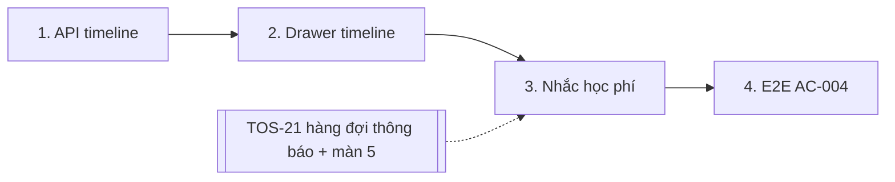

# Plan: TOS-18 — Dòng thời gian hóa đơn/giao dịch và nhắc học phí

## Overview

AC-004 của US-003:

1. Bấm **(eye) Xem dòng thời gian lịch sử hóa đơn & giao dịch** của học viên → hiện toàn bộ hóa đơn học phí đã phát hành và giao dịch thanh toán (QR Bank-Hub hoặc thu thủ công) theo thứ tự thời gian.
2. Tích chọn học viên đang nợ → **Gửi nhắc học phí** → hệ thống phát thông báo nhắc hạn hóa đơn qua **Email & In-app** (FR-selfomy-alignment-001) và ghi vào **Nhật ký thông báo** `[5]`.

Nền tảng: TOS-15 (`/debts`, cột Thao tác, chỗ nút nhắc phí ở PageHead), TOS-16 (phiếu thu thủ công nằm trong ledger `payment_transaction` với `provider = "manual"`, `method`), TOS-17 (`#451`, middleware `requireFinanceRole` phải gắn tường minh vào cả 2 route mới và thêm vào `FINANCE_ENDPOINTS` trong `require-finance-role.test.ts`), và TOS-21 (`#454`, hàng đợi thông báo `enqueueNotifications` + `deliverNotifications` + builder `tuitionReminderEvent` + màn Nhật ký thông báo `/notifications`).

Nguồn: Jira [TOS-18](https://teacher-os.atlassian.net/browse/TOS-18) (subtask TOS-10 / US-003 · AC-004), FR-selfomy-alignment-010/001, wireframe `debt-and-notification-flow.md` mục [1], [15] và screen `notification-logs` `[5]`.

## Scope Challenge

- **Có sẵn:** hóa đơn (snapshot), giao dịch matched theo hóa đơn (`GET /api/invoices/:id/transactions`), hàng đợi thông báo Email + In-app cho học viên (`enqueueNotifications`, `deliverNotifications`, `tuitionReminderEvent` từ `#454`) và màn Nhật ký thông báo `/notifications` (`[5]`).
- **Còn thiếu:** endpoint timeline gộp theo **học viên** (`GET /api/students/:id/billing-timeline`); drawer UI; chọn nhiều học viên + nút nhắc phí (`POST /api/debt-reminders`).
- **Mode:** fast + scout + `--advice` handover contract, HOLD SCOPE.

## Quyết định

| # | Quyết định | Lý do |
|---|---|---|
| D1 | **Endpoint `GET /api/students/:id/billing-timeline`** gắn `requireFinanceRole`, trả mảng sự kiện đã sắp xếp: `invoice_issued` (từ `invoice`: `invoiceId`, `code = "INV-" + id.slice(-8).toUpperCase()`, `type = type.trim() \|\| "Khác"`, `amount`, `due`, `status: "unpaid" \| "paid"`, `at = createdAt.toISOString()`) và `payment` (từ `payment_transaction` matched của các hóa đơn đó: `id`, `invoiceId`, `code`, `amount`, `source: "bank_hub" \| "manual"`, `method`, `note`, `at = createdAt.toISOString()`). Sắp xếp **mới nhất trước** theo `createdAt` giảm dần, tie-break `payment` trước `invoice_issued` khi cùng `createdAt`, rồi `id` giảm dần. Org-scoped, 404 nếu học viên không thuộc org. | Giao dịch không nằm trong snapshot; dùng `createdAt.toISOString()` thống nhất để tránh đảo thứ tự trong ngày do `invoice.date` rỗng và `transactionDate` manual đóng cứng `00:00:00`. |
| D2 | **Không trả `raw` / payload provider / `content` gốc của Bank-Hub** — chỉ trả `note: tx.provider === "manual" ? tx.content : ""` và các trường hiển thị. | Giữ retention PII của #320: cột `content` của giao dịch `sepay_bankhub` chứa sao kê ngân hàng thô. |
| D3 | **Drawer** (Sheet bên phải ở desktop, full-screen ở 375px) mở từ nút `(eye)` ở cột Thao tác; tóm tắt 3 số lũy kế của học viên ở đầu (từ `debtLedger`), danh sách timeline nhóm theo tháng (múi giờ `Asia/Ho_Chi_Minh`); badge nguồn "QR Bank-Hub" / "Thu thủ công · {Tiền mặt\|Chuyển khoản\|Khác}". Có link sang `/tuition/$invoiceId`. Query dùng `staleTime: 0`. | Wireframe [15]; dữ liệu tóm tắt dùng lại view-model TOS-15, `staleTime: 0` đảm bảo mở lại sau khi thu tiền thấy ngay giao dịch mới. |
| D4 | **Chọn nhiều + nhắc phí:** cột checkbox chỉ bật cho học viên `remaining > 0` (chặn `stopPropagation` cho click + phím Space/Enter); tập chọn hiệu lực giao với các dòng đang hiển thị có `remaining > 0`; nút "Gửi nhắc học phí (N)" ở PageHead disabled khi N = 0; xác nhận → `POST /api/debt-reminders { studentIds, classId? }` (dưới `requireFinanceRole`). Server lọc các hóa đơn còn nợ (`status <> 'paid' AND paid_amount < amount`, lọc theo `classId` qua `enrollment` nếu có) của học viên thuộc org, truyền số tiền còn nợ `amount - min(paidAmount, amount)` vào `tuitionReminderEvent` với `idempotency_key = tuition_reminder:<invoiceId>:<YYYY-MM-DD VN>`, gọi trực tiếp `enqueueNotifications` rồi `deliverNotifications` (qua `runInBackground` / `await`). Trả `{ queued: createdIds.length, skipped: events.length - createdIds.length }` (đơn vị: hóa đơn) → invalidate `["kernel", "notification-logs"]` + toast kèm link tới `/notifications`. | Đúng AC "kích hoạt FR-001 và ghi vào [5]"; gọi trực tiếp `enqueueNotifications` để có `createdIds` chính xác và không nuốt lỗi DB như `emitNotifications`. |
| D5 | **Thứ tự triển khai:** #449 (TOS-15), #450 (TOS-16), #451 (TOS-17) và #454 (TOS-21) đều đã merge vào `develop`; triển khai tuần tự Phase 1 → Phase 2 → Phase 3 → Phase 4. | Toàn bộ phụ thuộc đã sẵn sàng trên nhánh hiện tại. |

## Non-goals

- Hạ tầng gửi Email/In-app, retry 3 lần, trạng thái failed, nút "Gửi lại", màn `[5]` (TOS-19/21/22/23).
- Nhắc phí tự động theo lịch (cron). Nội dung template email ngoài 1 template nhắc phí (template thuộc TOS-21 nếu hệ thống template ở đó).
- Sửa / hoàn tiền giao dịch từ timeline.

## Phases

| # | Phase | Ước lượng | Trạng thái | Phụ thuộc |
|---|---|---|---|---|
| 1 | [phase-01-billing-timeline-api.md](phase-01-billing-timeline-api.md): `GET /api/students/:id/billing-timeline` | 3h | completed | #449, #450 |
| 2 | [phase-02-timeline-drawer-ui.md](phase-02-timeline-drawer-ui.md): nút (eye) + drawer timeline | 4h | completed | 1 |
| 3 | [phase-03-tuition-reminders.md](phase-03-tuition-reminders.md): checkbox + "Gửi nhắc học phí (N)" + `POST /api/debt-reminders` | 4h | completed | 2, TOS-21 |
| 4 | [phase-04-e2e-ac-004.md](phase-04-e2e-ac-004.md): E2E timeline + nhắc phí | 2h | completed | 3 |

## Acceptance criteria (từ AC-004)

- [x] Bấm (eye) trên dòng "Nguyễn Minh Anh" → drawer liệt kê mọi hóa đơn đã phát hành và mọi giao dịch (QR Bank-Hub + thu thủ công) theo thứ tự thời gian, đúng số tiền / nguồn / phương thức.
- [x] Học viên đã thu đủ không tích chọn được; tích 2 học viên đang nợ → nút "Gửi nhắc học phí (2)".
- [x] Bấm gửi → mỗi hóa đơn còn nợ của học viên được chọn có 1 bản ghi thông báo `tuition_reminder` (Email + In-app) ở màn Nhật ký thông báo `[5]`; bấm lần 2 cùng ngày → không tạo bản ghi trùng (`skipped`).
- [x] API: học viên org khác → 404; role không có quyền tài chính → 403 (TOS-17).
- [x] `pnpm check`, `pnpm check-types`, test package bị đụng, E2E AC-004 xanh.

## Rủi ro

| Rủi ro | Giảm thiểu |
|---|---|
| Lệch thứ tự sự kiện trong cùng ngày nếu dùng `invoice.date` / `transactionDate`. | Dùng thống nhất `createdAt.toISOString()` (epoch ms) cho cả `invoice_issued` và `payment`; format tháng/ngày giờ VN ở client. |
| Vượt giới hạn 100 bind parameters của Cloudflare D1 khi dùng `inArray`. | Giới hạn `studentIds` tối đa 50 mỗi request hoặc chia chunk `CHUNK_SIZE = 50`; truy vấn giao dịch timeline bằng `INNER JOIN invoice` theo `(orgId, studentId)` (chỉ 3 bind params). |

## Red Team Review

### Session — 2026-10-27
**Findings:** 8 (8 accepted, 0 rejected)
**Severity breakdown:** 4 Critical, 2 High, 2 Medium

| # | Finding | Severity | Disposition | Applied To |
|---|---------|----------|-------------|------------|
| 1 | `emitNotifications` trả `Promise<void>` và nuốt lỗi; `skipped` trộn đơn vị học viên vs hóa đơn (`apps/server/src/lib/notifications/emit.ts:45-68`, `enqueue.ts:13-26`) | Critical | Accept | `plan.md`, Phase 3 |
| 2 | Sắp xếp timeline theo `invoice.date` / `transactionDate` bị đảo thứ tự trong ngày; `vietnamStampParts` chỉ có ở `apps/web`; thiếu `id` ở event `payment` (`apps/server/src/routes/kernel.ts:1532-1543`, `record-manual-payment.ts:117-119`) | Critical | Accept | `plan.md`, Phase 1, Phase 2 |
| 3 | Guard `requireFinanceRole` (TOS-17 `#451`) chỉ gắn trên `/invoices*`, không tự động bảo vệ `/students/:id/billing-timeline` và `/debt-reminders` (`apps/server/src/routes/kernel.ts:153-155`, `require-finance-role.test.ts:188-253`) | Critical | Accept | `plan.md`, Phase 1, Phase 3 |
| 4 | Lộ nội dung chuyển khoản gốc (PII) của Bank-Hub nếu ánh xạ thẳng `payment_transaction.content` sang `note` (`packages/db/src/schema/payment-transaction.ts:36`, `ingest-transaction.ts:112`) | Critical | Accept | `plan.md`, Phase 1, Phase 2 |
| 5 | Lệch ngữ nghĩa "hóa đơn còn nợ" (`status <> 'paid' AND paid_amount < amount`), số tiền còn nợ trong `tuitionReminderEvent`, và bộ lọc lớp `?lop=` / checkbox selection (`apps/server/src/routes/kernel.ts:1566`, `templates.ts:35-49`, `tuition-from-kernel.ts:541-546`) | High | Accept | `plan.md`, Phase 3, Phase 4 |
| 6 | Nguy cơ vượt trần 100 bind parameters của Cloudflare D1 khi `inArray` với 100 phần tử (`apps/server/src/lib/notifications/enqueue.ts:30-33`, `holidays.ts:33-34`) | High | Accept | `plan.md`, Phase 1, Phase 3 |
| 7 | Cột checkbox kích hoạt điều hướng dòng `<tr>` của `DataTable`; drawer cần focus tiêu đề (`tabIndex={-1}`) + trả focus nút `(eye)`; `QueryClient` `staleTime: Infinity` giữ cache cũ (`apps/web/src/components/ui/data-table.tsx:44-57`, `modal.tsx:58-61`, `query-client.ts:18-29`) | Medium | Accept | Phase 2, Phase 3 |
| 8 | E2E Phase 4 chỉ định sai `bank-hub-mock` thay vì `POST /webhooks/sepay/bankhub/ipn` kèm `org_bank_link` (`apps/e2e/specs/tuition-bank-transfer.spec.ts:97-120`, `fake-bank-hub.ts:93-103`) | Medium | Accept | Phase 4 |

### Whole-Plan Consistency Sweep (Red-Team)
- Files reread: `plan.md`, `phase-01-billing-timeline-api.md`, `phase-02-timeline-drawer-ui.md`, `phase-03-tuition-reminders.md`, `phase-04-e2e-ac-004.md`
- Decision deltas checked: 8
- Reconciled stale references: 8 (đã xóa mọi tham chiếu `emitNotifications` trực tiếp, `vietnamStampParts` ở server, `bank-hub-mock` ở E2E, và giả định prefix guard tự động)
- Unresolved contradictions: 0

## Validation Log

### Verification Results (Session — 2026-10-27)
- **Tier:** Standard (4 phases — Fact Checker + Contract Verifier, 10 claims/phase)
- **Claims checked:** 40
- **Verified:** 40 (sau khi cập nhật 8 điểm từ Red-Team) | **Failed:** 0 | **Unverified:** 0
- **Key Decisions Confirmed:**
  - D1/D2: `BillingTimelineEvent` dùng `at = createdAt.toISOString()`, thêm `id` cho nhánh `payment`, lọc `note = tx.provider === "manual" ? tx.content : ""` để bảo vệ PII sao kê ngân hàng.
  - D3: `BillingTimelineDrawer` dùng `staleTime: 0`, nhóm theo tháng giờ VN (`Asia/Ho_Chi_Minh`), focus vào heading `<h2>` (`tabIndex={-1}`) khi mở và hoàn trả focus về nút `(eye)` khi đóng.
  - D4: `POST /api/debt-reminders` nhận `{ studentIds, classId? }`, lọc hóa đơn còn nợ (`status <> 'paid' AND paid_amount < amount`), truyền số tiền còn nợ vào `tuitionReminderEvent`, gọi `enqueueNotifications` + `deliverNotifications`, trả `{ queued, skipped }` theo đơn vị hóa đơn.
  - Guard tài chính: Gắn tường minh `requireFinanceRole` cho cả 2 route mới và thêm vào `FINANCE_ENDPOINTS` trong `apps/server/src/lib/require-finance-role.test.ts`.

### Whole-Plan Consistency Sweep (Validation)
- Files reread: `plan.md`, `phase-01-billing-timeline-api.md`, `phase-02-timeline-drawer-ui.md`, `phase-03-tuition-reminders.md`, `phase-04-e2e-ac-004.md`
- Decision deltas checked: 8
- Reconciled stale references: 0 remaining
- Unresolved contradictions: 0
